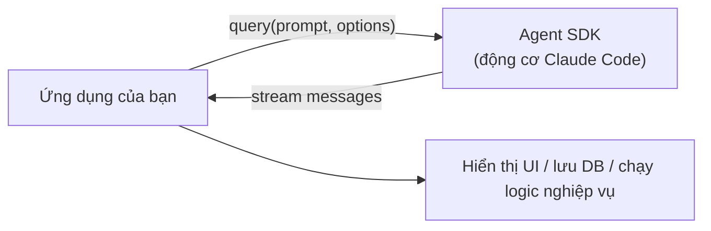

---
tags:
  - claude/tich-hop
  - claude/automation
aliases:
  - Agent SDK
  - Claude Agent SDK
up: "[[Claude Code]]"
---

# Agent SDK

Thư viện (**TypeScript / Python**) nhúng **chính động cơ của [[Claude Code]]** vào ứng dụng của bạn — thay vì gọi lệnh `claude` qua terminal/shell script, bạn gọi hàm lập trình trực tiếp. Là đầu "kiểm soát tối đa" của [[Tự động hóa Claude Code (Routines & Headless)|phổ tự động hóa]].

## Hoạt động qua hàm `query`

Cả TypeScript và Python đều có hàm `query`: truyền **prompt + options**, nhận về **luồng message (stream)**.

| Option | Vai trò |
| --- | --- |
| `allowedTools` | Giới hạn chính xác tool Claude được dùng |
| `systemPrompt` | Định hình ngữ cảnh/quy tắc của phiên |
| `permissionMode` | Mức tự động/phê duyệt, xem [[Permission Modes]] |



```typescript
import { query } from "@anthropic-ai/claude-agent-sdk";

for await (const message of query({
  prompt: "Tìm và sửa lỗi trong auth.ts",
  options: {
    allowedTools: ["Read", "Edit", "Bash"],
    permissionMode: "acceptEdits",
  },
})) {
  console.log(message); // xử lý từng message khi nó đến
}
```

- **Streaming** — ứng dụng *lặp qua* các message (assistant, tool use, kết quả...) để hiển thị lên chat UI, lưu DB, hoặc kích hoạt logic riêng.
- **Python** — gói `claude-agent-sdk`, dùng `async for` tương tự; tên option viết theo kiểu Python (`allowed_tools`...).

## Khi nào chọn SDK

|           | [[Headless Mode (claude -p)\|Headless]] | Agent SDK                                                            |
| --------- | --------------------------------------- | -------------------------------------------------------------------- |
| Cách gọi  | Lệnh CLI trong script/CI                | Hàm trong code TS/Python                                             |
| Phù hợp   | Pipeline, script ngắn                   | Sản phẩm/ứng dụng riêng, logic phức tạp                              |
| Kiểm soát | Cờ dòng lệnh                            | Kiểm soát toàn diện: tool, quyền, hook, subagent, xử lý từng message |

> [!note] Phân biệt
> Agent SDK ≠ SDK gọi API thuần (`anthropic`). Agent SDK mang theo **vòng lặp agent + tool dựng sẵn của Claude Code**; SDK API chỉ gọi model, bạn tự viết vòng lặp (xem [[SDKs]], [[Vòng lặp Agent]]).

## Lưu ý

- **Quyền của Claude** — chạy trong ứng dụng/server thường không có người duyệt từng thao tác, nên giới hạn chặt việc Claude được phép làm: `allowedTools` chỉ liệt kê tool thật sự cần, `permissionMode` chọn mức phù hợp.
- **Xác thực & chi phí** — cần API key; theo dõi lượt/chi phí khi nhúng vào sản phẩm.
- **Tên gói/option** có thể đổi theo phiên bản — đối chiếu tài liệu chính thức.

## Liên kết

- Thuộc: [[Claude Code]]
- Phổ tự động hóa: [[Tự động hóa Claude Code (Routines & Headless)]]
- Liên quan: [[Routines]], [[Headless Mode (claude -p)]], [[Hooks]], [[Subagents (Tác vụ phụ)]], [[SDKs]]
