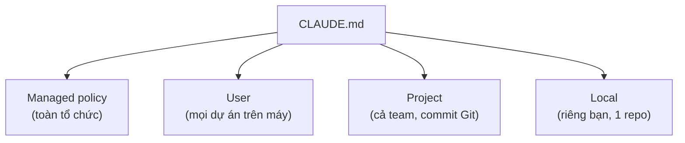
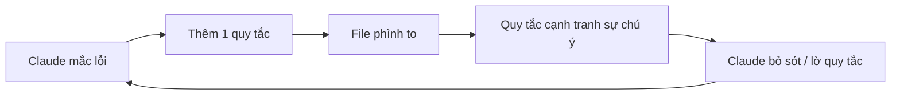
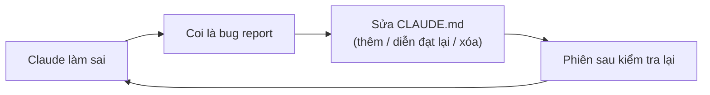

---
tags:
  - claude/tich-hop
aliases:
  - CLAUDE.md
  - Bộ nhớ dự án
up: "[[Claude Code]]"
---

# CLAUDE.md — Bộ nhớ dự án (Persistent Memory)

File Markdown đặt ở **thư mục gốc (root)** của dự án, đóng vai trò bộ nhớ dài hạn cho [[Claude Code]] — tương tự một tài liệu bàn giao/hướng dẫn hội nhập (onboarding script) dành riêng cho AI khi bước vào dự án.

## Vấn đề khi không có CLAUDE.md

- **Mất bối cảnh mỗi phiên mới** — mỗi lần mở phiên làm việc mới (hoặc sau `/clear`), Claude bắt đầu từ con số 0, không còn ký ức về quy ước dự án trước đó.
- **Tốn context window** — phải tự khám phá lại cấu trúc dự án, dependencies, tính năng nào đã triển khai — xem [[Claude Code#Hai trụ cột kỹ thuật Context Tools|Context]].
- **Dễ đưa giả định sai** — chưa hiểu quy chuẩn dự án nên có thể đoán sai, khiến người dùng mất công điều hướng lại.

## Cơ chế hoạt động

- Claude Code **tự động đọc** file này vào đầu mỗi phiên làm việc, nội dung được đính kèm sẵn vào bối cảnh (prompt context) — không cần người dùng nhắc lại thủ công.
- Ký ức được duy trì **xuyên suốt mọi phiên**, kể cả sau khi `/clear` xóa sạch lịch sử hội thoại hiện tại.

## Nội dung nên ghi vào CLAUDE.md

- Quy ước cấu trúc dự án, coding convention, chuẩn commit message (đặt ở đúng tầng — xem [[#Phân cấp bộ nhớ (Memory Hierarchy)|Phân cấp bộ nhớ]]).
- Kinh nghiệm xử lý lỗi lặp lại — nếu Claude liên tục mắc cùng một lỗi hoặc quên quy tắc dự án, yêu cầu Claude ghi giải pháp vào đây để các phiên sau không lặp lại.
- Danh sách kênh/cấu hình cần dùng khi tích hợp thêm công cụ khác (vd: kênh Slack cần thông báo khi dùng chung với [[Connectors (MCP)|Slack MCP Server]]).

## Cấu trúc file mẫu

Một file `CLAUDE.md` chuẩn thường chia thành 3 phần ngắn gọn:

- **`# Project`** — công nghệ cốt lõi đang dùng (vd: Next.js 15 App Router, Tailwind CSS, Drizzle ORM).
- **`# Commands`** — lệnh terminal chính xác để chạy dự án (vd: `pnpm dev`, `pnpm test`, `pnpm lint`).
- **`# Code Style`** — quy tắc kiến trúc & định dạng code của team (vd: thụt lề 2 khoảng trắng, ưu tiên named export, gom API routes vào `app/api/`, ưu tiên Server Actions).

> [!example] Tác dụng thực tế
> Với prompt đơn giản *"Tạo component hiển thị danh sách sản phẩm"*, Claude tự động áp dụng đúng Tailwind CSS, 2-space indentation, named export, và Server Actions/Drizzle ORM theo đúng khai báo — không cần giải thích lại quy chuẩn kỹ thuật ở mỗi phiên.

## Mẹo viết CLAUDE.md hiệu quả

- **Ngắn gọn** — chỉ ghi thông tin quan trọng nhất mà Claude cần tuân thủ, tránh dài dòng.
- **Dùng heading & bullet Markdown** (`#`, `##`, `-`) — giúp Claude dễ trích xuất đúng phần cần dùng thay vì đọc nguyên khối văn bản.
- **Cập nhật thường xuyên** — mỗi khi dự án đổi quy chuẩn hoặc thêm thư viện mới, cập nhật ngay để tránh Claude áp dụng quy tắc lỗi thời.

## Phân cấp bộ nhớ (Memory Hierarchy)

Claude Code đọc `CLAUDE.md` từ **4 vị trí** cùng lúc theo kiến trúc tầng (layering):



- **Xếp chồng (stacking)** — không file nào bị bỏ qua: nội dung cả 4 tầng được gộp thành ngữ cảnh chung của phiên. Vì vậy quy tắc ở các tầng có thể **mâu thuẫn** nhau → xem [[#Bẫy CLAUDE.md càng dài, tuân thủ càng kém|mục Bẫy]].
- **Managed policy** — do IT/Platform quản lý, chứa quy định bắt buộc của doanh nghiệp (chuẩn bảo mật, tuân thủ); cá nhân **không thể tắt/loại bỏ**. Vị trí hệ thống: Windows `C:\Program Files\ClaudeCode\CLAUDE.md`, macOS `/Library/Application Support/ClaudeCode/CLAUDE.md`, Linux `/etc/claude-code/CLAUDE.md`.
- **User** — `~/.claude/CLAUDE.md` (Windows: `%USERPROFILE%\.claude\CLAUDE.md`), **không** commit Git, áp dụng cho **mọi dự án** trên máy: thói quen cá nhân (văn phong commit message, phím tắt, môi trường riêng).
- **Project** — `CLAUDE.md` ở root repo (hoặc `.claude/CLAUDE.md`), commit vào Git, áp dụng cho cả team: tech stack, quy chuẩn code chung, lệnh build/test.
- **Local** — `CLAUDE.local.md` ở root repo, **tự động nằm trong `.gitignore`** (hoặc cần tự thêm vào), chỉ riêng bạn trên **một repo cụ thể**.

| Tiêu chí | Managed policy | User | Project | Local |
| --- | --- | --- | --- | --- |
| Vị trí | Thư mục hệ thống | `~/.claude/` | Root repo | Root repo (`CLAUDE.local.md`) |
| Chia sẻ Git | Không (IT phân phối) | Không | Có | Không (gitignore) |
| Phạm vi | Toàn tổ chức | Mọi dự án trên máy | Dự án hiện tại, cả team | Dự án hiện tại, riêng bạn |
| Ai quản lý | IT/Platform | Cá nhân | Team | Cá nhân |
| Mục đích | Quy định bắt buộc | Thói quen cá nhân | Quy chuẩn team & kiến trúc | Ghi chú tạm, thử nghiệm |

### Sức mạnh của file Local (hay bị bỏ quên)

- **Tình huống** — đang ở một branch riêng làm tính năng mới hoặc refactor một module phức tạp, muốn Claude nhớ các quyết định kiến trúc tạm thời.
- **Vì sao không để ở Project** — quy tắc tạm sẽ bị push lên Git và ảnh hưởng toàn bộ đồng nghiệp.
- **Giải pháp** — đặt vào `CLAUDE.local.md`: không gian riêng tư cho riêng repo đó, codebase chung vẫn sạch.
- **Dọn khi xong** — ghi chú tạm nên xóa sau khi merge/hoàn tất, tránh thành quy tắc lỗi thời gây nhiễu.

> [!note] Lưu ý tên file và cách nạp
> - Tên chuẩn là `CLAUDE.local.md` (không phải `.claude.local.md`). Bản mới của Claude Code khuyến khích dùng import `@~/.claude/...` thay thế cho `CLAUDE.local.md`, nhất là khi dùng nhiều git worktree; file cũ vẫn hoạt động — nên kiểm tra tài liệu phiên bản đang dùng.
> - `CLAUDE.md` còn có thể đặt trong **thư mục con** (chỉ nạp khi Claude làm việc ở đó) và nạp ngược từ thư mục hiện tại lên các thư mục cha.
> - Dùng `/memory` để xem các file đang được nạp trong phiên.

## Import `@` — để sắp xếp, không phải để thu gọn

Thay vì nhồi mọi thứ vào một `CLAUDE.md`, tách theo chủ đề rồi nhúng bằng cú pháp `@đường-dẫn-file`:

```markdown
@.claude/conventions/code-style.md
@.claude/conventions/testing.md
@.claude/conventions/workflow.md
```

- **Cơ chế: inline expansion** — khi khởi chạy, Claude đọc các file được chỉ định và **chèn toàn bộ nội dung vào đúng vị trí dòng `@`**. Tổng lượng văn bản nạp vào context **y nguyên** như khi gộp chung một file.
- **Hiểu lầm phổ biến** — tưởng import "làm nhẹ" context. Thực tế không: import chỉ giúp **con người** dễ đọc, dễ bảo trì, chia theo thư mục/chủ đề.
- **Cảnh báo** — nếu tổng các file import quá lớn, Claude vẫn bị nhiễu và giảm tuân thủ như bình thường → vẫn phải áp dụng [[#Cách khắc phục|nguyên tắc giữ lean]].
- **Chi tiết cần biết** — đường dẫn tương đối được tính từ file chứa lệnh import; import có thể lồng nhau (giới hạn độ sâu, khoảng 5 cấp); `@~/...` trỏ tới file ở thư mục home (tiện chia sẻ quy tắc cá nhân giữa các repo/worktree). Lần đầu gặp import ngoài dự án, Claude Code có thể hỏi xác nhận.

| Muốn | Dùng | Có tiết kiệm context? |
| --- | --- | --- |
| Tổ chức cấu hình cho dễ đọc/bảo trì | `@import` | Không (nạp hết từ đầu) |
| Chỉ nạp khi cần | Ghi đường dẫn thường (không `@`), [[Skills]], hoặc `CLAUDE.md` thư mục con | Có (nạp theo nhu cầu) |
| Ép buộc tuyệt đối | [[Hooks]] | Không liên quan context |

> [!tip] Quy tắc nhớ
> Import = **Organize**, không phải **Shrink**.

## Dùng cho làm việc nhóm (Teams)

- **Check-in vào version control** — đưa `CLAUDE.md` cấp dự án vào Git/SVN cùng mã nguồn, thay vì chỉ lưu cục bộ.
- **Lợi ích** — cả team chia sẻ chung một chuẩn, Claude Code áp dụng đồng nhất quy tắc viết code, cấu trúc thư mục và quy trình làm việc cho mọi thành viên, không lệch giữa người này với người khác.

## So sánh có/không dùng CLAUDE.md

| Khi KHÔNG dùng CLAUDE.md | Khi DÙNG CLAUDE.md |
| --- | --- |
| Mất bối cảnh mỗi khi `/clear` hoặc mở phiên mới | Ký ức dự án duy trì liên tục qua mọi phiên |
| Phải liên tục nhắc lại quy tắc code, cấu trúc thư mục | Claude tự tuân thủ quy chuẩn đã khai báo từ đầu |
| Tốn context để Claude tự quét lại code | Tiết kiệm context, đi thẳng vào tác vụ chính |

## Best Practices

- **Lưu câu sửa lỗi vào bộ nhớ** — nếu phải nhắc lại cùng một quy tắc nhiều lần (vd: "Luôn dùng Server Actions thay vì API routes"), yêu cầu Claude ghi thẳng vào `CLAUDE.md`; phiên sau Claude tự tuân thủ, không cần nhắc lại.
- **Tham chiếu tài liệu dự án bằng `@`** — liên kết nhanh các file tài liệu có sẵn bằng cú pháp `@đường-dẫn-file` (vd: `@README.md`, `@docs/architecture.md`); nội dung các file này được chèn vào ngữ cảnh, không phải chép lại thủ công vào `CLAUDE.md`. Lưu ý: đây là mở rộng tại chỗ, không tiết kiệm context — xem [[#Import `@` — để sắp xếp, không phải để thu gọn|mục Import]].
- **Không bắt buộc viết trước khi bắt đầu dự án** — có thể chạy dự án vài lần chưa có `CLAUDE.md`, quan sát xem hay phải sửa Claude ở điểm nào, rồi mới viết — giúp file luôn gọn, chỉ chứa thông tin thực sự cần thiết thay vì đoán trước dài dòng. Khi sẵn sàng, gõ `/init` để Claude tự quét dự án và khởi tạo khung `CLAUDE.md`.

> [!tip] Thứ tự khai báo gợi ý
> Bắt đầu đơn giản: **Tech Stack → Quy chuẩn Code → Commands cơ bản**, sau đó bổ sung dần kinh nghiệm thực tế phát sinh trong quá trình phát triển.

## Bẫy: CLAUDE.md càng dài, tuân thủ càng kém

Sai lầm phổ biến: mỗi lần Claude mắc lỗi lại thêm 1 quy tắc → file phình thành hàng chục/trăm dòng vụn vặt → hiệu quả **giảm** thay vì tăng.



- **Là guidance, không phải config cứng** — `CLAUDE.md` chỉ được nạp vào context như văn bản gợi ý; không được máy ép buộc tuyệt đối như linter/compiler.
- **Attention competition** — mọi dòng cùng tranh sự chú ý của model; quá nhiều chi tiết hoặc quy tắc mâu thuẫn làm loãng trọng số các chỉ dẫn quan trọng.
- **Tốn context mỗi phiên** — file được nạp đầy đủ ở đầu mọi phiên, càng dài càng chiếm chỗ của code và hội thoại.
- **Mâu thuẫn ngầm** — quy tắc thêm rải rác qua thời gian dễ trái nhau (kể cả giữa project-level và user-level) → Claude chọn tùy ý.

### Cách khắc phục

- **Giữ lean** — chỉ giữ quy tắc cốt lõi và hay vi phạm; mốc tham khảo: **dưới ~200 dòng**.
- **Bài test để cắt dòng** — *"Xóa dòng này đi, Claude có mắc lỗi không?"* Nếu không (Claude tự biết, hoặc đọc code là thấy) → xóa. Không ghi điều hiển nhiên ("viết code sạch", "đặt tên rõ ràng").
- **Dọn định kỳ** — rà soát, xóa quy tắc lỗi thời, gộp quy tắc trùng, giải quyết mâu thuẫn. Dùng `/memory` để mở và sửa nhanh.
- **Viết cụ thể, kiểm chứng được** — "Dùng 2 khoảng trắng thụt lề" tốt hơn "Format code cho đẹp"; nhấn mạnh có chừng mực — xem [[#Diễn đạt quy tắc (Phrasing)|Diễn đạt quy tắc]].
- **Đẩy bớt ra ngoài** (progressive disclosure):
  - Tài liệu chi tiết → file riêng, **chỉ ghi đường dẫn dạng văn bản thường** (không có `@`) để Claude tự đọc khi cần. Lưu ý: `@đường-dẫn` là import, nạp toàn bộ ngay từ đầu nên **không** giúp giảm context — xem [[#Import `@` — để sắp xếp, không phải để thu gọn|mục Import]].
  - Quy trình/chuyên môn chỉ dùng thỉnh thoảng → [[Skills]] (nạp theo nhu cầu, không chiếm context thường trực).
  - `CLAUDE.md` đặt trong thư mục con → chỉ nạp khi Claude làm việc ở đó.
- **Cần ép buộc 100%** (vd: luôn chạy format, chặn sửa file nhạy cảm) → dùng [[Hooks]], không dựa vào `CLAUDE.md`.

### Đây có đúng là nơi đặt quy tắc không? (CLAUDE.md vs Hook)

Trước khi thêm dòng nào, phân loại quy tắc:

| Tiêu chí | Quy tắc mềm (soft convention) | Quy tắc cứng (hard rule) |
| --- | --- | --- |
| Ví dụ | Đặt tên biến, cấu trúc thư mục, ưu tiên thư viện, phong cách comment | Không push thẳng lên `main`, không xóa DB production, không commit API key/password |
| Đặc điểm | Cần linh hoạt, chỉ định hướng | Vi phạm 1 lần cũng gây hậu quả nghiêm trọng |
| Nơi thuộc về | `CLAUDE.md` | **PreToolUse Hook** |
| Cơ chế | Guidance — hy vọng Claude tuân theo | Code chạy trước tool, **chặn thật** (block) |

- **Vì sao "hầu như luôn tuân thủ" là chưa đủ** — ghi "Không bao giờ push lên main" vào `CLAUDE.md` chỉ là lời đề nghị; đúng 99/100 lần vẫn là rủi ro không chấp nhận được với lỗi chết người.
- **Hook chặn cứng** — [[Hooks#Cơ chế chặn (Blocking) với PreToolUse|PreToolUse]] chạy ngay trước khi Claude thực thi lệnh Bash/tool; nếu khớp mẫu cấm (vd: `git push origin main`) thì từ chối, bất kể Claude vô tình hay cố ý.
- **Câu hỏi lọc** — *"Nếu Claude quên quy tắc này một lần, dự án có hỏng nặng không?"* Có → viết Hook. Không → `CLAUDE.md` (hoặc bỏ nếu quá hiển nhiên).
- **Nên kết hợp cả hai** — Hook chặn hành động; một dòng ngắn trong `CLAUDE.md` giải thích lý do giúp Claude tránh thử đi thử lại lệnh bị chặn và biết đường thay thế (vd: "tạo branch + PR thay vì push `main`").
- **Lợi ích kép** — `CLAUDE.md` gọn hơn, tập trung vào quy tắc phong cách; an toàn được đảm bảo 100% bằng code. Ngoài Hook, có thể dùng thêm permission deny rules trong settings để chặn cứng tool/lệnh cụ thể.

### Diễn đạt quy tắc (Phrasing)

Quy tắc đặt đúng chỗ vẫn có thể bị bỏ qua nếu diễn đạt kém. 3 nguyên tắc:

| Nguyên tắc | Kém | Tốt |
| --- | --- | --- |
| **Cụ thể, kiểm tra được** | "Tuân thủ best practices cho API routes" | "Đặt API route mới vào `src/api/handlers`, mỗi file chỉ chứa một route" |
| **Chỉ rõ giải pháp thay thế** | "Không dùng default export" | "Dùng named exports, không dùng default exports" |
| **Nhấn mạnh có ngân sách** | Câu nào cũng `IMPORTANT`/`MUST`/`ALWAYS` | Chỉ 2–3 quy tắc quan trọng nhất được nhấn mạnh |

- **Cụ thể, kiểm tra được** — nhìn vào kết quả là xác nhận ngay đúng/sai (vị trí file, tên, lệnh chính xác). Lời dặn trừu tượng thì người cũng hiểu theo nhiều cách.
- **Chỉ rõ thay thế** — chỉ cấm sẽ để lại "khoảng trống ngữ cảnh", Claude tự đoán cách khác (có thể sai). Công thức: *"Dùng X, không dùng Y"*, kèm lý do ngắn nếu không hiển nhiên.
- **Nhấn mạnh là ngân sách** — `IMPORTANT`, `CRITICAL`, `YOU MUST` chỉ hiệu quả nhờ **tương phản** với văn bản thường. Gắn cho mọi dòng thì mọi dòng ngang ưu tiên → mất tác dụng. "Tiêu" nhấn mạnh cho vài lỗi gây hại lớn nhất; còn lại giữ giọng bình thường.
- **Mẹo kiểm tra** — đọc lại từng dòng và hỏi: *"Có kiểm tra được bằng mắt/lệnh không? Có nói rõ phải làm gì thay vì chỉ cấm không?"*. Nếu cần ép tuyệt đối, đừng tăng độ nhấn mạnh mà chuyển sang [[Hooks]].

> [!warning] Cân bằng với Best Practices
> "Lưu câu sửa lỗi vào bộ nhớ" chỉ nên áp dụng cho lỗi **lặp lại thật sự**. Mỗi lần thêm 1 dòng, hãy cân nhắc xóa/gộp 1 dòng cũ.

### Bảo trì liên tục (living file)

Coi `CLAUDE.md` như **code đang chạy**, không phải tài liệu viết một lần.



- **Sai sót = bug report** — Claude làm sai nghĩa là file đang thiếu quy tắc hoặc quy tắc diễn đạt chưa rõ; đừng chỉ âm thầm sửa tay kết quả.
- **Nhờ Claude cập nhật** — vd: *"Thêm quy tắc vừa rồi vào CLAUDE.md"*; có thể gõ `#` rồi nội dung để ghi nhanh vào bộ nhớ, hoặc `/memory` để sửa trực tiếp.
- **Sửa trước khi thêm** — nếu quy tắc đã có mà vẫn bị vi phạm, thường cần **diễn đạt lại** (cụ thể hơn, có thay thế) hoặc **chuyển sang Hook**, không phải thêm dòng trùng.
- **Duyệt thay đổi** — `CLAUDE.md` cấp Project nằm trong Git: xem `git diff`/review như code; Claude tự ghi có thể thêm dòng thừa, cần cắt tỉa.
- **Kiểm tra hiệu quả** — sau khi sửa, thử lại đúng tình huống từng gây lỗi ở phiên mới.

### Checklist tóm tắt (The bottom line)

1. **Quy tắc cứng → [[Hooks|Hook]]**, không để trong `CLAUDE.md`.
2. **Chia nhỏ bằng `@import`** để dễ quản lý — không giảm context.
3. **Cụ thể, kiểm tra được, chỉ rõ giải pháp thay thế.**
4. **Nhấn mạnh có ngân sách** — chỉ 2–3 quy tắc.
5. **Cập nhật liên tục** — thêm khi có lỗi, xóa khi lỗi thời.

> [!tip] Thông điệp cốt lõi
> File càng ngắn gọn và súc tích, Claude càng tuân thủ triệt để.

## Liên kết

- Thuộc: [[Claude Code]]
- Dùng trong bước: [[Explore, Plan, Code, Commit#3. Code (Viết mã)|Explore, Plan, Code, Commit — bước Code]]
- Liên quan: [[Claude Code#Auto-Compaction — khi context đầy|Auto-Compaction]], [[Hooks]], [[Skills]]
