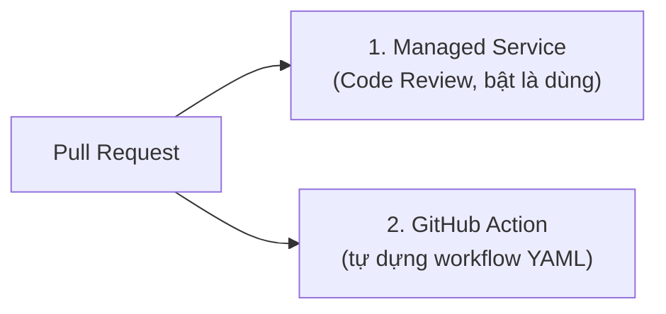
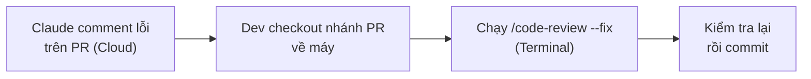
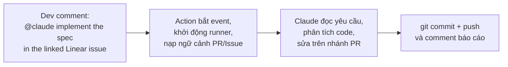
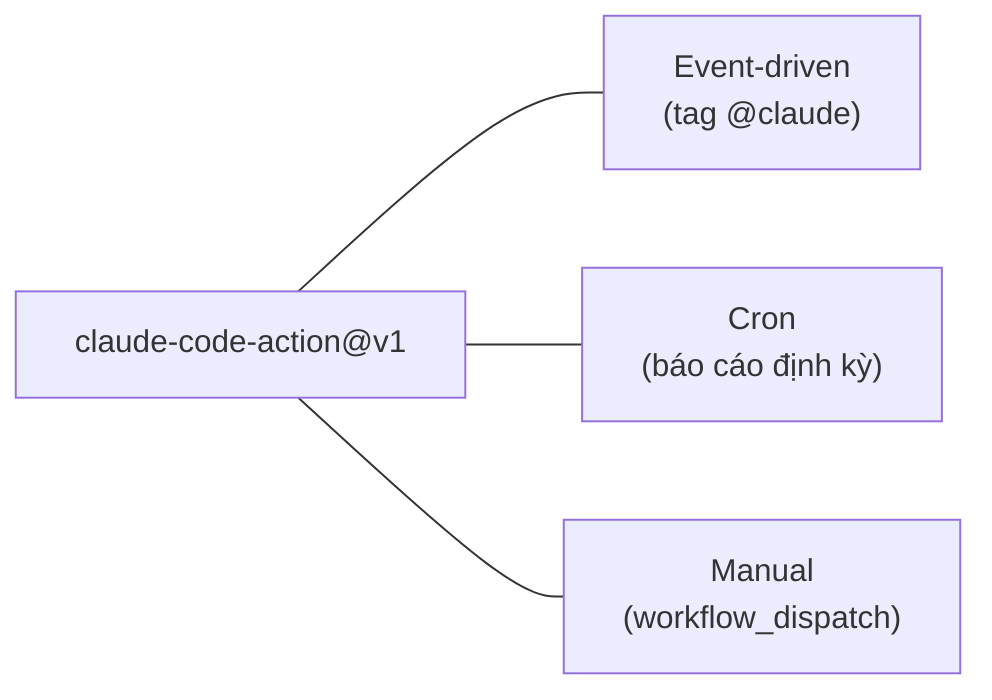

---
tags:
  - claude/tich-hop
  - claude/automation
  - github
aliases:
  - Claude Code PR
  - Claude Code GitHub
  - PR Automation
up: "[[Claude Code]]"
---

# Claude Code trong Pull Request (GitHub)

Đưa [[Claude Code]] vào quy trình **Pull Request (PR)** để tự động hóa các việc lặp lại. Đây là một ứng dụng cụ thể của [[Tự động hóa Claude Code (Routines & Headless)]] — "đã tin mới tự động".

## Vì sao PR là nơi lý tưởng?

PR là **trạm kiểm soát trung tâm**: nơi review code và nơi thay đổi được **land** vào nhánh chính. Đồng thời cũng chứa nhiều **busywork**:

- Viết mô tả PR, tóm tắt thay đổi.
- Kiểm tra lỗi cú pháp, tuân thủ quy chuẩn (convention).
- Phân loại / gắn nhãn PR, gợi ý reviewer.
- Review sơ bộ tìm lỗi tiềm ẩn, thiếu test.

## Hai hướng tiếp cận



| Tiêu chí | Managed Service | GitHub Action |
| --- | --- | --- |
| Bản chất | Dịch vụ dựng sẵn, **bật lên là chạy** | Tự cấu hình workflow qua file YAML |
| Công sức | Gần như không phải duy trì cấu hình | Tự viết, tự bảo trì workflow |
| Tùy biến | Giới hạn ở những gì dịch vụ cung cấp | Sâu: chọn model, prompt, hook, quyền, quy trình riêng của team |
| Phù hợp | Muốn review/tóm tắt PR nhanh, ít tốn công | Cần quy trình đặc thù, tích hợp nội bộ, kiểm soát chi phí/quyền |

> [!tip] Nguyên tắc chọn
> Giống phổ tự động hóa: bắt đầu từ **Managed Service** (ít công nhất); chỉ chuyển sang **GitHub Action** khi cần tùy biến mà dịch vụ dựng sẵn không đáp ứng.

## Managed Service: Code Review (Claude GitHub app)

Chạy hoàn toàn trên **cloud Anthropic**, không cần YAML hay server riêng.

- **Cài đặt** — Organization Admin vào *Claude Code admin settings* → **Code review** → **Configure** → liên kết các repository GitHub.
- **Trigger** (admin chọn):

| Trigger | Hành vi |
| --- | --- |
| PR vừa mở | Review **một lần** khi có PR mới |
| Mỗi lần push | Review lại sau mỗi `git push` cập nhật PR |
| On-demand | Chỉ chạy khi có người comment `@claude review` |

- **Cách review** — nhiều review agent đối chiếu thay đổi với **toàn bộ codebase** (không chỉ `diff`) để bắt side effect gợn sóng.
- **Đầu ra** — **inline comment** đúng dòng code, kèm **severity** và đề xuất sửa; bảng **summary** trong **Check Run** của GitHub.
- **Giá trị cốt lõi** — tự **deduplicate** và **rank** phát hiện: chỉ đẩy lên vài vấn đề nghiêm trọng nhất thay vì danh sách nitpick dài → kỹ sư tập trung đúng trọng tâm.

### Ranh giới của Code Review

| Giới hạn | Ý nghĩa |
| --- | --- |
| **Không Approve / Block PR** | Claude chỉ **flag** vấn đề; quyết định duyệt hay chặn merge vẫn thuộc về con người |
| **Không autofix trên GitHub** | Chỉ đăng finding + đề xuất dạng comment, không tự commit/push vào PR |
| **Research Preview** | Chỉ có ở gói **Team** và **Enterprise**; hành vi có thể còn thay đổi |

### Workflow kết hợp: Cloud phát hiện → Local sửa



1. **Phát hiện** — Claude đăng finding trên PR.
2. **Khắc phục** — trong Terminal tại thư mục dự án, chạy `/code-review --fix`: đọc review của diff hiện tại và **áp dụng bản vá vào working tree** cục bộ.
3. **Chốt** — tự review lại thay đổi rồi commit/push.

> [!tip] Mental model
> **Cloud để quan sát & cảnh báo, Local để thực thi & sửa lỗi** — nhánh chính an toàn, dev kiểm soát mọi thay đổi trước khi vào codebase.

## GitHub Action (`anthropics/claude-code-action@v1`)

Hướng **DIY**: dùng khi cần Claude **thực sự làm việc** chứ không chỉ comment review.

### Khi nào chọn thay vì Code Review?

- **Sửa/viết code theo yêu cầu** — nhận comment `@claude` trên PR rồi tự viết fix và push commit.
- **Báo cáo định kỳ** — tổng hợp báo cáo mã nguồn theo lịch cron.
- **Phản hồi sự kiện bất kỳ** — Issue, Release, PR comment...

### Cài đặt

- Chạy `/install-github-app` trong Terminal (cần quyền **Admin repo**): liên kết **Claude GitHub App** và tự lưu `ANTHROPIC_API_KEY` vào Secrets của repo.
- Sau đó viết workflow trong `.github/workflows/*.yml`.

### Input chính

| Input | Ý nghĩa |
| --- | --- |
| `trigger_phrase` | Cụm từ trong comment để kích hoạt; mặc định `@claude` |
| `prompt` | Chỉ dẫn cụ thể cho lượt chạy |
| `claude_args` | Chuỗi CLI args truyền thẳng vào Claude Code (`--allowedTools`, `--bare`, `--max-turns`...) |
| `github_token` | Mặc định `secrets.GITHUB_TOKEN`, để gọi GitHub API |
| `anthropic_api_key` | API key; không bắt buộc nếu dùng Bedrock/Vertex |
| `use_bedrock` / `use_vertex` | `true` nếu dùng Claude qua **AWS Bedrock** / **Google Vertex AI** |

### So sánh 2 hướng

| | Managed: Code Review | DIY: GitHub Action |
| --- | --- | --- |
| Cấu hình | Dịch vụ sẵn của Anthropic | Tự viết `.github/workflows/` |
| Việc làm được | Chỉ đọc diff và nhận xét | Viết code, commit, chạy report, xử lý mọi event |
| Tự sửa code trên PR | Không | Có |
| Tùy biến | Thấp | Sâu (prompt, CLI args, tool) |
| Phù hợp | Đảm bảo chất lượng code | Tự động hóa CI/CD linh hoạt |

### Ví dụ: lắng nghe `@claude` trong comment

File `.github/workflows/claude.yaml`, step chính:

```yaml
- uses: anthropics/claude-code-action@v1
  with:
    anthropic_api_key: ${{ secrets.ANTHROPIC_API_KEY }}
    github_token: ${{ secrets.GITHUB_TOKEN }}
    trigger_phrase: "@claude"
    prompt: "Your instructions here"
    claude_args: "--max-turns 5 --model claude-sonnet-5"
```

- `trigger_phrase` — comment chứa `@claude` mới kích hoạt Action.
- `claude_args` — `--max-turns 5` chặn vòng lặp vô tận/tốn chi phí; `--model` chỉ định model cố định (kiểm tra ID model còn hiệu lực).
- Workflow cần `on: issue_comment` (và `pull_request_review_comment` nếu muốn bắt comment trên dòng code), cùng `permissions: contents: write` để Claude push commit.

**Kịch bản vận hành:**



> [!tip] From Comments to Commits
> Không cần mở IDE sửa thủ công theo review — tag `@claude` kèm mô tả, comment biến thành commit. Vẫn phải **review commit do Claude tạo** như code của người khác.

### Chạy theo lịch & thủ công

Cùng một action, chỉ đổi phần `on:` — không cần comment hay PR làm trigger:

```yaml
on:
  schedule:
    - cron: "0 9 * * *"   # 09:00 UTC mỗi ngày
  workflow_dispatch:       # nút "Run workflow" ở tab Actions
```

- **Cron (`schedule`)** — daily rollup, quét bảo mật, rà issue tồn đọng rồi đăng kết quả lên GitHub. Giờ cron tính theo **UTC**; GitHub có thể trễ vài phút khi tải cao.
- **Thủ công (`workflow_dispatch`)** — bấm chạy bất cứ lúc nào từ tab **Actions**, tiện để test workflow hoặc chạy ngoài lịch.
- Khi không có comment/PR làm ngữ cảnh, **`prompt` phải tự đủ ý** (nêu rõ việc cần làm và nơi đăng kết quả).
- **Observability** — theo dõi từng step của Claude real-time ngay tab Actions, như mọi workflow CI/CD khác; log lưu lại để kiểm toán.



### Tinh chỉnh bằng `claude_args`

`claude_args` là chuỗi CLI flag đi thẳng vào Claude Code — nơi đặt **giới hạn, quyền và chế độ** cho job không người giám sát (unattended). Ba "núm vặn" chính:

| Núm vặn | Mục đích | Ví dụ |
| --- | --- | --- |
| `--max-turns <n>` | Chặn cứng số lượt → tránh vòng lặp vô tận, tốn chi phí, treo pipeline | `--max-turns 5` |
| **Permission mode** | Không ai bấm "Accept" trong CI → thiếu quyền tự động thì job **hang/fail** | `--permission-mode ...` (xem [[Permission Modes]]) |
| `--allowedTools` | Least privilege: chỉ cấp tool cần thiết | `--allowedTools "Read,Grep,Glob"` |

- **Báo cáo/review** → chỉ quyền **đọc** (`Read`, `Grep`, `Glob`); **autofix** mới thêm `Edit`/`Write`.
- Chọn permission mode theo mức rủi ro; tránh bỏ qua toàn bộ xác nhận trừ khi chạy trong sandbox/runner cô lập, kèm allowlist chặt.
- Ghép với `--bare` cho môi trường đồng nhất, `--model` để cố định model (xem [[Headless Mode (claude -p)]]).

```yaml
claude_args: >-
  --max-turns 5
  --allowedTools "Read,Grep,Glob"
```

### Điểm cần nhớ

- Nền tảng là GitHub Actions chạy trên **runner của bạn/GitHub**, bên trong gọi Claude Code ở chế độ không giao diện (xem [[Headless Mode (claude -p)]]).
- Kích hoạt theo sự kiện: `pull_request` (mở/cập nhật PR), `issue_comment` (mention `@claude` trong comment), v.v.
- Khóa API lưu ở **GitHub Secrets**, không hardcode vào YAML.
- Cấp **quyền tối thiểu** cho job (`permissions:` — vd. chỉ `contents: read`, `pull-requests: write`) và giới hạn tool qua `--allowedTools`.
- Dùng [[CLAUDE.md Bộ nhớ dự án|CLAUDE.md]] để Claude biết quy chuẩn dự án; muốn môi trường nhất quán trên mọi runner thì cân nhắc `--bare`.

```yaml
# Khung tối giản (minh họa ý tưởng, kiểm tra cú pháp/tham số theo docs hiện hành)
name: claude-pr-review
on:
  pull_request:
    types: [opened, synchronize]
permissions:
  contents: read
  pull-requests: write
jobs:
  review:
    runs-on: ubuntu-latest
    steps:
      - uses: actions/checkout@v4
      - uses: anthropics/claude-code-action@v1
        with:
          anthropic_api_key: ${{ secrets.ANTHROPIC_API_KEY }}
          prompt: "Review PR này: tóm tắt thay đổi, chỉ ra lỗi tiềm ẩn và thiếu test."
          claude_args: "--max-turns 5"
```

> [!warning] Kiểm chứng theo phiên bản
> Tên action, tham số YAML và vị trí menu cài đặt có thể thay đổi giữa các bản. Đối chiếu docs chính thức trước khi áp dụng.

## Lưu ý an toàn

- PR từ **fork / người lạ** có thể chứa prompt injection trong code, comment — không cấp secrets hay quyền ghi rộng cho các luồng này.
- Claude chỉ **gợi ý/comment**; quyết định merge vẫn là con người.
- Đặt giới hạn lượt (`--max-turns`), chi phí và timeout cho job.

## Liên kết

- Thuộc: [[Claude Code]]
- Phổ tự động hóa: [[Tự động hóa Claude Code (Routines & Headless)]]
- Liên quan: [[Routines]] (trigger GitHub event), [[Headless Mode (claude -p)]], [[Hooks]], [[Permission Modes]], [[CLAUDE.md Bộ nhớ dự án|CLAUDE.md]]
