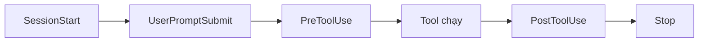
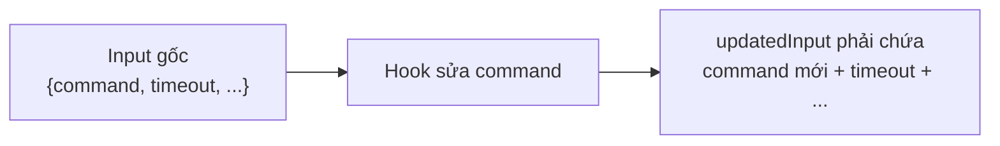

---
tags:
  - claude/tich-hop
aliases:
  - Hooks
  - Hook
up: "[[Claude Code]]"
---

# Hooks

Điểm can thiệp tự động trong [[Claude Code]] — cho phép kích hoạt lệnh script/hệ thống tại các thời điểm cụ thể trong vòng lặp hoạt động (xem [[Claude Code#Cơ chế hoạt động: Vòng lặp Agentic|Vòng lặp Agentic]]).

## Đặc trưng: Tính xác định (Deterministic)

- Dặn qua [[CLAUDE.md Bộ nhớ dự án|CLAUDE.md]] (vd. "chạy Prettier sau mỗi lần sửa file") — Claude vẫn là AI, thỉnh thoảng có thể quên hoặc bỏ qua.
- Dùng **Hook** — lệnh bắt buộc chạy 100%, không có ngoại lệ, vì do hệ thống kích hoạt chứ không phụ thuộc AI tự nhớ.

### Hy vọng vs. Đảm bảo

| | CLAUDE.md (lời dặn) | Hook (code cứng) |
| --- | --- | --- |
| Bản chất | Lời đề nghị bằng ngôn ngữ tự nhiên, Claude *đọc và cố tuân thủ* | Đoạn code **do hệ thống tự chạy** tại một điểm cố định trong vòng lặp |
| Độ tin cậy | "Thường thì" tuân thủ (usually) | 100%, Claude không thể thương lượng/quên/bỏ qua |
| Rủi ro | Phiên dài (long run) hoặc chạy tự động không ai canh → dễ bị bỏ sót | Gần như không có — kết quả xác định (deterministic) |

- **Điểm mấu chốt** — Hook biến quy tắc từ *"hy vọng AI thường xuyên tuân thủ"* thành *"cơ chế buộc AI tuyệt đối phải thực thi"*.
- **Đặc biệt quan trọng khi** chạy chế độ tự động/không giám sát (xem [[Permission Modes]]), vì không có ai kịp phát hiện khi Claude quên quy tắc.
- Hook chạy **ngoài** ngữ cảnh của Claude → không tốn context, cũng không bị "attention competition" như CLAUDE.md dài.

## Tác dụng chính

- **Tự động định dạng** — chạy linter/formatter (Prettier, ESLint...) ngay khi file bị chỉnh sửa.
- **Ghi log** — lưu lịch sử toàn bộ lệnh Claude đã thực thi, phục vụ kiểm duyệt/tuân thủ quy trình.
- **Chặn hành động nguy hiểm** — ngăn AI tự ý sửa file quan trọng hoặc file cấu hình production.
- **Thông báo** — tự gửi thông báo khi Claude hoàn thành một tác vụ dài.

## Cách thiết lập

- **Vị trí cấu hình** — lưu trong file `settings.json`.
- **Cách thao tác** — dùng lệnh **`/hooks`** ngay trong giao diện Claude Code, hoặc tự sửa trực tiếp `settings.json`.
- **Thành phần một Hook** — **Event** (thời điểm kích hoạt) + **Matcher** (điều kiện lọc, áp dụng cho công cụ nào) + **Command** (lệnh thực thi).

Ví dụ cấu hình tối giản trong `settings.json` (auto-format sau khi sửa file):

```json
{
  "hooks": {
    "PostToolUse": [
      {
        "matcher": "Edit|MultiEdit|Write",
        "hooks": [
          { "type": "command", "command": "npx prettier --write \"$CLAUDE_PROJECT_DIR\"" }
        ]
      }
    ]
  }
}
```

- **Matcher** khớp theo **tên tool** (`Bash`, `Edit`, `Write`, `Read`...), hỗ trợ dạng regex/`|`; bỏ trống hoặc `*` = khớp mọi tool.
- Hook nhận dữ liệu (tên tool, input, đường dẫn...) dạng **JSON qua `stdin`** — script tự parse (vd. `jq`) để lấy `file_path`, `command`...

## Các sự kiện (Events) trong vòng lặp

Vòng đời một phiên: **Khởi tạo → Nhận yêu cầu → Gọi tool → Kết thúc lượt (turn)**; mỗi mốc có một event để gắn code.



| Event | Thời điểm chạy | Phù hợp cho |
| --- | --- | --- |
| **PreToolUse** | Ngay **trước** khi Claude thực thi một tool | Chặn cứng hành động nguy hiểm (`git push --force`, xóa DB) — *enforcement primitive* |
| **PostToolUse** | Ngay **sau** khi tool chạy thành công | Tự động format (Prettier/Black), linter, kiểm tra lỗi |
| **UserPromptSubmit** | Khi người dùng nhấn gửi, trước khi Claude xử lý | Thêm ngữ cảnh, kiểm tra nội dung đầu vào |
| **Stop** / **SubagentStop** | Khi Claude (hoặc [[Subagents (Tác vụ phụ)\|subagent]]) báo hoàn thành lượt | Kiểm tra *Definition of Done* — chặn lại nếu test chưa thông; hoặc dọn file tạm, báo xong |
| **SessionStart** | Khi khởi tạo/tiếp tục phiên | Chuẩn bị môi trường, nạp lại ngữ cảnh (kể cả sau compaction) |
| **InstructionsLoaded** | Khi `CLAUDE.md`/rules được nạp | Audit: xác nhận hướng dẫn nào thực sự đã vào context |
| **PreCompact** / **PostCompact** | Trước/sau khi nén context | Theo dõi/xử lý khi bộ nhớ phiên bị thu gọn |
| **Notification** | Khi Claude gửi một thông báo | Bắn thông báo về Slack/Email |

> [!note] Danh sách thay đổi theo phiên bản
> Còn có `SessionEnd` (cuối phiên) và các event khác. Gõ `/hooks` để xem danh sách đúng bản đang dùng.

### Stop hook — ép làm cho tới khi đạt chất lượng

- Hook `Stop` có thể **chặn Claude kết thúc** và trả lý do (vd: "Chưa xong, test còn đỏ") để Claude tiếp tục làm → biến "xong" thành tiêu chí kiểm chứng được bằng code.
- **Cẩn thận vòng lặp vô hạn** — nếu điều kiện không bao giờ thỏa, Claude sẽ bị ép tiếp tục mãi; script nên kiểm tra cờ cho biết hook đang chạy lặp (`stop_hook_active` trong JSON `stdin`) để thoát.

### Bẫy: khôi phục context sau Compaction

- **Sai** — dùng `PostCompact` để bơm lại thông tin quan trọng: output của nó **không** đi ngược vào hội thoại.
- **Đúng** — dùng **`SessionStart` + matcher `compact`**: event này chạy lại sau khi nén và output được đưa vào context của Claude.
- Liên quan: [[Claude Code#Auto-Compaction — khi context đầy|Auto-Compaction]].

#### Pattern: tự "nhớ lại" sau khi compact

- **Vấn đề** — compaction làm rơi chi tiết cụ thể (file đang làm dở, trạng thái hiện tại) → Claude khởi động lại trong trạng thái mơ hồ, phải hỏi lại.
- **Giải pháp** — hook `SessionStart` với matcher `compact`, in ra bản tóm tắt ngắn; plain text từ `exit 0` của `SessionStart` được **bơm vào context** (xem [[#Exit Code chi tiết (áp dụng cho mọi event)|Exit Code chi tiết]]).

```json
{
  "hooks": {
    "SessionStart": [
      {
        "matcher": "compact",
        "hooks": [
          { "type": "command", "command": "cat \"$CLAUDE_PROJECT_DIR/.claude/session-state.md\"" }
        ]
      }
    ]
  }
}
```

- **Nguồn dữ liệu cần có sẵn** — hook chỉ *in lại* thông tin, không tự biết trạng thái. Cần một file trạng thái (vd. `.claude/session-state.md`, danh sách việc đang làm, `git status`, quy tắc quan trọng) được cập nhật trước đó — có thể bằng `PostToolUse`/`Stop` hook hoặc nhờ Claude ghi lại.
- **Cách thay thế/bổ sung** — thông tin ổn định dài hạn thì để trong [[CLAUDE.md Bộ nhớ dự án|CLAUDE.md]] (tự nạp lại sau compaction); hook phù hợp cho **trạng thái động** của phiên.
- **Giữ ngắn** — output càng dài càng tốn lại chính context vừa được giải phóng; chỉ in những gì thật sự cần để tiếp tục.
- **Matcher của `SessionStart`** — lọc theo nguồn khởi tạo: thường gặp `startup`, `resume`, `clear`, `compact`; dùng đúng `compact` để chỉ chạy sau khi nén, không chạy mỗi lần mở phiên.

> [!tip] Bức tranh toàn cảnh
> `PreToolUse` chặn nguy hiểm → `PostToolUse` dọn dẹp/định dạng → `Stop` ép đạt chất lượng.

### Ví dụ điển hình: Auto-format với PostToolUse

Hook ở event `PostToolUse` + matcher `Edit | MultiEdit | Write` → mỗi khi Claude sửa/tạo file, hook tự kích hoạt, kiểm tra đuôi file và chạy công cụ căn chỉnh tương ứng (Prettier cho TypeScript, `gofmt` cho Go...).

## Cơ chế chặn (Blocking) với PreToolUse

`PreToolUse` cho phép kiểm tra và **ngăn chặn** lệnh của Claude trước khi kịp thực thi.

- **Cách hoạt động** — Claude Code truyền thông tin công cụ + dữ liệu đầu vào (JSON) vào `stdin` của script Hook; Hook xử lý và trả về **Exit Code** để quyết định:

| Exit Code | Hành động |
| --- | --- |
| **0** | Cho phép lệnh chạy bình thường |
| **2** (chặn) | Dừng lệnh ngay; nội dung lỗi từ `stderr` gửi ngược lại cho Claude để nó biết lý do bị chặn và tự điều chỉnh |
| Khác (1, 3...) | Lỗi không chặn: `stderr` chỉ ghi log, Claude vẫn chạy tiếp (xem [[#Exit Code chi tiết (áp dụng cho mọi event)\|Exit Code chi tiết]]) |

- **Dùng để áp đặt quy tắc cứng** mà AI không được phép vi phạm — vd. chặn ghi/sửa thư mục cấu hình production, chặn lệnh Bash nguy hiểm (`rm -rf`), chặn commit trực tiếp vào nhánh `main`.

- **Mẹo** — ghi lý do chặn vào `stderr` thật rõ ràng và gợi ý hướng thay thế (vd: "Không push `main`, hãy tạo branch + PR") để Claude tự điều chỉnh thay vì thử lại lệnh bị chặn.
- **Lưu ý** — `PostToolUse` chạy *sau* khi tool đã xong nên **không thể hoàn tác**; muốn ngăn chặn phải dùng `PreToolUse`.

### Phản hồi bằng JSON (`permissionDecision`)

Ngoài exit code, `PreToolUse` có thể trả quyết định tinh hơn: script **in JSON ra `stdout` và thoát `exit 0`**.

```json
{
  "hookSpecificOutput": {
    "hookEventName": "PreToolUse",
    "permissionDecision": "deny",
    "permissionDecisionReason": "Chặn vì phát hiện lệnh nguy hiểm",
    "updatedInput": { "command": "..." }
  }
}
```

| `permissionDecision` | Ý nghĩa |
| --- | --- |
| **`allow`** | Cho chạy, bỏ qua bước hỏi quyền |
| **`deny`** | Chặn ngay; `permissionDecisionReason` được gửi lại cho Claude |
| **`ask`** | Đẩy về người dùng tự duyệt (hộp thoại xác nhận) |
| **`defer`** | Chỉ dùng cho luồng không tương tác (`-p`) nâng cao, hiếm gặp |

- **Exit code vs JSON** — `exit 2` + `stderr` là cách chặn nhanh, đơn giản; JSON cho phép chọn `ask`/`allow` và sửa input. Chọn **một** cách cho mỗi lần chạy (JSON chỉ được xử lý khi `exit 0`).
- **`allow` từ hook** có thể bỏ qua prompt quyền thông thường → chỉ dùng khi chắc chắn an toàn; xem [[Permission Modes]].

#### `updatedInput` — viết lại lệnh trước khi chạy

- **Tác dụng** — thay vì chỉ cho/cấm, **sửa** tham số Claude sắp gửi: vd. lược bỏ API key/secret khỏi lệnh Bash, thêm cờ `--dry-run`, ép đường dẫn vào thư mục an toàn.
- **Bẫy: ghi đè TOÀN BỘ** — `updatedInput` **thay thế cả object input gốc**, không phải merge từng field. Phải trả lại đầy đủ mọi field không đổi, nếu quên thì field đó mất.



- **Cách làm an toàn** — script đọc JSON gốc từ `stdin`, sao chép nguyên `tool_input`, chỉ đổi field cần sửa rồi in ra (vd. với `jq`: `.tool_input | .command |= sub(...)`).
- **Minh bạch** — Claude có thể không biết lệnh đã bị sửa; nên ghi chú vào `permissionDecisionReason` hoặc log để dễ gỡ lỗi.

#### Redact thay vì Deny (ví dụ xử lý secrets)

| Cách tiếp cận | Luồng | Hệ quả |
| --- | --- | --- |
| **Block** | Phát hiện rủi ro → `deny` / `exit 2` | Lệnh bị hủy, Claude phải tự tìm cách khác |
| **Redact/Rewrite** | Phát hiện rủi ro → sửa bằng `updatedInput` → `allow` | Lệnh vẫn chạy, công việc không bị gián đoạn |

- **Tình huống** — Claude sắp chạy lệnh Bash chứa chuỗi khóa lộ (vd. `sk_live_...`).
- **Hook** — `PreToolUse` (matcher `Bash`) quét pattern nhạy cảm bằng regex → thay khóa thật bằng placeholder (vd. `[REDACTED]`) → trả `allow` kèm `updatedInput` (nhớ giữ đủ các field khác).
- **Giá trị** — tiêu chuẩn an toàn cấp doanh nghiệp mà vẫn giữ tốc độ làm việc: Hook không chỉ là "cảnh sát" cấm (`deny`) mà còn là "thợ sửa ống nước" làm sạch dữ liệu âm thầm.

> [!warning] Giới hạn cần biết
>
> - **Placeholder có thể làm lệnh sai/thất bại** (vd. gọi API với khóa giả) — redact chỉ hợp lý khi secret vô tình lọt vào lệnh, còn lệnh thật sự cần secret thì nên dùng biến môi trường thay vì dán thẳng.
> - **Không phải lá chắn tuyệt đối** — secret có thể đã nằm trong context/hội thoại (do người dùng dán, hoặc Claude đọc từ file) trước khi hook chạy; hook chỉ làm sạch *lệnh gửi đi*. Muốn chặn từ gốc, kết hợp `deny` cho việc đọc file nhạy cảm (`.env`...) ở `PreToolUse` với matcher `Read`.
> - **Chọn theo mức rủi ro** — secret thật/quan trọng → `deny` cho an toàn; lỗi vặt có thể tự động sửa được → redact/rewrite.

## Exit Code chi tiết (áp dụng cho mọi event)

Exit code là cách đơn giản thay thế cho JSON; ý nghĩa phụ thuộc cả **event** lẫn **mã thoát**.

| Exit Code | Bản chất | Xử lý output | Dùng khi |
| --- | --- | --- | --- |
| **0** | Thành công | JSON → được parse. Text thường → **bỏ qua** ở hầu hết event, *trừ* `SessionStart`, `UserPromptSubmit`, `UserPromptExpansion` (text được **bơm thẳng vào context** Claude) | Chạy êm, hoặc muốn tiêm thêm ngữ cảnh |
| **2** | Lỗi **chặn cứng** | Dừng hành động/quy trình; `stderr` được **phản hồi lại cho Claude** | **Chặn hành động** (cấm push, không cho dừng phiên) |
| **Khác** (1, 3...) | Lỗi **không chặn** | `stderr` chỉ ghi log/hiện cho người dùng; Claude **vẫn chạy tiếp** | Cảnh báo, log ngầm |

> [!warning] Bẫy lớn nhất: `exit 1` KHÔNG chặn
> Theo thói quen lập trình, `exit 1` = "lỗi, dừng". Trong Hook thì **không**: Claude vẫn thực thi lệnh bình thường. Muốn chặn **bắt buộc** `exit 2`. Script bảo mật mà để lỗi thoát bằng `exit 1` (vd. do `set -e`, crash) sẽ **fail-open** — im lặng cho phép lệnh chạy.

### Ngoại lệ theo event

| Event | Khi `exit 2` |
| --- | --- |
| **PreToolUse** | Chặn tool call; `stderr` gửi cho Claude |
| **Stop** | Chặn việc kết thúc; `stderr` bảo Claude *"chưa xong, sửa tiếp"* (ví dụ: test còn đỏ) |
| **PostToolUse** | **Quá trễ để chặn** (tool đã chạy xong); `stderr` vẫn được đưa vào hội thoại để Claude xử lý tiếp |
| **Notification**, **SessionStart** | **Không thể chặn** — chỉ hiện `stderr` cho người dùng rồi chạy tiếp |

- **Quy tắc chọn** — muốn *chặn trước khi xảy ra* → `PreToolUse` + `exit 2`; muốn *phản hồi sau khi xảy ra* → `PostToolUse`; muốn *ép làm tiếp* → `Stop` + `exit 2`.
- **Mẹo fail-closed** — trong script bảo mật, bọc logic để mọi nhánh lỗi bất ngờ đều kết thúc bằng `exit 2` (vd. `trap 'exit 2' ERR`), thay vì để rơi về `exit 1`.

## Lưu ý an toàn & gỡ lỗi

- **Hook chạy với quyền của chính bạn** — là lệnh shell thật trên máy, nên chỉ dùng hook từ nguồn tin cậy; review kỹ `.claude/settings.json` khi clone repo lạ.
- **Giữ hook nhanh và nhẹ** — hook chạy trong vòng lặp, mỗi lần gọi tool đều có thể kích hoạt; hook chậm làm cả phiên chậm theo.
- **Xử lý lỗi cẩn thận** — script lỗi bất ngờ (exit code khác 0/2) chỉ báo lỗi chứ không chặn → với quy tắc bảo mật phải đảm bảo script chặn bằng đúng `exit 2`.
- **Gỡ lỗi** — thử chạy script thủ công với JSON mẫu qua `stdin` trước, rồi mới gắn vào `settings.json`.

## Chia sẻ Hooks với team

- **Vị trí cấp dự án** — cấu hình tại `.claude/settings.json` trong thư mục dự án (khác cấu hình cá nhân/toàn cục) mang tính project-level.
- **Đồng bộ qua Git** — commit file này lên repo; ai clone dự án về cũng tự động áp dụng cùng tập quy tắc Hook, không cần cấu hình lại thủ công.
- **Biến môi trường `CLAUDE_PROJECT_DIR`** — dùng trong câu lệnh của Hook để trỏ đúng đường dẫn file trong dự án, đảm bảo script chạy đúng dù Claude đang đứng ở thư mục con nào.

> [!tip] Triết lý cốt lõi
> Nếu một việc bắt buộc phải xảy ra, không được phép có ngoại lệ — đừng viết vào prompt/CLAUDE.md, hãy đưa vào Hook.

## Liên kết

- Thuộc: [[Claude Code]]
- Liên quan: [[CLAUDE.md Bộ nhớ dự án]], [[Skills]] (Hook = code chặn cứng; CLAUDE.md/Skill = lời dặn), [[Claude Code#Cơ chế phân quyền (Permissions)|Permissions]]
