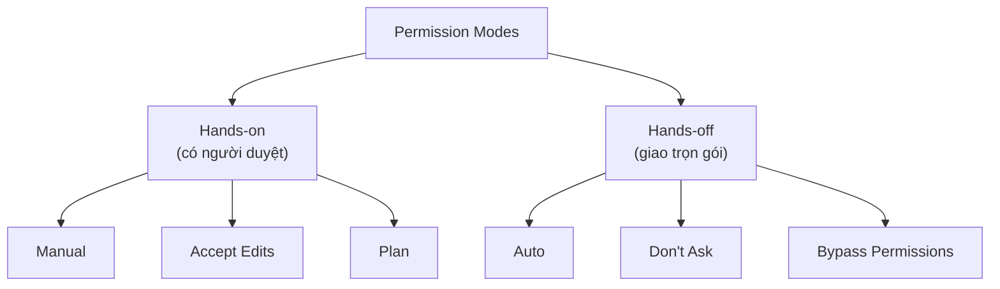
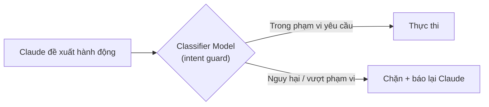
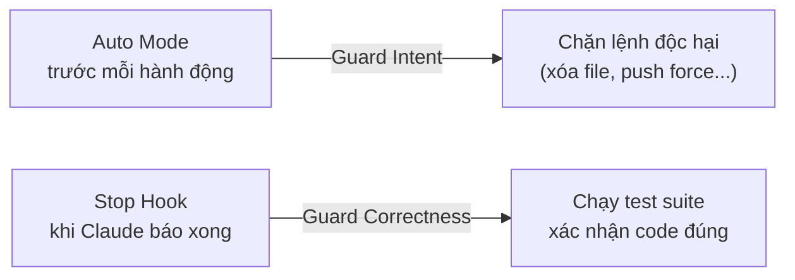
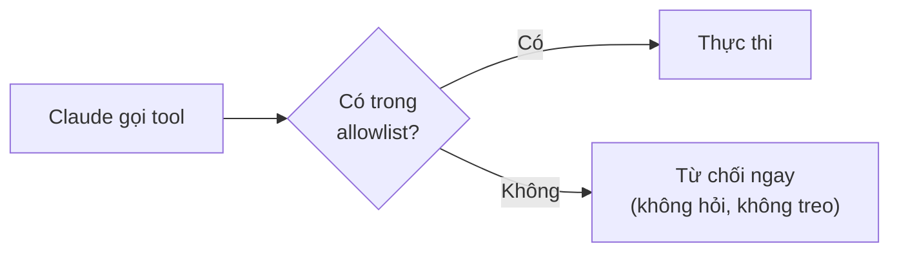
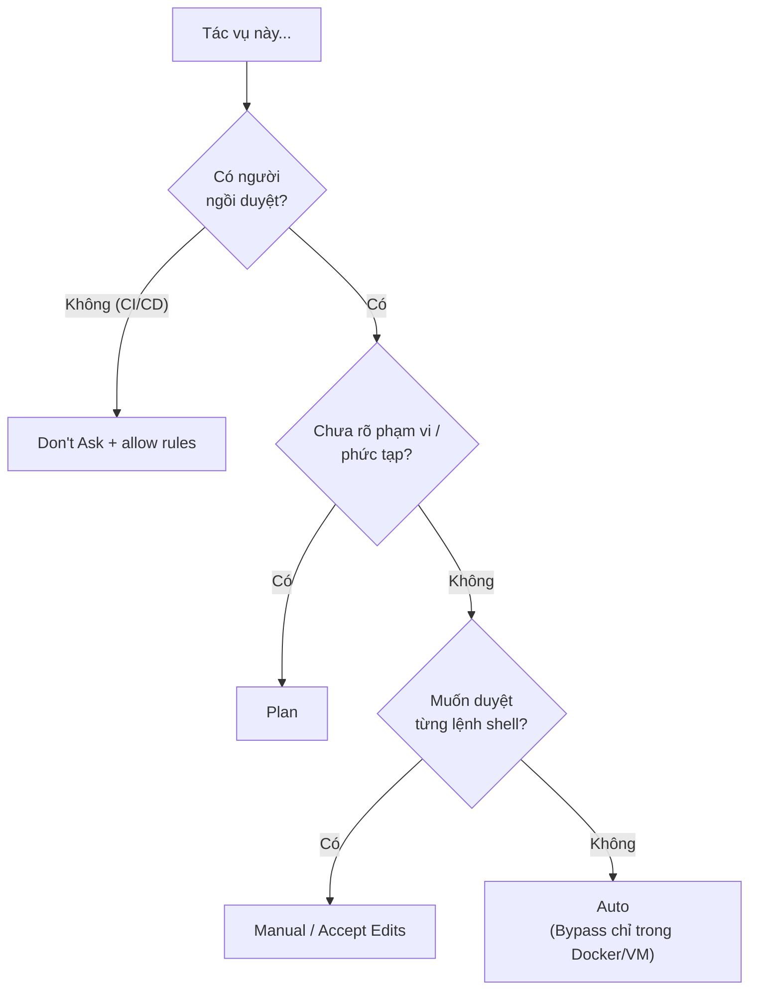

---
tags:
  - claude/tich-hop
aliases:
  - Permission Modes
  - Chế độ phân quyền
up: "[[Claude Code]]"
---

# Permission Modes (Chế độ phân quyền)

Cơ chế của [[Claude Code]] để **đặt trước mức độ ủy quyền** — thay vì bấm Approve cho từng lần sửa file/chạy lệnh, chọn một chế độ khớp với tính chất công việc và **mức độ tin tưởng** dành cho Claude tại thời điểm đó. Có **6 chế độ**; mỗi chế độ vạch ranh giới giữa việc Claude được tự làm và việc bắt buộc phải hỏi.

## 6 chế độ

| Chế độ | Cơ chế | Khi dùng |
| --- | --- | --- |
| **Manual** (Default) | Chỉ **đọc file** tự do; sửa file, chạy lệnh đều phải hỏi | Kiểm soát 100% từng thao tác; làm quen, repo nhạy cảm |
| **Accept Edits** | Tự **đọc, sửa file và chạy lệnh filesystem cơ bản** (vd `mkdir`, `mv`, `cp`); lệnh shell khác vẫn hỏi | Cùng code/refactor liên tục, review toàn bộ thay đổi sau |
| **[[Plan Mode\|Plan]]** | Chỉ **đọc**; nghiên cứu codebase, đề xuất phương án, không sửa gì | Bắt đầu tính năng mới hoặc refactor lớn, cần phân tích kiến trúc trước |
| **Auto** | **Chấp nhận mọi hành động**, nhưng một **Classifier Model** riêng rà soát an toàn trước mỗi hành động | Giao việc A-Z mà vẫn có lớp AI độc lập giám sát |
| **Don't Ask** | Chỉ chạy tool **đã duyệt trước** (allow rules); mọi thứ khác **bị từ chối ngay**, không hỏi | Tự động hóa nghiêm ngặt (CI/CD, script) — không có người ngồi duyệt |
| **Bypass Permissions** | **Bỏ toàn bộ kiểm tra an toàn** (= `--dangerously-skip-permissions`) | Chỉ trong môi trường cách ly hoàn toàn: Docker/VM |

### Điểm cần nhớ

- **Auto ≠ cho phép mù quáng** — Classifier phụ phân tích hành động sắp chạy có nguy hại không (xóa hàng loạt, đẩy dữ liệu ra ngoài, vượt phạm vi yêu cầu...) rồi mới cho thực thi; hành động bị đánh giá rủi ro sẽ bị chặn. Khả dụng tùy gói/model, có thể phải bật trong settings.
- **Don't Ask ≠ Auto** — Auto *cho phép rồi kiểm tra*; Don't Ask *cấm mặc định*, chỉ cho đúng danh sách whitelist. Don't Ask là chế độ **an toàn nhất cho tự động hóa**, Bypass là **nguy hiểm nhất**.
- **Bypass** — Claude có toàn quyền máy tính, không rào cản; một lệnh sai có thể hỏng hệ điều hành/dữ liệu cá nhân nếu không chạy trong sandbox.

## Auto Mode hoạt động bên trong thế nào

- **Bảo vệ hai lớp** — Claude (model làm việc) và **Classifier Model độc lập** (model giám sát). Trước khi *bất kỳ* hành động nào chạy thật trên máy, classifier rà soát; nó đóng vai **intent guard**: hành động có vượt phạm vi yêu cầu ban đầu của người dùng không.
- **Bị chặn** (Claude phải đổi hướng hoặc hỏi lại người dùng):
  - Deploy / migration lên **production**.
  - Lệnh shell nguy hiểm: `git push --force`, `curl | sh` (tải về chạy thẳng).
  - **Rò rỉ dữ liệu nhạy cảm**: gửi API key, mật khẩu, dữ liệu nội bộ ra server ngoài.
  - Xóa file quan trọng (cần cho phiên làm việc hoặc dữ liệu hệ thống).
- **Được tự động cho qua**:
  - Sửa file code cục bộ trong dự án.
  - Cài dependency đã khai báo trong file lock (`package-lock.json`, `requirements.txt`...).
  - Thao tác chỉ đọc (đọc file, tìm kiếm, xem log).
  - Push lên **branch làm việc cá nhân** (không phải main/production).

### Giới hạn: Classifier kiểm tra Ý định, không kiểm tra Độ chính xác

- Classifier chỉ hỏi "hành động này có **nguy hiểm/phá hoại** không", **không** hỏi "code này có **đúng** không".
- Ví dụ: nhờ refactor authentication, Claude viết sai logic khiến user không đăng nhập được → classifier vẫn **cho qua**, vì code lỗi không phải hành động phá hoại (như xóa DB hay force push lên `main`).
- **Giải pháp: kết hợp Auto + [[Hooks|Stop Hook]]** — hai lớp phòng thủ ở hai thời điểm khác nhau:

> [!tip] Auto giữ hệ thống AN TOÀN, Stop Hook giữ code CHẠY ĐÚNG
> Stop Hook chạy lệnh test khi Claude tuyên bố xong; nếu test fail (exit code chặn, thường là `2`) thì Claude bị buộc làm tiếp để sửa thay vì dừng. Nhớ tránh vòng lặp vô hạn (kiểm tra cờ `stop_hook_active`). Chi tiết event và exit code: [[Hooks]].

<!-- -->

> [!tip] Chạy unattended: chọn Auto thay vì Bypass
> Auto vẫn có lớp classifier chặn thao tác nguy hiểm, Bypass thì không có gì. Nhưng Auto chỉ bảo vệ khỏi *danger*, không đảm bảo *correctness* → mức xác minh sau lượt chạy vẫn phải tương xứng với rope đã cấp. Xem [[Xác minh tương xứng (Proportional Verification)]].

<!-- -->

> [!note] Danh sách chặn/cho phép của Auto liên tục thay đổi
> Hành vi cụ thể của classifier được Anthropic cập nhật thường xuyên — tham khảo docs chính thức định kỳ thay vì coi danh sách trên là cố định.

<!-- -->

> [!warning] Classifier là lớp giảm rủi ro, không phải bảo đảm tuyệt đối
> Nó là một model nên vẫn có thể phán đoán sai (bỏ lọt hoặc chặn nhầm). Bài học gốc gọi là "an toàn tuyệt đối" nhưng thực tế nên coi là *giảm đáng kể* rủi ro — vẫn nên dùng git branch riêng, không đưa secret vào repo, và thêm [[Hooks]] cho các lệnh cấm tuyệt đối. Với dữ liệu thật/hệ thống quan trọng, dùng sandbox (Docker/VM).

<!-- -->

> [!warning] Càng tự động càng cần rào chắn
> Với nhóm hands-off, nên làm việc trong git branch/[[Claude Code#Chạy song song với Git Worktrees|worktree]] riêng, commit thường xuyên để [[Claude Code#Rewind — quay lại khi Claude đi sai hướng|Rewind]] dễ dàng, và chỉ cấp quyền trong thư mục dự án. Có thể thêm [[Hooks]] để chặn cứng lệnh nguy hiểm.

## Don't Ask — cho tác vụ không người giám sát

Chế độ dành riêng cho chạy **unattended** (không ai túc trực bấm duyệt):

- **CI pipelines** — tự động review/build/test khi có commit mới.
- **Scheduled / cron jobs** — tác vụ ngầm chạy theo giờ cố định.
- **Overnight batches** — chạy test lớn hoặc xử lý dữ liệu nặng lúc cả team nghỉ.

**Cơ chế**: chỉ gọi được tool nằm trong **allowlist** (cấu hình trước bằng rule `allow`); mọi thứ ngoài danh sách bị **auto-deny ngay**, không dừng hỏi.

**Lợi ích cốt lõi — tránh pipeline stalling**: ở chế độ khác, gặp lệnh cần xác nhận Claude sẽ chờ "Approve"; không ai ngồi đó thì CI **treo vô thời hạn** (tốn tiền runner, kẹt hàng đợi). Với Don't Ask, lệnh không hợp lệ bị từ chối tức thì, Claude tìm cách khác hoặc dừng an toàn.

> [!tip] Cách dùng thực tế
>
> - Khai báo allowlist **tối thiểu cần thiết** (vd `Bash(npm test)`, `Read`, `Edit`) — thiếu tool thì job fail nhanh và rõ ràng, dễ bổ sung dần.
> - Chạy ở chế độ headless (`claude -p "..."`) kết hợp `--permission-mode dontAsk` và `--allowedTools`; log lại lý do bị từ chối để chỉnh allowlist.
> - Chạy trong runner/container cô lập, giới hạn secret có trong môi trường.

## Cách chuyển & cấu hình

- **`Shift + Tab`** — xoay vòng nhanh giữa **4 chế độ hàng ngày** ngay trong phiên, không cần gõ lệnh: Manual → Accept Edits → Plan → Auto → (quay lại Manual). Don't Ask và Bypass **không** nằm trong vòng xoay mặc định vì quá cực đoan/dành cho chạy không người giám sát — đặt qua cờ khởi động hoặc settings.
- **Status Bar** — thanh trạng thái ở góc dưới luôn hiển thị chế độ hiện tại; liếc xuống là biết Claude có tự sửa code được không hay phải chờ duyệt. Nên nhìn lại sau mỗi lần bấm `Shift + Tab` để tránh đang ở Auto mà tưởng là Manual.
- **Khởi động** — cờ `--permission-mode <mode>` khi gõ `claude`.
- **Mặc định lâu dài** — `permissions.defaultMode` trong `settings file`; bản Desktop chỉnh bằng UI.
- **Rule chi tiết (allow / ask / deny)** — cho phép sẵn lệnh cụ thể (vd `git status`, `npm test`) hoặc cấm hẳn (vd đọc `.env`). Rule `deny` luôn thắng chế độ; rule `allow` chính là "danh sách duyệt trước" mà Don't Ask dựa vào.

## Chọn chế độ nào?

Đổi chế độ theo từng giai đoạn công việc bằng `Shift + Tab`:

| Giai đoạn | Chuyển sang |
| --- | --- |
| Lên ý tưởng / thiết kế | **Plan** |
| Bắt đầu code liên tục | **Accept Edits** |
| Muốn Claude tự chạy test, sửa lỗi A-Z | **Auto** |
| Cần kiểm soát cẩn thận từng bước | **Manual** |

> [!tip] Không có chế độ đúng/sai tuyệt đối
> Quy trình hay dùng: **Plan** chốt kế hoạch → **Accept Edits** hoặc **Auto** để thực thi → review diff trước khi commit (xem [[Explore, Plan, Code, Commit]]).

## Vị trí trong bộ công cụ quản trị Claude Code

Permission Modes là một trong 3 trụ cột điều khiển Claude Code:

- **[[CLAUDE.md Bộ nhớ dự án|CLAUDE.md]] & [[Skills]]** — định hướng phong cách, tự động hóa quy trình.
- **[[Hooks]]** — rào cản bằng code, chặn cứng lỗi chết người.
- **Permission Modes** — chỉnh "độ tin tưởng" và mức tự động hóa theo ngữ cảnh.

## Liên kết

- Thuộc: [[Claude Code]] (mục [[Claude Code#Cơ chế phân quyền (Permissions)|Cơ chế phân quyền]])
- Cùng nhóm: [[Plan Mode]], [[Hooks]], [[Subagents (Tác vụ phụ)]]
- Tương tự bên Cowork: [[Mô hình Phân quyền (Permissions)]]
