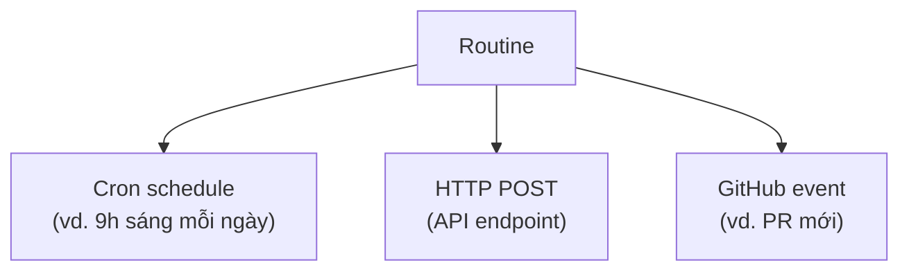

---
tags:
  - claude/tich-hop
  - claude/automation
aliases:
  - Routine
  - Routines
  - Quy trình tự động
up: "[[Claude Code]]"
---

# Routines

Cách tự động hóa tác vụ lặp lại **không cần viết script hay tự duy trì server** — định nghĩa công việc một lần, Claude tự chạy trên **cloud do Anthropic quản lý**. Là đầu "zero-build" của [[Tự động hóa Claude Code (Routines & Headless)|phổ tự động hóa]].

> [!tip] Mental model
> **Routine = Prompt + Repository + Connectors + Trigger**

## Bản chất

- **Chạy hoàn toàn trên cloud** — không cần để máy bật xuyên đêm, không cần quản lý file workflow/CI rườm rà.
- Khác [[Lên lịch Tác vụ (Scheduled Tasks)|Scheduled Tasks của Cowork]]: Routines hướng vào công việc **repo/lập trình** và hỗ trợ trigger theo sự kiện, không chỉ theo giờ.

## 3 thành phần

| Thành phần | Vai trò |
| --- | --- |
| **Prompt** | Hướng dẫn Claude phải làm gì |
| **Repository** | Kho mã nguồn Claude làm việc cùng |
| **Connectors** | Kết nối dịch vụ ngoài (Sentry, Slack...) nếu cần — xem [[Connectors (MCP)]] |

## Trigger (kích hoạt)



| Trigger | Khi nào chạy | Dùng cho |
| --- | --- | --- |
| **Cron schedule** | Theo lịch cố định | Báo cáo/kiểm tra định kỳ |
| **API (HTTP POST)** | Hệ thống/code của bạn chủ động gọi | Nối vào pipeline, alert, công cụ nội bộ |
| **GitHub event** | Ngay khi có sự kiện trên repo | Phản ứng tức thời với PR/issue |

## Cách tạo Routine

Hai cách cho cùng kết quả (một Routine chạy trên cloud Anthropic):

| | Web | Terminal |
| --- | --- | --- |
| **Nơi tạo** | `claude.ai/code/routines` | Lệnh `/schedule` trong Claude Code |
| **Cách làm** | Điền form trực quan | Mô tả bằng ngôn ngữ tự nhiên, Claude dựng thành Routine |
| **Phù hợp** | Cấu hình đủ chi tiết, nhiều trigger, xem/sửa về sau | Tạo nhanh, không rời terminal |

### Cách 1: Giao diện Web

Cấu hình 4 thông tin:

1. **Name** — tên dễ nhớ.
2. **Instructions** — prompt mô tả việc Claude làm mỗi lần chạy.
3. **Repository** — kho code Routine thao tác.
4. **Trigger** — cron schedule, GitHub event hoặc API.

### Cách 2: Lệnh `/schedule`

```text
/schedule daily dependency audit at 9am
```

- Cú pháp: `/schedule <mô tả công việc + thời gian>` — hệ thống phân tích câu mô tả thành Routine hoàn chỉnh (ở ví dụ: chạy 9h sáng mỗi ngày).
- Nên **xem lại** prompt và lịch Claude dự thảo trước khi xác nhận, giống cách làm ở [[Lên lịch Tác vụ (Scheduled Tasks)]].
- Điều kiện: đã đăng nhập và repo cần dùng đã được kết nối.

## Ví dụ ứng dụng

- **Kiểm tra dependency hàng ngày** — quét gói lỗi thời / lỗ hổng bảo mật mỗi sáng.
- **PR Triager** — khi có PR mới: xem xét, gán nhãn, tóm tắt nội dung.
- **Quét lỗi hệ thống** — đọc danh sách lỗi từ Sentry mỗi ngày, chỉ ra vấn đề cấp bách nhất.

> [!note] Ứng viên tốt cho Routine
> Bất kỳ prompt nào bạn đã kiểm chứng và phải lặp lại theo lịch hoặc theo sự kiện.

## Giới hạn & rào cản bảo vệ

| Giới hạn | Nội dung | Hệ quả |
| --- | --- | --- |
| **Research Preview** | Tính năng còn thử nghiệm, cách hoạt động/giới hạn có thể đổi mà không báo trước | Chưa nên dùng cho việc mission-critical |
| **Tối đa 1 giờ/lần** | Lịch định kỳ không thể dày hơn hourly (không có 5/15/30 phút) | Không hợp tác vụ gần real-time → dùng trigger API/GitHub event, hoặc [[Tự động hóa Claude Code (Routines & Headless)\|headless/SDK]] |
| **Branch guardrail** | Mỗi lần chạy: **fresh clone** nhánh mặc định (`main`/`master`); chỉ được push lên nhánh tiền tố **`claude/*`** | Routine không thể ghi đè trực tiếp `main`; muốn push nhánh khác phải chủ động nới quyền cho repo đó |

### Git Branch Guardrail

- **Fresh clone mỗi lần** — môi trường sạch, không mang trạng thái từ lần chạy trước (muốn nhớ gì phải ghi vào repo/connector).
- **Chỉ push `claude/*`** (vd. `claude/fix-deps-2026`) → kết quả đi qua PR để người review, giữ nguyên quy trình bảo vệ `main`.
- **Nới quyền** là quyết định có chủ đích, cấu hình riêng theo repo — cân nhắc kỹ vì mất lớp an toàn này.

## Lưu ý

- Chạy không ai canh → prompt phải rõ ràng, phạm vi quyền gọn (xem [[Permission Modes]]).
- Chỉ truy cập được repo và connectors đã cấp; cần kiểm soát sâu hơn thì chuyển sang headless/SDK.
- Cấu hình cụ thể có thể đổi theo phiên bản — đối chiếu tài liệu chính thức.

## Liên kết

- Thuộc: [[Claude Code]]
- Cùng nhóm: [[Tự động hóa Claude Code (Routines & Headless)]], [[Hooks]], [[Subagents (Tác vụ phụ)]]
