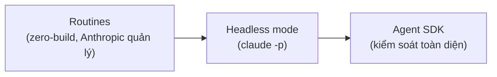

---
tags:
  - claude/tich-hop
  - claude/automation
aliases:
  - Automation Spectrum
  - Routines
  - Headless mode
  - Tự động hóa Claude Code
up: "[[Claude Code]]"
---

# Tự động hóa Claude Code (Routines & Headless)

Khi đã kiểm chứng và **tin tưởng** Claude hoàn thành một việc, bước tiếp theo là loại con người ra khỏi khâu *khởi động*: prompt lặp đi lặp lại theo định kỳ hoặc theo sự kiện (**recurring trigger**) thì không nên ngồi bấm chạy thủ công nữa.

## Phổ tự động hóa (Automation Spectrum)

Hai con đường, nằm trên một dải từ "ít phải dựng hạ tầng nhất" đến "kiểm soát tối đa":



| Tiêu chí | Routines | Headless mode & Agent SDK |
| --- | --- | --- |
| Hạ tầng | Chạy trên **cloud do Anthropic quản lý**, không cần máy chủ/code vận hành | Chạy trên hạ tầng/script/CI **của bạn** |
| Công sức dựng | Gần như bằng 0 (zero-build) | Phải tự viết script, quản lý runner, secrets |
| Kiểm soát | Cấu hình ở mức prompt + trigger | Toàn quyền: tool, quyền, đầu ra, tích hợp nội bộ |
| Phù hợp | Lịch định kỳ, phản ứng sự kiện đơn giản | Tích hợp sâu vào CI/CD, công cụ nội bộ, pipeline tùy biến |

> [!tip] Nguyên tắc chọn
> Bắt đầu từ đầu dễ nhất (Routines); chỉ chuyển sang Headless/SDK khi cần kiểm soát hoặc tích hợp mà Routines không đáp ứng.

## Con đường 1: Routines

- **Bản chất** — Prompt + Repository + Connectors + Trigger (cron / HTTP POST / GitHub event), chạy trên cloud Anthropic. Chi tiết xem [[Routines]].
- Cùng ý tưởng với [[Lên lịch Tác vụ (Scheduled Tasks)]] của Cowork, nhưng hướng vào công việc lập trình/repo. Skill `/schedule` dùng để tạo/quản lý.

## Con đường 2: Headless mode & Agent SDK

- **Headless mode** — `claude -p "prompt"` chạy một lần, không giao diện, dễ pipe vào script/cron/CI; cần môi trường riêng của bạn thì dùng thay Routines. Chi tiết xem [[Headless Mode (claude -p)]].
- **Agent SDK** — thư viện (Python/TypeScript) nhúng động cơ Claude Code vào ứng dụng, gọi qua hàm `query` và xử lý luồng message. Chi tiết xem [[Agent SDK]].
- **Tích hợp CI** — thường dùng qua GitHub Actions / GitLab CI để review PR, sửa lỗi, sinh changelog. Chi tiết cho PR xem [[Claude Code trong Pull Request (GitHub)]].

```bash
# Ví dụ headless: chạy trong CI, chỉ cho đọc + chạy test, trả JSON
claude -p "Review diff và liệt kê lỗi tiềm ẩn" \
  --allowedTools "Read" "Grep" "Bash(git diff:*)" \
  --output-format json
```

## Lưu ý an toàn khi tự động hóa

- **Không ai giám sát** → cấp quyền tối thiểu (allowlist), ưu tiên chạy trong sandbox/container.
- Dùng [[Hooks]] để áp đặt quy tắc cứng (chặn lệnh nguy hiểm, bắt buộc test pass với `Stop`).
- Đặt giới hạn (số lượt, chi phí, timeout) và ghi log để kiểm toán.
- Chỉ tự động hóa việc đã **kiểm chứng thủ công** trước — đúng triết lý "đã tin mới tự động".
- **Giám sát càng ít, xác minh càng sâu** — lượt unattended phải dựng lại bức tranh từ log/diff/test trước khi ship. Xem [[Xác minh tương xứng (Proportional Verification)]].

## Liên kết

- Thuộc: [[Claude Code]]
- Chi tiết: [[Routines]], [[Headless Mode (claude -p)]], [[Agent SDK]], [[Claude Code trong Pull Request (GitHub)]], [[Xác minh tương xứng (Proportional Verification)]]
- Liên quan: [[Hooks]], [[Permission Modes]], [[Subagents (Tác vụ phụ)]], [[SDKs]], [[Lên lịch Tác vụ (Scheduled Tasks)]]
