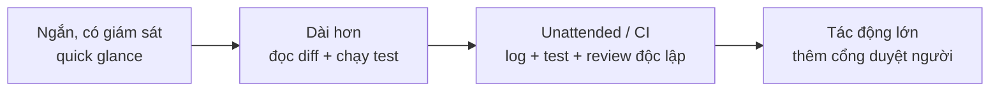
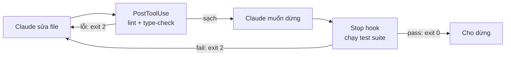

---
tags:
  - claude/tich-hop
  - claude/automation
  - claude/verification
aliases:
  - Proportional Verification
  - Xác minh tương xứng
  - Verify unattended run
up: "[[Tự động hóa Claude Code (Routines & Headless)]]"
---

# Xác minh tương xứng (Proportional Verification)

Nguyên tắc vàng khi chạy **hands-off** (không ai giám sát): khi Claude báo `Done`, đó mới là *lời khai*, chưa phải *bằng chứng*. Phải có bước kiểm tra trước khi `ship` — và bước đó là điểm tựa để dám tin các quy trình tự động.

> [!important] Nguyên tắc
> **Giám sát càng ít → xác minh càng sâu.** Mức kiểm tra tỷ lệ thuận với "độ dài dây thừng" (how much rope) đã cấp cho Claude trong lượt chạy đó.

## Hai thái cực

| | Interactive (có giám sát) | Unattended / CI (không giám sát) |
| --- | --- | --- |
| Bạn thấy gì | Lệnh + suy luận chạy qua màn hình | Không thấy gì trong lúc chạy |
| Cách kiểm tra | Lướt nhanh (quick glance) | **Dựng lại sau sự việc** (reconstruct after the fact) từ log, diff, test, báo cáo |
| Bằng chứng | Quan sát trực tiếp | Artifact để lại: transcript, `git diff`, kết quả test/CI |

## "Dây thừng" gồm những gì?

Rope dài khi kết hợp nhiều yếu tố sau — càng nhiều thì càng phải xác minh kỹ:

- **Quyền rộng** — [[Permission Modes]] lỏng (Auto, Bypass) hoặc `--allowedTools` nhiều.
- **Phạm vi lớn** — sửa nhiều file/repo, có quyền ghi, push, deploy, gọi API ngoài.
- **Lượt chạy dài** — nhiều turn, chạy qua đêm, không có điểm dừng để duyệt.
- **Hậu quả khó đảo ngược** — xóa dữ liệu, gửi email, migrate DB, chạm production.

## Xác minh theo thang rope



## Giữ Auto mode, đừng Bypass — nhưng Auto không thay xác minh

Khi chạy unattended, đừng "tắt hết rào" bằng Bypass Permissions (`--dangerously-skip-permissions`) cho tiện:

| | Bypass Permissions | Auto mode |
| --- | --- | --- |
| Rào cản | Không có | Classifier độc lập rà soát từng hành động |
| Bảo vệ khỏi | Không gì cả | **Danger**: xóa nhầm, `git push --force`, `curl \| sh`, rò rỉ secret, deploy production |
| Không bảo vệ | — | **Correctness**: logic sai, thuật toán sai, bug nghiệp vụ |

- Classifier chỉ trả lời "hành động này có **nguy hiểm** không", không trả lời "code này có **đúng** không" → code sai logic vẫn được cho qua.
- Hệ quả: Auto giúp tránh **thảm họa hệ thống**, còn **verification bar vẫn giữ nguyên** theo độ dài rope. Đừng vì "đã có classifier" mà nới lỏng khâu kiểm thử.
- Phân vai hai lớp: **Auto** giữ hệ thống AN TOÀN (trước mỗi hành động), **Stop Hook + test + review** giữ code CHẠY ĐÚNG (khi báo xong). Chi tiết cơ chế: [[Permission Modes#Giới hạn: Classifier kiểm tra Ý định, không kiểm tra Độ chính xác|Permission Modes]].
- Classifier là một model nên vẫn có thể sai — vẫn dùng branch riêng, sandbox, không đưa secret vào repo.
- Nếu chỉ cần chạy một tập lệnh cố định (CI), **Don't Ask + allowlist** còn chặt hơn Auto; Bypass chỉ chấp nhận trong Docker/VM cách ly hoàn toàn.

## Công cụ để "dựng lại bức tranh"

- **Diff** — `git diff` / PR: Claude đã *thực sự* đổi gì, có file ngoài phạm vi không.
- **Test tự động** — chạy lại độc lập (đừng chỉ tin câu "tests pass" trong báo cáo); kiểm tra Claude không sửa/xóa test cho qua.
- **Log & transcript** — bật `--output-format json` hoặc `stream-json` trong [[Headless Mode (claude -p)]] để lưu lại từng bước; đọc exit code, số turn, chi phí.
- **[[Hooks]]** — `Stop` hook chạy test và chặn nếu fail (Definition of Done tự động); `PreToolUse` chặn lệnh nguy hiểm *trước* khi xảy ra. Nhớ cờ `stop_hook_active` tránh vòng lặp vô hạn.
- **[[Subagents (Tác vụ phụ)]] reviewer** — một agent *khác* (context sạch) rà soát kết quả, tránh tự chấm bài của chính mình.
- **CI & Pull Request** — đẩy thay đổi qua PR, để CI + người review làm cổng cuối ([[Claude Code trong Pull Request (GitHub)]]).
- **Giới hạn & ghi nhận** — `--max-turns`, ngân sách chi phí, timeout; lưu log để kiểm toán.

## Rủi ro thường gặp khi báo "Done"

- Tuyên bố xong nhưng **chưa chạy** thử / chỉ chạy một phần.
- **Sửa test hoặc nới điều kiện** cho test pass thay vì sửa lỗi gốc.
- **Scope creep** — đổi thêm file/việc không được yêu cầu.
- Hoàn thành **một phần** mà không báo rõ chỗ bỏ dở.
- Kết quả đúng "ý định" nhưng sai "độ chính xác" (tương tự giới hạn classifier trong [[Permission Modes]]).

## Bắt đầu bằng diff, không bắt đầu bằng summary

Cạm bẫy phổ biến nhất: summary của Claude đọc rất mạch lạc, thuyết phục nên dễ tin là xong. Nhưng summary là **lời kể**, có thể không nhắc việc Claude lỡ đụng vào file ngoài phạm vi; `git diff` thì không bỏ sót. → `git diff` là **single source of truth**.

Quy trình 2 bước khi Claude báo xong:

1. **`/code-review`** — nhờ Claude rà soát diff một lượt để bắt lỗi tiềm ẩn trước (xem skill `code-review`; có thể chọn mức effort). Đây là lớp lọc sơ bộ, không thay bước 2.
2. **Tự đọc `git diff`** (đặt mắt của chính mình lên diff):
   - Đọc **file nằm trong kế hoạch** trước.
   - Sau đó **săn file bất thường ngoài kế hoạch** (config, lockfile, CI, `.env`, file test bị sửa/xóa...).

```bash
git status                  # file nào đã đổi / file mới (untracked)
git diff --stat             # tổng quan: file nào, bao nhiêu dòng
git diff -- path/to/file    # đọc chi tiết từng file
git diff --name-only | grep -v -f planned-files.txt   # lọc file ngoài kế hoạch
```

- **Có kế hoạch từ trước** ([[Plan Mode]]) mới có "danh sách file dự kiến" để đối chiếu — một lý do nữa nên Plan trước khi giao việc dài.
- Đừng quên **file mới chưa track** (`git status`): `git diff` mặc định không hiện chúng.
- Dấu hiệu đáng ngờ: diff lớn hơn nhiều so với yêu cầu, đổi format hàng loạt, sửa test cho khớp code, thêm dependency, đụng file cấu hình/secret.
- Gặp file lạ: hỏi Claude vì sao đổi hoặc `git checkout -- <file>` để hoàn tác phần ngoài phạm vi (xem [[Claude Code#Rewind — quay lại khi Claude đi sai hướng|Rewind]]).

## Test là cổng chặn, không phải lời hứa (a gate, not a promise)

Trong summary Claude có thể nói "đã chạy test, tất cả pass" mà thực tế chưa chạy hoặc bỏ qua test đỏ. Đừng dựa vào lời nói — dùng [[Hooks]] để **ép chạy test bằng cơ chế kỹ thuật**, không thể bypass, chạy 100% mỗi lượt dù bạn có nhớ dặn hay không.



| Hook                                               | Khi chạy                  | Việc làm                                                  | Khi lỗi                                                                                                  |
| -------------------------------------------------- | ------------------------- | --------------------------------------------------------- | -------------------------------------------------------------------------------------------------------- |
| **PostToolUse** (matcher `Edit\|MultiEdit\|Write`) | Ngay sau mỗi lần sửa file | Linter + type-checker (ESLint, `tsc --noEmit`, `mypy`...) | `exit 2` → `stderr` đưa lại Claude để sửa ngay (tool đã chạy xong nên không hoàn tác được, chỉ phản hồi) |
| **Stop**                                           | Khi Claude tuyên bố xong  | Chạy toàn bộ test suite                                   | `exit 2` → **từ chối cho dừng**, `stderr` = "chưa xong, sửa tiếp"                                        |

Claude nhận log lỗi → tự đọc, tự sửa, lặp đến khi pass — không cần bạn can thiệp.

Script `Stop` hook mẫu (minh họa ý tưởng; kiểm tra tên field/cú pháp theo `/hooks` và docs bản đang dùng):

```bash
#!/usr/bin/env bash
# .claude/hooks/run-tests.sh
input=$(cat)
# Chống vòng lặp vô hạn: nếu đang bị ép tiếp tục từ lần Stop trước thì cho qua
if [ "$(echo "$input" | jq -r '.stop_hook_active')" = "true" ]; then exit 0; fi

cd "$CLAUDE_PROJECT_DIR" || exit 2
if ! output=$(npm test 2>&1); then
  echo "Test fail, sửa tiếp:" >&2
  echo "$output" | tail -n 50 >&2   # chỉ gửi đoạn cuối cho đỡ tốn context
  exit 2                            # KHÔNG dùng exit 1 — sẽ fail-open
fi
exit 0
```

```json
{ "hooks": { "Stop": [ { "hooks": [
  { "type": "command", "command": "\"$CLAUDE_PROJECT_DIR\"/.claude/hooks/run-tests.sh" }
] } ] } }
```

> [!warning] Gate chỉ mạnh bằng bài test đằng sau nó
>
> - **`exit 1` không chặn** — script crash/`set -e` rơi về `exit 1` là fail-open; dùng `trap 'exit 2' ERR` (xem [[Hooks#Exit Code chi tiết (áp dụng cho mọi event)|Exit Code chi tiết]]).
> - **Chống vòng lặp vô hạn** — kiểm tra `stop_hook_active`; thêm giới hạn lượt/chi phí. Nhưng cờ này cho qua lần lặp thứ hai, nên test vẫn đỏ có thể lọt → vẫn phải đọc kết quả cuối.
> - **Claude có thể "lách" gate** bằng cách sửa/xóa test hoặc skip test → soi `git diff` phần test; cân nhắc `deny` việc sửa thư mục test hoặc file hook/`settings.json` bằng `PreToolUse`.
> - **Test yếu = cổng giả** — suite thiếu bao phủ thì pass vẫn không chứng minh đúng nghiệp vụ.
> - **Giữ nhanh** — chạy test nhanh/bộ con (smoke/unit) ở `Stop`; suite nặng để CI. Đặt timeout cho script.
> - **Cấu hình ở `.claude/settings.json`** commit vào repo để mọi môi trường (kể cả CI chạy [[Headless Mode (claude -p)]]) dùng chung; kiểm tra hook thực sự được nạp trong chế độ chạy của bạn, đừng giả định.

## Ý kiến thứ hai độc lập (cold second opinion)

**Vấn đề** — agent chính tự hợp lý hóa lỗi của mình: sau nhiều bước suy luận, nó chịu ảnh hưởng của chính context history và có thể tự thuyết phục rằng một workaround/hack là "chấp nhận được" → mù trước sơ hở do mình tạo ra. Người viết code luôn có xu hướng bào chữa; người review độc lập mới thấy vết nứt.

**Giải pháp** — để một reviewer **context sạch** xem diff:

| Đặc điểm reviewer | Ý nghĩa |
| --- | --- |
| Không có ký ức cũ | Không biết agent chính đã vật lộn thế nào → không bị "neo" vào lập luận cũ |
| Không có lợi ích gắn với cách làm | Không cần bảo vệ giải pháp |
| Nhìn code thực tế | Đánh giá `diff` theo tiêu chuẩn kỹ thuật thuần túy; bắt lỗi logic, edge case, code thừa |

Hai cách thực hiện:

- **[[Subagents (Tác vụ phụ)]]** — gọi subagent reviewer ngay trong phiên (vd. trước khi push, xem [[Explore, Plan, Code, Commit]]); context riêng, chỉ trả về bản tóm tắt phát hiện, không làm phình context chính. Có thể tự tạo subagent "reviewer" với prompt/quyền chỉ đọc.
- **Phiên mới hoàn toàn (fresh session)** — mở `claude` mới (hoặc `claude -p` trong CI) rồi chạy `/code-review` trên branch/PR; cách cô lập mạnh nhất vì không chia sẻ gì với phiên làm việc.

```bash
# Reviewer độc lập: phiên mới, chỉ đọc, không thấy lịch sử phiên làm việc
claude -p "Review git diff main...HEAD: tìm bug logic, edge case, workaround, file ngoài phạm vi" \
  --allowedTools "Read" "Grep" "Bash(git diff:*)" "Bash(git log:*)"
```

> [!tip] Mẹo để review thật sự "lạnh"
>
> - **Đừng đưa summary/lý lẽ của agent chính cho reviewer** — chỉ đưa diff + yêu cầu gốc, nếu không sẽ truyền luôn thiên kiến.
> - Prompt reviewer theo hướng **tìm lỗi** ("tìm điểm sai, workaround, test bị nới") thay vì "xác nhận có ổn không".
> - Dùng quyền **chỉ đọc** để reviewer không tự sửa mà lẫn vai.
> - Có thể dùng model khác/mạnh hơn cho reviewer để đa dạng góc nhìn.
> - Reviewer cũng là AI nên có thể bỏ sót và vẫn có thể "đồng ý" theo ngôn ngữ của diff — đây là một lớp thêm vào, **không thay** việc tự đọc diff và test.

## Mô hình 4 lớp cho lượt chạy unattended

| Lớp | Cơ chế | Công dụng |
| --- | --- | --- |
| 1. Trực quan | Tự đọc `git diff`, không chỉ đọc summary | Bắt file bị sửa ngoài kế hoạch |
| 2. Tự động | Giữ Auto mode (classifier) | Chặn hành động nguy hại cho hệ thống ([[Permission Modes]]) |
| 3. Cổng chặn | [[Hooks]] + `exit 2` | Ép tự sửa khi test/lint lỗi, không cho dừng sớm |
| 4. Độc lập | Subagent / fresh session review | Loại thiên vị và lập luận ngụy biện của agent chính |

Mỗi lớp bắt một loại lỗi khác nhau (phạm vi, nguy hiểm, tính đúng cơ học, thiên kiến) nên **bổ trợ chứ không thay thế nhau**; số lớp cần bật tăng theo độ dài rope.

## Checklist nhanh sau một lượt unattended

1. Đọc báo cáo cuối + exit code / trạng thái job.
2. Xem `git status` + `git diff --stat` rồi diff chi tiết (file trong kế hoạch trước, file ngoài kế hoạch sau).
3. Chạy lại test/build/lint độc lập.
4. Soát log tìm lỗi bị bỏ qua, lệnh bị từ chối, retry bất thường.
5. Với việc tác động lớn: duyệt tay hoặc chạy trước trên nhánh/sandbox.

> [!tip] Hệ quả thiết kế
> Hãy **thiết kế cho việc xác minh ngay từ đầu**: yêu cầu Claude để lại bằng chứng (test, log, tóm tắt thay đổi), giữ rope ngắn bằng quyền tối thiểu và sandbox, rồi mới nới dần khi đã có track record.

## Liên kết

- Thuộc: [[Tự động hóa Claude Code (Routines & Headless)]]
- Cùng nhóm: [[Routines]], [[Headless Mode (claude -p)]], [[Agent SDK]], [[Claude Code trong Pull Request (GitHub)]]
- Liên quan: [[Hooks]], [[Permission Modes]], [[Subagents (Tác vụ phụ)]], [[Explore, Plan, Code, Commit]]
