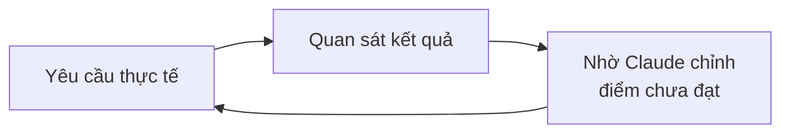
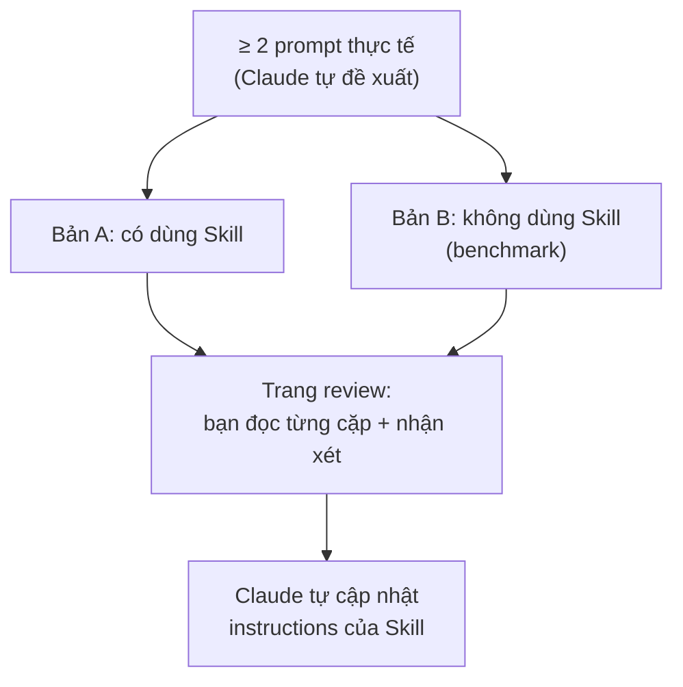
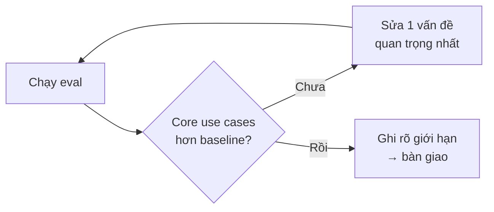

---
tags:
  - claude/cowork
aliases:
  - Evals
  - Evaluations
  - skill-creator
  - A/B Testing Skill
  - Đánh giá Skill
  - Author's Blind Spot
up: "[[Claude Cowork]]"
---

# Đánh giá Skill & Plugin bằng Evals

Khi đóng gói chỉ dẫn thành [[Skills|Skill]] hoặc [[Plugins|Plugin]], bạn không còn viết prompt cho riêng mình mà đang làm ra một **sản phẩm cho đồng nghiệp dùng** — nên phải **chạy thử (test drive)** trước khi bàn giao, giống như kiểm tra một file Excel tính toán hay template trước khi gửi đi.

## Đốm mù của tác giả (Author's Blind Spot)

| | Tác giả tự dùng | Đồng nghiệp dùng |
| --- | --- | --- |
| Cách hỏi | Biết chính xác phải hỏi thế nào | Dùng **từ ngữ khác** |
| Đầu vào | Biết đưa đúng file, đúng định dạng | Dữ liệu **lệch một chút** so với thiết kế |
| Khi lỗi | Tự biết cách "lách" hoặc sửa câu lệnh | Va phải **edge case**, không hiểu vì sao sai |

- **Edge case:** tình huống có thật nhưng ít gặp, nằm sát ranh giới thiết kế của Skill.
- **Hậu quả:** Skill chệch hướng/thất bại đúng ở những chỗ tác giả không bao giờ gặp, nên chỉ tự dùng thì không phát hiện được.

## Eval là gì

- **Eval = một lần dùng thử thực tế:** đưa vào một yêu cầu thật → xem kết quả → yêu cầu Claude sửa những điểm chưa ưng ý. Lặp lại đến khi đạt.
- **Không cần lập trình:** không phải viết code hay kịch bản tự động hoá.
- **Thước đo là chuyên môn của bạn:** kết quả đã đủ chất lượng để bạn **tự tin gắn tên mình** vào chưa.

## Eval tự động với `skill-creator`

Khi dựng Skill bằng công cụ `skill-creator`, hệ thống eval được tích hợp sẵn và chạy kiểu **so sánh đối chứng (A/B)**:

- **Bản B là mốc so sánh:** câu hỏi không chỉ là "Skill có chạy được không" mà là "Skill có tốt hơn hẳn việc Claude trả lời tự do không" — nếu A không hơn B thì Skill chưa đáng tồn tại.
- **Feedback bằng ngôn ngữ tự nhiên** ngay trên trang review, xoay quanh 2 câu hỏi:
  - *Kết quả từ Skill có phải thứ bạn muốn dùng không?* → nếu có, nói rõ **vì sao tốt hơn** ("đúng định dạng", "đủ các bước cần thiết") để Skill giữ điểm mạnh đó.
  - *Nếu chưa, thiếu/sai ở đâu?* → góp ý **cụ thể**: "giọng văn quá trang trọng", "thiếu phần tóm tắt cho lãnh đạo". Câu chung chung như "chưa đúng lắm" không giúp được gì.
- **Revision tự động:** sau khi gửi feedback, Claude dựa vào nhận xét để **viết lại instructions** (`SKILL.md`) — rồi có thể chạy vòng eval mới.

## Lặp lại để hoàn thiện (Iterate)

- **Vòng lặp dựa trên feedback:** nhận xét của bạn giúp Claude viết lại instructions, chỉnh ví dụ mẫu và thắt chặt yêu cầu trong Skill → chạy lại eval → kiểm tra đã cải thiện đúng ý chưa.
- **Mỗi lần sửa một điểm (one thing at a time):** Skill nhiều lỗi cùng lúc (vd vừa dài dòng, vừa thiếu một mục quan trọng) → chọn **1 vấn đề quan trọng nhất**, sửa, chạy lại eval, rồi mới sang lỗi kế. Lý do: biết chính xác thay đổi nào thực sự "move the needle"; sửa dồn thì không biết cái nào có tác dụng.

### Tiêu chuẩn để bàn giao (The Bar for Shipping)

Không cần kiểm thử hoàn hảo 100% mới dùng được. Đủ khi:

- **Core use cases** cho kết quả tốt hơn rõ rệt so với baseline (Claude trả lời mặc định, tức bản B).
- Bạn đã **ghi rõ các trường hợp Skill chưa hỗ trợ**, để người dùng biết ranh giới.

Hầu hết Skill sẵn sàng sau **1–2 vòng** tinh chỉnh. Nếu lần chạy đầu đã tốt và đúng ý thì chốt luôn — eval là công cụ củng cố niềm tin vào chất lượng, không phải thủ tục hình thức.

## Nên thử những gì

Chọn ca thử nhắm thẳng vào ba điểm đồng nghiệp sẽ khác bạn:

- **Cách diễn đạt khác** — cùng một việc nhưng hỏi bằng từ ngữ khác, ngắn hơn, thiếu ngữ cảnh hơn; kiểm tra Skill có còn tự kích hoạt không (phụ thuộc `description`, xem [[Skills#Lazy loading — tối ưu context window|lazy loading]]).
- **Đầu vào khác** — file thiếu cột, sai định dạng, dài/ngắn bất thường.
- **Edge case** — ca hiếm nhưng có thật của nghiệp vụ.

Dùng **tài liệu thật** thay vì ví dụ tự bịa, và thử lại các ca cũ sau mỗi lần sửa Skill để chắc không làm hỏng chỗ đã chạy đúng.

> Phân biệt: eval ở đây là dùng thử thủ công dựa trên phán đoán chuyên môn. Bộ eval 20–30 mẫu có tiêu chí đạt/không đạt để chọn model là việc khác — xem [[Model Tiers#Quy trình đánh giá & chọn model (Model Evaluation)|Model Evaluation]].

## Liên kết

- Thuộc nhóm: [[Claude Cowork]]
- Khái niệm nền: [[Skills]], [[Plugins]]
- Bước trước đó: [[Tự xây dựng Plugin (Cowork)]], [[Cài đặt & Tùy biến Plugins (Cowork)]]
- Bước tiếp theo: [[Phân phối Plugin cho Tổ chức (Distribution)]]
- Xem thêm: [[Nghiệm thu Sản phẩm (Review the Deliverable)]]
