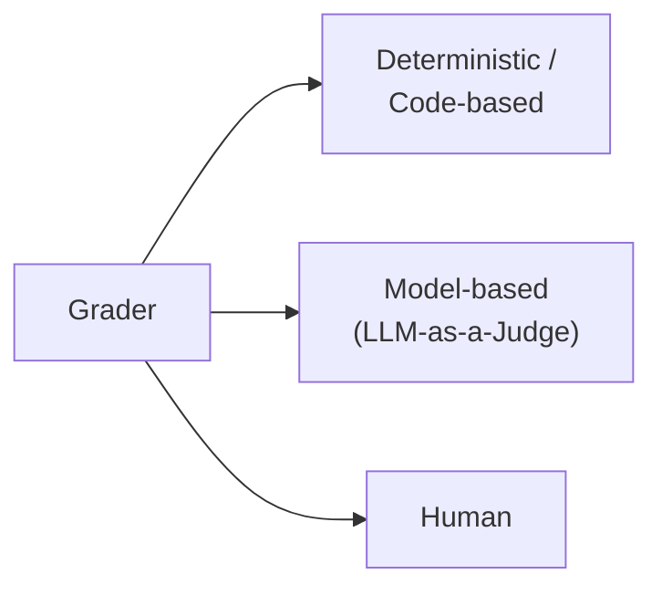
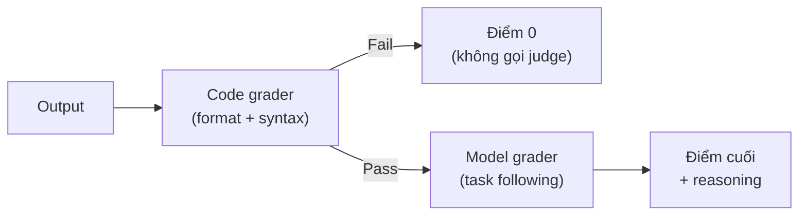
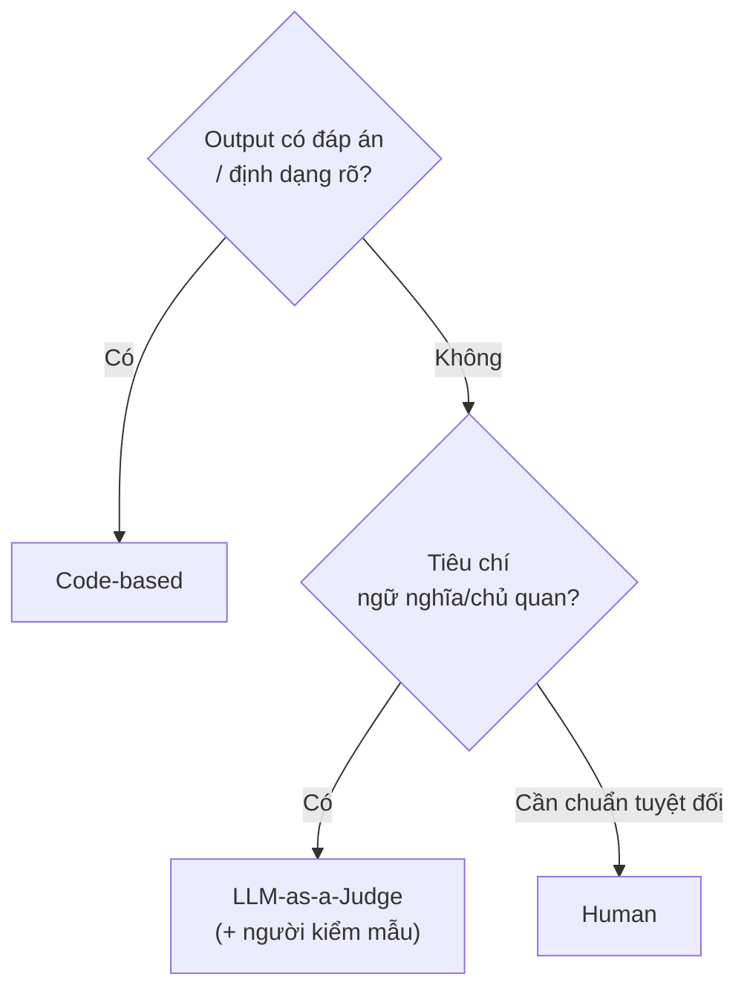

---
tags:
  - claude/nen-tang
  - llm/eval
  - llm/grader
aliases:
  - Grader
  - Hệ thống chấm điểm
  - LLM-as-a-Judge
  - LLM Judge
up: "[[Prompt Evaluation (Đánh giá câu lệnh)]]"
---

# Grader (Hệ thống chấm điểm)

**Grader** là "bộ kiểm định chất lượng tự động" trong [[Prompt Evaluation (Đánh giá câu lệnh)]]: nhận output của model, trả về **điểm + lý do**. Nhờ nó, không phải đọc tay hàng trăm output mỗi lần sửa prompt hay đổi model.

## Cấu trúc một grader

| | Thành phần | Ghi chú |
| --- | --- | --- |
| **Input** | `Prompt` gốc | Đề bài/yêu cầu |
| | `Model Output` | Câu trả lời cần chấm |
| | `Ground Truth / Reference` *(tùy chọn)* | Đáp án chuẩn hoặc dữ liệu tham chiếu |
| **Output** | `Score` | Thang 1–10 hoặc nhị phân 0/1 |
| | `Reasoning` | Lý do cho điểm — **rất quan trọng để debug** (bước 5 của quy trình) |

## Các loại grader



### A. Deterministic / Heuristic (code-based)

Code kiểm tra theo luật cứng → kết quả **lặp lại được, rẻ, nhanh**. **Ưu tiên dùng khi có thể.**

- **Format validation:** JSON hợp lệ, đúng schema, parse được (`json.loads`, `ast.parse`, `re.compile`).
- **Keyword / Regex match:** có từ khóa bắt buộc, không có từ cấm, độ dài trong khoảng cho phép.
- **Output length:** quá ngắn (< 100 từ) hoặc quá dài so với giới hạn.
- **Readability score:** công thức toán như Flesch-Kincaid đo độ dễ đọc của văn bản.
- **Exact match / so khớp đáp án:** phân loại, trích xuất, trắc nghiệm.
- **Code execution:** chạy code sinh ra trong **sandbox**, kiểm tra pass unit test (ví dụ [[Prompt Evaluation cho sinh code AWS]]: linter, security scan, moto/LocalStack).

#### Code-based grading cho bài toán sinh code

Với code do LLM sinh, "đọc thấy hợp lý" (semantic plausibility) **chưa đủ**: chỉ một lỗi cú pháp (thiếu ngoặc, sai thụt lề) hoặc sai format (kèm lời giải thích/code fence thay vì code thô) là output **vô dụng** khi đưa vào pipeline tự động. Code grader là **"cổng kiểm đầu tiên"** — nhanh, rẻ, đúng/sai tuyệt đối — chạy trước khi tốn tiền cho model grader hay người.

| Kiểm tra | Câu hỏi | Công cụ |
| --- | --- | --- |
| **Valid syntax** | Biên dịch/parse được không? | `ast.parse` / `py_compile` (Python), `json.loads` (JSON), `re.compile` (Regex), `node --check`, `tsc --noEmit`, `bash -n`, `terraform validate`, `cfn-lint` |
| **Correct format** | Đúng cấu trúc yêu cầu, không rác? | So output với phần parse được; bắt code fence ` ``` `, lời dẫn ("Here is…"), text thừa trước/sau |

**Giới hạn — pass cú pháp ≠ code đúng:**

- `ast.parse` chỉ kiểm tra **cú pháp**, không bắt: tên biến/hàm chưa định nghĩa, import sai, API không tồn tại, lỗi runtime, logic sai. Muốn bắt thêm → lint (`ruff`, `mypy`), rồi **chạy unit test trong sandbox** (xem bảng lớp metrics ở [[Prompt Evaluation cho sinh code AWS]]).
- `json.loads` mặc định chấp nhận `NaN`/`Infinity` và key trùng; JSON hợp lệ vẫn có thể sai **schema** → validate thêm bằng JSON Schema.
- `re.compile` chỉ chứng minh pattern hợp lệ, không chứng minh khớp đúng chuỗi → test với tập chuỗi khớp/không khớp (và cẩn thận catastrophic backtracking).
- Không dùng `exec`/`eval` trực tiếp để "thử chạy" output của model ngoài sandbox.

**Cách dùng đúng chỗ:** kết quả nhị phân (pass/fail + `reason`) → làm **gate** của pipeline hybrid (xem mục *Hybrid* bên dưới); tách riêng điểm `format` và `syntax` để biết prompt yếu ở đâu; luôn chấm **output gốc** chưa qua post-processing.

**Helper functions (điểm nhị phân 10/0):** mỗi hàm nhận text, trả `10` (hợp lệ) hoặc `0` (lỗi) để cùng thang điểm 1–10 với model grader.

```python
import ast, json, re

def validate_json(text: str) -> int:
    try:
        json.loads(text.strip())
        return 10
    except json.JSONDecodeError:
        return 0

def validate_python(text: str) -> int:
    try:
        ast.parse(text.strip())   # chỉ parse, KHÔNG thực thi code
        return 10
    except (SyntaxError, ValueError, RecursionError, MemoryError):
        return 0

def validate_regex(text: str) -> int:
    try:
        re.compile(text.strip())
        return 10
    except re.error:
        return 0
```

- **`try/except` = defensive programming:** output rác đến đâu pipeline cũng không crash, chỉ ghi 0.
- **`ast.parse` an toàn vì không execute** — kiểm tra ngữ pháp mà không sợ mã độc. Nhưng vẫn có thể ném `ValueError` (chuỗi có null byte), `RecursionError`/`MemoryError` (code lồng quá sâu/quá lớn) → bắt rộng hơn `SyntaxError`.
- **`.strip()`** bỏ khoảng trắng/xuống dòng đầu-cuối; **không** dùng để gọt code fence hay lời dẫn — làm vậy sẽ che lỗi format (cần chấm output gốc).
- **Binary scoring "trá hình":** thang chung là 1–10 nhưng cú pháp chỉ có 10 hoặc 0 vì không có "đúng một nửa".
- Bản `check_format()` trả `{pass, reason}` ở [[Prompt Evaluation cho sinh code AWS]] hợp để debug hơn (có `reason`); bản 10/0 hợp khi cần cộng/trung bình với điểm model grader. Chọn một kiểu cho cả pipeline, tránh trộn.

### B. Model-based (LLM-as-a-Judge)

Dùng một LLM mạnh làm trọng tài cho tiêu chí **chủ quan/ngữ nghĩa** (đúng ý, đủ ý, văn phong, hallucination). Judge nhận **rubric** rồi chấm:

| Mức điểm | Mô tả (ví dụ rubric) |
| --- | --- |
| 9–10 | Đầy đủ ý, lập luận logic, giọng chuyên nghiệp |
| 5–6 | Đúng một phần, thiếu sót hoặc dài dòng |
| 1–2 | Sai lệch thông tin hoặc bịa đặt (hallucination) |

**Tiêu chí thường giao cho judge:** chất lượng câu trả lời (đúng trọng tâm, logic), **instruction following** (làm đúng mọi yêu cầu phức tạp trong prompt gốc), độ đầy đủ & hữu ích, **safety** (nội dung độc hại, hallucination, vi phạm chính sách).

**3 kiểu chấm của judge:**

| Kiểu | Cách làm | Hợp với |
| --- | --- | --- |
| **Pointwise** | Chấm từng output độc lập theo rubric | Đo chất lượng tuyệt đối, theo dõi theo thời gian |
| **Reference-based** | So output với đáp án chuẩn/ground truth | Có đáp án nhưng nhiều cách diễn đạt đúng |
| **Pairwise** | Cho 2 output (A/B), chọn bản tốt hơn | So sánh 2 phiên bản prompt/model; ổn định hơn thang điểm tuyệt đối |

**Prompt mẫu cho judge** (trả JSON để parse tự động, xem [[Structured Output (Ép đầu ra JSON thuần)]]):

```text
You are a strict grader. Evaluate the answer against the rubric.
<question>{question}</question>
<answer>{output}</answer>
<rubric>
- Factually correct (no hallucination)
- Covers all key steps
- Professional tone
</rubric>
First write brief reasoning, then give an integer score 1-10.
Return ONLY JSON: {"reasoning": string, "score": integer}
```

- **Reasoning trước, score sau** — buộc model suy luận trước khi chốt điểm → điểm ổn định hơn.
- **Rubric cụ thể, đo được** ("nêu đủ 3 rủi ro chính") thay vì mơ hồ ("viết hay").
- **Một judge chỉ chấm một tiêu chí** nếu cần độ chính xác cao (độ đúng, văn phong... tách riêng) rồi gộp điểm.
- **Nên dùng thang nhỏ/nhị phân** (pass/fail hoặc 1–5) — thang 1–10 dao động nhiều hơn, khó phân biệt 6 với 7.

### C. Human

Người chấm (dev, chuyên gia domain, người dùng thử) qua giao diện review — chính xác nhưng chậm, đắt. Dùng để **hiệu chuẩn (calibrate)** judge và soi mẫu, không dùng chấm toàn bộ.

Mạnh ở tiêu chí khó đo bằng máy: cảm nhận **văn phong/độ mượt**, **độ sâu vs súc tích** (sâu sắc hay lan man), **độ liên quan** với nhu cầu thật của người dùng. Được coi là **ground truth** của chất lượng, nhưng không scale tới hàng nghìn/triệu case.

## So sánh nhanh 3 loại

| Tiêu chí | Code | Model (LLM judge) | Human |
| --- | --- | --- | --- |
| **Tốc độ** | Gần như tức thì | Vài giây / API call | Rất chậm (giờ → ngày) |
| **Chi phí** | Gần như 0 (không tốn token) | Trung bình (token API) | Rất cao (nhân lực) |
| **Hiểu ngữ nghĩa** | Thấp — chỉ cấu trúc/luật | Rất cao | Tuyệt đối |
| **Tính lặp lại** | 100% (deterministic) | Có sai số giữa các lần chạy | Phụ thuộc người chấm (cần nhiều người, đo đồng thuận) |
| **Scale** | Hàng triệu case | Tốt, chạy theo lô (batch) | Kém |
| **Dùng khi** | Luật rõ, kiểm tra cấu trúc | Tiêu chí chủ quan/ngữ nghĩa | Hiệu chuẩn, kiểm mẫu, quyết định cuối |

## Thiên vị & hạn chế của LLM judge

| Thiên vị | Biểu hiện | Cách giảm |
| --- | --- | --- |
| **Self-preference** | Judge ưu ái output do cùng họ model sinh ra | Dùng model/họ **khác** làm judge |
| **Verbosity bias** | Cho điểm cao câu dài dòng | Rubric nêu rõ "ngắn gọn vẫn đủ ý = điểm cao" |
| **Position bias** (pairwise) | Thiên vị đáp án đứng trước | Chạy 2 lần **đảo thứ tự A/B**, chỉ tính khi nhất quán |
| **Dao động giữa các lần chạy** | Cùng input, điểm khác nhau | `temperature` thấp ([[Temperature]]), chạy nhiều lần lấy trung bình |
| **Hào phóng quá mức** | Hầu hết đều 8–9 | Rubric có ví dụ mốc điểm thấp (few-shot), yêu cầu "strict" |

**Hiệu chuẩn judge:** lấy ~20–50 case, so điểm judge với điểm người chấm (tỷ lệ đồng thuận hoặc Cohen's kappa). Lệch nhiều → sửa rubric trước khi tin điểm của judge.

## Nguyên tắc: tiêu chí trước, grader sau

Đừng chọn công cụ chấm trước rồi mới nghĩ tiêu chí. Làm theo thứ tự: **(1) liệt kê tiêu chí cần đo → (2) với mỗi tiêu chí, chọn grader rẻ nhất mà đủ đo được nó** → (3) ghép lại thành pipeline hybrid.

Ví dụ prompt **sinh code** (3 tiêu chí):

| Tiêu chí | Ý nghĩa | Grader | Vì sao |
| --- | --- | --- | --- |
| **Format** | Chỉ trả code (Python/JSON/Regex), không giải thích thừa | **Code** | Đúng/sai tuyệt đối: output parse thẳng được, không có code fence/lời dẫn |
| **Valid syntax** | Code đúng cú pháp, không lỗi biên dịch | **Code** | `ast.parse()`, `json.loads()`, `re.compile()` — nhanh, chính xác 100%, 0 token |
| **Task following** | Code giải đúng bài toán người dùng đặt ra | **Model** | Cần hiểu ngữ nghĩa/ý định; code thuần khó biết logic có "đúng ý" không |

- **Lưu ý:** nếu task có đáp án kiểm chứng được (unit test, input → output mong đợi), thì **Task following** cũng có thể chấm bằng code (chạy test trong sandbox) — chính xác hơn judge. Chỉ dùng LLM judge khi không viết nổi test, hoặc để bổ sung các mặt mềm (chất lượng, bảo mật, dễ đọc).
- Bản đầy đủ áp dụng cho code AWS: [[Prompt Evaluation cho sinh code AWS]].

### Hybrid: code lọc trước, model chấm sau



- **Tiết kiệm chi phí:** output hỏng cú pháp bị loại sớm, không tốn token judge.
- **Chính xác hơn:** judge chỉ phải đánh giá những output đã hợp lệ, không bị phân tâm bởi lỗi format; điểm tổng hợp có thể tách theo tiêu chí (format / syntax / task) để biết prompt yếu ở đâu.
- **Mỗi grader một tiêu chí** — báo cáo điểm theo từng tiêu chí thay vì gộp một con số, vì điểm gộp che mất nguyên nhân thật của lỗi.

#### Model grader cho *Task following* (sinh code)

Judge chỉ nhận output **đã qua gate** code grader, và chỉ chấm **một tiêu chí**: code có giải đúng yêu cầu không (không chấm format/cú pháp nữa).

```text
You are a strict code reviewer. Judge ONLY whether the code solves the task.
Ignore formatting and style.
<task>{task}</task>
<code>{output}</code>
<checklist>
- Implements every requirement in the task
- Handles the stated edge cases
- Does not invent APIs or add unrequested behavior
</checklist>
Write brief reasoning first, then an integer score 1-5.
Return ONLY JSON: {"reasoning": string, "score": integer}
```

**Gộp điểm cuối:** giữ điểm từng tiêu chí, đừng chỉ báo một con số.

| Tiêu chí | Grader | Kiểu điểm |
| --- | --- | --- |
| Format | Code | 0/1 (gate) |
| Valid syntax | Code | 0/1 (gate) |
| Task following | Model | 1–5, chỉ chấm khi 2 gate trên pass |

- Công thức đơn giản: nếu format hoặc syntax fail → điểm cuối = 0; ngược lại điểm cuối = điểm Task following (có thể quy về 0–1).
- Báo cáo **tỷ lệ fail theo từng gate** (vd. 12% fail format, 3% fail syntax) → biết ngay nên sửa prompt (ép định dạng) hay sửa lý luận (task).
- Task có test chạy được → thay judge bằng unit test trong sandbox, chính xác hơn.

**Combining scores — 3 cách gộp:**

| Cách | Công thức | Hợp khi |
| --- | --- | --- |
| **Trung bình đơn giản** (điểm khởi đầu) | `(model_score + syntax_score) / 2` | Muốn trọng số bằng nhau giữa đúng kỹ thuật (`syntax_score` 0/10) và chất lượng nội dung (`model_score` 1–10) |
| **Trọng số** | `w1*model_score + w2*syntax_score` (`w1 + w2 = 1`) | Ưu tiên khác nhau: cần ngữ nghĩa/ý tưởng → tăng `w1`; cần chắc chắn chạy được → tăng `w2` |
| **Gate (nhân/lọc)** | `syntax_score == 0 → 0`, ngược lại `model_score` | CI/CD, code đưa thẳng vào hệ thống: sai cú pháp là bỏ |

```python
def combine(model_score: float, syntax_score: float, w_model: float = 0.5) -> float:
    return w_model * model_score + (1 - w_model) * syntax_score

def combine_gated(model_score: float, syntax_score: float) -> float:
    return 0 if syntax_score == 0 else model_score
```

- **Cảnh báo trung bình đơn giản:** code sai cú pháp (`syntax = 0`) nhưng judge cho `model_score = 9` vẫn ra **4.5** — nhìn như "tạm được" dù code vô dụng. Nếu output phải chạy được, dùng gate hoặc đẩy `w_model` thấp.
- **Judge nên chỉ thấy output đã qua syntax** (hybrid ở trên) thì `model_score` mới đáng tin; nếu vẫn chấm cả output hỏng, hãy coi điểm đó là nhiễu.
- Trọng số là **quyết định sản phẩm**, không phải hằng số: chốt cùng version prompt/dataset và ghi lại, đổi trọng số giữa các lần chạy là mất khả năng so sánh. Luôn giữ **điểm thành phần** song song với điểm tổng.

## Chọn grader nào?



**Thực tế hay kết hợp (gate):** code-based chấm trước (format hợp lệ?) → pass mới đưa sang LLM judge → human kiểm mẫu. Tiết kiệm chi phí judge vì output hỏng format bị loại sớm.

## Vai trò trong Prompt Engineering

- **"CI/CD cho prompt":** như unit test cho code — chạy test suite mỗi lần đổi prompt/model (công cụ: Promptfoo, Braintrust, LangSmith, DeepEval — xem mục Công cụ ở [[Prompt Evaluation (Đánh giá câu lệnh)]]).
- **Phát hiện regression:** tối ưu một chỗ làm tốt hơn ở case này nhưng tệ đi ở case khác → điểm theo từng case lộ ra ngay.
- **Dẫn hướng tối ưu tự động:** hệ thống tối ưu prompt dựa vào score của grader để chọn hướng cải thiện.
- **Chọn model theo chi phí:** judge thường cần model mạnh, nhưng việc sinh output có thể thử model rẻ hơn ([[Model Tiers]]) và dùng grader biết chắc chất lượng có tụt không.

## Lưu ý

- **Grader cũng phải được kiểm thử** — grader sai thì mọi điểm số đều ảo ("điểm cao" từ grader dễ dãi vẫn là ảo giác an toàn).
- **Điểm trung bình che mất case tệ** — luôn xem điểm + reasoning từng case thất bại.
- **Chống reward hacking:** khi tối ưu prompt theo điểm grader, prompt có thể "lách" rubric (ví dụ viết dài cho điểm cao) thay vì tốt thật → giữ tập hold-out và kiểm mẫu bằng người.
- **Chi phí:** mỗi case chấm bằng judge = thêm 1 lần gọi API; Batch API giúp giảm giá khi không cần kết quả ngay.

## Liên kết

- Thuộc nhóm: [[Prompt Evaluation (Đánh giá câu lệnh)]] → [[Claude Platform]]
- Ví dụ áp dụng: [[Prompt Evaluation cho sinh code AWS]]
- Đầu ra có cấu trúc cho judge: [[Structured Output (Ép đầu ra JSON thuần)]]
- Ổn định điểm: [[Temperature]]
- Mức Skill/Plugin: [[Đánh giá Skill & Plugin bằng Evals]]
