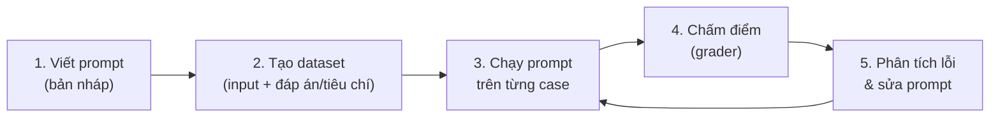

---
tags:
  - claude/nen-tang
  - llm/prompt
  - llm/eval
aliases:
  - Prompt Evaluation
  - Prompt Eval
  - Đánh giá câu lệnh
  - LLM Evals
up: "[[Claude Platform]]"
---

# Prompt Evaluation (Đánh giá câu lệnh)

Quá trình **đo lường định lượng** một prompt hoạt động tốt đến đâu trên một **tập dữ liệu thử nghiệm (test set)** đủ lớn. Đây là bước chuyển từ "chat thử nghiệm với AI" sang **xây dựng ứng dụng AI production-ready**.

## Prompt Engineering vs Prompt Evaluation

| | [[Prompt Engineering]] (Xây dựng) | Prompt Evaluation (Đo lường) |
| --- | --- | --- |
| Hành động | Viết, tinh chỉnh, tối ưu prompt | Kiểm thử, chấm điểm prompt |
| Câu hỏi cốt lõi | *"Ra lệnh thế nào để Claude làm đúng việc?"* | *"Prompt này đúng ở mức bao nhiêu % trên toàn hệ thống?"* |
| Mục tiêu | Đạt kết quả mong muốn | Đảm bảo ổn định, **độ tin cậy** |
| Tương đương code | Viết source code | Viết **unit / integration test** |
| Hình thức | Thử thủ công, chỉnh cú pháp | Tự động hóa qua code / test suite |
| Kết quả | Một bản prompt hoàn chỉnh | Số liệu báo cáo (accuracy %, tỷ lệ lỗi %) |

**Bộ công cụ của Prompt Engineering** (chi tiết ở [[Prompt Engineering]]): *multishot prompting* (ví dụ mẫu input → output ngay trong prompt), *XML tags* (`<context>`, `<rules>`, `<input>` để tách ngữ cảnh/quy tắc/dữ liệu), cùng role, [[Structured Output (Ép đầu ra JSON thuần)#Prefill + Stop Sequences (cách 2 chi tiết)|prefill và stop sequences]].

> Prompt Engineering tạo ra giải pháp tốt; Prompt Evaluation cho biết giải pháp đó **đủ tin cậy để deploy** chưa.

## 3 cách ứng xử sau khi viết xong prompt

| Cấp | Cách làm | Rủi ro / giá trị |
| --- | --- | --- |
| 1. **Test once** | Thử 1 ví dụ, thấy đẹp là đưa vào code | Rủi ro lớn: input thật (định dạng lạ, câu mơ hồ, prompt injection) làm hệ thống **hỏng** |
| 2. **Ad-hoc testing** | Thử 3–5 case, thấy lỗi corner case nào thì sửa tay | Khá hơn nhưng dựa **cảm tính**: chỉ vá được góc khuất mình nghĩ ra, sửa chỗ này dễ vỡ chỗ khác |
| 3. **Evaluation pipeline** | Test suite tự động chạy hàng trăm case, chấm theo chỉ số khách quan, rồi mới iterate | Tốn thời gian dựng pipeline + chi phí API, đổi lại **độ tin cậy cao** và biết chính xác prompt đúng bao nhiêu % |

> Làm ứng dụng nghiêm túc (production) thì cấp 3 là mức nên hướng tới; cấp 1–2 chỉ hợp để thử nhanh/prototype. Có thể bắt đầu nhỏ (20–50 case, grader bằng code) rồi mở rộng dần, không cần dựng hệ thống lớn ngay.

### Vì sao kỹ sư hay dừng ở cấp 1–2

- **Confirmation bias:** tác giả prompt thường thử bằng input "ngoan" mà mình hình dung sẵn (cùng gốc với *Author's Blind Spot* ở [[Đánh giá Skill & Plugin bằng Evals]]).
- **Đánh giá thấp edge case:** nghĩ "prompt rõ vậy thì sao hiểu sai", quên rằng LLM xử lý theo xác suất chứ không theo logic cứng như code.
- **Cảm giác "xong việc" giả:** 2–3 lần đầu đúng là muốn chuyển sang việc khác, bỏ qua bước dựng test.

Input thật ở production thường gồm: sai chính tả, viết tắt, tiếng lóng, emoji; quá ngắn (1 từ) hoặc quá dài (dán cả tài liệu); cố tình **prompt injection**. Prompt chạy tốt với 5 ví dụ ở staging có thể hỏng với hàng nghìn biến thể thật → test set cần **chủ động chứa các dạng input này**.

## Tại sao cần

- LLM **không tất định (non-deterministic)** — chạy đúng 1–2 ví dụ thử tay không đảm bảo đúng với hàng nghìn người dùng thật (xem [[Temperature]]).
- **Chống hồi quy (regression):** sửa prompt để fix lỗi A có thể làm hỏng tính năng B — chỉ phát hiện được nếu chạy lại cả bộ test.
- **Có số liệu để so sánh:** prompt v1 vs v2, model này vs model khác ([[Model Tiers]]) — quyết định bằng điểm số thay vì cảm tính.
- **Đánh đổi chi phí/độ trễ:** có thể thử model rẻ/nhanh hơn và biết chắc chất lượng có tụt không.

## Evaluation-First: dựng eval trước, tối ưu prompt sau

Tương tự TDD: thay vì viết prompt rồi mới nghĩ tới test, **dựng test set + cách chấm điểm trước**, rồi để điểm số dẫn dắt việc sửa prompt.

- **Phát hiện điểm yếu sớm** — input quá dài, ngôn ngữ lạ, câu mơ hồ lộ ra ở dev, trước khi người dùng gặp.
- **So sánh khách quan** — "Prompt A 92% vs B 85%" thay vì tranh luận cảm tính.
- **Iterate tự tin** — đổi prompt, chạy lại, điểm tăng và không tụt ở case cũ (regression test).
- **Ứng dụng đáng tin hơn** — eval không làm model hết ngẫu nhiên, mà giúp **đo và giới hạn** mức sai lệch để hành vi dự đoán được.

**Đầu tư ban đầu:** thời gian dựng pipeline + chi phí API chạy hàng loạt case. **Hoàn vốn dài hạn:** sửa lỗi ở dev rẻ hơn nhiều so với production, và bảo vệ uy tín sản phẩm (người dùng không gặp lỗi rồi bỏ đi).

## Quy trình 5 bước (vòng lặp)

Biến việc tối ưu prompt từ cảm tính thành quy trình kỹ thuật: **đo lường → đánh giá → cải tiến → kiểm thử lại**. Mọi thay đổi prompt phải chứng minh hiệu quả bằng **con số** (điểm, % chính xác), không bằng cảm nhận.



1. **Viết prompt nháp** — bản đầu tiên làm baseline để so sánh.
2. **Xây dataset** — gồm case phổ biến, **edge case**, input xấu/mơ hồ. Có thể nhờ Claude sinh dữ liệu thử rồi người duyệt lại.
3. **Chạy** prompt (kèm [[System Prompt]], tham số) trên mọi case: ghép từng input vào prompt, gửi cho Claude, thu output.
4. **Chấm điểm** bằng grader (bảng dưới) → ra điểm tổng.
5. **Phân tích case thất bại**, sửa prompt, chạy lại **toàn bộ** để chắc không hồi quy; lặp đến khi đạt ngưỡng chấp nhận.

### Bước 1 chi tiết: viết prompt nháp (baseline)

**Baseline** = phiên bản prompt đơn giản nhất, làm "vạch xuất phát" để đo xem các bản nâng cấp sau (XML tags, multishot, prefill...) có **thật sự tốt hơn** không. Không có baseline thì không chứng minh được prompt mới hiệu quả hơn.

```python
prompt = f"""
Please answer the user's question:

{question}
"""
```

- Chỉ dán `{question}` (biến cần thay bằng input của từng test case) vào một câu lệnh chung chung.
- **Cố tình thô sơ:** chưa có role, chưa có quy tắc cho câu hỏi mơ hồ, chưa quy định định dạng đầu ra → dễ sai/hallucination với câu khó. Chính những điểm yếu này là thứ các bước sau sẽ đo và cải thiện.
- Đừng cố viết prompt "hoàn hảo" ngay; việc của bước 1 chỉ là có một bản chạy được để đưa vào vòng lặp. Kỹ thuật nâng cấp xem [[Prompt Engineering]].

### Bước 2 chi tiết: tạo eval dataset

Eval dataset = danh sách **input mẫu** đại diện các tình huống người dùng thật sẽ gửi — chính là "đề thi" cho prompt. Mỗi input được chèn vào biến `{question}` của prompt baseline ở bước 1.

```python
dataset = [
    {"question": "What's 2+2?"},
    {"question": "How do I make oatmeal?"},
    {"question": "How far away is the Moon?"},
]
```

- **Quy mô:** ví dụ minh họa chỉ 3 mẫu; thực tế thường **hàng chục → hàng trăm → hàng nghìn**. Càng lớn và đa dạng thì kết quả càng đáng tin.
- **Tính đại diện:** phủ nhiều dạng (tính toán, hướng dẫn quy trình, kiến thức thực tế) **và** cả câu mẹo, lỗi chính tả/ngữ pháp, dữ liệu nhiễu để thử độ bền.
- **Cách tạo:**
  - *Thủ công* — lấy từ lịch sử chat/log thật (tốt nhất vì sát thực tế) hoặc tự nghĩ kịch bản.
  - *Dùng Claude sinh* — mô tả sản phẩm rồi nhờ tạo hàng loạt input; nhanh, nhưng **người cần duyệt lại** và bổ sung edge case thật.
- **Thêm đáp án/tiêu chí** (ground truth hoặc rubric) cho mỗi case nếu dùng grader so khớp — cần ở bước 4.
- Sau này giữ dataset **cố định** để so sánh công bằng giữa các phiên bản prompt (xem "Thực hành tốt").

### Bước 3 chi tiết: chạy qua Claude (feed through Claude)

Chạy hàng loạt tự động: **ghép → gọi API → thu output**.

1. **Ghép (interpolation):** chèn từng `question` trong dataset vào `{question}` của prompt template.
2. **Gọi API:** gửi prompt hoàn chỉnh cho Claude (`messages.create`, xem [[REST API]], [[SDKs]]).
3. **Thu output:** lưu lại câu trả lời của từng case — đây là "bài làm" để chấm ở bước 4.

```python
results = []
for case in dataset:
    prompt = template.format(question=case["question"])
    resp = client.messages.create(
        model=MODEL, max_tokens=1024,
        messages=[{"role": "user", "content": prompt}],
    )
    results.append({**case, "output": resp.content[0].text})
```

Ví dụ kết quả: `2+2` → "2 + 2 = 4"; `oatmeal` → các bước nấu; `Moon` → khoảng 384.400 km.

- **Lưu kèm input + output** (JSON/CSV) để chấm và so sánh phiên bản sau mà không gọi lại API.
- **Cố định tham số** (model, [[Temperature]], `max_tokens`, system prompt) và ghi lại cùng kết quả — nếu không, không biết điểm đổi do prompt hay do tham số.
- **Thực tế:** chạy song song/theo lô để nhanh hơn, nhưng chú ý **rate limit** và retry khi lỗi; chi phí token tỷ lệ với số case × số lần chạy.

### Bước 4 chi tiết: đưa qua grader (feed through a grader)

Bước biến câu trả lời dạng văn bản thành **con số (metric)** để đo và so sánh. **Grader** là "giám khảo" — code kiểm thử hoặc một LLM khác (các loại: xem bảng "3 kiểu chấm điểm" bên dưới).

- **Đầu vào grader:** câu hỏi gốc + output của Claude ở bước 3 (thêm đáp án chuẩn/rubric nếu có).
- **Đầu ra:** điểm cho từng case, thường thang 1–10 (hoặc pass/fail), nên kèm **lý do ngắn** để bước 5 biết sửa gì.

| Case | Điểm | Nhận xét |
| --- | --- | --- |
| `2+2` | 10 | Chính xác tuyệt đối |
| Nấu yến mạch | 4 | Sơ sài, thiếu chi tiết/định dạng |
| Khoảng cách Mặt Trăng | 9 | Đúng, còn thiếu sót nhỏ |

**Điểm baseline** = trung bình toàn dataset: (10 + 4 + 9) / 3 ≈ **7,67** (đoạn gốc ghi 7.66 do cắt chứ không làm tròn). Đây là mốc khách quan của prompt gốc — bước 5 phải **vượt mốc này** mới coi là cải thiện.

- **Phân tích theo case, không chỉ nhìn trung bình:** trung bình che mất case rất tệ (ví dụ 4/10 ở trên) — đó là chỗ cần sửa trước.
- **Rubric rõ cho LLM-judge:** nêu tiêu chí cụ thể (đúng sự thật, đủ bước, đúng định dạng) và yêu cầu trả về lý do + điểm, tốt nhất theo JSON để parse tự động.
- **Điểm LLM-judge dao động** giữa các lần chạy và có thiên vị → đặt temperature thấp, kiểm tra mẫu bằng người.

### Bước 5 chi tiết: đổi prompt và lặp lại (change prompt & repeat)

Sửa prompt dựa trên **điểm yếu đã đo được** (không đoán mò), rồi chạy lại toàn bộ bước 2 → 3 → 4 và so điểm với baseline.

```python
prompt = f"""
Please answer the user's question:

{question}

Answer the question with ample detail
"""
```

- Ví dụ: case yến mạch bị 4/10 do thiếu chi tiết → thêm dòng "trả lời với đầy đủ chi tiết" → điểm trung bình tăng **7,67 → 8,7**. Đây là bằng chứng định lượng rằng thay đổi có hiệu quả.
- **Điểm giảm** (ví dụ xuống 6,5) → thay đổi sai hướng, **rollback** về bản trước. Nên lưu mỗi phiên bản prompt kèm điểm (git hoặc bảng so sánh).
- **Dùng đúng dataset cũ** và chỉ đổi một thứ mỗi lần để so sánh công bằng (xem "Thực hành tốt").
- **Soi cả case riêng lẻ:** điểm trung bình tăng nhưng case nào đó có thể tụt (hồi quy) — kiểm tra từng case trước khi chốt.
- **Điều kiện dừng:** đạt ngưỡng chấp nhận (ví dụ ≥ 9/10), hoặc cải thiện giữa các vòng không còn đáng kể; đừng tối ưu mãi vì dễ **overfit** vào dataset (dùng tập hold-out kiểm tra cuối).
- Các hướng sửa tiếp theo: role, XML tags, multishot, prefill, Structured Output — xem [[Prompt Engineering]].

#### Tóm tắt 5 bước

| Bước | Tên | Hành động chính |
| --- | --- | --- |
| 1 | Draft a Prompt | Viết prompt khởi tạo (baseline) |
| 2 | Create Eval Dataset | Chuẩn bị tập input đa dạng |
| 3 | Feed Through Claude | Chạy prompt trên dataset, thu output |
| 4 | Feed Through a Grader | Chấm điểm, tính điểm trung bình |
| 5 | Change Prompt & Repeat | Sửa prompt, chạy lại, so điểm |

#### Lợi ích cốt lõi của chấm điểm bằng số

Biến tinh chỉnh prompt từ "đoán mò, hên xui" thành quy trình **đo lường được**, gần chuẩn software engineering (mỗi thay đổi phải có số liệu chứng minh).

- **So sánh phiên bản bằng số** — "A: 7,67 vs B: 8,7" thay cho "B nghe hay hơn".
- **Chọn bản tốt nhất để đưa lên production** — quyết định dựa trên dữ liệu, dễ giải thích với team.
- **Iterate tiếp có định hướng** — thử XML tags, multishot, prefill... và biết ngay kỹ thuật nào thật sự làm tăng điểm.
- **Phân biệt "cải tiến thật" với "biến thể khác"** — tránh bẫy sửa lỗi này làm hỏng chỗ khác; đổi prompt mà điểm không tăng thì chưa phải cải tiến.

Lưu ý: điểm số chỉ đáng tin khi dataset đại diện và grader được hiệu chuẩn tốt — "điểm cao" trên dataset kém vẫn là ảo giác an toàn (xem "Thực hành tốt"). Xem thêm lập luận ở mục "Evaluation-First" phía trên.

### Bắt đầu nhỏ, mở rộng dần (start small, scale up)

- **Công cụ chỉ là phương tiện** — quan trọng là hiểu quy trình cốt lõi ở trên; hiểu rồi thì dùng công cụ nào cũng được.
- **Giai đoạn đầu:** một script Python nhỏ + khoảng **20–30 test case**, grader bằng code — không cần mua phần mềm hay dựng hạ tầng phức tạp.
- **Khi ứng dụng lớn lên** (nhiều người dùng, rủi ro cao): mở rộng dataset lên hàng trăm/nghìn case, dùng công cụ chuyên dụng, tích hợp eval vào **CI/CD**.

## 3 hoạt động chính của Eval

- **Test against expected answers** — chạy prompt trên dataset đã có **đáp án chuẩn (ground truth)**, tính tỷ lệ chính xác.
- **Compare versions (A/B)** — đặt prompt A và B cạnh nhau trên cùng test set: bản nào ít lỗi hơn, latency thấp hơn, tốn ít token hơn.
- **Review outputs for errors** — soi các **edge case** thất bại: hallucination, sai định dạng, vi phạm quy tắc an toàn.

## 3 kiểu chấm điểm (grader)

| Grader | Cách chấm | Hợp với | Lưu ý |
| --- | --- | --- | --- |
| **Code-based** | Code so khớp: exact match, regex, parse được JSON, đúng schema, độ dài | Đầu ra có đáp án rõ/định dạng cố định (xem [[Structured Output (Ép đầu ra JSON thuần)]]) | Rẻ, nhanh, lặp lại được — **ưu tiên dùng khi có thể** |
| **Model-based** (LLM-as-judge) | Một model khác chấm theo rubric (thang điểm, tiêu chí) | Đầu ra tự do: tóm tắt, văn phong, độ hữu ích | Cần rubric rõ; có thể thiên vị → kiểm tra mẫu bằng người |
| **Human** | Người đọc và chấm | Chất lượng chủ quan, hiệu chuẩn grader khác | Chính xác nhưng chậm, đắt, khó scale |

## Chỉ số thường đo

- **Accuracy / pass rate** — % case đạt.
- **Format compliance** — % output đúng định dạng/schema.
- **Latency** (xem TTFT ở [[Response Streaming]]) và **cost** (token in/out).
- **Tỷ lệ refusal / hallucination** nếu liên quan.

## Thực hành tốt

- **Test set đại diện dữ liệu thật** (production), không chỉ ví dụ "đẹp" do tự nghĩ ra.
- **Đổi một thứ mỗi lần** (prompt *hoặc* model *hoặc* temperature) để biết nguyên nhân thay đổi điểm.
- **Giữ tập test cố định** để so sánh công bằng giữa các phiên bản; case lỗi thật ở production → bổ sung vào test set.
- **Tránh overfit prompt vào test set** — nên có tập riêng (hold-out) để kiểm tra cuối.
- **Chạy eval như một phần CI/regression** mỗi khi đổi prompt/model (chỉ là một thói quen quy trình, không bắt buộc công cụ cụ thể).
- Rubric cho LLM-judge nên **cụ thể, đo được** ("nêu đủ 3 rủi ro chính") thay vì mơ hồ ("viết hay").

## Công cụ

- **[[Console]]** (Anthropic Console) có công cụ đánh giá prompt để chạy nhiều case và so sánh phiên bản — tên và tính năng có thể đổi theo thời gian, kiểm tra tài liệu hiện hành.
- **Framework mã nguồn mở (miễn phí):** *Promptfoo* (CLI, cấu hình YAML, so sánh prompt/model), *Ragas* (mạnh ở đánh giá RAG), *DeepEval* (kiểu pytest cho LLM).
- **Dịch vụ trả phí / nền tảng:** *LangSmith*, *Braintrust*, *Arize Phoenix* (tracing + eval + dashboard; Phoenix cũng có bản open-source).
- Tự viết: script lặp qua test set, gọi `messages.create` ([[REST API]], [[SDKs]]), chấm bằng code hoặc gọi thêm Claude làm judge.
- Cùng tư duy áp dụng cho Skill/Plugin: xem [[Đánh giá Skill & Plugin bằng Evals]] (bản "nhẹ", dùng thử thực tế, không cần code).

## Liên kết

- Thuộc nhóm: [[Claude Platform]] (tầng *Controls* — xem mục "Góc nhìn kiến trúc")
- Viết prompt: [[Prompt Engineering]], [[System Prompt]]
- Ổn định kết quả: [[Temperature]]
- Đánh giá ở mức Skill/Plugin: [[Đánh giá Skill & Plugin bằng Evals]]
