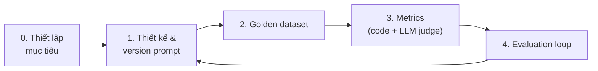
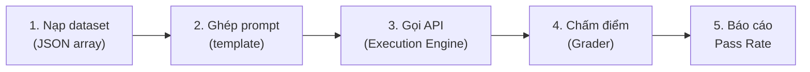

---
tags:
  - claude/nen-tang
  - llm/eval
  - aws
  - llm/code-generation
aliases:
  - AWS Code Generation Eval
  - Eval sinh code AWS
  - Prompt Evaluation Workflow AWS
up: "[[Prompt Evaluation (Đánh giá câu lệnh)]]"
---

# Prompt Evaluation cho bài toán sinh code AWS

Ví dụ áp dụng quy trình [[Prompt Evaluation (Đánh giá câu lệnh)]] vào một bài toán cụ thể: **prompt sinh mã nguồn AWS** (Boto3, AWS CDK, SDK, Lambda...). Khác với eval văn bản thường, code có thể **kiểm chứng bằng máy** (lint, compile, chạy thử, quét bảo mật) → ưu tiên grader code-based, LLM-judge chỉ bổ sung phần chủ quan.



## Bước 0: Thiết lập mục tiêu (Setting Up the Goal)

Thu hẹp bài toán trước khi viết prompt: xác định rõ **đầu ra** và **ràng buộc định dạng** — mục tiêu càng cụ thể thì càng dễ chấm tự động.

**3 dạng đầu ra hỗ trợ:**

| Dạng | Dùng cho | Cách kiểm tra |
| --- | --- | --- |
| **Python code** | Script `boto3`, Lambda function, CDK | `ast.parse()` |
| **JSON config** | CloudFormation template, IAM / S3 bucket policy, ECS task definition | `json.loads()` (+ validate schema) |
| **Regex** | CloudWatch Logs metric filter, API Gateway request validation, WAF rule | `re.compile()` |

**Ràng buộc tuyệt đối:** chỉ trả về **đúng 1 trong 3 dạng, ở dạng raw** — không lời chào, không giải thích ("Here is your code:"), không bọc markdown code fence, không header/footer. Nghĩa là output đưa thẳng vào parser/pipeline được mà không cần "làm sạch".

> Lưu ý: ràng buộc này **thay thế** yêu cầu "kèm giải thích" ở Bước 1 — nếu cần giải thích, phải tách thành lần gọi khác hoặc để dạng comment trong code.

### Tác động tới thiết kế prompt

- **System prompt + output rule**, ví dụ: *"You are an AWS automation tool. Generate ONLY valid Python code, JSON configuration, or a Regex pattern based on the request. Do NOT include markdown code blocks, intro/outro text, or explanations under any circumstances."* — xem [[System Prompt]].
- **Ép định dạng nhiều lớp** (không chỉ dựa vào lời dặn): [[Structured Output (Ép đầu ra JSON thuần)#Prefill + Stop Sequences (cách 2 chi tiết)|prefill + stop sequences]] để loại lời dẫn/code fence; multishot cho thấy mẫu output sạch ([[Prompt Engineering]]).
- **Quy tắc fallback:** quyết định trước khi user xin cả code lẫn giải thích, yêu cầu mơ hồ không rõ dạng nào, hoặc yêu cầu ngoài phạm vi 3 dạng thì xử lý ra sao (chỉ xuất phần code / từ chối theo một định dạng cố định / hỏi lại). Phải có test case cho từng tình huống.
- **Post-processing là lưới an toàn, không phải giải pháp:** có thể tự cắt code fence ở tầng ứng dụng, nhưng eval nên chấm **output gốc** để biết prompt thật sự tuân thủ đến đâu.

### Ép raw code: Prompt Clarity + Prefill

Hai kỹ thuật kết hợp để output sạch, đưa thẳng vào code grader:

1. **Prompt clarity** — luật định dạng cụ thể, cấm tiệt phần thừa, đặt trong system prompt:

   ```text
   Respond only with Python, JSON, or a plain Regex.
   Do not add any comments or commentary or explanation.
   ```

2. **Prefill assistant** — chèn tin `assistant` cuối `messages` để model *viết tiếp* thay vì chào hỏi/giải thích, kèm stop sequence để cắt ở fence đóng:

   ```python
   msg = client.messages.create(
       model=MODEL, max_tokens=1024, temperature=0, system=SYSTEM,
       messages=[
           {"role": "user", "content": case["task"]},
           {"role": "assistant", "content": "```code"},   # prefill: đã "mở" khối code
       ],
       stop_sequences=["```"],                            # dừng khi model đóng fence
   )
   out = msg.content[0].text.strip()                      # → đưa vào validate_*
   ```

- **Dùng fence chung ` ```code `** (không phải ` ```python `/` ```json `) → khỏi đoán ngôn ngữ trước; model tự viết đúng loại theo đề. Hệ quả: dòng đầu output có thể là tên ngôn ngữ (vd. `python`) cần cắt trước khi parse — hoặc đổi sang fence theo `format` của case.
- **Không có stop sequence** thì output còn dính ` ``` ` đóng ở cuối → `ast.parse` fail oan.
- **Prefill và stop sequence không nằm trong `text` trả về**; prefill không được kết thúc bằng khoảng trắng/xuống dòng; model mới có thể không hỗ trợ prefill (lỗi 400) → chi tiết và phương án thay thế ở [[Structured Output (Ép đầu ra JSON thuần)#Prefill + Stop Sequences (cách 2 chi tiết)|Prefill + Stop Sequences]].
- **Đừng kỳ vọng "100%"**: ép định dạng làm Format Success Rate tăng mạnh nhưng vẫn phải đo bằng code grader; lỗi còn lại (model đóng fence sớm, thêm text sau code) lộ ra ở metric format.
- **Eval nên chấm đúng cấu hình sản xuất** (đã prefill + strip tối thiểu) và ghi rõ vào version prompt, vì bước cắt fence/tên ngôn ngữ là một phần của pipeline chứ không phải "làm sạch ngầm".

### Tác động tới eval

- **Metric định dạng (Format Adherence):**
  - *Raw format validation (pass/fail):* parse trực tiếp output gốc bằng `json.loads()` / `ast.parse()` / `re.compile()`.
  - *Text leakage check:* output có chứa ngôn ngữ tự nhiên ngoài cú pháp (ví dụ mở đầu bằng "Here is…", "Note:", có ` ``` `) → **fail ngay**.
- **Golden dataset thêm trường `expected_format`** (`python` | `json` | `regex`), ví dụ:
  - "Tạo IAM policy cho phép đọc S3 bucket `public-logs`" → `json`
  - "Viết regex lọc dòng log có status code 5xx" → `regex`
  - "Viết hàm Lambda xóa EBS snapshot cũ hơn 30 ngày" → `python`
- **Thêm case bẫy định dạng:** user xin "giải thích thêm", yêu cầu mơ hồ về dạng, yêu cầu chứa chỉ thị kiểu "hãy chào tôi trước" (injection) — để kiểm tra prompt vẫn giữ đúng dạng raw.
- **Thứ tự chấm (gate):** format hợp lệ → mới chấm tiếp logic AWS (Bước 3). Output sai định dạng thì các metric sau không có ý nghĩa.

Script grader định dạng (code-based, rẻ và chạy được hàng loạt):

```python
import ast, json, re

LEAK = re.compile(r"^\s*(here is|here's|sure|certainly|note:)|```", re.I)

def check_format(output: str, expected: str) -> dict:
    if LEAK.search(output):
        return {"pass": False, "reason": "text leakage / code fence"}
    try:
        if expected == "json":
            json.loads(output)
        elif expected == "python":
            ast.parse(output)
        elif expected == "regex":
            re.compile(output)
    except Exception as e:
        return {"pass": False, "reason": f"invalid {expected}: {e}"}
    return {"pass": True, "reason": ""}
```

- `LEAK` chỉ bắt được các mẫu phổ biến; chấm kỹ hơn bằng cách so output với phần parse được (chuỗi thừa trước/sau → fail).
- Regex: `re.compile` chỉ chứng minh cú pháp hợp lệ; nên kiểm thêm bằng **chuỗi khớp / không khớp** có sẵn trong test case (và tránh pattern gây catastrophic backtracking).
- JSON: parse được chưa đủ — kiểm tiếp schema (IAM policy cần `Version`, `Statement`...) hoặc `aws iam validate-policy`/IAM Access Analyzer.

## Bước 1: Thiết kế & quản lý phiên bản prompt

Prompt tốt không dừng ở "Viết code AWS để làm X" mà phải đặt **rào cản kỹ thuật**:

- **Role:** Senior Cloud Engineer / Solutions Architect chuyên AWS (Boto3, CDK, SDK, Lambda) — xem [[System Prompt]].
- **Ràng buộc kiến trúc & an toàn:** theo *AWS Well-Architected Framework*; IAM **least privilege**; xử lý ngoại lệ; mã hóa **at rest / in transit**.
- **Định dạng đầu ra:** theo mục tiêu ở Bước 0 (raw Python / JSON / Regex, không văn bản thừa). Nếu mục tiêu cho phép giải thích thì mới quy định thêm phần giải thích, hướng dẫn cấu hình môi trường.
- **Quản lý phiên bản:** lưu prompt trong git (`prompt_v1.md`, `v2`...) kèm điểm eval của từng bản; đổi **một thứ mỗi lần**.

Ràng buộc nên thêm vào prompt (bổ sung):

- Không hardcode credential, region, account ID — dùng IAM Role / STS / biến môi trường / default credential chain.
- Chỉ dùng API có thật trong phiên bản SDK chỉ định (ví dụ `boto3 >= 1.34`); nếu không chắc, nói rõ thay vì bịa.
- Nêu rõ **IAM policy tối thiểu** cần để chạy đoạn code.
- Dùng *paginator* / *waiter* / retry config thay vì vòng lặp tự chế.
- Kỹ thuật viết prompt: XML tags, multishot, prefill — xem [[Prompt Engineering]].

## Bước 2: Golden dataset

Tập kiểm thử đa dạng, **cố định** để so sánh giữa các phiên bản prompt.

| Nhóm | Ví dụ |
| --- | --- |
| **Happy path** | Script Boto3 upload file lên S3 kèm server-side encryption (SSE-S3/KMS) |
| **Edge case** | Query DynamoDB phân trang khi kết quả > 1 MB (`LastEvaluatedKey`); S3 multipart upload file lớn; xử lý throttling |
| **Security** | Yêu cầu "cho nhanh" bằng Access Key trong code → model phải từ chối và dùng IAM Role/STS; không sinh policy `"Action": "*"` |
| **Adversarial** (bổ sung) | Yêu cầu mơ hồ, thiếu thông tin, prompt injection trong input, API đã deprecated (ví dụ `boto` cũ, S3 path-style) |

Mỗi test case gồm:

- **Input** — câu yêu cầu.
- **Context** — tham số/ràng buộc kèm theo (ngôn ngữ, region, phiên bản SDK).
- **Ground Truth** — code mẫu *hoặc* (tốt hơn) **danh sách tiêu chí bắt buộc**, vì một bài toán có nhiều lời giải đúng.

```json
{
  "id": "s3-upload-sse-001",
  "input": "Viết script Python upload file lên S3 có mã hóa phía server",
  "context": {"language": "python", "sdk": "boto3"},
  "must_have": ["ServerSideEncryption", "try/except ClientError", "không hardcode key"],
  "must_not": ["aws_access_key_id=", "Action: *"]
}
```

### Cách tạo dataset

Dataset là **JSON array**, mỗi phần tử là 1 test case độc lập. Dạng tối giản chỉ cần trường `task` (mệnh lệnh cho model); các trường khác (`expected_format`, `must_have`...) thêm dần khi cần chấm sâu.

```json
[
  { "task": "Viết Python dùng Boto3 tạo S3 bucket mới ở ap-southeast-1", "expected_format": "python" },
  { "task": "Tạo IAM Policy JSON cho Lambda chỉ được đọc một DynamoDB table", "expected_format": "json" },
  { "task": "Viết regex khớp định dạng ARN của một IAM Role", "expected_format": "regex" }
]
```

| Cách | Ưu | Nhược |
| --- | --- | --- |
| **Viết tay** | Kiểm soát chất lượng, đưa được edge case sát thực tế (lấy từ ticket, incident, log thật) | Tốn thời gian, khó scale lên hàng trăm case |
| **LLM sinh tự động** | Nhanh, ra số lượng lớn, đa dạng từ dễ đến khó | Có thể trùng lặp, thiếu edge case thật, đôi khi vô lý/không khả thi → cần người duyệt |

> Kết hợp: **viết tay phần cốt lõi + edge case/security**, rồi nhờ LLM nhân rộng; người duyệt lại trước khi đưa vào dataset cố định.

**Dùng model nhỏ (Haiku) làm data generator:** sinh test case là việc đơn giản, không cần model mạnh/đắt — dùng tier nhẹ, nhanh, rẻ (xem [[Model Tiers]]), sau đó dùng dataset này để đánh giá model chính. Cùng ý với việc chọn model theo tác vụ: đắt chỉ cho nơi cần suy luận khó (ví dụ judge phức tạp).

Mẹo khi nhờ LLM sinh dataset:

- **Phân bổ rõ trong prompt:** số lượng theo `expected_format` (python/json/regex), theo độ khó (dễ/trung bình/khó), theo dịch vụ AWS (S3, IAM, Lambda, DynamoDB, CloudWatch, EC2...).
- **Yêu cầu đầu ra là JSON thuần** (prefill `[` + stop sequence) để parse thẳng — xem [[Structured Output (Ép đầu ra JSON thuần)]].
- **Chủ động yêu cầu nhóm khó:** edge case, security trap (đòi hardcode key, policy `*`), yêu cầu mơ hồ, injection.
- **Sinh theo nhiều lô nhỏ** (mỗi lô một dịch vụ/chủ đề) rồi gộp, thay vì một lần 500 case → ít trùng hơn.
- **Khử trùng lặp & lọc:** loại case gần giống nhau, case không khả thi, case sai tên dịch vụ/API.
- **Cẩn thận thiên vị:** model sinh dữ liệu và model được test cùng họ có thể "dễ" với nhau → trộn thêm case thật từ production.
- **Đóng băng dataset:** lưu file có version (`dataset_v1.json`); khi thêm case thì tăng version, và vẫn giữ tập hold-out riêng.

Prompt sinh dataset (mẫu):

```text
Generate 20 realistic AWS tasks for evaluating a code-generation prompt.
Each task must be answerable with exactly one of: Python code, a JSON config, or a regex.
Cover S3, IAM, Lambda, DynamoDB, CloudWatch. Mix easy, medium, hard.
Include 3 tasks that tempt the model to hardcode credentials or use wildcard IAM permissions.
Return ONLY a JSON array of objects: {"task": string, "expected_format": "python"|"json"|"regex"}.
```

### Trường `format` → chọn validator

Mỗi test case phải mang **nhãn định dạng mong đợi** (ở note này đặt tên `expected_format`; tài liệu khác có thể gọi `format` — chọn một tên và dùng nhất quán). Nhờ nhãn này pipeline biết gọi validator nào, không phải đoán từ nội dung output:

```json
{ "task": "Create a Python function to validate an AWS IAM username", "format": "python" }
```

```python
VALIDATORS = {"python": validate_python, "json": validate_json, "regex": validate_regex}

def grade_syntax(case: dict, output: str) -> int:
    validator = VALIDATORS.get(case["format"])
    if validator is None:                      # nhãn sai/thiếu → báo lỗi dataset, đừng chấm bừa
        raise ValueError(f"unknown format: {case['format']!r} in case {case.get('id')}")
    return validator(output)
```

Các hàm `validate_*` xem ở [[Grader (Hệ thống chấm điểm)]].

- **Few-shot trong prompt sinh dataset:** đưa 1–2 ví dụ đúng cấu trúc `{task, format}` vào prompt để các case sinh ra đồng bộ, dùng thẳng được, không phải sửa tay.
- **Kiểm tra dataset sau khi sinh:** mọi case có đủ `task` + `format`, `format` thuộc tập cho phép (`python|json|regex`), và nhãn khớp nội dung đề (đề "viết regex…" mà gắn `python` là sai nhãn).
- **Phân bổ cân đối** số case theo từng `format` để tỷ lệ pass không bị lệch bởi một loại.

## Bước 3: Metrics đánh giá

Kết hợp **grader code** (rẻ, lặp lại được) và **LLM-as-a-Judge** — xem bảng grader ở [[Prompt Evaluation (Đánh giá câu lệnh)]].

| Lớp | Kiểm tra | Công cụ gợi ý |
| --- | --- | --- |
| **Syntax & static analysis** | Parse/compile được, type đúng, lint sạch | `flake8`/`ruff`, `mypy`, `tsc`, `go vet` |
| **API correctness** | Method/tham số SDK có thật, đúng tài liệu (chống hallucination) | Chạy với `botocore` Stubber / `boto3-stubs` + mypy; test với **moto** hoặc **LocalStack** |
| **Security scan** (bổ sung) | Secret rò rỉ, IAM quá rộng, thiếu mã hóa | `bandit`, `detect-secrets`/`gitleaks`, `cfn-lint`, `cdk-nag`, `Checkov`, IAM Access Analyzer |
| **Functional test** (bổ sung) | Chạy code với mock, kiểm tra hành vi (đủ trang pagination, file được mã hóa) | `pytest` + moto |
| **LLM-as-a-Judge** | Chấm theo rubric (bên dưới) | Model độc lập, temperature thấp |

**Rubric cho LLM judge:**

- *Bảo mật* — IAM có wildcard `*` quá rộng không? Có mã hóa, không lộ secret?
- *Độ hoàn thiện* — có `try/except ClientError` và xử lý lỗi cụ thể (`NoSuchKey`, `ThrottlingException`)? Có retry/pagination?
- *Độ rõ ràng* — comment, giải thích, hướng dẫn cấu hình dễ hiểu?
- Yêu cầu trả về **JSON** (điểm + lý do) để parse tự động — xem [[Structured Output (Ép đầu ra JSON thuần)]].

> Tip: dùng model **khác** (hoặc ít nhất prompt khác) làm judge để giảm thiên vị tự chấm bài mình; hiệu chuẩn judge bằng mẫu người chấm.

**Chỉ số tổng hợp:** pass rate %, số lỗi cú pháp, số finding bảo mật (theo mức độ), điểm judge trung bình theo từng tiêu chí, kèm latency/cost token. Với code sinh ngẫu nhiên có thể dùng **pass@k** (chạy k lần, chỉ cần 1 lần đúng) hoặc đo tỷ lệ đúng qua nhiều lần chạy ([[Temperature]]).

## Bước 4: Vòng lặp đánh giá

### Core Evaluation Pipeline (tự động hóa)

Thay vì chạy tay từng câu lệnh, pipeline nối các thành phần lại để **chạy hàng loạt + chấm tự động** (thường viết bằng Python). Mỗi lần sửa prompt chỉ cần chạy lại → xem **Pass Rate** tăng hay giảm = *data-driven prompt engineering*.



| Bước | Việc làm | Lưu ý |
| --- | --- | --- |
| **1. Dataset Loading** | Đọc mảng JSON các `task` (+ `expected_format`) từ `dataset_vN.json` | Dataset đã đóng băng, có version |
| **2. Prompt Templating** | Chèn từng `task` vào System/User prompt chuẩn | System prompt giữ nguyên, chỉ `task` thay đổi → so sánh công bằng giữa các version |
| **3. Model Execution** | Gửi prompt tới Claude, nhận Python / JSON / Regex | Cố định model, `temperature`, `max_tokens` |
| **4. Grader Execution** | Chạy output qua `check_format()` (Bước 0) rồi các lớp ở Bước 3 | Gate: sai format → bỏ qua metric sau |

**Prompt Execution Engine** — phần quản lý gọi API, cần:

- **Async + giới hạn đồng thời** (`asyncio.Semaphore`) để chạy song song mà không vượt **rate limit**.
- **Retry có backoff** cho lỗi tạm thời (429 rate limit, 5xx/overloaded, timeout) — SDK `anthropic` có sẵn `max_retries`.
- **Bắt ngoại lệ từng case:** một case lỗi không được làm sập cả lượt chạy; ghi `status: error` rồi chạy tiếp.
- **Lưu kết quả thô** (output gốc, token, latency) ra file để chấm lại / debug mà không phải gọi API lần nữa.

**Automated Grader** — kiểm chứng đúng các yêu cầu đã đặt ở Bước 0 (Setting Up the Goal):

- *Deterministic check:* `json.loads()` / `ast.parse()` / `re.compile()`.
- *Format check:* output còn dính code fence ` ```python ` hoặc câu chữ thừa ("Here is…") → fail.

Khung code tối giản:

```python
import asyncio, json
from anthropic import AsyncAnthropic

client = AsyncAnthropic(max_retries=5)        # SDK tự retry + backoff cho 429/5xx
sem = asyncio.Semaphore(5)                     # tối đa 5 request đồng thời
MODEL = "claude-haiku-5-5"
SYSTEM = open("prompt_v1.md").read()           # version prompt đang test

async def run_case(case: dict) -> dict:
    async with sem:
        try:
            msg = await client.messages.create(
                model=MODEL, max_tokens=1024, temperature=0,
                system=SYSTEM,
                messages=[{"role": "user", "content": case["task"]}],
            )
            out = msg.content[0].text
        except Exception as e:                 # lỗi API không làm sập cả lượt chạy
            return {**case, "output": "", "pass": False, "reason": f"api error: {e}"}
    return {**case, "output": out, **check_format(out, case["expected_format"])}

async def main():
    dataset = json.load(open("dataset_v1.json"))
    results = await asyncio.gather(*(run_case(c) for c in dataset))
    rate = sum(r["pass"] for r in results) / len(results)
    print(f"Pass rate: {rate:.0%}  ({len(results)} cases)")
    json.dump(results, open("results_prompt_v1.json", "w"), ensure_ascii=False, indent=2)

asyncio.run(main())
```

- Đặt tên file kết quả theo version prompt (`results_prompt_v1.json`, `v2`...) → so sánh điểm giữa các bản, phát hiện **hồi quy** (case trước pass, giờ fail).
- Báo cáo nên liệt kê **case fail kèm `reason`**, không chỉ con số tổng — để biết sửa gì trong prompt.
- Quy mô lớn hoặc không cần kết quả ngay: cân nhắc Batch API (rẻ hơn, bất đồng bộ).
- Có thể dùng framework có sẵn (promptfoo, Inspect, DeepEval...) thay vì tự viết, nhưng nắm cấu trúc 4 bước trên là nền tảng.

### Vòng lặp

1. **Chạy pipeline** — đưa toàn bộ golden dataset vào prompt, thu code sinh ra (cố định model, temperature, `max_tokens`).
2. **Chấm điểm** — chạy linter, scanner, test, rồi LLM judge → bảng điểm theo case và theo metric.
3. **Tối ưu** — tìm điểm yếu lặp lại (ví dụ hay quên bắt `ClientError`, hay dùng `"Resource": "*"`) → sửa prompt (thêm quy tắc/ví dụ) → chạy lại **toàn bộ** để so với bản cũ, kiểm tra không hồi quy.

Bổ sung cho vòng lặp:

- **Baseline score:** sau khi dựng xong code grader + model grader + hàm gộp điểm (xem [[Grader (Hệ thống chấm điểm)]]), việc đầu tiên là chạy cả dataset với prompt nháp để lấy điểm trung bình đầu tiên (vd. 6.5/10). Con số này **không nói prompt giỏi hay dở** — nó chỉ là vạch xuất phát để mọi lần sửa sau được so với nó. Khái niệm chung: [[Prompt Evaluation (Đánh giá câu lệnh)]].
  - **Lưu baseline đầy đủ:** điểm tổng, điểm từng thành phần (format / syntax / task), điểm từng case, version prompt + dataset + model + temperature + trọng số gộp điểm. Thiếu một thứ là không so sánh công bằng được.
  - **Mỗi lần sửa = một thay đổi, chạy lại cả bộ**: 6.5 → 8.2 là bằng chứng định lượng; điểm giảm thì rollback ngay (prompt nằm trong git, xem Bước 1).
  - **Đọc thay đổi điểm cho đúng:** điểm tổng tăng mà vài case tụt = hồi quy ẩn → so theo từng case; chênh nhỏ (< ~0.3) có thể chỉ là nhiễu của judge/model nên chạy lặp vài lần lấy trung bình; điểm tăng đến mức bất thường → nghi dataset quá dễ hoặc prompt đang overfit/lách rubric, kiểm tra bằng tập hold-out.
  - **Đổi grader/trọng số/dataset = đặt baseline mới**, không so với điểm cũ.
  - Bản chất: prompt engineering chuyên nghiệp là **vòng lặp** *đổi prompt → chạy pipeline → đọc điểm → tối ưu tiếp*, không phải tìm câu lệnh hoàn hảo ngay lần đầu.
- **Gating ở CI:** chặn merge prompt mới nếu security finding > 0 hoặc pass rate tụt so với baseline.
- **Case lỗi thật ở production** → thêm vào golden dataset.
- **Tập hold-out** để tránh overfit prompt vào dataset.
- **Theo dõi drift:** SDK/API AWS thay đổi liên tục → cập nhật dataset và phiên bản SDK định kỳ.
- **Sandbox an toàn:** chạy code sinh ra bằng mock/LocalStack hoặc tài khoản AWS cô lập, **không** chạy thẳng lên tài khoản thật (tránh tốn tiền, xóa nhầm tài nguyên).

## Lỗi thường gặp ở code AWS do LLM sinh

- Bịa method/tham số không tồn tại, hoặc dùng API cũ/deprecated.
- IAM policy rộng (`*`) hoặc thiếu điều kiện.
- Hardcode credential/region/account ID.
- Quên pagination (S3 `list_objects_v2` > 1000 object, DynamoDB > 1 MB) và retry/backoff.
- Bắt `Exception` chung chung thay vì `ClientError` với `error code` cụ thể.
- Tạo tài nguyên không mã hóa, bucket public, thiếu tag/logging.

## Liên kết

- Thuộc nhóm: [[Prompt Evaluation (Đánh giá câu lệnh)]] → [[Claude Platform]]
- Viết prompt: [[Prompt Engineering]], [[System Prompt]]
- Đầu ra có cấu trúc: [[Structured Output (Ép đầu ra JSON thuần)]]
- Ổn định kết quả: [[Temperature]]
