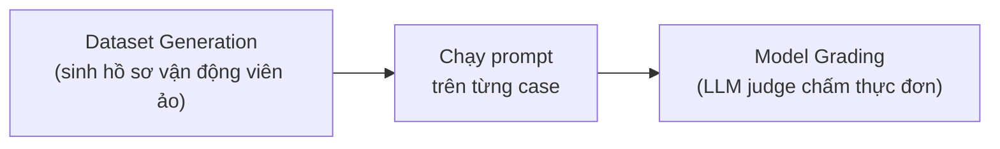

---
tags:
  - claude/nen-tang
  - llm/eval
  - llm/concurrency
aliases:
  - Meal Plan Eval
  - Eval thực đơn vận động viên
  - PromptEvaluator
  - max_concurrent_tasks
up: "[[Prompt Evaluation (Đánh giá câu lệnh)]]"
---

# Prompt Evaluation cho bài toán thực đơn vận động viên

Ví dụ thực hành dựng **evaluation pipeline** (xem [[Prompt Evaluation (Đánh giá câu lệnh)]]) cho prompt sinh **thực đơn 1 ngày** cho vận động viên, kèm lưu ý hạ tầng quan trọng: **concurrency & rate limit**.

## Bài toán

| | Nội dung |
| --- | --- |
| **Đầu vào (biến trong prompt)** | `height`, `weight`, `goals` (tăng cơ / giảm cân / duy trì), `dietary restrictions` (ăn chay, dị ứng hải sản, keto...) |
| **Đầu ra** | Kế hoạch ăn uống 1 ngày phù hợp các thông số trên |

**Vì sao là ví dụ tốt:** bài toán trộn cả hai loại tiêu chí nên cần cả hai loại grader ([[Grader (Hệ thống chấm điểm)]]):

- **Ràng buộc cứng** → code grader: đủ các bữa, đúng format, **không vi phạm dị ứng/chế độ ăn** (kiểm bằng từ khóa cấm), tổng calo/macros nằm trong khoảng hợp lý.
- **Ngữ nghĩa mềm** → model grader: món ăn hợp lý, đúng mục tiêu, khả thi.

> Với bài toán liên quan sức khỏe, vi phạm dị ứng là lỗi nghiêm trọng → nên là tiêu chí **pass/fail bắt buộc**, không để bị "trung bình hóa" trong điểm tổng.

## Kiến trúc `PromptEvaluator`

Toàn bộ logic eval được đóng gói trong 1 class, đảm nhận 2 việc chính:



1. **Dataset generation** — tự sinh hàng chục/trăm hồ sơ với chiều cao, cân nặng, mục tiêu, ràng buộc ăn uống đa dạng (nên cố ý có case biên: dị ứng nhiều thứ, mục tiêu mâu thuẫn, số đo cực đoan).
2. **Model grading** — gửi thực đơn do AI tạo cho LLM trọng tài chấm chất lượng và mức tuân thủ chỉ dẫn.

## Sinh dataset tự động (Synthetic Test Data Generation)

Thay vì gõ tay từng test case, nhờ chính AI sinh dataset JSON:

```python
evaluator.generate_dataset(
    task_description="Write a compact, concise 1 day meal plan for a single athlete",
    prompt_inputs_spec={
        "height": "Athlete's height in cm",
        "weight": "Athlete's weight in kg",
        "goal": "Goal of the athlete (gain muscle, lose fat, endurance...)",
        "restrictions": "Dietary restrictions of the athlete",
    },
    output_file="dataset.json",
    num_cases=3,
)
```

| Tham số | Vai trò |
| --- | --- |
| `task_description` | Mô tả mục đích prompt → AI sinh kịch bản test sát thực tế |
| `prompt_inputs_spec` | Dict các biến đầu vào của prompt **kèm mô tả ý nghĩa/đơn vị** (khóa phải khớp biến trong prompt template) |
| `output_file` | File JSON lưu kết quả → **tái dùng** cho nhiều lần chạy eval, không tốn API sinh lại |
| `num_cases` | Số test case cần sinh |

Đầu ra là mảng object, mỗi object ứng một bộ input:

```json
[
  {"height": "180", "weight": "75", "goal": "Gain muscle mass", "restrictions": "Lactose intolerant"},
  {"height": "162", "weight": "58", "goal": "Fat loss", "restrictions": "Vegetarian"},
  {"height": "175", "weight": "82", "goal": "Marathon endurance training", "restrictions": "None"}
]
```

- **Người duyệt lại** dataset sinh ra và bổ sung edge case thật (xem bước 2 ở [[Prompt Evaluation (Đánh giá câu lệnh)]]); dataset do AI sinh có xu hướng "đều đều", ít case lạ.
- **Giữ file dataset cố định** sau khi chốt để so sánh công bằng giữa các phiên bản prompt.

### Chiến lược `num_cases`: nhỏ khi dev, lớn khi nghiệm thu

| Giai đoạn | `num_cases` | Lý do |
| --- | --- | --- |
| **Dev / prototyping** | 2–3 | Mỗi lần sửa prompt tốn `num_cases` request sinh + `num_cases` request chấm → ít case thì vòng lặp chỉ vài giây, rẻ |
| **Final validation / benchmark** | 20–100+ | Đo độ bền vững (robustness), phủ corner/edge case, kết quả đáng tin thống kê |

Số case ít chỉ để **kiểm tra nhanh hướng sửa**; không dùng điểm của 3 case để kết luận prompt "đủ tốt" — chốt bằng lần chạy lớn.

## Initial prompt (v0.1) — cố tình thô sơ

Bước 2 của chu trình ([[Prompt Engineering#Iterative Refinement — prompt engineering như quy trình kỹ thuật|Iterative Refinement]]): viết bản đơn giản nhất làm **baseline**.

```python
def run_prompt(prompt_inputs):
    prompt = f"""
What should this person eat?

- Height: {prompt_inputs["height"]}
- Weight: {prompt_inputs["weight"]}
- Goal: {prompt_inputs["goal"]}
- Dietary restrictions: {prompt_inputs["restrictions"]}
"""
    messages = []
    add_user_message(messages, prompt)
    return chat(messages)
```

- **Luồng:** f-string nhúng các trường từ dataset (khóa khớp `prompt_inputs_spec`) → tạo `messages` → `add_user_message` → `chat(messages)` lấy câu trả lời. `add_user_message` / `chat` là helper tự viết bọc `messages.create` (xem [[Stateless API & Hội thoại nhiều lượt]]).
- **Hàm nhận 1 bộ input, trả 1 output** → evaluator gọi lặp cho từng case trong dataset (và song song theo `max_concurrent_tasks`).

**Vì sao chấp nhận prompt "tệ":**

- **Có baseline ngay** để chấm điểm và so với các bản sau.
- **Tránh premature optimization:** viết prompt dài, phức tạp từ đầu mà không biết nó có hiệu quả không là lãng phí.
- **Lộ điểm yếu thật:** chạy qua eval sẽ thấy lỗi (lan man, quên calo, bỏ qua dị ứng, format lộn xộn) → các lỗi đó định hướng việc bổ sung ràng buộc, ví dụ ở vòng sau, xem [[Prompt Engineering]].

> Lưu ý: prompt v0.1 chưa có role, format, ràng buộc calo/dị ứng — **cố ý**; đừng "vá" trước khi có điểm baseline.

## Chạy eval với `extra_criteria` (rubric cho Model Grader)

```python
results = evaluator.run_evaluation(
    run_prompt_function=run_prompt,
    dataset_file="dataset.json",
    extra_criteria="""
The output should include:
- Daily caloric total
- Macronutrient breakdown
- Meals with exact foods, portions, and timing
""",
)
```

- `extra_criteria` = **rubric tùy biến** nạp vào model grader ([[Grader (Hệ thống chấm điểm)]]): cho LLM trọng tài biết *cần soi những gì* ngoài đánh giá chung chung "thực đơn có hợp lý không".
- **3 tiêu chí trong ví dụ:** tổng calo/ngày; phân bổ macro (đạm, tinh bột, béo); từng bữa ghi rõ món cụ thể, khẩu phần, giờ ăn.
- **Cách grader dùng:** đối chiếu output với từng gạch đầu dòng; thiếu mục nào bị trừ điểm tương ứng (vd quên khẩu phần, thiếu macro).
- **Vì sao cần:** mỗi bài toán có chuẩn thành công riêng (*domain-specific evaluation*); đồng bộ điểm số với yêu cầu thật của sản phẩm trước khi lên production.

Lưu ý khi viết rubric:

- Viết **cụ thể, kiểm đếm được** (như 3 gạch đầu dòng trên) thay vì mơ hồ ("thực đơn tốt"); xem thực hành tốt ở [[Prompt Evaluation (Đánh giá câu lệnh)]].
- Tiêu chí kiểm tra được bằng code (có trường calo không, có từ khóa dị ứng không) nên chuyển sang **code grader** — rẻ và ổn định hơn LLM-judge; `extra_criteria` dành cho phần cần phán đoán.
- **Đổi rubric = đổi thước đo:** điểm trước/sau khi sửa rubric không so sánh trực tiếp được; chốt rubric trước khi lấy baseline.
- Rubric cũng là "kim chỉ nam" cho bước sửa prompt: thiếu macro → thêm yêu cầu đó vào prompt (xem [[Prompt Engineering]]).

## Phân tích kết quả (Analyzing Results)

Sau khi `run_evaluation` chạy xong, nhận được 2 thứ:

| Thành phần | Nội dung | Dùng để |
| --- | --- | --- |
| **Điểm số** (numerical score) | Điểm tổng của phiên bản prompt hiện tại (vd 6.5/10) | Biết vị trí xuất phát, so sánh phiên bản |
| **Báo cáo HTML chi tiết** | Từng test case: input → output của model → **reasoning của judge** (vd "trừ 2 điểm vì thiếu định lượng protein bữa trưa", "trừ 3 điểm vì vi phạm không lactose") | **Chẩn đoán** nguyên nhân mất điểm |

- **Điểm baseline thấp là bình thường:** prompt thô có thể chỉ đạt khoảng **2.3/10**. Đó chỉ là *vạch xuất phát thực tế* (không phản ánh năng lực người viết hay model) — cho thấy còn nhiều lỗ hổng để vá, và càng thấp thì càng thấy rõ tác dụng khi điểm tăng.
- **Từ "đoán mò" sang "chẩn đoán":** đọc reasoning để biết model vấp chỗ nào (thiếu thông tin, sai format, vi phạm ràng buộc) rồi chọn kỹ thuật tương ứng (ví dụ bổ sung few-shot, thắt ràng buộc, thêm system prompt — xem bảng lỗi → kỹ thuật ở [[Prompt Engineering]]) và chạy lại.
- Chu trình: **Đo lường → Đọc báo cáo → Tinh chỉnh → Đo lại.**

Mẹo đọc báo cáo:

- **Gom lỗi theo nhóm** (cùng một lý do lặp ở nhiều case) và sửa nhóm phổ biến nhất trước — hiệu quả hơn vá từng case riêng lẻ.
- **Đừng chỉ nhìn điểm trung bình:** soi các case điểm thấp nhất (xem "Phân tích theo case" ở [[Prompt Evaluation (Đánh giá câu lệnh)]]).
- **Kiểm tra lại reasoning của judge** vài mẫu: judge cũng có thể chấm sai hoặc thiên vị ([[Grader (Hệ thống chấm điểm)]]).
- Lưu báo cáo/điểm từng phiên bản để so sánh và rollback nếu điểm tụt.

## `max_concurrent_tasks` — song song hóa có kiểm soát

```python
evaluator = PromptEvaluator(max_concurrent_tasks=5)
```

- **Vì sao cần song song:** chạy tuần tự 50–100 case (mỗi case gồm 1 lần sinh + 1 lần chấm) rất chậm; chạy bất đồng bộ (`asyncio`, `concurrent.futures`) giúp rút ngắn đáng kể.
- **Vì sao phải giới hạn:** API có **rate limit** (RPM – request/phút, TPM – token/phút); gửi quá nhiều cùng lúc → lỗi **HTTP 429 Too Many Requests**.
- **Lời khuyên:** bắt đầu nhỏ (**3–5**) cho ổn định; biết rõ quota tài khoản rồi mới tăng để giảm thời gian chạy.

Điểm cần nhớ thêm:

- Cơ chế thường dùng bên trong: `asyncio.Semaphore(max_concurrent_tasks)` để giới hạn số task chạy cùng lúc.
- Gặp 429 thì **retry với exponential backoff** (đợi lâu dần giữa các lần thử); SDK Anthropic có sẵn retry tự động cho lỗi này (xem [[SDKs]], [[REST API]]).
- Mỗi case gọi API **2 lần** (sinh + chấm) → tải thực tế gấp đôi số case; chi phí token tỷ lệ với số case × số lần chạy.
- Giữ [[Temperature]] và tham số cố định khi chạy để so sánh phiên bản công bằng.

## Liên kết

- Thuộc: [[Prompt Evaluation (Đánh giá câu lệnh)]]
- Cùng cấp: [[Prompt Evaluation cho sinh code AWS]], [[Grader (Hệ thống chấm điểm)]]
- Liên quan: [[Prompt Engineering]], [[Vòng đời Request (Request Lifecycle)]]
