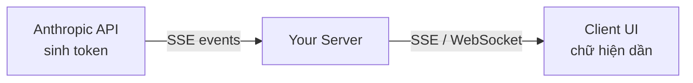
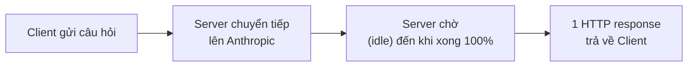
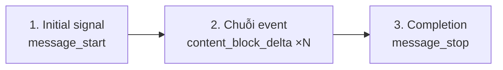
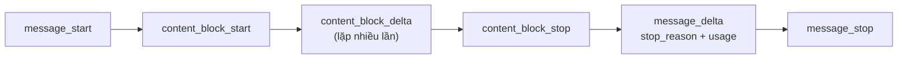
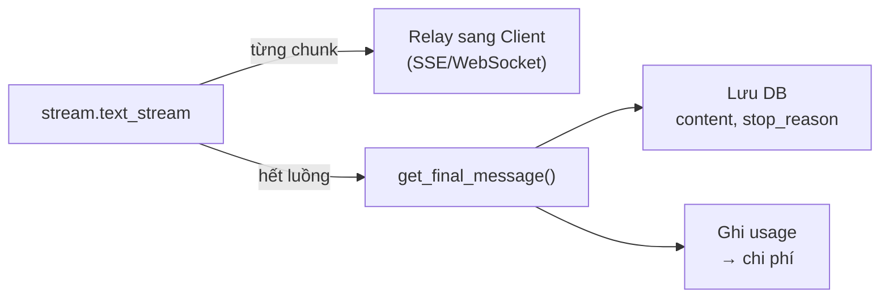

---
tags:
  - claude/nen-tang
  - llm/streaming
aliases:
  - Response Streaming
  - Streaming
  - Truyền dữ liệu theo luồng
  - SSE
up: "[[Claude Platform]]"
---

# Response Streaming (Truyền dữ liệu theo luồng)

Kỹ thuật để Server nhận và chuyển tiếp **từng mảnh (chunk/token)** câu trả lời ngay khi Claude vừa sinh ra, thay vì chờ sinh xong 100% mới trả về. Giải quyết bài toán UX "nhìn spinner hàng chục giây". Vị trí trong pipeline: bước trả kết quả của [[Vòng đời Request (Request Lifecycle)]].



## Vấn đề UX: Loading Spinner

- Câu trả lời dài/phức tạp mất khoảng **10–30 giây** (ước lượng, tuỳ model và độ dài output).
- **Non-streaming**: Server chờ sinh xong toàn bộ → đóng gói → trả 1 lần. Người dùng chỉ thấy spinner, không biết hệ thống chạy hay treo → cảm giác chậm.
- **Streaming**: chữ hiện dần (typewriter effect), từ đầu tiên sau ~**0,5–1 giây** (thường, không đảm bảo) → ứng dụng có cảm giác phản hồi nhanh dù **tổng thời gian không đổi**.

### Standard (non-streaming) hoạt động ra sao



- Anthropic vẫn sinh từng token bên trong, nhưng Server **không nhận được gì** cho đến khi xong → chỉ có 1 gói tin duy nhất sau ~15–20 giây.
- **Hệ lụy UX — "sự im lặng đáng sợ" (awkward delay):**
  - Không có phản hồi trạng thái: người dùng không phân biệt được đang xử lý, nghẽn mạng hay Server lỗi.
  - Tăng **drop-off rate**: dead time vài giây không phản hồi → người dùng reload nhiều lần (sinh thêm request, tốn thêm tiền) hoặc bỏ đi.
  - Rủi ro kỹ thuật kèm theo: request chờ lâu dễ chạm timeout của proxy/serverless/trình duyệt.

| | Standard | Streaming |
| --- | --- | --- |
| Thời gian chờ **chữ đầu tiên** | ≈ toàn bộ thời gian sinh (10–30 giây) | ~0,5–1 giây |
| Cảm nhận | Trì trệ, như bị treo | Mượt, như AI đang "gõ" trực tiếp |
| Tổng thời gian hoàn tất | Giống nhau | Giống nhau |

> [!note] Cách đọc bảng so sánh
> Với non-streaming, "chờ chữ đầu tiên" thực chất là chờ **cả câu trả lời** (không có khái niệm token đầu tiên hiển thị được). Các con số trên chỉ là ước lượng điển hình, không phải cam kết.
>
> **Streaming không làm model chạy nhanh hơn.** Đây là tối ưu **cảm nhận** (perceived latency): chỉ rút ngắn thời gian chờ chữ đầu tiên (**TTFT**), còn tổng thời gian ≈ TTFT + số token output × thời gian mỗi token. Muốn nhanh thật: giảm token output, dùng model nhỏ hơn, prompt caching.

## Vì sao khả thi

Model sinh **tự hồi quy**, mỗi vòng ra đúng 1 token → token có sẵn ngay khi sinh, đẩy về được luôn. Không phải hiệu ứng "diễn" thêm. Xem mục *Sinh tự hồi quy* trong [[Vòng đời Request (Request Lifecycle)]].

## Cơ chế kỹ thuật

1. Bật `stream: true` (SDK Python: `client.messages.stream(...)` hoặc `messages.create(..., stream=True)`).
2. API giữ **một kết nối HTTP mở** và trả theo giao thức **SSE (Server-Sent Events)** — luồng một chiều server → client, dạng text `event:` + `data:` (JSON).
3. Server của bạn đọc event, **relay** sang Client (SSE hoặc WebSocket) để render ngay.

### 3 giai đoạn trong cùng một HTTP request



1. **Khởi tạo** — request hợp lệ thì API trả `message_start` (khung message), báo mô hình sắp sinh. Lỗi xác thực/payload (400/401/429...) vẫn trả **ngay như thường**, trước khi luồng mở.
2. **Truyền event** — mỗi khi có thêm vài token, API đóng thành một `content_block_delta`; Server nhận và **forward** ngay sang Client (SSE/WebSocket).
3. **Kết thúc** — `message_delta` (kèm `stop_reason`, `usage`) rồi `message_stop` → Client ngừng lắng nghe, đóng luồng.

- **Chỉ 1 request duy nhất** — hàng chục event đều chạy trên **một kết nối HTTP kéo dài** (persistent connection, `Transfer-Encoding: chunked`); không polling, không tạo request liên tục.
- **Phía Client chỉ cần append** — nối `text_delta` vào cuối text đang hiển thị là ra hiệu ứng chữ chạy.
- **Delta không phải đúng "từng từ"** — mỗi event có thể là một vài token, nửa từ hoặc nhiều từ; đừng giả định ranh giới từ, và đừng parse nghĩa trên từng mảnh riêng lẻ.
- **Kết nối tồn tại suốt thời gian sinh** — nên cần timeout đủ dài, và `ping` giúp giữ kết nối khỏi bị cắt khi im lặng.

```js
// Client: đọc stream từ route của Server (fetch + ReadableStream)
const res = await fetch("/api/chat", { method: "POST", body: JSON.stringify({ message }) });
const reader = res.body.getReader();
const decoder = new TextDecoder();
while (true) {
  const { done, value } = await reader.read();
  if (done) break;
  output.textContent += decoder.decode(value, { stream: true }); // append mảnh mới
}
```

- Dùng `fetch` + `ReadableStream` khi cần **POST** body (chat); `EventSource` gốc của trình duyệt chỉ hỗ trợ GET, không gửi được body/header tuỳ ý.

### Chuỗi sự kiện



| Event | Mang gì |
| --- | --- |
| `message_start` | Khung message (`id`, `model`, `usage` ban đầu) |
| `content_block_start` / `_stop` | Mở/đóng một block (text, `tool_use`, thinking...) |
| `content_block_delta` | **Nội dung từng mảnh** — loại delta tuỳ block (bảng dưới) |
| `message_delta` | `stop_reason` và `usage` cuối cùng |
| `message_stop` | Kết thúc message |
| `ping` | Giữ kết nối, bỏ qua được |
| `error` | Lỗi **giữa chừng** (vd `overloaded_error`) dù HTTP đã trả 200 |

| Loại delta | Block | Cách dùng |
| --- | --- | --- |
| `text_delta` | `text` | Nối vào chuỗi hiển thị |
| `input_json_delta` | `tool_use` | JSON tham số tool **đến từng phần** — gom đủ rồi mới parse ([[Tool Use (Function Calling)]]) |
| `thinking_delta` | `thinking` | Suy luận trung gian ([[Extended Thinking]]) |

- **Tên gọi theo SDK** — tài liệu/SDK hay viết kiểu PascalCase (`MessageStart`, `ContentBlockStart`, `ContentBlockDelta`, `ContentBlockStop`, `MessageDelta`, `MessageStop`); trên đường truyền (SSE) là `message_start`, `content_block_delta`... Cùng một thứ, trường `type` của event dùng dạng snake_case.
- **Chỉ `ContentBlockDelta` là nội dung để hiển thị** — các event còn lại là khung/metadata. Với chat UI thuần text, chỉ cần lọc delta kiểu `text_delta`.
- **`MessageDelta` không phải "message xong"** — nó mang `stop_reason` và `usage` **cuối cùng**; tín hiệu kết thúc thật là `message_stop`. `usage.output_tokens` ở đây là tổng cộng dồn.
- **Mỗi delta có `index`** — chỉ số block trong `content`; một message có thể gồm nhiều block (text → `tool_use`) nên phải ghép delta theo `index`, đừng gộp tất cả vào một chuỗi.
- **Event mới có thể xuất hiện** — Anthropic có thể thêm loại event/delta mới; code nên **bỏ qua loại không nhận ra** thay vì văng lỗi.

Ví dụ dòng SSE thô cho câu trả lời text ngắn (rút gọn):

```text
event: message_start
data: {"type":"message_start","message":{"id":"msg_...","role":"assistant","content":[],...}}

event: content_block_start
data: {"type":"content_block_start","index":0,"content_block":{"type":"text","text":""}}

event: content_block_delta
data: {"type":"content_block_delta","index":0,"delta":{"type":"text_delta","text":"Xin"}}

event: content_block_delta
data: {"type":"content_block_delta","index":0,"delta":{"type":"text_delta","text":" chào"}}

event: content_block_stop
data: {"type":"content_block_stop","index":0}

event: message_delta
data: {"type":"message_delta","delta":{"stop_reason":"end_turn"},"usage":{"output_tokens":12}}

event: message_stop
data: {"type":"message_stop"}
```

Đọc event thô bằng SDK (Python) khi cần xử lý từng loại:

```python
with client.messages.stream(model="<model-id>", max_tokens=1000, messages=msgs) as stream:
    for event in stream:
        if event.type == "content_block_delta" and event.delta.type == "text_delta":
            print(event.delta.text, end="", flush=True)
        elif event.type == "message_delta":
            stop_reason = event.delta.stop_reason  # biết lý do dừng ở đây
```

## Ví dụ (Python)

```python
import anthropic

client = anthropic.Anthropic()

with client.messages.stream(
    model="<model-id>",  # kiểm tra ID hiện hành, xem [[Model Tiers]]
    max_tokens=1000,
    messages=[{"role": "user", "content": "Viết một bài thơ ngắn về biển"}],
) as stream:
    for text in stream.text_stream:
        print(text, end="", flush=True)  # in từng mảnh ngay

    final = stream.get_final_message()  # message đầy đủ: stop_reason, usage
```

- `text_stream` chỉ trả phần text; cần event thô (tool, thinking) thì lặp trực tiếp `for event in stream`.
- `get_final_message()` gom lại kết quả hoàn chỉnh — dùng để **lưu DB** và ghi `usage`.
- Bản TypeScript tương tự: `client.messages.stream({...}).on('text', ...)` — xem [[TypeScript]].

## Simplified API: `text_stream` (lọc sẵn văn bản)

Xử lý event thô nghĩa là phải `if event.type == ...` cho từng loại → nhiều boilerplate và dễ vỡ nếu cấu trúc event đổi. `client.messages.stream()` bọc sẵn luồng thô, **chỉ giữ `delta.text`** và trả một iterator thuần các mảnh chữ.

| | Event thô (`for event in stream`) | `stream.text_stream` |
| --- | --- | --- |
| Nhận được | Mọi event + metadata | Chỉ chuỗi text |
| Code | Rẽ nhánh theo `type` | Một vòng `for` |
| Dùng khi | Tool use, thinking, cần `stop_reason`/index | Chat UI thuần text |

```python
with client.messages.stream(model="<model-id>", max_tokens=1000, messages=messages) as stream:
    for text in stream.text_stream:
        print(text, end="", flush=True)
```

- **Context manager (`with`)** — vào khối thì mở kết nối, thoát khối (xong, `break` hoặc exception) thì **đóng kết nối an toàn**, không rò rỉ tài nguyên. Thoát sớm cũng ngừng nhận → hữu ích cho nút Stop.
- **`end=""` + `flush=True`** — `end=""` không xuống dòng; thêm `flush=True` vì stdout thường được buffer, thiếu thì chữ có thể hiện từng cục thay vì mượt.
- **Vẫn lấy được kết quả đầy đủ** — sau vòng lặp gọi `stream.get_final_message()` (có `stop_reason`, `usage`) hoặc `stream.get_final_text()` mà không cần tự gom; dùng để lưu DB.
- **Bản async** — `async with client.messages.stream(...)` với `AsyncAnthropic` và `async for text in stream.text_stream`; dùng trong FastAPI/server bất đồng bộ để không chặn event loop.
- **Giới hạn** — `text_stream` **bỏ qua** tool và thinking; khi có `tool_use` phải xem event thô hoặc `get_final_message()` rồi chạy tool ([[Vòng lặp Agent]]). Nếu cần thinking thì xem event `thinking_delta`.
- **Bản TypeScript** — `client.messages.stream({...}).on('text', t => ...)` và `await stream.finalMessage()` ([[TypeScript]]).
- **Về con số "giảm 80% code"** — chỉ là ước lượng minh hoạ; lợi ích thật là mã gọn, ít lỗi, ít phụ thuộc vào chi tiết event.

## Vừa stream cho UI vừa lưu bản hoàn chỉnh: `get_final_message()`

Hai nhu cầu cùng lúc: **Client** muốn thấy chữ chạy ngay; **Backend** cần câu trả lời đầy đủ + metadata để lưu DB và tính tiền.



- **Vấn đề của tự nối chuỗi** (`full_text += chunk`): chỉ có text, **mất** `usage`, `stop_reason`, `id`, các block không phải text.
- **Giải pháp**: SDK tự gom mọi event thành một đối tượng `Message` **giống hệt** kết quả `messages.create()` non-streaming → code lưu/log dùng chung cho cả hai chế độ.

```python
with client.messages.stream(model="<model-id>", max_tokens=1000, messages=messages) as stream:
    for text in stream.text_stream:
        send_chunk_to_client(text)               # 1. UX: đẩy ngay về giao diện
    final = stream.get_final_message()           # 2. Backend: message hoàn chỉnh

# 3. Dùng dữ liệu hoàn chỉnh
save_to_db(role="assistant", content=final.content)   # lưu để dựng history lượt sau
log_usage(final.usage.input_tokens, final.usage.output_tokens, final.stop_reason)
```

Điểm cần cẩn thận so với bản đơn giản hoá:

- **Đừng mặc định `content[0].text`** — `content` là mảng block; có thể có `thinking` hoặc `tool_use` đứng trước/sau. Lấy text bằng cách lọc `type == "text"` (hoặc `get_final_text()`).
- **Lưu nguyên mảng `content` nếu còn dùng tool/thinking** — lượt sau phải gửi lại đúng các block (`tool_use`, `thinking`) cho API, lưu mỗi text sẽ làm hỏng vòng lặp ([[Vòng lặp Agent]], [[Stateless API & Hội thoại nhiều lượt]]).
- **`get_final_message()` chỉ có ý nghĩa khi stream chạy hết** — nếu đứt giữa chừng hoặc Client bấm Stop thì có thể lỗi/thiếu; bọc `try/finally`, ghi bản dở kèm cờ "chưa hoàn tất" nếu muốn giữ.
- **Kiểm tra `stop_reason`** — `max_tokens` nghĩa là câu trả lời bị cắt; nên đánh dấu hoặc cho "viết tiếp" thay vì lưu như hoàn chỉnh.
- **`usage` đầy đủ chỉ có ở cuối** — nếu dùng prompt caching sẽ có thêm `cache_creation_input_tokens`, `cache_read_input_tokens`; tính tiền từ message cuối, không ước lượng theo số chunk.
- **Không chặn event loop** — hàm relay (`send_chunk_to_client`) trong server async phải là `await`/non-blocking; lưu DB nên làm sau khi đã gửi xong chunk cuối để không trễ TTFT.
- **Gửi tín hiệu kết thúc cho Client** — sau chunk cuối, đẩy event "done" (kèm id message đã lưu nếu cần) để UI chuyển từ trạng thái đang gõ sang hoàn tất.

## Lưu ý khi triển khai

- **Lưu DB khi stream kết thúc** (`message_stop`), không lưu từng mảnh; nếu đứt giữa chừng thì quyết định bỏ hoặc lưu bản dở kèm cờ "chưa hoàn tất".
- **Xử lý `error` giữa luồng** và cho phép **thử lại**; `stop_reason` chỉ biết ở `message_delta` cuối.
- **Nút Stop** — Client huỷ thì Server phải **abort** request lên Anthropic để không trả tiền cho token không ai đọc.
- **Proxy/CDN buffer** làm mất hiệu ứng: tắt buffering (`X-Accel-Buffering: no`, `Cache-Control: no-cache`), giữ timeout đủ dài; serverless có giới hạn thời gian chạy.
- **Chọn SSE hay WebSocket** — chat AI chủ yếu một chiều nên SSE đủ và đơn giản hơn.
- **Render Markdown dở dang** (code block/bảng chưa đóng) dễ nhấp nháy → throttle hoặc dùng thư viện chịu được markdown chưa hoàn chỉnh; **sanitize HTML** trước khi chèn DOM.
- **Request dài (`max_tokens` lớn)** — SDK có thể bắt buộc dùng streaming để tránh timeout kết nối; nên stream cả khi không cần hiển thị dần.
- **Khi nào không cần stream** — job nền, xử lý máy cần JSON hoàn chỉnh mới parse được.

## Liên kết

- Thuộc nhóm: [[Claude Platform]]
- Ngữ cảnh pipeline & bước relay Server → Client: [[Vòng đời Request (Request Lifecycle)]]
- Giao thức nền: [[REST API]], [[SDKs]]
- Tool use trong stream: [[Vòng lặp Agent]]
