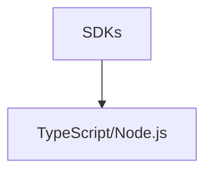

---
tags:
  - claude/nen-tang
aliases:
  - SDKs
  - Bộ công cụ phát triển
up: "[[Claude Platform]]"
---

# SDKs (Bộ công cụ phát triển)

Thư viện hỗ trợ sẵn cho các ngôn ngữ lập trình phổ biến (Python, TypeScript/JavaScript...), giúp gọi [[REST API]] nhanh và ít lỗi hơn so với tự viết HTTP request thủ công.

- Đóng gói sẵn: xử lý auth, retry, streaming response, định dạng request/response...
- Giảm boilerplate code so với gọi REST API trực tiếp.
- Có phiên bản riêng cho **Claude Agent SDK** — xây dựng agent tự động (không chỉ gọi chat đơn thuần).
- Tích hợp sẵn [[Tool Runner]] — tự động hóa vòng lặp gọi tool + tự sinh JSON Schema từ code, khỏi viết tay.

## Server gọi API: SDK hay HTTP thô?

Sau khi đã có server trung gian (xem [[Vòng đời Request (Request Lifecycle)]]), server có 2 cách gọi Anthropic:

| | SDK chính thức (khuyên dùng) | HTTP thô (plain/raw) |
| --- | --- | --- |
| Ngôn ngữ | Python, TypeScript/JS, Go, Ruby, Java, C#, PHP... (danh sách tăng dần, kiểm tra tài liệu) | Bất kỳ ngôn ngữ nào có HTTP client (`fetch`, `axios`, `requests`, `curl`) |
| Header `x-api-key`, `anthropic-version` | SDK tự gắn | Tự thêm thủ công |
| Streaming (SSE) | Có sẵn iterator/event helper | Tự parse luồng SSE |
| Retry & timeout | Mặc định retry 2 lần với backoff cho lỗi tạm thời (429/5xx/529) | Tự viết |
| Kiểu dữ liệu | Type definitions / type hints, bắt lỗi khi gõ code | Không có |
| [[Tool Runner]], pagination, đọc `request-id` | Có sẵn | Tự làm |
| Khi nào chọn | Mặc định cho mọi dự án | Ngôn ngữ chưa có SDK, hoặc cần kiểm soát từng byte/ứng dụng cực nhẹ |

- API key: SDK tự đọc biến môi trường `ANTHROPIC_API_KEY`, không cần truyền thủ công trong code (tránh vô tình hard-code key).
- SDK theo kịp thay đổi của API (tham số mới, kiểu dữ liệu mới) — nâng version định kỳ thay vì tự sửa payload.
- Vẫn cần biết HTTP thô để **debug** (đọc request/response trong log, thử nhanh bằng `curl`) vì SDK chỉ là lớp bọc trên [[REST API]].

Ví dụ tối thiểu bằng HTTP thô — 3 header bắt buộc và endpoint:

```bash
curl https://api.anthropic.com/v1/messages \
  -H "x-api-key: $ANTHROPIC_API_KEY" \
  -H "anthropic-version: 2023-06-01" \
  -H "content-type: application/json" \
  -d '{"model": "<model-id>", "max_tokens": 1024,
       "messages": [{"role": "user", "content": "Xin chào"}]}'
```

> [!tip] Ghi nhớ
> Trừ khi buộc phải dùng ngôn ngữ chưa có SDK, hãy dùng SDK: ít lỗi cấu hình, dễ bảo trì, và không phải tự xử lý SSE/retry.

## Theo ngôn ngữ



- [[TypeScript]] — cài đặt, giải phẫu request, ví dụ thực hành (code review)

## Liên kết

- Thuộc nhóm: [[Claude Platform]]
- Xem thêm: [[REST API]], [[Console]]
