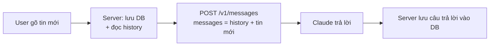
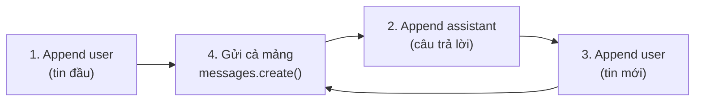

---
tags:
  - claude/nen-tang
aliases:
  - Stateless API
  - Stateless Architecture
  - Multi-turn Conversation
  - Hội thoại nhiều lượt
up: "[[Claude Platform]]"
---

# Stateless API & Hội thoại nhiều lượt

Anthropic API (và hầu hết LLM API) là **stateless — không lưu trạng thái**: mỗi HTTP request là một yêu cầu độc lập hoàn toàn. Server của Anthropic không nhớ bạn là ai, cũng không biết request trước đó nói gì. Muốn hội thoại nhiều lượt (multi-turn), **ứng dụng của bạn phải tự quản lý Conversation State** và gửi lại toàn bộ lịch sử ở mỗi lượt.

> [!note] Phân biệt
> Ứng dụng Claude.ai "có vẻ nhớ" vì chính app đó lưu và gửi lại history giúp bạn. Còn gọi API trực tiếp thì việc này là của bạn. (Chỉ có [[Managed Agents]] là hạ tầng do Anthropic vận hành, giữ session thay cho bạn.)

## Vì sao thiết kế stateless

- **Scale dễ** — request nào cũng có thể rơi vào bất kỳ máy nào, không cần "dính" session.
- **Bảo mật & riêng tư** — không tự ý lưu dữ liệu hội thoại của khách hàng trên server.
- **Đơn giản & dễ dự đoán** — đầu vào quyết định đầu ra; bạn kiểm soát hoàn toàn thứ model nhìn thấy (cắt, tóm tắt, sửa history tuỳ ý).

## Cách làm: gửi lại Full History Payload



Ví dụ lượt 2 (sau khi lượt 1 là *"Tôi tên là Nam."* → *"Chào Nam!"*):

```json
[
  { "role": "user", "content": "Tôi tên là Nam." },
  { "role": "assistant", "content": "Chào Nam!" },
  { "role": "user", "content": "Tên tôi là gì?" }
]
```

Nếu chỉ gửi câu cuối, Claude sẽ trả lời không biết tên. Gửi đủ mảng, Claude đọc lại từ đầu và trả lời đúng: *"Bạn tên là Nam."*

### Quy trình 4 bước (vòng lặp chuẩn)

Chỉ cần làm đúng 2 việc: **lưu history** và **gửi lại toàn bộ mảng ở mỗi request**.



Ví dụ: lượt 1 *"Điện toán lượng tử là gì?"* → lưu thêm câu trả lời của Claude (`assistant`) → user hỏi *"Viết thêm một câu nữa"* → gửi cả 3 tin. Nhờ đọc lại từ đầu, Claude hiểu "một câu nữa" nói về điện toán lượng tử.

```python
messages = []  # state do ứng dụng giữ

def chat(user_text):
    messages.append({"role": "user", "content": user_text})        # bước 1 / 3
    response = client.messages.create(
        model=MODEL, max_tokens=1024, messages=messages,           # bước 4
    )
    messages.append({"role": "assistant", "content": response.content})  # bước 2
    return "".join(b.text for b in response.content if b.type == "text")
```

- **Append cả `response.content`** (mảng block) thay vì chỉ chuỗi text, để không làm rơi `tool_use`/`thinking` block.
- **`messages` là biến cục bộ trong process** — chỉ phù hợp demo/CLI. Web app nhiều user phải lưu theo `conversation_id` trong DB, mỗi request nạp lại rồi append (xem [[Vòng đời Request (Request Lifecycle)]]).
- **Chỉ append câu trả lời khi request thành công** — nếu lỗi/bị huỷ, bỏ luôn tin user vừa thêm (hoặc retry) để tránh hai tin `user` liên tiếp hoặc history lệch.
- **Mỗi lượt vẫn phải kèm `system`, `tools`** — chúng không được "nhớ" giữa các request.

## Quy tắc khi dựng mảng `messages`

- **`role` luân phiên** `user` / `assistant`; tin đầu tiên là `user`. Các tin liên tiếp cùng role bị API gộp lại thành một.
- **System prompt không nằm trong `messages`** — truyền riêng bằng tham số `system`, lượt nào cũng phải gửi lại.
- **Giữ nguyên `content` của assistant** khi nối lại, đặc biệt các block `tool_use` (và `thinking` khi dùng [[Extended Thinking]]); `tool_result` phải khớp `tool_use_id` — xem [[Vòng lặp Agent]].
- **Lưu cả hai phía** vào DB: tin user trước khi gọi, câu trả lời hoàn chỉnh của Claude sau khi xong (kể cả khi streaming — xem [[Vòng đời Request (Request Lifecycle)]]).
- **Client chỉ gửi tin mới + id hội thoại**; server mới là nơi dựng `messages` từ DB, để user không sửa được history và để có chỗ cắt/tóm tắt.
- **Có thể "bịa" history** — vì stateless, bạn được chủ động chèn/sửa/bỏ lượt cũ (vd. few-shot bằng cặp user/assistant giả, bỏ lượt lỗi) — là kỹ thuật chứ không phải gian lận.

## Hệ quả & cách xử lý

| Vấn đề | Nguyên nhân | Cách giảm |
| --- | --- | --- |
| **Token bloat** — chi phí và độ trễ tăng dần | Mỗi lượt gửi lại toàn bộ history; tổng token cả hội thoại tăng gần như **bậc hai** theo số lượt | [[Context Management]]: Prompt Caching (phần history cố định rẻ ~90%), Compaction |
| **Chạm context window** | History vượt giới hạn tối đa của model → request lỗi | **Truncate** (cắt lượt cũ), **summarization** (tóm tắt lượt cũ), Server-side Compaction |
| **Mất ngữ cảnh khi cắt** | Cắt/tóm tắt làm rơi chi tiết quan trọng | Giữ lại system prompt + các quyết định/sự kiện chính, ghim vào bản tóm tắt |
| **Nhớ xuyên phiên** | Phiên mới = history rỗng | Lưu ra ngoài rồi nạp lại: Memory Tool, DB riêng (xem [[Context Management]]) |

- **Chiến lược cắt đơn giản:** giữ N lượt gần nhất (sliding window) + system prompt; cắt theo **cặp** user/assistant (và cặp `tool_use`/`tool_result`) để không làm vỡ cấu trúc.
- **Chiến lược tóm tắt:** khi history vượt ngưỡng, nhờ Claude (có thể dùng model nhỏ rẻ hơn, xem [[Model Tiers]]) tóm tắt phần cũ thành một đoạn, đặt đầu hội thoại, giữ nguyên vài lượt gần nhất.
- **Theo dõi** `usage.input_tokens` mỗi response — con số này tăng theo độ dài history, là tín hiệu để biết khi nào cần cắt/tóm tắt.

## Liên kết

- Thuộc nhóm: [[Claude Platform]]
- Bối cảnh trong hành trình request: [[Vòng đời Request (Request Lifecycle)]]
- Giải pháp cho history dài: [[Context Management]]
- Giao thức gọi API: [[REST API]]
