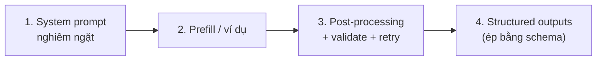
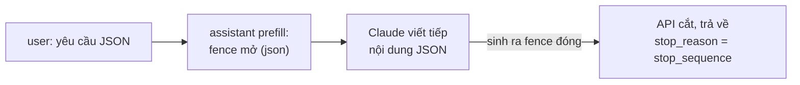
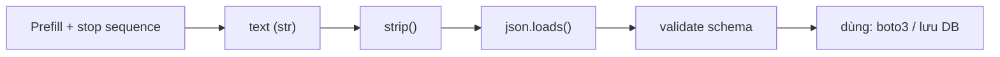

---
tags:
  - claude/nen-tang
  - llm/prompt
aliases:
  - Structured Output
  - JSON thuần
  - Ép đầu ra JSON
  - JSON Mode
up: "[[Claude Platform]]"
---

# Structured Output (Ép đầu ra JSON thuần)

Cách buộc LLM trả về **đúng một chuỗi dữ liệu thô** (thường là JSON) để code phía sau parse được ngay, thay vì văn bản chat kèm lời chào, giải thích hoặc khối ` ```json `.

## Vấn đề

LLM được huấn luyện làm **trợ lý chat** nên có thói quen "quá nhiệt tình": mở đầu *"Dưới đây là JSON bạn cần..."*, bọc code trong markdown fence, thêm lời giải thích cuối. Với ứng dụng tự động hóa, phần thừa này là **noise**:

- `JSON.parse()` / `json.loads()` **lỗi** vì chuỗi không bắt đầu bằng `{`.
- UX kém: nút **Copy** copy luôn cả rác, người dùng phải bôi đen thủ công.

Ví dụ: web tạo rule **AWS EventBridge** — user mô tả bằng ngôn ngữ tự nhiên, app gọi Claude sinh JSON event pattern, user bấm Copy dán vào AWS Console.

### Ví dụ output "lỗi" điển hình

````text
```json
{
  "source": ["aws.ec2"],
  "detail-type": ["EC2 Instance State-change Notification"],
  "detail": { "state": ["stopped"] }
}
```

This rule captures EC2 instances that enter the stopped state.
````

Hai nguồn gây hỏng, hậu quả khác nhau:

| Nguồn rác | Hậu quả |
| --- | --- |
| **Markdown fence** (` ```json ` … ` ``` `) | Nút Copy lấy luôn ký hiệu fence → dán vào AWS Console bị **lỗi cú pháp** |
| **Câu giải thích** (đầu hoặc cuối) | `JSON.parse()` **throw** vì chuỗi không còn là JSON hợp lệ; copy tay phải bôi đen chính xác từ `{` đầu tới `}` cuối |

## 4 cách xử lý (từ yếu → mạnh)



| # | Cách | Mức đảm bảo | Ghi chú |
| --- | --- | --- | --- |
| 1 | **[[System Prompt]] nghiêm ngặt** | Thấp–vừa | *"Chỉ trả JSON thuần, không markdown, không giải thích"* + nêu lý do (*"output được parse bằng máy"*) + 1–2 ví dụ few-shot |
| 2 | **Prefill** (+ stop sequences, xem [[#Prefill + Stop Sequences (cách 2 chi tiết)]]) | Vừa | Gửi sẵn tin `assistant` kết thúc bằng `{` để model viết tiếp thẳng vào JSON. **Model mới có thể không hỗ trợ prefill** (báo lỗi 400) → kiểm tra theo model đang dùng |
| 3 | **Post-processing** | Vừa | Cắt từ `{` đầu tới `}` cuối / bỏ fence bằng regex → `parse` → **validate schema** → lỗi thì **retry** |
| 4 | **Structured outputs** (ép theo JSON Schema) | **Cao nhất** | Truyền schema qua `output_config.format` (`type: "json_schema"`), hoặc dùng tool + `strict: true`; model bị ràng buộc khi sinh token nên luôn khớp schema |

> [!tip] Cách chọn
> Đầu ra do **máy đọc** (parse, lưu DB, gọi API khác) → dùng cách **4**. Cách 1–3 là lớp phòng thủ bổ sung hoặc khi model/tính năng không hỗ trợ.

### Mẫu system prompt cho cách 1

```text
You are an API backend that generates AWS EventBridge event patterns.
Output ONLY raw, valid JSON. Do not use markdown code blocks.
Do not include any explanatory text before or after the JSON.
Your output is parsed by a program, so any extra character breaks it.
```

Ghi chú: đặt vai **"API backend"** giúp model bỏ giọng trợ lý chat; câu lý do (*parsed by a program*) làm ràng buộc hiệu quả hơn lệnh trơ trụi (xem [[System Prompt#Cách viết system prompt hiệu quả]]).

### Prefill + Stop Sequences (cách 2 chi tiết)

Kết hợp hai cơ chế để cắt rác ở **cả đầu lẫn cuối**:

- **Prefill** — thêm sẵn tin `assistant` ở cuối `messages`; Claude coi như mình đã viết phần đó và **viết tiếp** → mất lời dẫn mở đầu.
- **`stop_sequences`** — API **cắt ngay** khi model sinh ra chuỗi này → mất lời giải thích phía sau.

```python
messages = [
    {"role": "user", "content": "Generate a very short EventBridge rule as json"},
    {"role": "assistant", "content": "```json"},   # prefill: đã "mở" khối code
]
response = client.messages.create(
    model=MODEL, max_tokens=1000, messages=messages,
    stop_sequences=["```"],                          # gặp fence đóng là dừng
)
text = response.content[0].text   # chỉ còn ruột JSON → json.loads(text)
```



Lợi ích: sạch cả hai đầu, **dừng sớm** nên giảm token output + latency, đưa thẳng vào `JSON.parse()`.

> [!warning] Lưu ý khi dùng
>
> - **Phần prefill và chuỗi dừng không nằm trong `text` trả về** — nếu cần chuỗi đầy đủ phải tự nối lại; `stop_reason` là `stop_sequence`, chuỗi khớp nằm ở `response.stop_sequence`.
> - **Prefill không được kết thúc bằng khoảng trắng/xuống dòng** (vd. `"```json\n"`) — API có thể báo lỗi 400; dùng `"```json"` hoặc prefill `{`.
> - **Model mới có thể không hỗ trợ prefill** (lỗi 400) → khi đó dùng structured outputs. Xem bảng ở trên.
> - Prefill `{` + stop `}` không dùng được cho JSON lồng nhau (dừng ở `}` đầu tiên); với fence ` ``` ` thì an toàn hơn vì JSON hiếm khi chứa 3 backtick.
> - Nếu model không viết fence đóng mà kết thúc bằng cách khác, vẫn nên **validate + retry** như checklist bên dưới.

### Bước cuối: `strip()` + `json.loads()` (Python)

Sau prefill + stop sequence, `text` vẫn là **`str`** — chưa dùng được như dữ liệu. Cần thêm hai bước:

```python
import json

clean_json = json.loads(text.strip())   # str → dict/list
print(clean_json["source"])             # truy cập field như dữ liệu thật
```

| Hàm | Vai trò |
| --- | --- |
| `text.strip()` | Bỏ khoảng trắng/`\n`/tab ở **đầu và cuối**. Thường còn sót `\n` ngay trước fence đóng ` ``` ` đã bị cắt |
| `json.loads()` | **Parse** chuỗi JSON → `dict`/`list` của Python (`loads` = *load string*; `json.load` dành cho file) |

Ngoài `strip()`, `json.loads()` vốn đã bỏ qua whitespace ngoài cùng, nên `strip()` chủ yếu để gọn và an toàn khi log/so sánh. Phiên bản chịu lỗi cho production:

```python
try:
    data = json.loads(text.strip())
except json.JSONDecodeError as e:
    # retry (gửi lại kèm lỗi) hoặc báo lỗi rõ ràng, đừng để crash
    raise ValueError(f"Claude trả JSON không hợp lệ: {e}") from e
```

Sau đó validate schema (Pydantic / `jsonschema`) rồi mới dùng, ví dụ truyền sang `boto3` (`events.put_rule(...)`) để tạo rule thật trên AWS. Tương đương JavaScript: `JSON.parse(text.trim())`.



### Nguyên lý tổng quát: áp dụng ngoài JSON

> [!tip] Cốt lõi
> Xác định **Claude tự nhiên muốn bọc nội dung bằng gì** (ký hiệu mở/đóng), rồi dùng đúng ký hiệu mở làm **prefill** và ký hiệu đóng làm **stop sequence**.

Quy trình: (1) chạy thử không ràng buộc, quan sát cách model mở/đóng; (2) prefill phần mở; (3) đặt stop ở phần đóng.

| Định dạng | Prefill | Stop sequence | Dùng cho |
| --- | --- | --- | --- |
| **JSON** | fence mở `json` | fence đóng ` ``` ` | `json.loads()` |
| **Code** (Python/SQL/HTML…) | fence mở kèm tên ngôn ngữ (vd. `python`) | fence đóng ` ``` ` | Ghi thẳng ra file `.py`, chạy trong sandbox |
| **CSV** | Dòng tiêu đề `Col1,Col2,Col3` | `"\n\n"` hoặc fence đóng | Import vào DB / `pandas.read_csv(io.StringIO(text))` |
| **Danh sách** | `-` (gạch đầu dòng) | `"\n\n"` (hết danh sách) | Bỏ câu dẫn kiểu *"Dưới đây là danh sách..."* |

- **CSV:** prefill dòng tiêu đề còn **khoá luôn schema cột** — model không tự đổi tên/số cột.
- **Danh sách:** prefill `"- "` có khoảng trắng cuối dễ bị API từ chối, dùng `"-"` (xem cảnh báo prefill ở trên).
- **Chọn stop sequence đủ đặc trưng** — ngắn/phổ biến (vd. `"\n"`) sẽ cắt giữa chừng. Có thể truyền **nhiều** chuỗi trong `stop_sequences`.
- **Giá trị:** kiểm soát chính xác cấu trúc đầu ra, bỏ bớt Regex/parsing phức tạp ở backend — nhưng đây là **giảm rủi ro chứ không đảm bảo 100%**; vẫn validate (xem [[#Checklist khi đưa vào production]]).

### Về "JSON Mode"

Thuật ngữ `response_format={"type": "json_object"}` là của **OpenAI**. Với Claude, tương đương (và mạnh hơn) là **structured outputs** theo JSON Schema — không chỉ "là JSON hợp lệ" mà còn **đúng field, đúng kiểu**. Tên tham số/tính năng có thể đổi theo phiên bản SDK → kiểm tra tài liệu hiện hành.

### Mẹo: dùng Tool Use làm "khuôn" JSON

Định nghĩa một tool giả (vd. `create_eventbridge_rule`) với `input_schema` là schema mong muốn, rồi ép `tool_choice: {"type": "tool", "name": "create_eventbridge_rule"}`. Claude phải điền **input** của tool — chính là JSON thuần, nằm trong block `tool_use`, không lẫn văn bản. Xem [[Tool Use (Function Calling)]].

## Checklist khi đưa vào production

- **Luôn validate** kết quả bằng schema (Zod / Pydantic / `jsonschema`) — ngay cả khi dùng structured outputs, vì còn các ca biên bên dưới.
- **Kiểm tra `stop_reason`**: `max_tokens` → JSON bị **cắt cụt** (tăng `max_tokens` hoặc rút gọn schema); `refusal` → model từ chối nên có thể không khớp schema.
- **Retry có kiểm soát** — parse lỗi thì gửi lại kèm thông báo lỗi, giới hạn số lần.
- **Hạ [[Temperature]]** (gần 0) cho tác vụ trích xuất/sinh cấu hình để kết quả ổn định.
- **Streaming**: JSON chưa hoàn chỉnh cho tới chunk cuối — chỉ parse khi xong, hoặc dùng parser JSON tăng dần. Xem [[Response Streaming]].
- **Tách "dữ liệu" khỏi "giải thích"**: nếu UI vẫn cần lời giải thích, thêm field `explanation` trong schema thay vì để model viết ngoài JSON.
- **Phía UI**: render JSON trong code block có nút **Copy** lấy đúng chuỗi đã parse (có thể `JSON.stringify(obj, null, 2)` để pretty-print) — đừng copy raw output của model.

## Ví dụ: Post-processing tối thiểu (TypeScript)

```typescript
function extractJson(raw: string): unknown {
  const start = raw.indexOf("{");
  const end = raw.lastIndexOf("}");
  if (start === -1 || end <= start) throw new Error("Không tìm thấy JSON");
  return JSON.parse(raw.slice(start, end + 1)); // bỏ fence & lời dẫn
}
```

> [!warning] Giới hạn
> Cắt theo `{`…`}` chỉ là phương án dự phòng: sẽ sai nếu đầu ra là mảng `[...]` hoặc văn bản thừa cũng chứa dấu ngoặc nhọn. Ưu tiên structured outputs.

## Liên kết

- Thuộc nhóm: [[Claude Platform]]
- Chỉ dẫn định dạng đầu ra: [[System Prompt]]
- Ép cấu trúc qua tool: [[Tool Use (Function Calling)]]
- Cấu trúc request/response: [[REST API]]
- Kỹ thuật viết prompt: [[Prompt Engineering]]
