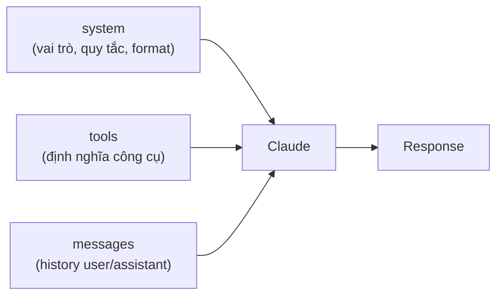

---
tags:
  - claude/nen-tang
aliases:
  - System Prompt
  - Prompt hệ thống
  - system parameter
up: "[[Claude Platform]]"
---

# System Prompt (Prompt hệ thống)

Chỉ dẫn nền được gửi kèm **mỗi request** qua tham số `system` của Messages API, dùng để định hình **vai trò, giọng điệu, ràng buộc và định dạng đầu ra** của Claude. Giống một bản "Job Description" giao trước khi cuộc trò chuyện bắt đầu — không phải một lượt hội thoại.

> [!warning] Đừng hiểu là "quyền lực tuyệt đối"
> System prompt được model ưu tiên hơn tin `user`, nhưng **không phải rào chắn bảo mật cứng**: người dùng vẫn có thể prompt injection, và nội dung system prompt có thể bị moi ra. Quy tắc nghiệp vụ/quyền hạn quan trọng phải kiểm soát ở code phía server (xem [[#Giới hạn cần nhớ]]).

## Vị trí trong API

`system` nằm **ngang hàng** với `messages`, không nằm bên trong (khác với API kiểu OpenAI có `role: "system"`; Anthropic không nhận role này trong `messages`).

```python
response = client.messages.create(
    model=MODEL,
    max_tokens=1000,
    system="Bạn là chuyên gia .NET/C# Senior. Trả lời ngắn gọn, tập trung hiệu năng, kèm ví dụ C#.",
    messages=[{"role": "user", "content": "Tôi nên viết code thế nào cho tối ưu?"}],
)
```

- Giá trị là **chuỗi**, hoặc **mảng text block** — dạng mảng cho phép gắn `cache_control` để bật Prompt Caching (xem [[Context Management]]).
- Vì [[Stateless API & Hội thoại nhiều lượt|API stateless]], **lượt nào cũng phải gửi lại `system`** — nó không được "nhớ".
- Tính vào `input_tokens` và chi phí như mọi nội dung khác; system prompt dài + ít đổi → nên cache.

### Ví dụ: gia sư toán (Socratic tutor)

```python
system_prompt = """
You are a patient math tutor.
Do not directly answer a student's questions.
Guide them to a solution step by step.
"""

response = client.messages.create(
    model=MODEL, max_tokens=1000,
    system=system_prompt,                      # cố định ở server, ngoài messages
    messages=[{"role": "user", "content": "Giải giúp tôi 2x + 6 = 14"}],
)
```

Một prompt 3 dòng nhưng đủ 3 thành phần: **vai trò** (`patient math tutor` → văn phong sư phạm, kiên nhẫn), **ràng buộc** (`Do not directly answer` → không đưa đáp án ngay), **phương pháp** (`step by step` → đặt câu hỏi gợi mở, chia nhỏ bài). Kết quả: thay vì trả `x = 4`, Claude hỏi lại kiểu *"Bạn thử chuyển số 6 sang vế phải xem?"*.

| | Không có `system` | Có `system` (gia sư) |
| --- | --- | --- |
| **Vai** | Trợ lý chung, tối ưu sự tiện lợi | Người dẫn đường |
| **Chiến lược** | Giải từ đầu đến cuối, đưa đáp án ngay | Hỏi gợi mở: *"Bước đầu để cô lập ẩn x là gì?"* |
| **Với người học** | Nhận kết quả thụ động | Tự động não, hiểu bản chất hơn |

> [!tip] Bài học
> `system` không chỉ đổi **giọng điệu** mà còn đổi **logic và chiến lược xử lý** — cùng một model, cùng một câu hỏi, nhưng hành vi phục vụ mục đích nghiệp vụ khác hẳn (giáo dục, code review, chăm sóc khách hàng...). Đây là cách chuyên biệt hóa Claude mà **không cần fine-tune hay đổi model**.

- **Tách bạch trách nhiệm** — `messages` chỉ chứa hội thoại; `system` giữ luật chơi riêng một chỗ, nên không phải lặp *"đừng cho đáp án nhé"* ở mỗi câu hỏi và người dùng không phải biết tới nó.
- **"Nhớ" xuyên suốt nhờ gửi lại mỗi lượt**, không phải do server lưu — history có dài tới đâu `system` vẫn nằm ở đầu input. Khi history rất dài, vẫn nên giữ nguyên `system` lúc cắt/tóm tắt (xem [[Stateless API & Hội thoại nhiều lượt]]).
- **Học sinh ép "cho đáp án luôn đi" thường vẫn bị từ chối, nhưng không đảm bảo tuyệt đối** — nếu cần chắc chắn (vd. chặn lộ đáp án trong bài kiểm tra), thêm kiểm tra ở code hoặc đừng đưa đáp án vào context.



### Khi `system` là tùy chọn: không truyền `None`/`null`

`system` là tham số **tùy chọn**, nhưng nếu có mặt thì phải là chuỗi (hoặc mảng text block) hợp lệ. Wrapper/backend hay để `system_prompt = None` rồi truyền thẳng vào → request bị từ chối (lỗi validate, `400 BadRequest`). Chuỗi rỗng `""` cũng nên tránh. **Quy tắc: không có thì bỏ hẳn key, đừng truyền giá trị rỗng.**

```python
kwargs = {"model": MODEL, "max_tokens": 1000, "messages": messages}
if system_prompt:                      # None / "" → bỏ qua
    kwargs["system"] = system_prompt
response = client.messages.create(**kwargs)
```

```typescript
const params: Anthropic.MessageCreateParamsNonStreaming = {
  model: MODEL, max_tokens: 1000, messages,
  ...(systemPrompt ? { system: systemPrompt } : {}),   // chỉ thêm khi có
};
const response = await client.messages.create(params);
```

- **Python thay thế:** `system=system_prompt or anthropic.NOT_GIVEN` (sentinel của SDK, tên có thể đổi tuỳ phiên bản) — gọn hơn `if/else` hai nhánh.
- **TypeScript:** `undefined` thường bị bỏ khi serialize JSON nên ít gây lỗi, còn `null` thì vẫn bị gửi đi — vẫn nên dùng spread có điều kiện cho rõ ý.
- Đây là chỗ nên xử lý **một lần** trong hàm wrapper dùng chung, đừng rải `if` khắp codebase.

## Dùng để làm gì

| Mục đích | Ví dụ |
| --- | --- |
| **Tone & Style** | Trang trọng như chuyên viên tài chính / thân thiện như bạn bè |
| **Constraints & Guardrails** | "Không bịa thông tin", "Không biết thì nói không biết", "Chỉ trả lời tiếng Việt" |
| **Output Formatting** | Luôn trả JSON / bảng / theo template để backend dễ parse |
| **Role** | Code reviewer, giáo viên toán, biên tập viên |
| **Ngữ cảnh ứng dụng** | Tên sản phẩm, đối tượng người dùng, phạm vi được/không được hỗ trợ |
| **Hướng dẫn dùng tool** | Khi nào gọi tool nào, thứ tự ưu tiên — xem [[Tool Use (Function Calling)]] |

Không có `system` → Claude trả lời kiểu trợ lý chung chung, trung lập. Có `system` → cùng câu hỏi nhưng câu trả lời đổi hẳn hướng (ví dụ ở trên: chuyển sang chuyên sâu .NET, ngắn gọn).

## Cách viết system prompt hiệu quả

- **Cụ thể thay vì mơ hồ** — nêu rõ vai trò, đối tượng đọc, độ dài, định dạng mong muốn.
- **Giải thích lý do** sau mỗi ràng buộc ("Trả lời ngắn vì hiển thị trên mobile") — model suy ra được ý định tốt hơn là chỉ có lệnh trơ trụi.
- **Nói điều cần làm**, hạn chế chỉ liệt kê điều cấm.
- **Dùng thẻ XML** (`<rules>`, `<context>`, `<format>`) để tách các phần; đặt tài liệu dài ở đầu, chỉ dẫn/câu hỏi ở cuối.
- **Thêm vài ví dụ** (few-shot) cho định dạng khó diễn tả bằng lời.
- **Tách phần động ra khỏi `system`** — thông tin đổi theo từng request (tên user, ngày giờ…) nên đặt cuối hoặc trong `messages`, để phần tĩnh phía trước vẫn cache được.
- **Chỉ nạp khi cần** — đừng nhồi cả kho tài liệu vào `system`; dùng pattern tra cứu bằng tool (xem [[Context Management]]).
- **Thử và đo** — sửa prompt rồi kiểm tra bằng bộ ca test (evals), đừng chỉnh theo cảm giác.

## Giới hạn cần nhớ

- **Không phải ranh giới bảo mật** — secret (API key, dữ liệu nhạy cảm) **không** đưa vào system prompt; phân quyền làm ở server/tool.
- **Không đảm bảo 100% tuân thủ** — ràng buộc quan trọng về định dạng nên kiểm chứng ở code (validate JSON, retry) hoặc dùng structured outputs.
- **Có thể bị lộ** — người dùng có thể dụ model đọc lại chỉ dẫn; viết như thể nội dung đó công khai.
- **Chi phí lặp lại mỗi lượt** — prompt càng dài càng tốn; dùng Prompt Caching.
- **Khác Claude.ai/Claude Code** — ở đó system prompt do Anthropic/ứng dụng cài sẵn; qua API thì bạn tự viết hoàn toàn. Vai trò tương tự ở Claude Code là `CLAUDE.md` và output style.

## Liên kết

- Thuộc nhóm: [[Claude Platform]]
- Cấu trúc request: [[REST API]]
- Vì sao phải gửi lại mỗi lượt: [[Stateless API & Hội thoại nhiều lượt]]
- Cache phần cố định: [[Context Management]]
- Agent cố định system prompt + tool trong "bản thiết kế": [[Managed Agents]]
