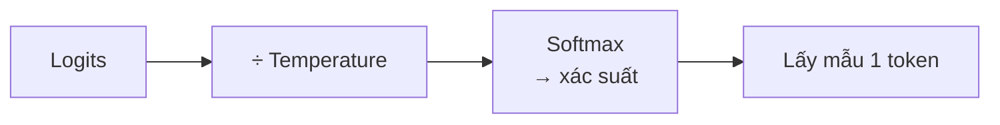
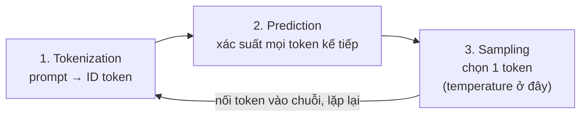
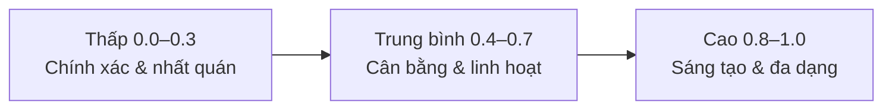

---
tags:
  - claude/nen-tang
  - llm/tham-so
aliases:
  - Temperature
  - Nhiệt độ
  - Sampling parameters
up: "[[Claude Platform]]"
---

# Temperature (Nhiệt độ)

Tham số điều khiển **độ ngẫu nhiên khi chọn token kế tiếp** — cán cân giữa **tính chính xác/dự đoán được** và **tính sáng tạo/đa dạng**. Tác động ở bước *Generation* trong [[Vòng đời Request (Request Lifecycle)]].



## Cơ chế

Temperature chia **logits** trước softmax, làm biến dạng phân phối xác suất (không đổi thứ hạng token):

| Temperature | Phân phối | Hệ quả |
| --- | --- | --- |
| Thấp (→ 0) | **Nhọn**: token đứng đầu chiếm ưu thế tuyệt đối | Gần *greedy* — ổn định, lặp lại được |
| Cao (→ 1) | **Phẳng**: token xác suất thấp có cơ hội cao hơn | Đa dạng, bất ngờ, khó đoán |

### Ví dụ minh hoạ: vòng lặp 3 bước

Cách nhìn gọn của vòng sinh token: **Tokenization → Prediction → Sampling**, lặp lại. Temperature chỉ tác động ở bước cuối. Chi tiết từng bước: [[Vòng đời Request (Request Lifecycle)]].



Prompt `"What do you think"` → bước Prediction ra (số liệu minh hoạ):

| Token kế tiếp | Xác suất | `temperature = 0` | `temperature` cao (0.8–1.0) |
| --- | --- | --- | --- |
| `about` | 30% | **Luôn chọn** | Khả năng cao nhất nhưng không chắc chắn |
| `would` | 20% | Không bao giờ | Có cơ hội được chọn |
| `of` | 10% | Không bao giờ | Có cơ hội được chọn |
| …hàng nghìn token khác | phần còn lại | Không | Đuôi dài, hiếm khi trúng |

- Chọn `about` → chuỗi mới `"What do you think about"` → lặp lại 3 bước, đến khi gặp điều kiện dừng (`end_turn`, `max_tokens`, `stop_sequence`).
- **Sai lệch tích luỹ** — mỗi lần lấy mẫu rẽ nhánh khác đi (`would` thay vì `about`) thì toàn bộ phần sau cũng đi theo nhánh khác. Đó là lý do cùng prompt ở temperature cao cho các câu trả lời khác hẳn nhau.
- Xác suất tính trên **token** (mảnh từ), không nhất thiết trên cả từ.

### "Nút vặn sáng tạo" (Creativity dial): ví dụ số

Công thức: `p_i = softmax(logit_i / T)` — tương đương luỹ thừa xác suất gốc `p^(1/T)` rồi chuẩn hoá lại. Ví dụ câu *"Bầu trời hôm nay rất…"*, xác suất gốc (ở `T = 1`): `đẹp` 50%, `xanh` 30%, `trong` 15%, `u ám` 5%.

| Temperature | `đẹp` | `xanh` | `trong` | `u ám` | Hành vi |
| --- | --- | --- | --- | --- | --- |
| `→ 0` | ~100% | ~0% | ~0% | ~0% | Luôn `đẹp` (greedy) |
| `0.5` | 68,5% | 24,7% | 6,2% | 0,7% | Nghiêng mạnh về `đẹp`, thỉnh thoảng `xanh` |
| `1.0` | 50% | 30% | 15% | 5% | **Phân phối gốc của model**, không biến đổi |
| `2.0` *(minh hoạ, ngoài khoảng API)* | 37,9% | 29,4% | 20,8% | 12,0% | Phẳng hơn, `u ám` có cơ hội đáng kể |

> [!warning] Hiểu đúng `temperature = 1.0`
> `1.0` **không** "san phẳng" thêm gì — đó là phân phối gốc model học được (và là mặc định). Chỉ **dưới 1** mới làm phân phối nhọn hơn; muốn phẳng hơn phân phối gốc cần `T > 1`, vốn ngoài khoảng `0–1` của Anthropic API. Vì vậy "cao" ở đây nghĩa là *giữ nguyên độ đa dạng tự nhiên*, không phải *khuếch đại*. Các bảng ví dụ kiểu "`0.5` giữ nguyên, `1.0` làm phẳng" là cách diễn đạt trực quan nhưng **không đúng số học**.

- **Ngoại lệ ở `T = 0`** — không chia được cho 0 nên thực tế được xử lý là chọn thẳng token cao nhất (argmax); vì thế `0` là chế độ "gần xác định" chứ không phải giới hạn của công thức.
- **Gần xác định, không tuyệt đối** — chạy 10 lần ở `T ≈ 0` *thường* ra gần như giống hệt nhưng không đảm bảo 100% (xem lưu ý bên dưới).

## Ma trận chọn Temperature (Temperature Matrix)

Anthropic API: giá trị **`0.0` – `1.0`**, mặc định **`1.0`** nếu không khai báo.



| | Thấp (`0.0` – `0.3`) | Trung bình (`0.4` – `0.7`) | Cao (`0.8` – `1.0`) |
| --- | --- | --- | --- |
| Thiên về | Chính xác, nhất quán | Trung thực nhưng văn phong tự nhiên | Sáng tạo, đa dạng, bất ngờ |
| Use case | Factual Q&A/RAG, code/refactor/debug, trích xuất dữ liệu (JSON/XML đúng schema), content moderation & phân loại, giải toán/logic | Tóm tắt, nội dung giáo dục, problem-solving, viết sáng tạo **có ràng buộc** (theo dàn ý/khung) | Brainstorm, sáng tác tự do (truyện/thơ/kịch bản), marketing/tagline, tạo truyện cười, roleplay giải trí |
| Vì sao | Sai 1 ký tự/dữ kiện là hỏng; cần quyết định lặp lại được | Cần bám nguồn/logic nhưng vẫn diễn đạt trôi chảy | Cần từ ngữ phá cách, nhiều góc nhìn, punchline khó đoán |
| Rủi ro | Khô cứng, dễ lặp | Không có điểm cực trị — dễ "nửa vời" nếu cần tuyệt đối | Lan man, lạc đề, bịa nhiều hơn |

**Dải này là quy ước, không phải luật** — ranh giới `0.3`/`0.7` là hướng dẫn thực dụng, không phải ngưỡng kỹ thuật. Dải giữa thường là điểm khởi đầu hợp lý cho giao tiếp tự nhiên, nhưng phải **thử trên dữ liệu thật** của bạn rồi mới chốt. Tác vụ đòi hỏi tính xác định (trích xuất, phân loại, moderation) nên đi kèm validate đầu ra, không chỉ dựa vào temperature thấp.

> [!tip] Quy tắc chọn nhanh
> Có **một đáp án đúng** (dữ kiện, code, định dạng) → gần 0. Có **nhiều đáp án tốt** (ý tưởng, văn phong) → cao. Không chắc → để mặc định rồi tinh chỉnh bằng prompt.

## Ví dụ API

```python
import anthropic

client = anthropic.Anthropic()

# Trích xuất JSON: cần ổn định → temperature thấp
r1 = client.messages.create(
    model="<model-id>",  # kiểm tra ID model hiện hành, xem [[Model Tiers]]
    max_tokens=1000,
    temperature=0.0,
    messages=[{"role": "user", "content": "Trích xuất thông tin nhân sự từ văn bản này..."}],
)

# Ý tưởng quảng cáo: cần đa dạng → temperature cao
r2 = client.messages.create(
    model="<model-id>",
    max_tokens=1000,
    temperature=0.9,
    messages=[{"role": "user", "content": "Viết 5 ý tưởng quảng cáo sản phẩm mới..."}],
)
```

## Lưu ý quan trọng

- **`temperature = 0` ≠ xác định tuyệt đối** — vẫn có thể lệch nhẹ giữa các lần gọi (số học dấu phẩy động, hạ tầng). Cần ổn định tuyệt đối thì validate đầu ra phía ứng dụng.
- **Thấp không chống "bịa" (hallucination)** — chỉ làm đầu ra *nhất quán hơn*, không làm *đúng hơn*. Dữ kiện cần chính xác → cấp nguồn trong prompt hoặc dùng [[Tool Use (Function Calling)|tool]].
- **Chỉnh `temperature` *hoặc* `top_p`, đừng cả hai** — `top_p` (nucleus) cắt đuôi theo xác suất tích luỹ, `top_k` chỉ giữ k token đầu; chi tiết ở bảng tham số trong [[Vòng đời Request (Request Lifecycle)]].
- **[[Extended Thinking]]** — khi bật thinking, thường bị ràng buộc về sampling (không cho đặt temperature tuỳ ý) → kiểm tra tài liệu model đang dùng.
- **Model mới có thể hạn chế/bỏ tham số sampling** — luôn đối chiếu docs trước khi hard-code.
- **Prompt vẫn là đòn bẩy chính** — muốn ngắn gọn/đúng định dạng/đúng văn phong thì chỉ dẫn trong [[Prompt Engineering]] hiệu quả hơn chỉnh temperature.
- **Muốn nhiều phương án** — gọi nhiều lần ở temperature cao (hoặc xin N phương án trong một prompt) rồi chọn; muốn ổn định thì hạ thấp.

## Liên kết

- Thuộc nhóm: [[Claude Platform]]
- Bối cảnh trong pipeline sinh token: [[Vòng đời Request (Request Lifecycle)]]
- Tham số request: [[REST API]]
- Kiến thức nền: [[Generative AI và LLM]]
