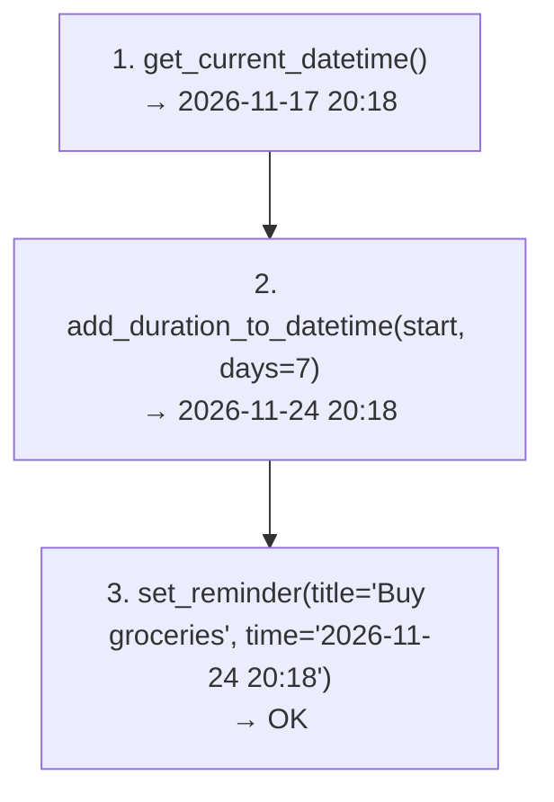
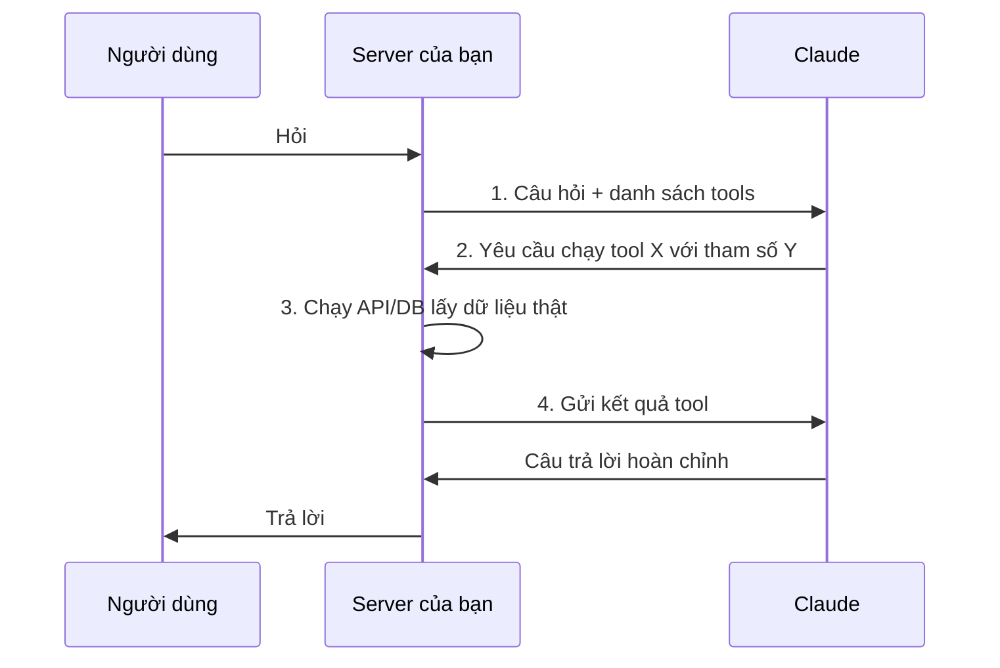
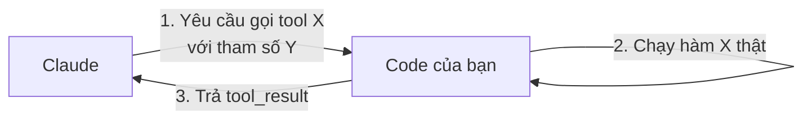
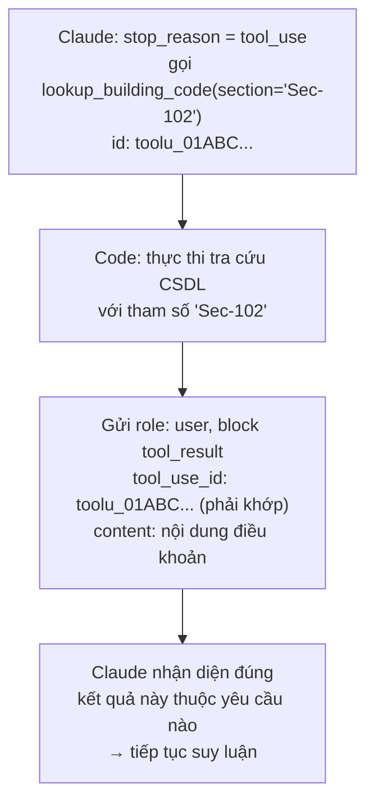

---
tags:
  - claude/nen-tang
aliases:
  - Tool Use
  - Function Calling
  - Sử dụng công cụ
up: "[[Claude Platform]]"
---

# Tool Use (Function Calling)

**Tool** là một hàm do lập trình viên tự viết (query CSDL, gọi API ngoài, đọc file...), được mô tả cho Claude qua tên + công dụng + tham số đầu vào. Claude tự phân tích ngữ cảnh và quyết định *khi nào* cần gọi tool nào — đây là cách Claude vượt qua giới hạn không tự truy cập được hệ thống dữ liệu nội bộ của bạn.

## Vì sao cần Tool Use

LLM thuần có 2 giới hạn:

- **Knowledge cutoff** — dữ liệu huấn luyện dừng ở một mốc thời gian, không biết sự kiện/thông tin thời gian thực (thời tiết, giá cổ phiếu...).
- **Cô lập với thế giới ngoài** — mặc định không tự lướt web, đọc email, tra số dư tài khoản... nếu không có "cầu nối".

Hệ quả với trải nghiệm người dùng: khi bị hỏi thông tin thời gian thực (vd: "Thời tiết ở San Francisco?"), AI thuần buộc phải từ chối kiểu *"Tôi không có truy cập thông tin thời tiết cập nhật"* — nghịch lý vì người dùng tìm đến AI để có thông tin nhanh, nhưng lại bị từ chối cả những nhu cầu cơ bản hằng ngày. Đây chính là "bức tường" mà Tool Use ra đời để phá bỏ.

Tool Use = trang bị "công cụ ngoại vi" cho AI (giống người dùng Google, máy tính, Excel). Ví dụ: hỏi giá cổ phiếu → tool tài chính; tìm quán cà phê gần đây → tool Maps.

### Ví dụ thực hành: Đặt lịch nhắc (Reminder)

Tool Use không chỉ để *tra cứu* dữ liệu (như thời tiết) mà còn **bù đắp giới hạn nhận thức thời gian** và **cho phép Claude thực hiện hành động (side-effect)** lên hệ thống ngoài. Bài toán: user nói *"Đặt nhắc lịch khám bác sĩ, đó là Thứ Năm tuần sau nữa"* → mong đợi Claude xác nhận *"OK, I will remind you."*

3 thách thức ẩn bên dưới:

- **Limited time awareness** — system prompt có thể cho Claude biết *ngày* hiện tại, nhưng Claude không có real-time clock → không biết giờ/phút chính xác nếu không được cấp tool kiểu `get_current_time`.
- **Date calculation issues** — LLM là token prediction, không phải máy tính/lịch → dễ tính sai mốc tương lai phức tạp ("Thứ Năm tuần sau nữa", +45 ngày: sai ngày, năm nhuận, số ngày trong tháng).
- **No reminder capability** — mô hình chỉ "nhận lệnh → trả lời ngay", không có background process, DB lưu trữ hay push notification → không thể tự chờ đến đúng ngày để nhắc.

**Tools lấp khoảng trống (bridge):**

- Bài toán thời gian & tính toán → tool xử lý date/time phía server, đổi cụm tương đối sang mốc tuyệt đối chính xác (vd `2026-11-26`), không để AI tự tính.
- Bài toán đặt lịch → tool nối hệ thống nhắc ngoài (Google Tasks, Apple Reminders, cron job, DB); Claude chỉ phát lệnh `set_reminder(title, date_time)`, server mới thực sự lưu lịch.

**Bộ 3 tool giải quyết bài toán** (mỗi tool một việc, độc lập):

| Tool | Nhiệm vụ | Khắc phục |
| --- | --- | --- |
| `get_current_datetime` | Trả ngày giờ hiện tại từ đồng hồ server — mốc xuất phát cho mọi tính toán | Limited time awareness |
| `add_duration_to_datetime` | Nhận mốc thời gian + khoảng tăng (+7 ngày, +2 giờ), tính bằng thư viện tin cậy (`datetime` Python, `Day.js` JS) | Date calculation issues |
| `set_reminder` | Nhận thời điểm chính xác + nội dung, ghi vào DB / Google Calendar / hệ thống thông báo | No reminder capability |

**Triển khai thực tế (Implementation):** mỗi tool chỉ là một **hàm Python thông thường** chạy trên server của bạn — bạn định nghĩa hàm (tên, mô tả, tham số) → đưa định nghĩa cho Claude → khi cần, Claude trả về tên hàm + tham số dạng structured data để app chạy hàm đó.

Tool đầu tiên cần viết là `get_current_datetime`:

- Chỉ dùng thư viện chuẩn `datetime` để đọc đồng hồ hệ thống và trả về chuỗi thời gian chuẩn (vd `2026-11-18 06:32:00`).
- Là **"bước mồi" (anchor point)** cho mọi phép tính thời gian: trước khi cộng +7 ngày/+1 tháng, Claude bắt buộc gọi tool này để lấy mốc xuất phát (nếu không, "tuần tới" hoàn toàn mơ hồ vì Claude không biết "hôm nay" là ngày nào).

Claude tự xâu chuỗi 3 tool qua [[Vòng lặp Agent]]. Ví dụ *"Remind me in a week to buy groceries"*:



> **Nguyên tắc vàng:** khi mô hình có giới hạn, hãy *mở rộng năng lực bằng tool* thay vì tìm cách lách giới hạn đó trong prompt. Ép AI tính lịch bằng prompt dài dòng dễ gây hallucination và tốn token; việc chính xác/có tác động thực tế nên **ủy quyền (delegate)** cho code phía server.
>
> Bài học: Tool vừa là "mắt" (đọc dữ liệu thời gian thực) vừa là "tay" (ghi/kích hoạt hành động) của Claude.

### Flow 4 bước (Application ↔ Claude)

Claude **không** tự truy cập internet hay API của bạn — server của bạn là "người thực thi". Ví dụ với câu hỏi *"Thời tiết San Francisco thế nào?"*:

1. **Initial Request** — app gửi câu hỏi của user + danh sách tool (kèm mô tả), vd `get_weather(location)`.
2. **Tool Request** — Claude nhận ra thiếu dữ liệu thời gian thực, thấy có tool phù hợp → trả về JSON có cấu trúc yêu cầu chạy `get_weather(location="San Francisco, CA")`.
3. **Data Retrieval** — server chạy code thật (gọi API thời tiết / truy vấn DB), nhận kết quả vd `20°C, có mây`.
4. **Final Response** — server gửi kết quả lại cho Claude → Claude kết hợp câu hỏi gốc + dữ liệu thật thành câu trả lời tự nhiên: *"Thời tiết hiện tại ở San Francisco là 20°C và có mây."*



Phân vai: **Claude = "bộ não"** (phân tích ý định, quyết định *khi nào* và *dùng tool nào, thế nào*); **server của bạn = "tay chân"** (thực sự đi lấy dữ liệu từ API/DB rồi đưa lại cho Claude).

### Lợi ích cốt lõi

- **Real-time information** — truy cập dữ liệu mới hơn dữ liệu huấn luyện (thời tiết, tin tức, giá chứng khoán, chuyến bay).
- **External system integration** — nối AI với CSDL nội bộ, REST API, CRM (Salesforce), dịch vụ bên thứ ba.
- **Dynamic responses** — câu trả lời dựa trên dữ liệu thực tại thời điểm hỏi, không cố định/lý thuyết suông.
- **Structured interaction** — Claude biết rõ thiếu dữ liệu gì, gọi hàm nào, tham số ra sao, ở dạng JSON để server xử lý dễ.

> Tool use biến Claude từ **kho tri thức tĩnh** (như bách khoa toàn thư ngừng xuất bản) thành **trợ lý năng động** làm việc được với dữ liệu sống.

## Nguyên tắc cốt lõi

> **Claude KHÔNG trực tiếp chạy công cụ — code của bạn mới là nơi thực thi nó.**



Claude chỉ trả về một yêu cầu dạng JSON ("hãy chạy tool này với input này"); ứng dụng nhận yêu cầu, tự thực thi, rồi gửi kết quả ngược lại để Claude tiếp tục suy luận.

## Cấu trúc khai báo tool

Claude chạy trên cloud nên **không đọc được mã Python** trên server của bạn. Sau khi viết xong hàm, bạn "dịch" nó thành **JSON Schema** — như tấm hướng dẫn sử dụng (manual) gửi kèm **mỗi lời gọi API** — để Claude biết tool làm gì, khi nào dùng và truyền tham số gì (vd hàm `get_current_datetime` ↔ schema mô tả "máy lấy giờ" và định dạng cần truyền).

**JSON Schema** không phải phát minh riêng của ngành AI — đây là chuẩn lâu đời trong web dùng để validate dữ liệu; giới AI mượn lại vì nó là ngôn ngữ chung, chặt chẽ để mô tả tham số hàm. Có thể xem schema là "bản hợp đồng thông tin" giữa Claude và code của bạn.

Mỗi tool là một JSON Schema gồm 3 phần:

- **`name`** — tên định danh tool.
- **`description`** — mô tả công dụng (làm gì, khi nào nên dùng, trả về gì), quan trọng nhất vì Claude dựa vào đây để quyết định *có nên* và *khi nào* gọi tool này (nên viết rõ ràng, cụ thể, như hướng dẫn cho người mới — không chỉ đặt tên hàm).
- **`input_schema`** — JSON Schema mô tả tham số đầu vào cần cung cấp: từng tham số kèm kiểu dữ liệu (`string`, `integer`...), tham số nào bắt buộc (`required`) và mô tả ý nghĩa để Claude truyền giá trị đúng.

```json
{
  "name": "lookup_building_code",
  "description": "Tra cứu nội dung một điều khoản quy chuẩn xây dựng theo mã định danh. Trả về toàn bộ văn bản của điều khoản đó.",
  "input_schema": {
    "type": "object",
    "properties": {
      "section": {
        "type": "string",
        "description": "Mã điều khoản quy chuẩn xây dựng cần tra cứu (ví dụ: 'Sec-102')"
      }
    },
    "required": ["section"]
  }
}
```

**4 nguyên tắc viết `description`** (Claude không thấy code, chỉ dựa vào ngôn ngữ tự nhiên này để suy luận):

1. **Độ dài vừa đủ** — khoảng 3–4 câu súc tích: không quá ngắn (thiếu ngữ cảnh), không lan man (loãng ý chính).
2. **When to use** — nêu rõ câu hỏi/tình huống nào của user thì nên gọi tool (la bàn để đối chiếu ý định).
3. **What it returns** — mô tả đầu ra (chuỗi ngày giờ chuẩn, JSON thời tiết...) để Claude biết trước dạng dữ liệu nhận lại và tổng hợp câu trả lời.
4. **Mô tả từng tham số** — mỗi argument trong `input_schema` đều giải thích nghĩa, kiểu, bắt buộc hay không → Claude không đoán mò/truyền sai kiểu.

> **Nguyên nhân số 1 khiến Agent gọi sai tool (hoặc không nhận ra tool khả dụng): `description` quá mơ hồ.** Hãy mô tả cụ thể mục đích và dữ liệu trả về, không viết chung chung.

### Quy ước đặt tên `_schema` (Python)

Đặt biến schema theo tên hàm + hậu tố `_schema` (`get_current_datetime` → `get_current_datetime_schema`) để dễ ánh xạ code thực thi ↔ bản mô tả khi dự án có hàng chục tool.

```python
get_current_datetime_schema = {
    "name": "get_current_datetime",  # phải khớp tuyệt đối tên hàm Python
    "description": "Returns the current date and time formatted ...",
    "input_schema": {
        "type": "object",  # tham số truyền dưới dạng object (dict)
        "properties": {
            "date_format": {
                "type": "string",
                "description": "Python strftime format string",
                "default": "%Y-%m-%d %H:%M:%S",
            }
        },
        "required": [],  # có default nên không bắt buộc
    },
}
```

- `name` khớp tên hàm → khi Claude yêu cầu gọi tên đó, server biết chạy hàm nào.
- `required: []` vì `date_format` đã có `default` → Claude có thể gọi không cần tham số.
- Khi gọi API, gom các schema vào `tools=[get_current_datetime_schema, ...]`.

**Request kích hoạt Tool Use** — điểm mấu chốt chỉ là thêm tham số `tools` vào `client.messages.create()`:

```python
messages = [{"role": "user", "content": "What is the exact time, formatted as HH:MM:SS?"}]

response = client.messages.create(
    model=model,
    max_tokens=1024,
    messages=messages,
    tools=[get_current_datetime_schema],  # danh sách JSON Schema của các tool
)
```

Claude đối chiếu câu hỏi (cần dữ liệu thời gian thực) với `tools`; thấy tool phù hợp thì **không trả text thường** mà trả block `tool_use` để code của bạn chạy hàm (xem [[#Cấu trúc response multi-block message]]).

**Type safety với `ToolParam`:** bọc dict bằng `ToolParam({...})` (`from anthropic.types import ToolParam`; là `TypedDict` của SDK Anthropic, đúng cấu trúc tham số `tools` mong đợi). Không bắt buộc — dùng `dict` thường vẫn chạy — nhưng bền vững hơn:

- **Bắt lỗi sớm (IDE/type-check time, không đợi runtime):** mypy, Pyright, VS Code/PyCharm cảnh báo ngay khi gõ sai key (`"descriptions"`), sai kiểu, hoặc thiếu field bắt buộc.
- **Autocomplete:** gợi ý đúng key và kiểu hợp lệ khi gõ trong `ToolParam({...})`.
- Càng hữu ích khi số tool tăng lên.

### Mẹo: nhờ Claude sinh schema

Gõ tay JSON schema dễ lỗi cú pháp (thiếu ngoặc, sai kiểu) → giao luôn cho Claude:

1. Copy mã nguồn hàm Python.
2. Nhờ Claude viết schema cho tool calling.
3. Đính kèm tài liệu Tool Use của Anthropic làm chuẩn.
4. Nhận JSON schema đúng định dạng, có `description` theo best practice.

Prompt mẫu: *"Write a valid JSON schema spec for the purposes of tool calling for this function. Follow the best practices listed in the attached documentation."*

Muốn khỏi viết schema hẳn: dùng [[Tool Runner]] của SDK (tự sinh schema từ code).

## Vòng đời một lượt gọi (tool_use_id)

1. Claude trả về `stop_reason: "tool_use"` kèm block `type: "tool_use"` gồm `id` (mã định danh riêng cho lượt gọi này, ví dụ `toolu_01ABC...`), `name`, `input`.
2. Code chạy hàm tương ứng với `input` đó.
3. Gửi lại block `type: "tool_result"` với `tool_use_id` **khớp chính xác** `id` ở bước 1, mang `content` là kết quả.



### Cấu trúc response: multi-block message

Khi dùng tool, `content` của response không còn là một chuỗi đơn thuần mà là **mảng các block** gồm 2 loại:

- **`type: "text"`** — văn bản thường của Claude (giải thích, câu hỏi ngược, lời dẫn trước khi gọi tool). Hướng tới **người dùng**: cho họ biết AI đang làm gì.
- **`type: "tool_use"`** — yêu cầu gọi tool, gồm `id` (khớp với `tool_result` sau này), `name`, `input` (JSON tham số). Hướng tới **hệ thống/code của bạn**: biết chạy hàm nào, truyền gì.

```json
{
  "role": "assistant",
  "content": [
    { "type": "text", "text": "Để tôi kiểm tra thời tiết Hà Nội cho bạn..." },
    {
      "type": "tool_use",
      "id": "toolu_01A09q90cm1567",
      "name": "get_weather",
      "input": { "location": "Ha Noi", "unit": "celsius" }
    }
  ],
  "stop_reason": "tool_use"
}
```

Phía code: duyệt mảng `content`, thấy block `tool_use` → chạy hàm theo `name` + `input` → gửi lại message `role: "user"` chứa block `tool_result` (`tool_use_id` khớp `id`) → Claude trả câu trả lời cuối dạng `text`.

### Quản lý lịch sử `messages`

API **stateless** — server không lưu hội thoại, bạn tự giữ mảng `messages` và gửi lại đầy đủ mỗi lượt. Khi Claude trả về `tool_use`, phải append **nguyên mảng** `response.content` (cả `text` lẫn `tool_use`), không chỉ trích đoạn text:

```python
messages.append({"role": "assistant", "content": response.content})
```

**Nâng cấp helper:** các hàm kiểu `add_user_message(messages, text)` / `add_assistant_message(...)` viết cho chuỗi đơn thuần sẽ lỗi type hoặc làm hỏng cấu trúc khi nhận mảng block. Cho `content` nhận **cả `str` lẫn `list` multi-block** (đừng ép kiểu/bọc lại):

```python
def add_user_message(messages, content):       # str hoặc [{"type": "tool_result", ...}]
    messages.append({"role": "user", "content": content})

def add_assistant_message(messages, content):  # str hoặc response.content
    messages.append({"role": "assistant", "content": content})
```

Lý do: khi gửi `tool_result`, Claude cần nhìn lại lượt trước để đối chiếu `id` của `tool_use` và mạch suy luận. Mất block `tool_use` khỏi lịch sử → API báo lỗi (không ghép được `tool_result` với yêu cầu gốc).

### Flow 5 bước hoàn chỉnh (mức code)

1. Gửi `messages` + `tools=[schema]`.
2. Nhận multi-block message → **lưu ngay** vào `messages` (`role: "assistant"`).
3. Đọc block `tool_use` (`name`, `input`, `id`) → chạy hàm thật ở backend.
4. Append message `role: "user"` chứa `tool_result` (`tool_use_id` khớp `id`) → gửi lại **toàn bộ** `messages` (câu hỏi → response đa khối → tool_result).
5. Nhận câu trả lời cuối dạng `text`.

```python
messages = [{"role": "user", "content": "Mấy giờ rồi?"}]
response = client.messages.create(model=model, max_tokens=1000,
                                  messages=messages, tools=[schema])

messages.append({"role": "assistant", "content": response.content})

if response.stop_reason == "tool_use":
    block = next(b for b in response.content if b.type == "tool_use")
    result = run_tool(block.name, block.input)

    messages.append({"role": "user", "content": [{
        "type": "tool_result",
        "tool_use_id": block.id,   # phải khớp id ở bước 2
        "content": str(result),
    }]})

    final = client.messages.create(model=model, max_tokens=1000,
                                   messages=messages, tools=[schema])  # vẫn phải truyền tools
    print(final.content[0].text)
```

Truyền tham số vào hàm thật (bước 3):

- `block.input` là một **dict** `{tên_tham_số: giá_trị}` do Claude sinh theo `input_schema`. Dùng `**` (dictionary unpacking) để bung thành keyword arguments: `get_current_datetime(**block.input)` ≡ `get_current_datetime(format="HH:MM:SS")`.
- **Đừng hardcode `response.content[1]`**: Claude có thể không kèm block `text` hoặc đổi thứ tự block → tìm theo `b.type == "tool_use"` như code trên.
- Claude trả key thừa/thiếu hoặc sai tên so với tham số hàm → `**input` ném `TypeError: unexpected keyword argument`. Bọc `try ... except` và trả `tool_result` với `is_error: True` để Claude tự sửa.

Về `tool_result` (bước 4 là "mảnh ghép cuối" khép kín vòng lặp):

- Khi Claude phát `tool_use` thì nó **chưa có dữ liệu thật**, chỉ mới ra chỉ thị. Nếu code không chạy hàm và gửi kết quả về, hội thoại bị treo ở trạng thái chờ dữ liệu.
- `content` của `tool_result` có thể là chuỗi hoặc JSON.
- Hàm chạy lỗi thì **vẫn gửi** `tool_result` (kèm `is_error: True`) để Claude biết chuyện gì xảy ra và xử lý khéo, thay vì để API báo lỗi (xem [[#Xử lý lỗi]]).

3 thuộc tính của block `tool_result` (nằm trong `content` của message `role: "user"`):

| Thuộc tính | Bắt buộc? | Ý nghĩa |
| --- | --- | --- |
| `tool_use_id` | Có | Khớp chính xác `id` của block `tool_use` tương ứng |
| `content` | Khuyến nghị | Kết quả hàm, thường ép thành `str` (vd `"16:33:00"` hoặc chuỗi JSON) |
| `is_error` | Không (mặc định `False`) | `True` khi hàm lỗi (mạng, thiếu dữ liệu, sai tham số) → Claude hiểu đây là lỗi, không phải dữ liệu thật, rồi báo user hoặc đề xuất cách khác |

```python
{"type": "tool_result", "tool_use_id": "toolu_01A09q90cm1567",
 "content": "Không thể kết nối tới dịch vụ thời gian.", "is_error": True}
```

Trước request ở bước 4, `messages` đã tích lũy đủ **3 message**: (1) `user` — câu hỏi gốc, (2) `assistant` — response đa khối chứa `tool_use`, (3) `user` — `tool_result` khớp `id`. Claude đọc lại cả 3 để biết user hỏi gì, mình đã định gọi tool nào và kết quả thật là gì → mới đủ ngữ cảnh trả câu cuối (vd *"Bây giờ là 15:04:22."*).

Lưu ý: request ở bước 4 **vẫn phải truyền `tools`** vì lịch sử đang chứa block `tool_use`/`tool_result` — dù bạn chỉ kỳ vọng Claude trả text thường. Thiếu `tools`, Claude không đối chiếu được schema của các tool trong lịch sử → API có thể báo lỗi. Kết quả: Claude tổng hợp `tool_result` thành câu trả lời tự nhiên, vòng Tool Use khép kín. Code trên chỉ xử lý 1 lượt gọi; nhiều lượt liên tiếp cần bọc vào vòng lặp → [[Vòng lặp Agent]].

Nhờ `tool_use_id`, Claude biết chính xác `tool_result` vừa nhận thuộc về lượt gọi tool nào — quan trọng khi có nhiều tool được gọi song song (xem [[#Gọi song song parallel tool use]]) vì lúc đó nhiều `tool_result` có thể trả về không theo đúng thứ tự gọi.

Chi tiết cách nối `messages` qua nhiều lượt để tạo thành agent hoàn chỉnh: xem [[Vòng lặp Agent]].

## Các loại tool

- **Custom tools** — tự định nghĩa và tự thực thi trong code của bạn; phổ biến nhất.
- **Server-side/built-in tools** — Anthropic host & thực thi sẵn (web search, code execution, bash, text editor, computer use...): Claude gọi nhưng hạ tầng Anthropic chạy, không phải code của bạn. Chi tiết: [[Built-in Tools (Server Tools)]].
- **Client tools** — vẫn thực thi trên máy/hạ tầng của bạn như custom tool, nhưng dùng schema dựng sẵn từ SDK (ví dụ Memory, Bash) thay vì tự viết `input_schema` từ đầu. Chi tiết: [[Client Tools]].
- **MCP connectors** — tool lấy từ MCP server bên ngoài, không cần tự viết schema (xem [[MCP Connector (API)]]); khái niệm/sản phẩm nền xem [[Connectors (MCP)]].

## tool_choice — điều khiển việc chọn tool

- `auto` (mặc định) — Claude tự quyết có dùng tool hay trả lời trực tiếp.
- `any` — bắt buộc gọi một tool nào đó, không được trả lời trực tiếp.
- `tool: {name}` — ép dùng đúng một tool cụ thể.
- `none` — cấm dùng tool.

## Khai báo nhiều tool cùng lúc

Mảng `tools` không giới hạn ở 1 phần tử — khai báo càng nhiều tool, Claude càng có nhiều lựa chọn để tự đối chiếu với yêu cầu người dùng và quyết định *tool nào, theo thứ tự nào*, dựa hoàn toàn vào phần `description` của từng tool.

Cấu trúc [[Vòng lặp Agent|vòng lặp]] không đổi — chỉ cần mở rộng 2 chỗ: thêm khai báo JSON vào mảng `tools`, và thêm một nhánh vào hàm điều hướng thực thi (`runTool`/`run_tool`) để `switch`/rẽ nhánh theo `name`:

```javascript
function runTool(name, input) {
  switch (name) {
    case "get_weather":
      return getWeather(input.city);   // thời tiết hôm nay
    case "get_forecast":
      return getForecast(input.city);  // dự báo nhiều ngày tới
  }
}
```

Muốn thêm tool thứ 3? Chỉ cần thêm 1 khai báo JSON + 1 nhánh `case` mới — toàn bộ logic vòng lặp bên dưới giữ nguyên, không cần sửa.

**Ví dụ:** yêu cầu *"Chuẩn bị hành lý đi Denver 3 ngày"* — Claude tự nhận ra cần cả thời tiết hôm nay lẫn dự báo 3 ngày tới, nên gọi cả `get_weather` lẫn `get_forecast` rồi tổng hợp thành lời khuyên cụ thể (ví dụ: mặc nhiều lớp áo vì có tuyết nhẹ, sẽ ấm dần). Việc Claude nhận diện đúng cả 2 tool cần dùng phụ thuộc hoàn toàn vào `description` của mỗi tool có đủ rõ ràng hay không — một lần nữa khẳng định `description` là yếu tố quyết định độ chính xác của Agent.

## Gọi song song (parallel tool use)

Nếu nhiều tool độc lập nhau (như `get_weather` và `get_forecast` ở trên), Claude có thể trả về nhiều block `tool_use` trong cùng một response — giảm số vòng lặp cần thiết thay vì gọi tuần tự từng cái. Khi đó mỗi block mang `id` riêng, và từng `tool_result` gửi lại phải khớp đúng `tool_use_id` tương ứng (xem [[#Vòng đời một lượt gọi tool_use_id|phần tool_use_id]]).

Xảy ra khi câu hỏi chứa nhiều tác vụ độc lập (vd *"10+10 và 30+30 bằng mấy?"*, *"Thời tiết Hà Nội và TP.HCM?"*): `response.content` gồm 1 block `text` dẫn + nhiều block `tool_use` (`toolu_01`, `toolu_02`...).

Quy tắc gửi kết quả:

- Tạo **một `tool_result` cho từng** `tool_use`, mỗi cái gắn đúng `tool_use_id` tương ứng.
- **Thứ tự không bắt buộc** khớp thứ tự gọi — nhờ `tool_use_id`, Claude vẫn ghép đúng kết quả với lời gọi.
- Gom **tất cả** `tool_result` vào **một message `role: "user"` duy nhất**, không tách thành nhiều message `user` rời.

```python
tool_results = []
for block in response.content:
    if block.type == "tool_use":
        output = run_tool(block.name, block.input)
        tool_results.append({
            "type": "tool_result",
            "tool_use_id": block.id,  # khớp id từng block
            "content": str(output),
        })

messages.append({"role": "assistant", "content": response.content})
messages.append({"role": "user", "content": tool_results})  # 1 message chứa tất cả
```

## Xử lý lỗi

Khi tool thực thi lỗi, vẫn trả `tool_result` như bình thường nhưng đánh dấu `is_error: true` kèm mô tả lỗi, để Claude tự điều chỉnh (thử cách khác, hỏi lại người dùng) thay vì làm gãy luồng hội thoại.

**Validate đầu vào trong tool function:** tool chỉ là hàm Python bình thường (Flask, FastAPI...) được "đăng ký" với Claude qua schema. Vì tham số do Claude sinh từ ngôn ngữ tự nhiên nên có thể thiếu, sai định dạng ngày tháng hoặc giá trị không hợp lệ → luôn kiểm tra đầu vào:

- **Chống crash** — không validate thì exception có thể làm sập cả hệ thống.
- **Giúp Claude tự sửa sai (self-correction)** — trả về thông báo lỗi rõ ràng (vd *"Lỗi: Không tìm thấy thành phố 'San Franci' trong CSDL"*) thay vì để app văng; Claude đọc lỗi, hiểu vấn đề rồi gọi lại tool với tham số đã sửa.

**3 best practices khi viết tool function:**

1. **Descriptive names** — tên hàm *và* tên tham số phải nói rõ mục đích, vì Claude chọn tool dựa trên ngữ nghĩa. Tốt: `get_weather(city_name: str)`; kém: `fetch_data(arg1: str)` (dễ chọn sai tool/truyền lộn tham số).
2. **Validate inputs** — kiểm tra rỗng (`""`), sai kiểu, sai định dạng (`YYYY-MM-DD`) rồi `raise` exception khi vi phạm → tránh crash và bảo vệ dữ liệu backend.
3. **Meaningful error messages** — nêu đúng nguyên nhân, không dùng lỗi chung chung kiểu `Error 500`/`Invalid input`.

Lỗi chi tiết đóng vai trò như *feedback prompt* (vd *"Location cannot be empty. Please specify a city name."*): hỏi "Thời tiết ở đó thế nào?" → Claude đoán gọi `get_weather(city_name="")` → code raise lỗi → Claude đọc lỗi và hỏi lại user "Bạn muốn xem thời tiết ở thành phố nào?". Lỗi mơ hồ hoặc crash im lặng thì Claude bị "mắc kẹt".

## Tích hợp vào hệ thống thực tế (Production)

Không cần viết mã nguồn mới riêng cho AI — Tool thường chỉ là **lớp bọc mỏng (thin wrapper)** quanh các hàm/dịch vụ đã có sẵn trong ứng dụng (hàm truy vấn CSDL, gọi service nội bộ...).

Ví dụ: một **Compliance Agent** (kiểm định tuân thủ pháp lý) dùng thẳng các hàm `lookup_building_code`/`search_building_code` vốn đã tồn tại trong dự án — khi dùng [[Tool Runner]], chỉ cần truyền thẳng các hàm này vào là Agent tự tra cứu và dẫn chứng đúng điều khoản pháp lý.

## Recap

| Nội dung | Chi tiết cần nhớ |
| --- | --- |
| Bản chất của Tool | Cho Claude kết nối hệ thống bên ngoài: bạn định nghĩa hàm → Claude chọn khi nào gọi → code của bạn trực tiếp thực thi. |
| Cấu trúc Tool | JSON Schema gồm `name`, `description`, `input_schema`, truyền qua mảng `tools`. |
| Tầm quan trọng của `description` | Mô tả chung chung/mơ hồ là nguyên nhân chính khiến Agent gọi sai hoặc bỏ sót tool. |
| Dấu hiệu thực thi | `stop_reason: "tool_use"` → chạy hàm tương ứng → phản hồi bằng `tool_result` khớp đúng `tool_use_id`. |
| Tối ưu với [[Tool Runner]] | SDK (TypeScript, Python, Ruby) tự sinh Schema từ hàm code thật + tự quản lý toàn bộ vòng lặp. |
| Lựa chọn triển khai | Tự quản lý [[Vòng lặp Agent\|vòng lặp]], dùng [[Tool Runner]] của SDK, hoặc giao hẳn cho Managed Agents của Anthropic vận hành. |

## Liên kết

- Thuộc nhóm: [[Claude Platform]]
- Phân biệt với [[Skills]]: Tool = khả năng hành động (what Claude can do), Skill = quy trình/quy chuẩn thực hiện (how you want it done)
- Cơ chế lắp ráp nhiều lượt gọi tool thành hành vi agent: [[Vòng lặp Agent]]
- Kết nối tool từ server ngoài: [[Connectors (MCP)]]
- Tool Anthropic tự host & thực thi sẵn: [[Built-in Tools (Server Tools)]]
- Tool chạy trên máy bạn nhưng dùng schema dựng sẵn từ SDK: [[Client Tools]]
- SDK tự sinh `input_schema` từ code, khỏi gõ tay: [[Tool Runner]]
