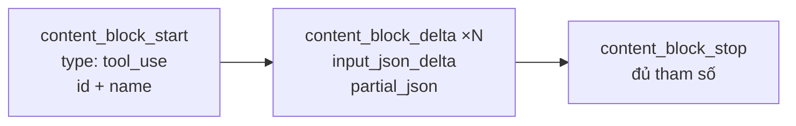
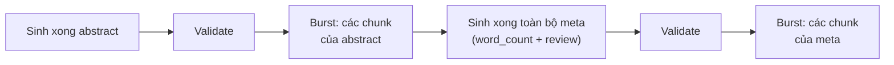

---
tags:
  - claude/nen-tang
  - llm/streaming
  - llm/tool-use
aliases:
  - Tool Use Streaming
  - Streaming Tool Use
  - input_json_delta
  - InputJsonEvent
  - Eager Input Streaming
  - Fine-grained Tool Streaming
up: "[[Claude Platform]]"
---

# Tool Use Streaming (Gọi tool ở chế độ streaming)

Kết hợp [[Tool Use (Function Calling)]] với [[Response Streaming]]: client nhận cập nhật **ngay trong lúc Claude đang sinh tham số tool**, thay vì chờ xong cả response. Đổi lại, code phải tự xử lý dữ liệu đến **từng phần**, không có sẵn object hoàn chỉnh như non-streaming.

**Lợi ích (UX):** UI hiện được trạng thái "đang chuẩn bị gọi tool X" / "đang điền tham số", giảm cảm giác bị treo khi tool nhận input dài (nội dung file, code, tài liệu).

## Vòng đời block trong stream

Một response có thể chứa nhiều block (vd `text` rồi tới `tool_use`), mỗi block đi qua 3 bước và được phân biệt bằng `index`:



| Thời điểm | Có gì | Nên làm |
| --- | --- | --- |
| `content_block_start` | `id`, `name`; `input` còn rỗng (`{}`) | Mở buffer theo `index`, hiện "đang gọi tool..." |
| `input_json_delta` | Một mảnh **chuỗi** JSON (`partial_json`) | Nối vào buffer, cập nhật UI nếu cần |
| `content_block_stop` | Block đã đóng | Parse chuỗi đã ghép |
| `message_delta` | `stop_reason` | Kiểm tra rồi mới chạy tool |

> [!warning] Quy tắc chính
>
> - **Không parse JSON giữa chừng** — mảnh chưa đủ thì JSON chưa hợp lệ (vd `{"location": "San Fr`).
> - **UI được cập nhật sớm, nhưng `run_tool` chỉ chạy khi block `tool_use` đã hoàn tất.**

## Xử lý bằng code (Python)

Cách đơn giản nhất: stream để cập nhật UI, còn việc ghép và parse để SDK lo qua `get_final_message()`.

```python
with client.messages.stream(model="<model-id>", max_tokens=16000,
                            messages=messages, tools=tools) as stream:
    for event in stream:
        if event.type == "content_block_start" and event.content_block.type == "tool_use":
            show_status(f"Đang chuẩn bị gọi {event.content_block.name}...")
        elif event.type == "content_block_delta":
            if event.delta.type == "text_delta":
                show_text(event.delta.text)
            elif event.delta.type == "input_json_delta":
                show_tool_progress(event.delta.partial_json)  # chỉ để hiển thị

    final = stream.get_final_message()  # input đã ghép và parse thành dict

if final.stop_reason == "tool_use":
    for block in final.content:
        if block.type == "tool_use":
            result = run_tool(block.name, block.input)
```

- Sau đó gửi `tool_result` như bình thường, xem [[Vòng lặp Agent]].
- Nếu đọc SSE thô (không dùng SDK): giữ một buffer cho mỗi `index`, parse khi gặp `content_block_stop`.

## `InputJsonEvent` (`type == "input_json"`)

Event tiện ích do **SDK Python** (`client.messages.stream()`) tạo thêm, dành riêng cho tham số tool. Với mỗi `input_json_delta`, SDK phát event thô `content_block_delta` trước rồi tới `input_json`, nên chỉ xử lý **một trong hai** để tránh nhận trùng. Khác với `text_delta` (nối lại thành câu trả lời), các mảnh này ghép thành đối số của tool.

| Thuộc tính | Kiểu | Nội dung | Dùng khi |
| --- | --- | --- | --- |
| `partial_json` | `str` | Chỉ **mảnh mới nhất** (vd `'{"ti'`, rồi `'tle": "'`) | Log, hiển thị phần vừa thêm |
| `snapshot` | `object` (thường là `dict`) | Tham số **cộng dồn, đã parse** tới thời điểm hiện tại | Xem trạng thái tích lũy, khỏi tự nối chuỗi |

```python
for chunk in stream:
    if chunk.type == "input_json":
        print(chunk.partial_json, end="")  # mảnh JSON mới
        current_args = chunk.snapshot      # object tạm tính, có thể còn thiếu
```

- **`snapshot` không phải chuỗi** → không gọi `json.loads(snapshot)`. SDK đã parse bằng parser chịu được JSON dở dang (`jiter`, partial mode).
- **Parse được không có nghĩa là đủ:** giữa chừng có thể thiếu key hoặc giá trị đang sinh dở → truy cập bằng `.get()`, không dùng để chạy tool. Muốn có chuỗi JSON thô thì tự nối `partial_json`.
- **Nhiều tool call trong một lượt:** `InputJsonEvent` **không có** `index`, `id` hay `name`. Lấy các thông tin này từ `content_block_start` (hoặc `index` của event thô). Mỗi block có `snapshot` riêng, nên lưu trạng thái theo từng block.

## Phía sau hậu trường: API buffer tham số

- **Mặc định**, API chờ xong **một cặp `key: value` cấp cao nhất (top-level)**, validate theo schema, rồi mới phát các `input_json_delta` của cặp đó. Vì vậy stream không nhỏ giọt đều như text mà **nghỉ rồi đổ về từng cụm** (burst), mỗi cụm vẫn có thể gồm nhiều chunk.

Ví dụ input có 2 key top-level là `abstract` (chuỗi) và `meta` (object chứa `word_count`, `review`):



- Key **lồng bên trong** không được gửi riêng: `word_count` phải đợi cả `meta` hoàn tất.
- Giá trị càng lớn (đoạn văn dài, object lồng sâu) thì càng **chờ lâu** mới có chunk đầu tiên của trường đó; tham số ngắn thì hầu như không nhận ra.
- **Thiết kế tool:** chia thành nhiều trường top-level hợp lý (thay vì gói trong một object lớn) → dữ liệu về theo nhịp nhỏ hơn, UI cập nhật sớm hơn. Một chuỗi đơn rất dài thì vẫn phải chờ.
- **Validate này không thay cho kiểm tra phía client:** tham số bị hỏng có thể được gửi về dưới dạng **một chuỗi** thay vì đúng kiểu. Cần đảm bảo đúng schema thì dùng `strict: true` trên tool; vẫn phải kiểm tra `stop_reason`.

## Fine-grained tool streaming

Chế độ **tắt buffer và bỏ JSON validation phía server**, bật bằng `eager_input_streaming: true` trên tool. Mảnh được đẩy về ngay khi sinh, không chờ xong key top-level: với ví dụ trên, `word_count` xuất hiện sớm, không phải đợi cả `meta`. Chuỗi event không đổi, chỉ khác **thời điểm** và **mức đảm bảo hợp lệ**.

| | Mặc định (buffered) | Fine-grained |
| --- | --- | --- |
| Nhịp dữ liệu | Chờ rồi đổ từng cụm | Sớm và liên tục hơn |
| JSON validation phía server | Có | **Không** |

### Khi nào nên bật

- **Hiển thị tiến độ real-time** khi tool nhận tham số lớn (soạn bài viết, mô tả dài).
- **Xử lý sớm** trường đến trước (chuẩn bị, tiền xử lý). Chỉ làm việc không có side-effect; `run_tool` vẫn đợi đủ input hợp lệ.
- **Buffer làm UI khựng** vì giá trị top-level quá lớn.
- **Điều kiện bắt buộc:** client đã bắt lỗi parse, kiểm tra kiểu (không lọt `"undefined"` thay cho số) và chỉ chạy tool khi input hợp lệ.

Không thuộc các trường hợp trên hoặc client chưa đáp ứng điều kiện → **giữ mặc định**: đủ cho đa số ứng dụng, giảm (không loại bỏ) rủi ro JSON hỏng ở client.

> [!note] Khuyến nghị khác
> Tài liệu hướng dẫn đi kèm skill `claude-api` của Claude Code khuyên **bật** cho mọi request streaming có tool tự viết, **với điều kiện** client xử lý được input không hợp lệ. Bản thân API vẫn mặc định là buffered.

### Cách bật

- `fine_grained=True` (vd `run_conversation(..., fine_grained=True)`) chỉ là tham số của **hàm wrapper tự viết** trong bài hướng dẫn, **không phải tham số API/SDK**.
- Header beta `fine-grained-tool-streaming-2025-05-14` là cách **cũ** (legacy), không cần gửi kèm.
- Cách hiện hành: đặt `eager_input_streaming: true` trong định nghĩa từng tool tự viết (không áp dụng cho server tool), không cần beta header. Một số proxy hoặc bản triển khai Bedrock cũ có thể từ chối field này.

```json
{
  "name": "write_file",
  "description": "Write text to a file",
  "eager_input_streaming": true,
  "input_schema": {
    "type": "object",
    "properties": {
      "path": { "type": "string" },
      "contents": { "type": "string" }
    },
    "required": ["path", "contents"]
  }
}
```

### Rủi ro khi bật

API không còn validate, JSON ghép lại (kể cả **bản cuối cùng**) có thể **bị cắt** hoặc **sai cú pháp**. Khi bật, client phải:

- **Validate `input` theo schema** trước khi chạy tool. SDK có thể parse "dễ dãi", trả object **thiếu dữ liệu mà không báo lỗi**.
- **Kiểm tra `stop_reason`**: gặp `max_tokens` (input có thể bị cắt) hoặc `refusal` thì **không chạy tool**.
- **Bắt lỗi parse JSON** của SDK khi đọc stream (không bắt gộp cả lỗi API).
- Input không hợp lệ mà đã có block `tool_use` → trả `tool_result` với `is_error: true` để Claude thử lại; chưa có block → gửi lại request (giới hạn số lần retry).

### Xử lý JSON lỗi

Hai kiểu lỗi: **sai cú pháp** (vd `"word_count": undefined` là kiểu JavaScript, JSON chỉ nhận như `847` hoặc `null`; thiếu ngoặc) và **sai kiểu** (cần `int` nhưng nhận chuỗi).

| | Mặc định (buffered) | Fine-grained |
| --- | --- | --- |
| Giá trị có vấn đề | Có thể bị bọc thành **chuỗi** (vd `"undefined"`): JSON hợp lệ nhưng **sai kiểu** so với schema | Đến thẳng client, có thể **không parse được** |
| Client vẫn phải | Kiểm tra kiểu | Bắt lỗi parse **và** kiểm tra kiểu |

Với **SDK Python**, SDK tự parse từng delta nên JSON không đọc được sẽ ném `ValueError` ngay từ vòng lặp stream → bọc `try` quanh **cả khối stream**:

```python
try:
    with client.messages.stream(...) as stream:
        for chunk in stream:
            if chunk.type == "input_json":
                show_tool_progress(chunk.partial_json)
        final = stream.get_final_message()
except ValueError:
    retry_request()  # chưa có block hoàn chỉnh: gửi lại, giới hạn số lần
```

Khi **tự ghép chuỗi** (SSE thô), parse **sau `content_block_stop`**; lỗi thì không chạy tool:

```python
try:
    args = json.loads(buffer)  # buffer = các partial_json đã nối
except json.JSONDecodeError:
    tool_result = {
        "type": "tool_result", "tool_use_id": tool_id, "is_error": True,
        "content": json.dumps({"INVALID_JSON": buffer}),
    }
else:
    validate(args)  # parse được vẫn phải kiểm tra theo schema
```

- **Không dùng `json.loads(chunk.snapshot)`:** `snapshot` đã là object nên ném `TypeError`, `except json.JSONDecodeError` không bắt được.
- Lỗi parse **giữa chừng** do JSON chưa đủ là bình thường; lỗi ở **bản cuối** mới là input hỏng, không được chỉ "bỏ qua rồi chạy tiếp".

## Liên kết

- Thuộc nhóm: [[Claude Platform]]
- Cơ chế SSE và chuỗi event: [[Response Streaming]]
- Khai báo tool, `tool_use` / `tool_result`: [[Tool Use (Function Calling)]]
- Vòng lặp chạy tool nhiều lượt: [[Vòng lặp Agent]]
- SDK tự quản lý vòng lặp: [[Tool Runner]]
