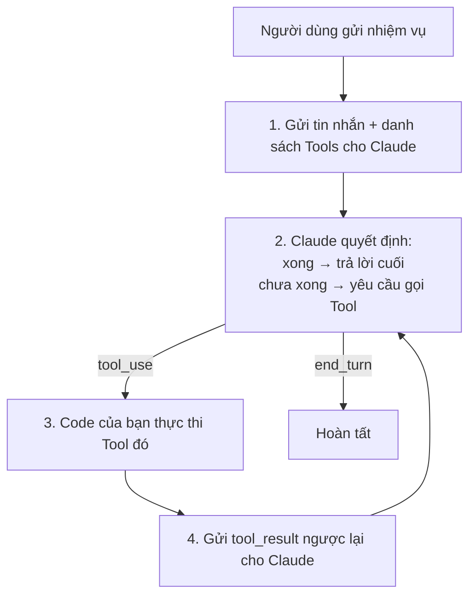
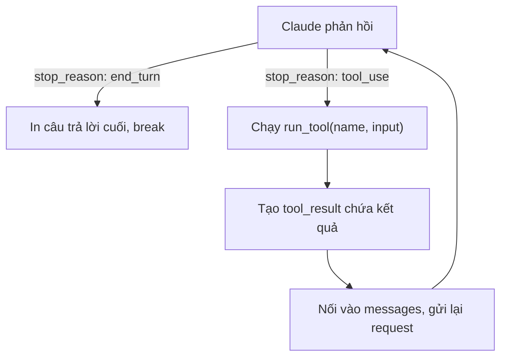
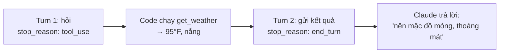
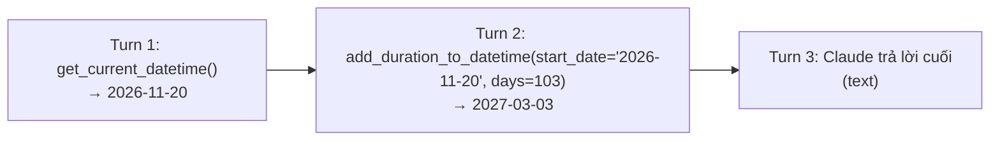

---
tags:
  - claude/nen-tang
aliases:
  - Agent Loop
  - Vòng lặp Agent
  - Agentic Loop
up: "[[Claude Platform]]"
---

# Vòng lặp Agent (Agent Loop)

Cơ chế biến Claude từ một mô hình hỏi-đáp đơn thuần (1 request → 1 response) thành một **Agent tự vận hành**: Claude tự đóng cả hai vai trong một vòng lặp nhắn tin, không cần con người can thiệp giữa chừng — tự phân tích việc cần làm, chọn tool, đọc kết quả, và lặp lại đến khi xong.

Đây chính là cách [[Tool Use (Function Calling)|Tool use]] (nhắc ở [[Claude Platform#Góc nhìn kiến trúc 3 tầng|Primitives]]) được lắp ráp thành hành vi agent thực sự.

## 5 bước



1. **Khởi tạo** — gửi yêu cầu người dùng kèm danh sách tool khả dụng.
2. **Claude ra quyết định** — trả về câu trả lời cuối cùng, **hoặc** một yêu cầu gọi tool (`tool_use`).
3. **Thực thi** — code của bạn (không phải Claude) chạy tool đó (query CSDL, chạy code, tìm web...).
4. **Phản hồi** — gửi lại kết quả tool (`tool_result`) cho Claude.
5. **Lặp lại** — quay về bước 2, cho đến khi `stop_reason` = `end_turn`.

## Điểm cần nhớ

- Claude **không tự chạy tool** — chỉ *yêu cầu* gọi tool qua `tool_use`; việc thực thi thật luôn nằm ở code của người phát triển.
- Vòng lặp có thể lặp nhiều vòng (nhiều lần gọi tool nối tiếp) trước khi đến `end_turn` — không giới hạn ở 1 lần gọi tool duy nhất.
- **Nguyên tắc dừng:** vòng lặp chạy đến khi Claude **ngừng yêu cầu tool** — đó chính là tín hiệu Claude đã có **câu trả lời cuối cùng** (khối `text` trong phản hồi cuối). Không đoán trước số lượt gọi API hay số lần dùng tool; giao quyền quyết định dừng cho Claude (sau 0, 1 hay nhiều lần gọi tool nối tiếp đều được).
- Đây là nền tảng của mọi hệ thống agent phức tạp hơn (Claude Code, [[Managed Agents]]...) — chỉ khác ở việc ai giữ vòng lặp (code tự viết vs. hạ tầng managed).

## Ví dụ thực hành (Python)

3 thành phần cốt lõi khi tự viết vòng lặp (ví dụ: agent tra cứu thời tiết):

1. **`tools`** — mảng JSON Schema mô tả công cụ Claude được phép dùng: `name`, `description` (để Claude biết *khi nào* nên dùng), `input_schema` (tham số đầu vào cần cung cấp).
2. **`run_tool(name, input)`** — hàm phía ứng dụng, chạy khi Claude yêu cầu (ví dụ: gọi API thời tiết thật, thay vì trả kết quả giả lập).
3. **Vòng lặp `while True`** — rẽ nhánh theo `stop_reason`:



**Điểm kỹ thuật quan trọng** — khi gặp `tool_use`, phải nối thêm **2 tin nhắn** vào `messages` trước lượt gọi tiếp theo, nếu không Claude sẽ mất ngữ cảnh đã gọi tool gì:

- `role: "assistant"` — toàn bộ `response.content` gốc (gồm cả khối `tool_use` Claude vừa trả về).
- `role: "user"` — khối `tool_result`, tham chiếu đúng `tool_use_id`, mang kết quả thực thi.

Nhờ giữ lại lịch sử này, vòng lặp sau Claude mới biết tool đã trả về gì để tổng hợp câu trả lời cuối cho người dùng.

### Vết chạy thực tế: chỉ 2 turn là xong

Với câu hỏi *"Tôi nên mặc gì ở Austin hôm nay?"*, toàn bộ vòng lặp chỉ tốn **2 lượt gọi API, 1 lần thực thi tool**:



- **Turn 1** — Claude không biết thời tiết thực tế → phát `tool_use` gọi `get_weather({"city": "Austin"})`; code thực thi và lấy được `95°F, nắng`.
- **Turn 2** — gửi kết quả đó lại; Claude phân tích (95°F ≈ 35°C, nắng) và đưa ra lời khuyên trang phục, `stop_reason` = `end_turn`.

**Core Pattern:** mọi agent phức tạp hơn (tự sửa code, tìm web, truy vấn CSDL...) đều chạy trên đúng nguyên lý lặp này — chỉ khác về số turn và loại tool được gọi.

## Gọi tool tuần tự (chained / sequential tool calls)

Khác với [[Tool Use (Function Calling)#Gọi song song (parallel tool use)|gọi song song]] (nhiều tool **độc lập** trong **1 lượt**, vd *"10+10 và 30+30 bằng mấy?"*), gọi tuần tự là **nối tiếp qua nhiều lượt**: kết quả tool trước là **đầu vào bắt buộc** của tool sau.

Ví dụ *"103 ngày kể từ hôm nay là ngày nào?"*:



**Diễn biến 6 bước (behind the scenes):**

1. **User hỏi** — câu hỏi cần mốc "hôm nay", thông tin động Claude không tự biết.
2. **Claude yêu cầu tool 1** — nhận ra phải biết hôm nay là ngày nào trước → phát `tool_use` gọi `get_current_datetime`.
3. **Server chạy + gửi kết quả lượt 1** — code chạy hàm (ra `2026-11-20`), đóng vào `tool_result`, gửi lại cả lịch sử `messages`.
4. **Claude yêu cầu tool 2** — đã có điểm xuất phát, vẫn thiếu kết quả cuối → phát `tool_use` gọi `add_duration_to_datetime` với `start_date: "2026-11-20"`, `days: 103`.
5. **Server chạy + gửi kết quả lượt 2** — code chạy hàm (ra `2027-03-03`), gửi `tool_result` thứ hai.
6. **Claude trả lời cuối** — đủ dữ liệu → chuyển sang block `type: "text"`: *"Hôm nay là 20/11/2026, 103 ngày sau là 03/03/2027."*

> **Bài học:** Claude tự làm **orchestrator** — bạn không viết logic "tool A hay B trước", Claude tự suy luận ở mỗi lượt theo chu trình *Nhiệm vụ → Gọi tool → Đọc kết quả → Gọi tool tiếp (nếu cần) → Kết luận*.

**Vì sao bắt buộc dùng vòng lặp `while`:** không biết trước câu hỏi cần 1, 2 hay 5 tool liên tiếp (hoặc không cần tool nào). Code cứng kiểu "gọi 1 lần + gửi follow-up 1 lần" sẽ dừng sớm khi Claude mới đi được nửa đường → gói cả *gọi API → chạy tool → gửi `tool_result`* vào `while True`, chỉ thoát khi `stop_reason != "tool_use"` (Claude đã đủ dữ liệu, chuyển sang trả text cuối).

```python
while True:
    response = client.messages.create(
        model=model, max_tokens=1000, messages=messages, tools=tools
    )
    # Luôn lưu phản hồi của Claude vào lịch sử
    messages.append({"role": "assistant", "content": response.content})

    # Không còn yêu cầu tool -> đã có câu trả lời cuối
    if response.stop_reason != "tool_use":
        break

    # Có tool_use -> chạy hết các block, gom tool_result vào 1 message user
    tool_results = []
    for block in response.content:
        if block.type == "tool_use":
            result = execute_tool(block.name, block.input)
            tool_results.append({
                "type": "tool_result",
                "tool_use_id": block.id,
                "content": str(result),
            })
    messages.append({"role": "user", "content": tool_results})

# Block text cuối cùng = câu trả lời cho người dùng
final_text = next(b.text for b in response.content if b.type == "text")
```

- Điều kiện thoát dùng `!= "tool_use"` (thay vì chỉ `== "end_turn"`) bao quát luôn các `stop_reason` khác như `max_tokens`, `stop_sequence`.
- `stop_reason == "tool_use"` là cách **rõ ràng và đáng tin cậy nhất** để biết Claude có đang yêu cầu tool không — phản ánh đúng lý do Claude dừng sinh phản hồi, tốt hơn việc tự dò khối `tool_use` trong `content` (tránh lỗi biên khi bị cắt do `max_tokens`).
- **Production:** nên thêm giới hạn `max_iterations` cho vòng `while` để chặn trường hợp mô hình lặp gọi tool quá nhiều ngoài ý muốn.
- Claude tự điều phối thứ tự gọi tool qua nhiều lượt (`multi-turn`); việc của bạn chỉ là **giữ vòng lặp chạy** cho tới khi `stop_reason` không còn là `tool_use`.

### Hàm `run_conversation` (đóng gói vòng lặp)

Tách vòng lặp thành một hàm tái sử dụng, nhận và trả về mảng `messages` hoàn chỉnh:

```python
def run_conversation(messages):
    while True:
        response = chat(messages, tools=[get_current_datetime_schema])  # 1. gửi lịch sử + schema tool
        add_assistant_message(messages, response)         # 2. lưu phản hồi (text + tool_use)
        print(text_from_message(response))                # 3. in text lượt này (lời dẫn hoặc câu trả lời cuối)
        if response.stop_reason != "tool_use":            # 4. điều kiện dừng
            break
        tool_results = run_tools(response)                # 5. chạy tool, lấy mảng tool_result
        add_user_message(messages, tool_results)          # 6. lưu tool_result với role "user"
    return messages                                       # 7. trả về lịch sử đầy đủ
```

- **Luôn truyền `tools` ở mỗi vòng** để Claude biết các hàm khả dụng và hiểu đúng các block `tool_use`/`tool_result` trong lịch sử.
- **`print(text_from_message(response))` ngay sau khi lưu:** lượt gọi tool thì in lời dẫn (vd *"Let me check the current time..."*); lượt cuối thì in câu trả lời cuối trước khi `break`.
- **`run_tools(response)`** đóng gói việc tìm các block `tool_use`, gọi hàm tương ứng (`**block.input`) và tạo `tool_result` (`tool_use_id`, `content`, `is_error`) → vòng lặp chính gọn.
- Ví dụ *"What is the exact time?"*: vòng 1 nhận `tool_use` → chạy `get_current_datetime` → thêm `tool_result`; vòng 2 Claude trả text với `stop_reason = "end_turn"` → `break`.

Một vòng lặp này xử lý được **mọi kịch bản**, không cần rẽ nhánh riêng:

| Kịch bản | Số vòng lặp |
| --- | --- |
| Không cần tool | 1 vòng: Claude trả text → `break` |
| 1 tool | 2 vòng: nhận `tool_use` + gửi kết quả → nhận text cuối → `break` |
| Nhiều tool song song | `run_tools` xử lý hết các block `tool_use` trong 1 response |
| Nhiều tool nối tiếp (multi-turn) | N vòng, đến khi Claude đủ dữ liệu và ngừng phát `tool_use` |

Vì cả phản hồi của Claude lẫn `tool_result` đều được ghi vào `messages` ở mỗi vòng, lần `chat(messages)` kế tiếp Claude luôn thấy toàn cảnh: đã suy luận gì, đã thu thập dữ liệu nào. Các helper `add_*_message` cần nhận được cả `str`, mảng block lẫn `Message` object: xem phần dưới.

### Refactor 3 hàm nền tảng cho `run_conversation`

Để `run_conversation` chạy được, cần nâng cấp 3 hàm helper:

**1. `add_user_message` / `add_assistant_message`** — nhận linh hoạt `str`, `list` block hoặc `Message` object của SDK:

```python
from anthropic.types import Message

def add_user_message(messages, message):
    messages.append({
        "role": "user",
        "content": message.content if isinstance(message, Message) else message,
    })
# add_assistant_message làm tương tự với "role": "assistant"
```

- Là `Message` (vd `response` từ API) → tự lấy `message.content`; là chuỗi hoặc `[{"type": "tool_result", ...}]` → giữ nguyên.
- Nhờ đó vòng lặp gọi thẳng `add_assistant_message(messages, response)` mà không cần tự `.content`.

**2. `chat(...)`** — nhận thêm `tools`, trả về **nguyên `Message` object**:

```python
def chat(messages, system=None, temperature=1.0, stop_sequences=[], tools=None):
    params = {"model": model, "max_tokens": 1000, "messages": messages,
              "temperature": temperature, "stop_sequences": stop_sequences}
    if tools:
        params["tools"] = tools   # chỉ thêm khi có dữ liệu
    if system:
        params["system"] = system
    return client.messages.create(**params)
```

- Không còn trích sẵn chuỗi text: vòng lặp cần đọc `message.stop_reason` (có phải `"tool_use"` không) và toàn bộ block trong `message.content`.

**3. `text_from_message(...)`** — gom text từ response đa khối:

```python
def text_from_message(message):
    return "\n".join(b.text for b in message.content if b.type == "text")
```

- Vì `chat()` trả về `Message` có thể chứa cả block `text` lẫn `tool_use`, phải lọc `block.type == "text"` rồi nối bằng `"\n"`. Dùng khi hết vòng lặp để hiển thị câu trả lời cuối.

| Hàm | Vai trò sau refactor |
| --- | --- |
| `add_user_message` / `add_assistant_message` | Nhận `str`, `list` block hoặc `Message` mà không phá cấu trúc đa khối |
| `chat(...)` | Gửi kèm `tools` (nếu có), trả nguyên `Message` để kiểm tra `stop_reason` + `content` |
| `text_from_message(...)` | Gom block `text` thành chuỗi sạch cho người dùng |

### Hàm `run_tools(message)`: xử lý nhiều tool trong 1 response

Khung 3 bước: **lọc mọi block `tool_use` → chuẩn bị mảng `tool_result_blocks` → duyệt từng yêu cầu, chạy và thu kết quả** theo đúng `id`.

```python
def run_tools(message):
    tool_requests = [b for b in message.content if b.type == "tool_use"]
    tool_result_blocks = []

    for tool_request in tool_requests:
        try:
            if tool_request.name == "get_current_datetime":
                output = get_current_datetime(**tool_request.input)
            elif tool_request.name == "add_duration_to_datetime":
                output = add_duration_to_datetime(**tool_request.input)
            else:
                raise ValueError(f"Unknown tool: {tool_request.name}")
            tool_result_blocks.append({
                "type": "tool_result", "tool_use_id": tool_request.id,
                "content": str(output), "is_error": False,
            })
        except Exception as e:
            tool_result_blocks.append({
                "type": "tool_result", "tool_use_id": tool_request.id,
                "content": f"Error: {e}", "is_error": True,
            })
    return tool_result_blocks
```

- **Lọc theo `block.type`**, không truy cập theo chỉ số (`content[1]`): đúng với 0, 1 hay nhiều tool, không phụ thuộc vị trí block `text`.
- **Điều phối theo `tool_request.name`**, truyền tham số bằng `**tool_request.input`.
- **`try/except` + `is_error`:** lỗi không làm sập vòng lặp — gửi `is_error: True` kèm thông báo để Claude tự xử lý (thử lại/giải thích).
  - **Vì sao vẫn phải trả `tool_result` khi tool lỗi:** mỗi `tool_use` bắt buộc có `tool_result` tương ứng ở lượt `user` kế tiếp; để exception văng ra thì app crash, bỏ sót `tool_result` thì lịch sử thiếu block → lượt gọi API sau lỗi cấu trúc.
  - **Claude nhờ đó biết:** tool call nào hỏng (`tool_use_id`), nguyên nhân (`content: "Error: ..."`), và tự quyết hướng tiếp: gọi lại với tham số khác, thử tool thay thế, hoặc giải thích cho người dùng thay vì treo.
  - **Tách `run_tool(name, input)` làm bộ điều phối** (gọi đúng hàm với `**input`), để `try/except` trong `run_tools` gọn.
    - Ánh xạ `tool_request.name` → hàm Python, truyền `tool_request.input` bằng `**`; không khớp tool nào thì `raise` để `run_tools` bắt và trả `is_error: True`.
    - **Tách bạch trách nhiệm:** `run_conversation` lo vòng đời API + `messages`; `run_tools` lo duyệt block, bắt lỗi, gom `tool_result`; `run_tool` chỉ lo định tuyến tên → hàm.
    - **Thêm tool mới không sửa vòng lặp chính:** viết hàm + JSON schema → thêm nhánh vào `run_tool` → đưa schema vào `tools` của `chat`.
    - Nhiều tool thì dùng **dictionary registry** thay chuỗi `if/elif`:

      ```python
      TOOL_REGISTRY = {"get_current_datetime": get_current_datetime, "another_tool": another_tool}

      def run_tool(tool_name, tool_input):
          func = TOOL_REGISTRY.get(tool_name)
          if func is None:
              raise ValueError(f"Unknown tool: {tool_name}")
          return func(**tool_input)
      ```

  - **Cẩn thận thông tin nhạy cảm** trong `f"Error: {e}"` (đường dẫn file, chuỗi kết nối DB, stack trace thô): log đầy đủ ở server, chỉ trả thông điệp lỗi gọn cho mô hình.
- **Mỗi `tool_result` gắn đúng `tool_use_id`**; cả mảng được gửi trong **một** message `role: "user"` qua `add_user_message`.
- **Quy tắc 1-for-1:** có N block `tool_use` thì phải trả đủ N block `tool_result`, mỗi block mang đúng `tool_use_id` tương ứng.

**Cấu trúc 1 `tool_result` block:**

| Trường | Vai trò |
| --- | --- |
| `type: "tool_result"` | Khai báo khối kết quả thực thi tool (bắt buộc) |
| `tool_use_id` | `tool_request.id` — liên kết kết quả với đúng lần gọi tool (quan trọng khi gọi song song) |
| `content` | Kết quả dạng **chuỗi**, vd `json.dumps(tool_output)` |
| `is_error` | `False` = chạy thành công; `True` = lỗi, `content` là thông báo lỗi |

- **`json.dumps` vs `str`:** `json.dumps(tool_output)` tốt nhất cho `dict`/`list` (chuỗi JSON hợp lệ, Claude đọc cấu trúc rõ ràng). Với chuỗi thuần (vd `"22:06:00"`), `json.dumps` thêm cặp ngoặc kép (`'"22:06:00"'`) — Claude vẫn hiểu, nhưng có thể dùng `str(...)` nếu muốn giữ nguyên.

## Từ demo đến Production

Kiến trúc vòng lặp **giữ nguyên 100%** khi lên production (ví dụ: một Compliance Agent kiểm định tuân thủ pháp lý) — chỉ khác ở việc tool và hạ tầng nối vào hệ thống thật thay vì giả lập:

| | Demo (thời tiết) | Production (Compliance Agent) |
| --- | --- | --- |
| Tool | Giả lập `get_weather` | Gọi API CSDL mã quy chuẩn xây dựng thật |
| Kết quả | In ra console | Trả real-time (streaming SSE) |
| Kết thúc | Thoát script | Lưu rủi ro phát hiện được vào bảng CSDL |

## Recap

- **Agent = Claude trong vòng lặp** Quan sát → Ra quyết định → Hành động → Lặp lại.
- **Cơ chế:** gửi tin nhắn kèm tools → chạy tool khi được yêu cầu → trả `tool_result` → dừng khi `stop_reason == "end_turn"`.
- **Bản ghép hoàn chỉnh (multi-turn tool workflow):** `chat` + `run_conversation` + `run_tools` + `run_tool` khép kín 5 bước — gửi `messages` + `tools` → Claude trả `text`/`tool_use` → `run_tools` chạy mọi tool (bắt lỗi, gắn đúng `tool_use_id`) → gửi `tool_result` dưới `role: "user"` → lặp đến khi `stop_reason != "tool_use"`.
- **Giá trị cốt lõi:** giải được bài toán nhiều bước (tool nối tiếp hoặc song song trong cùng lượt); giữ nguyên toàn bộ `messages` nên ngữ cảnh tích lũy qua từng lượt (câu hỏi gốc, tool đã gọi, dữ liệu/lỗi thu được) → Claude tổng hợp câu trả lời đầy đủ, tự nhiên.
- **Phân chia vai trò:** bạn làm chủ vòng lặp + tools; Claude làm chủ reasoning (suy luận khi nào cần tool, diễn giải kết quả).
- **Mở rộng:** cùng một mẫu áp dụng từ demo nhỏ đến hệ thống tự động hóa quy mô lớn.
- **Không muốn tự viết vòng lặp bằng tay?** Hai mức tự động hóa: [[Tool Runner]] (vẫn chạy trong code của bạn, SDK tự lo boilerplate + sinh schema) và [[Managed Agents]] (Anthropic tự vận hành toàn bộ vòng lặp lẫn sandbox thực thi trên hạ tầng của họ).

## Liên kết

- Thuộc nhóm: [[Claude Platform]]
- Khái niệm nền tảng (định nghĩa tool, cấu trúc khai báo, tool_choice...): [[Tool Use (Function Calling)]]
- SDK tự động hóa toàn bộ vòng lặp này: [[Tool Runner]]
- Cơ chế bên dưới: `response.content` có thể chứa block `tool_use` — xem ví dụ đọc block trong [[TypeScript]]
- Ví dụ hạ tầng giữ vòng lặp thay code tự viết: [[Managed Agents]]
- Ứng dụng thực tế: [[Claude Code]] (CLI agent), [[Hooks]] (can thiệp vào vòng lặp)
