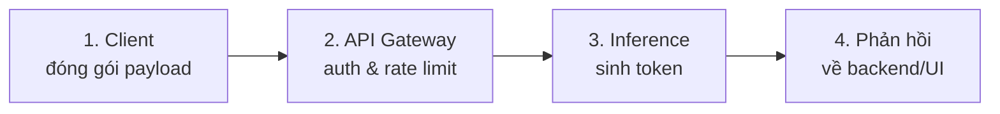
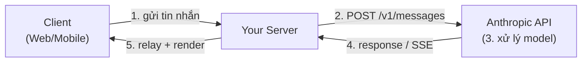
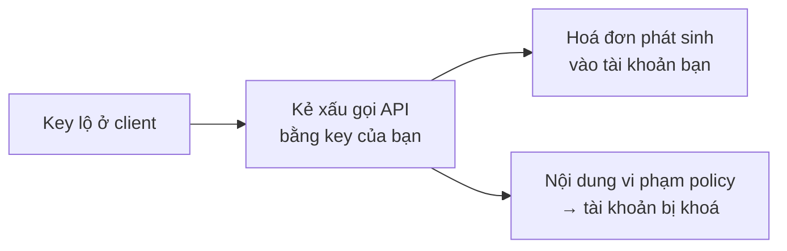
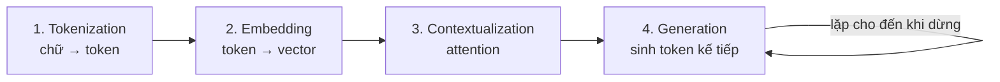
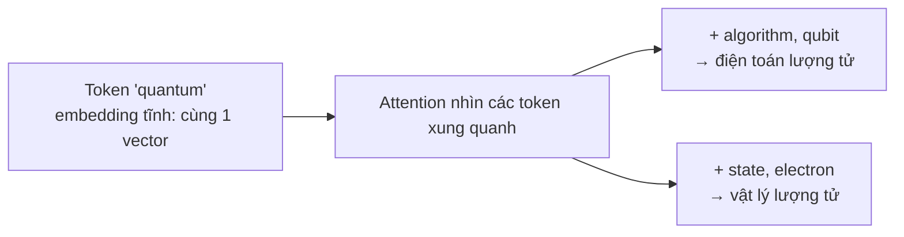
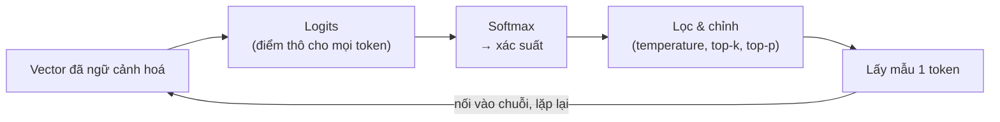
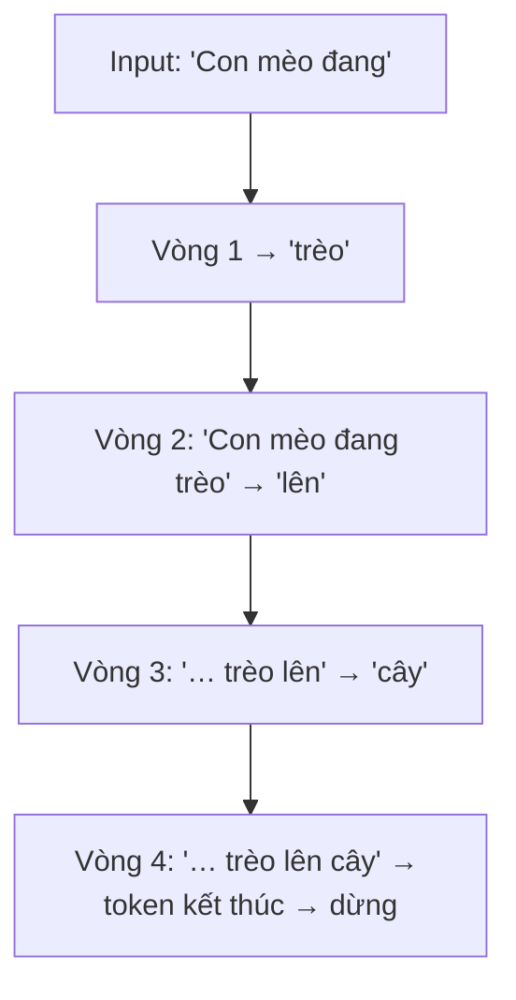
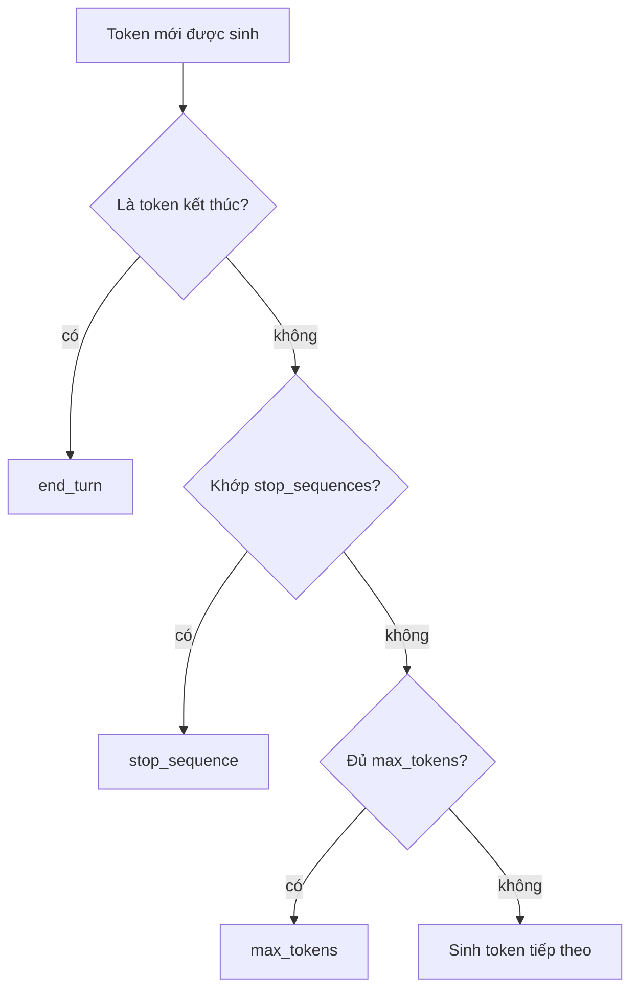

---
tags:
  - claude/nen-tang
aliases:
  - Request Lifecycle
  - Vòng đời Request
up: "[[Claude Platform]]"
---

# Vòng đời Request (Request Lifecycle)

Hành trình của một yêu cầu khi ứng dụng gọi Claude qua [[REST API]]: từ lúc người dùng bấm "Gửi" đến lúc câu trả lời hiện trên UI. Hiểu vòng đời này giúp thiết kế kiến trúc, tối ưu latency/chi phí và debug đúng tầng.



## Góc nhìn kiến trúc: 5 bước Client – Server – API

Cùng vòng đời trên nhưng nhìn theo **ai làm gì** trong mô hình 3 thành phần. Server của bạn là cầu nối bắt buộc, nằm giữa Client và Anthropic API:



| Bước | Chặng | Việc phía bạn cần làm |
| --- | --- | --- |
| 1 | Client → Server | Xác thực/phân quyền user, rate limit **nội bộ** (theo user), lưu tin nhắn mới vào DB |
| 2 | Server → Anthropic | Dựng payload, gắn `x-api-key` (lấy từ biến môi trường/secret manager), gửi HTTPS |
| 3 | Anthropic xử lý | Không phải việc của bạn — chỉ cần chọn `model`, `max_tokens`, `stream` hợp lý |
| 4 | Anthropic → Server | Nhận JSON đầy đủ hoặc luồng SSE; xử lý `stop_reason` và lỗi |
| 5 | Server → Client | Relay stream (SSE/WebSocket), **lưu câu trả lời hoàn chỉnh vào DB**, Client render Markdown |

Điểm dễ sót khi triển khai thật:

- **Hai lớp rate limit khác nhau** — giới hạn nội bộ bảo vệ chi phí/chống lạm dụng theo từng user; rate limit của Anthropic tính theo toàn bộ API key/workspace. Chỉ có lớp thứ hai thì một user có thể "ăn" hết hạn mức của cả hệ thống.
- **Server là nơi tải lịch sử** — Client chỉ gửi tin mới (kèm id hội thoại); server đọc history từ DB rồi dựng `messages`. Cũng là chỗ để cắt/tóm tắt history ([[Context Management]]).
- **Lưu DB khi streaming** — gom các `content_block_delta` thành văn bản đầy đủ, chỉ lưu khi stream kết thúc (`message_stop`). Nếu stream đứt giữa chừng, quyết định rõ: bỏ, hay lưu bản dở kèm cờ "chưa hoàn tất".
- **Client ngắt kết nối** (đóng tab, bấm Stop) — server nên huỷ request lên Anthropic (abort stream) để không trả tiền cho token không ai đọc.
- **Tool use nằm ở server** — khi gặp `tool_use`, vòng lặp chạy hoàn toàn giữa Server ↔ Anthropic (bước 2–4 lặp lại); Client thường chỉ thấy trạng thái "đang tra cứu...". Xem [[Vòng lặp Agent]].
- **Che lỗi nội bộ** — dịch lỗi Anthropic (401/429/529...) thành thông báo thân thiện cho Client, không lộ chi tiết hạ tầng hay key.

### Vì sao bắt buộc có Server trung gian (không gọi API từ client)

**Nguyên tắc:** API key chỉ được tồn tại ở môi trường bạn kiểm soát (server). Mọi thứ chạy trên máy người dùng — JS trong trình duyệt, app mobile — đều đọc được qua DevTools/Network tab hoặc decompile, nên **không có cách "giấu" key ở client** (obfuscate cũng không an toàn).



Server proxy giải quyết bằng cách: key nằm trong **biến môi trường / secret manager**, Client chỉ nói chuyện với server của bạn (đã xác thực), server mới là bên gọi Anthropic.

Các điểm kỹ thuật cần nhớ:

- **SDK chặn sẵn** — bản JS/TS từ chối chạy trong trình duyệt, buộc phải bật cờ `dangerouslyAllowBrowser: true` (tên cờ đã là lời cảnh báo). Chỉ dùng cho prototype cá nhân, không bao giờ cho sản phẩm thật.
- **Giữ key đúng cách** — lưu qua env var hoặc secret manager; không commit vào Git (thêm `.env` vào `.gitignore`); không đưa vào log, error message hay response trả Client; tách key theo môi trường (dev/staging/prod).
- **Nếu key đã lộ** — vào [[Console]] **thu hồi (revoke) ngay**, tạo key mới, rồi kiểm tra usage để phát hiện request lạ. Việc xoay key định kỳ là thói quen tốt.
- **Giảm thiểu thiệt hại từ đầu** — dùng workspace/key riêng cho từng ứng dụng và đặt **giới hạn chi tiêu (spend limit)** trong Console, để sự cố có trần thiệt hại.
- **Lợi ích phụ của proxy** — ngoài bảo mật key: xác thực người dùng, rate limit theo user, kiểm duyệt/lọc prompt và phản hồi trước khi lưu DB, ghi log/đo chi phí theo user, và đổi model/prompt mà không cần cập nhật app Client.

> [!note] Ngoại lệ "tự mang key" (BYOK)
> Công cụ cá nhân mà **chính người dùng nhập key của họ** (key không thuộc về bạn) thì rủi ro lộ key của bạn không còn, nhưng vẫn nên lưu key an toàn phía họ và hiển thị rõ cho họ biết chi phí do họ chịu.

## Giai đoạn 1: Client đóng gói & gửi request

- Người dùng nhập tin nhắn → frontend gửi về **backend của bạn** (không gọi thẳng Anthropic từ client để không lộ API key).
- Backend đóng gói JSON gửi `POST /v1/messages` gồm:
  - `model`, `max_tokens` (bắt buộc), tuỳ chọn `temperature`, `stream`.
  - `system` — vai trò/văn phong.
  - `messages` — **toàn bộ lịch sử hội thoại** + tin nhắn mới.
  - `tools` — danh sách tool nếu dùng [[Tool Use (Function Calling)|Tool use]].
- Header bắt buộc: `x-api-key`, `anthropic-version`, `content-type: application/json` (SDK tự thêm — xem [[SDKs]]).

> [!important] API là stateless
> Anthropic **không nhớ** hội thoại giữa các request — ứng dụng phải gửi lại toàn bộ lịch sử ở mỗi lượt. Đó là lý do ngữ cảnh càng dài thì càng chậm và tốn token (xem [[Context Management]]). Chi tiết cách dựng `messages` nhiều lượt: [[Stateless API & Hội thoại nhiều lượt]].

## Giai đoạn 2: API Gateway kiểm tra

- Xác thực API key, kiểm tra quyền, workspace, hạn mức chi tiêu, **rate limit** (RPM / input TPM / output TPM) và cú pháp JSON.
- Sai ở bước này → lỗi trả về **ngay**, chưa tốn token sinh.
- Hợp lệ → định tuyến tới hạ tầng phục vụ model được chọn ([[Model Tiers]]).

## Giai đoạn 3: Inference (xử lý mô hình)

Gồm 2 pha:

- **Prefill** — đọc toàn bộ input (system + history + tin mới) song song. Quyết định **TTFT** (Time-to-First-Token). Phần prefix lặp lại có thể được **prompt caching** để giảm TTFT và chi phí (cache read rẻ hơn nhiều so với input thường).
- **Decode** — sinh token tự hồi quy, từng token một. Quyết định tốc độ xuất chữ (tokens/giây). Nếu bật [[Extended Thinking]], các thinking block được sinh trước câu trả lời và tính vào output token.

### Bên trong model: 4 bước biến chữ thành câu trả lời



| Bước | Làm gì | Hệ quả thực tế |
| --- | --- | --- |
| 1. Tokenization | Cắt toàn bộ input (system + history + tin mới) thành token bằng tokenizer | Token là đơn vị **tính tiền, rate limit và context window**; tiếng Việt/code/ký tự đặc biệt thường tốn nhiều token hơn tiếng Anh |
| 2. Embedding | Mỗi token → vector số trong không gian nhiều chiều; token gần nghĩa nằm gần nhau | Nền tảng để model "hiểu" quan hệ ngữ nghĩa |
| 3. Contextualization | Các lớp **Transformer** dùng **self-attention** để mỗi token "nhìn" mọi token khác, hiểu từ trong ngữ cảnh cả hội thoại | Giữ mạch logic, bắt được ràng buộc phức tạp; chi phí tính toán tăng theo độ dài ngữ cảnh |
| 4. Generation | Tính phân phối xác suất cho token kế tiếp, chọn 1 token, nối vào chuỗi, lặp lại (**autoregressive**) | Dừng khi gặp token kết thúc (`end_turn`), chuỗi `stop_sequences`, hoặc chạm `max_tokens` |

#### Zoom vào Tokenization & Embedding

##### Tokenization

- Token có thể là từ nguyên (`apple`), mảnh từ (`un`, `ing`), ký tự đơn, khoảng trắng hoặc dấu câu. Tokenizer dùng thuật toán **subword** (kiểu BPE): từ phổ biến → 1 token, từ hiếm/dài/tên riêng → bị tách thành nhiều mảnh.
- Mỗi token tương ứng một **ID số nguyên** trong bộ từ vựng (vocabulary) cố định; model chỉ nhận chuỗi ID này, không thấy chữ.
- Ví dụ minh hoạ (số liệu mang tính ước lượng): `"unbelievable"` → `un` + `believ` + `able`.
- Quy đổi thô: ~¾ từ tiếng Anh ≈ 1 token; tiếng Việt có dấu, code, JSON, emoji thường tốn nhiều token hơn trên cùng lượng nội dung → ảnh hưởng chi phí và context window.
- Hệ quả "lạ" cần biết: model nhìn **mảnh**, không nhìn từng chữ cái → dễ sai ở tác vụ đếm ký tự, đảo chữ, đánh vần; tokenizer mỗi thế hệ model có thể khác nhau nên **số token của cùng một văn bản có thể đổi khi đổi model**.

##### Embedding

- Mỗi token ID được tra trong **bảng embedding** (học được trong quá trình huấn luyện) thành một **vector** hàng trăm đến hàng nghìn chiều. Ý nghĩa nằm ở *vị trí* trong không gian, không phải từng con số riêng lẻ.
- Từ gần nghĩa/ngữ cảnh → vector gần nhau (đo bằng *cosine similarity*): "mèo" gần "chó" hơn "xe tải".
- Embedding đầu vào ở bước này là **tĩnh theo token** (cùng token → cùng vector, kèm thông tin **vị trí** trong câu). Việc hiểu nghĩa theo ngữ cảnh (ví dụ "bank" là ngân hàng hay bờ sông) xảy ra ở bước tiếp theo — **attention** — chứ không phải ở embedding.
- Đừng nhầm với **Embeddings API** dùng cho tìm kiếm ngữ nghĩa/RAG (biến cả đoạn văn thành 1 vector để so khớp). Đó là tính năng riêng; Anthropic không cung cấp model embedding riêng mà thường khuyên dùng nhà cung cấp khác (ví dụ Voyage AI) — kiểm tra tài liệu hiện hành.

##### Ví dụ đa nghĩa: "quantum" và vai trò của attention

Từ `quantum` đứng một mình mơ hồ: đơn vị vật lý rời rạc (*quantum of light*), cả ngành vật lý lượng tử, tính từ chỉ cấp độ siêu nhỏ, hay điện toán lượng tử (*quantum computing*). Hiện tượng một từ nhiều nghĩa gọi là **polysemy** — từ cùng token nhưng mang nghĩa khác theo ngữ cảnh.



- **Embedding tĩnh không đủ** — cùng token luôn ra cùng một vector ban đầu, nên chưa phân biệt được nghĩa.
- **Attention giải quyết** — qua nhiều lớp Transformer, vector của `quantum` được **cập nhật liên tục theo các token xung quanh** (có trọng số chú ý cao với `qubit`, `electron`...), cho ra biểu diễn *theo ngữ cảnh* (contextual embedding). Cùng cơ chế giúp phân biệt "bank" (ngân hàng/bờ sông), "python" (ngôn ngữ/con rắn), "table" (bảng dữ liệu/cái bàn).
- **Hai câu đối chiếu** — *"We are building a **quantum** algorithm using qubits."* → vector của `quantum` nghiêng về điện toán lượng tử; *"The electron made a **quantum** leap to a higher energy level."* → nghiêng về chuyển mức năng lượng hạt. Cùng token, hai biểu diễn khác nhau sau attention.
- **Cơ chế bên trong (mức khái niệm)** — mỗi token tạo 3 vector: **Query** (đang tìm thông tin gì), **Key** (mình chứa thông tin gì), **Value** (nội dung sẽ chia sẻ). Độ khớp Query–Key quyết định trọng số chú ý, rồi trộn các Value theo trọng số đó để cập nhật vector. "Làm đậm/làm mờ" nghĩa chính là việc tăng/giảm các trọng số này.
- **Multi-head & nhiều lớp** — nhiều "đầu" attention chạy song song (mỗi đầu bắt một kiểu quan hệ: cú pháp, đại từ tham chiếu, chủ đề...), xếp chồng nhiều lớp để biểu diễn ngày càng trừu tượng. Nhờ vậy model còn nắm được ẩn dụ, sắc thái văn phong và đại từ ("nó" chỉ cái gì).
- **Lưu ý về hướng nhìn** — model sinh văn bản (kiểu decoder-only) dùng **causal attention**: mỗi token chỉ nhìn các token **đứng trước** nó, không nhìn token đứng sau. Việc "hiểu" đầy đủ câu dài hình thành dần qua các lớp và khi các token sau được đọc; đừng hiểu máy "quét cả trước lẫn sau" như bản dán.
- **Hệ quả thực tế** — chi phí attention tăng theo độ dài ngữ cảnh (lý do prompt dài → TTFT cao). Kết quả tính toán cho phần prefix được lưu lại (**KV cache**) là cơ sở kỹ thuật của prompt caching khi prefix lặp lại giữa các request.
- **Bài học viết prompt** — ngữ cảnh càng rõ, model càng chọn đúng nghĩa. Prompt mơ hồ hoặc thuật ngữ đa nghĩa không kèm bối cảnh dễ cho câu trả lời lệch nghĩa → nên nêu rõ lĩnh vực/vai trò (xem [[Prompt Engineering]]).

- **Ánh xạ với 2 pha ở trên:** bước 1–3 (xử lý toàn bộ input song song) = **prefill**; bước 4 (từng token một) = **decode**.
- **`temperature`** tác động ở bước 4: thấp → chọn token xác suất cao nhất (ổn định, lặp lại được); cao → đa dạng, sáng tạo hơn nhưng khó đoán.
- **Token đếm được trước khi gọi** — dùng endpoint *count tokens* của API để ước lượng chi phí/độ dài thay vì đoán theo số chữ; số thực tế có trong `usage` của response.
- **Model không "nhớ" gì ngoài những token đang có trong context** — kiến thức nền do huấn luyện, còn mọi thứ khác phải nằm trong request (vì thế API stateless và cần gửi lại history).
- Kiến thức nền về Transformer/LLM: xem [[Generative AI và LLM]].

#### Zoom vào Generation: từ xác suất đến token được chọn



- **Logits → softmax** — tầng cuối cho mỗi token trong từ vựng một điểm thô (logit), softmax chuyển thành phân phối xác suất cộng lại bằng 100%. Ví dụ *"Thủ đô của Việt Nam là…"* → `Hà` rất cao, các token khác rất thấp. Lưu ý xác suất tính trên **token** (một mảnh từ), không nhất thiết là cả từ "Hà Nội".
- **Greedy** (luôn lấy token cao nhất) cho kết quả ổn định nhưng khô cứng, dễ lặp; nên thực tế dùng **lấy mẫu có kiểm soát**.
- **Mỗi token mới được sinh ra phải đọc lại toàn bộ chuỗi trước đó** (nhờ KV cache nên không tính lại từ đầu) → câu trả lời dài thì tốn thời gian và token output.

| Tham số | Cách hoạt động | Khi nào dùng |
| --- | --- | --- |
| `temperature` (0–1, mặc định 1.0) | Chia logits trước softmax: thấp → phân phối nhọn (chọn token trội nhất), cao → phân phối phẳng (token ít khả năng cũng có cơ hội) | Gần 0: code, trích xuất, phân loại, Q&A thực tế. Cao: viết sáng tạo, brainstorm |
| `top_p` (nucleus) | Chỉ giữ nhóm token nhỏ nhất có **tổng xác suất tích luỹ ≥ p**, loại phần đuôi vô lý | Cắt nhiễu mà vẫn giữ đa dạng |
| `top_k` | Chỉ giữ k token xác suất cao nhất | Cắt đuôi dài, dùng nâng cao |

- **Không nên chỉnh đồng thời `temperature` và `top_p`** — chọn một; mặc định thường đã đủ tốt. Một số model mới có thể hạn chế/không cho đặt các tham số lấy mẫu → kiểm tra tài liệu model đang dùng.
- **`temperature` = 0 không đảm bảo kết quả giống hệt 100%** giữa các lần gọi (sai khác nhỏ do tính toán số học, hạ tầng). Cần ổn định tuyệt đối thì đừng dựa riêng vào tham số này — kiểm tra/validate đầu ra ở phía ứng dụng.
- **Temperature thấp không làm hết "bịa" (hallucination)** — nó chỉ làm đầu ra nhất quán hơn, không làm thông tin đúng hơn. Với dữ kiện cần chính xác, cấp nguồn trong prompt hoặc dùng tool tra cứu ([[Tool Use (Function Calling)]]).
- **Điều kiện dừng** — token kết thúc (`end_turn`), chuỗi trong `stop_sequences`, hoặc chạm `max_tokens` (xem bảng `stop_reason` bên dưới).

##### Sinh tự hồi quy (autoregressive): vòng lặp từng token

Model sinh **1 token mỗi vòng**, nối vào chuỗi rồi dùng chuỗi mới để dự đoán token kế tiếp, đến khi gặp token kết thúc.



- **Đây là lý do streaming khả thi** — mỗi token có sẵn ngay khi sinh ra nên có thể đẩy về UI ngay (`stream: true`); không phải kỹ thuật "diễn" thêm.
- **Chính xác hơn bản diễn giải đơn giản** — mỗi vòng **không** chạy lại tokenization/embedding cho cả chuỗi; phần đã xử lý được giữ trong **KV cache**, chỉ token mới được tính thêm. Vì vậy prefill (đọc input) nhanh theo lô, còn decode chậm hơn tính trên từng token.
- **Công thức latency thô** — tổng thời gian ≈ TTFT + (số token output × thời gian mỗi token). Muốn nhanh: giảm token output (đặt `max_tokens`, yêu cầu trả lời ngắn), dùng model nhỏ hơn, bật streaming để cảm nhận nhanh hơn.
- **Chi phí** — token output thường đắt hơn input nhiều lần trong bảng giá, và mỗi token output đều là một vòng lặp → kiểm soát độ dài đầu ra là đòn bẩy chi phí lớn nhất.
- **Không sửa lại được token đã sinh** — token đã nối vào chuỗi là cố định; model không quay lại viết lại phần trước. Nên khi lập luận sai ở bước đầu, các token sau dễ "đi theo" sai lầm đó (lỗi lan truyền). Đây là lý do cho model **"nghĩ trước khi trả lời"** (chain-of-thought, [[Extended Thinking]]) giúp chính xác hơn với bài toán nhiều bước: các token suy luận trung gian trở thành ngữ cảnh cho câu trả lời cuối.
- **Không phải "chỉ đoán từ kế tiếp một cách mù quáng"** — dù sinh từng token, biểu diễn nội bộ ở các lớp attention vẫn mã hoá thông tin về hướng đi của cả câu; nhưng model không có bước "soạn nháp cả đoạn rồi mới in" như con người hình dung.
- **Dừng** — token kết thúc (`end_turn`), `stop_sequences`, hoặc `max_tokens` (bị cắt giữa chừng).

Hai chế độ trả về:

| | `stream: false` | `stream: true` |
| --- | --- | --- |
| Trả về | 1 HTTP response sau khi xong hết | **SSE** (Server-Sent Events) từng đoạn |
| Cảm nhận chờ | Lâu với câu trả lời dài | Chữ hiện dần, TTFT quyết định |
| Phù hợp | Job nền, xử lý máy | Chat UI |

Chuỗi sự kiện SSE: `message_start` → (`content_block_start` → nhiều `content_block_delta` → `content_block_stop`) → `message_delta` (có `stop_reason`, `usage`) → `message_stop`. Thỉnh thoảng có `ping` (giữ kết nối) và `error`.

## Giai đoạn 4: Nhận phản hồi & hiển thị

### Cấu trúc response (non-streaming)

```json
{
  "id": "msg_01...",
  "type": "message",
  "role": "assistant",
  "model": "<model-id>",
  "content": [ { "type": "text", "text": "..." } ],
  "stop_reason": "end_turn",
  "stop_sequence": null,
  "usage": { "input_tokens": 25, "output_tokens": 120 }
}
```

*(Chú thích `//` trong bản dán chỉ để minh hoạ — JSON thật không có comment. Số liệu `usage` ở trên là ví dụ.)*

| Trường | Ý nghĩa |
| --- | --- |
| `id` | Mã định danh message (`msg_...`), dùng để log/đối soát |
| `type` | Luôn là `"message"` |
| `role` | Luôn là `"assistant"` — dùng nguyên khi nối lại vào `messages` ở lượt sau |
| `model` | Model thực tế xử lý request |
| `content` | **Mảng** content block, không phải chuỗi — cần lặp qua mảng |
| `stop_reason` | Lý do dừng (bảng bên dưới) |
| `stop_sequence` | Chuỗi dừng cụ thể đã kích hoạt (nếu `stop_reason` là `stop_sequence`), còn lại `null` |
| `usage` | Số token đã dùng: `input_tokens`, `output_tokens`; khi dùng caching có thêm `cache_creation_input_tokens`, `cache_read_input_tokens` |

- **`content` là mảng block** — các loại thường gặp: `text`, `tool_use` (có `id`, `name`, `input`), `thinking` (khi bật [[Extended Thinking]]), và các block của server tool. Một response có thể chứa **nhiều block** (ví dụ text rồi `tool_use`) → không giả định `content[0]` luôn là text; lọc theo `type`.
- **`usage` là nguồn số liệu chi phí thật** — ghi lại mỗi request để theo dõi chi phí theo user/tính năng, và để phát hiện prompt phình to. Cache read/creation được tính giá khác input thường.
- **Streaming trả cùng nội dung này nhưng chia mảnh** — `message_start` mang khung message, `content_block_delta` mang nội dung, `message_delta` mang `stop_reason` và `usage` cuối cùng.
- **Lưu `id` (và header `request-id`)** cùng log để tra cứu khi cần hỗ trợ.

Ba thành phần cần đọc ở mọi response: **message** (`content`), **usage**, **stop_reason**. Mẫu đọc an toàn (Python):

```python
response = client.messages.create(...)

# 1. Message: gom text từ các block, bỏ qua block khác
text = "".join(b.text for b in response.content if b.type == "text")

# 2. Usage: ghi lại để theo dõi chi phí
u = response.usage
log_usage(u.input_tokens, u.output_tokens)

# 3. Stop reason: rẽ nhánh xử lý
if response.stop_reason == "max_tokens":
    ...  # câu trả lời bị cắt
elif response.stop_reason == "tool_use":
    ...  # chạy tool rồi gửi tool_result
```

- **Ước tính chi phí 1 request** ≈ `input_tokens × giá input + output_tokens × giá output` (giá tính theo triệu token, mỗi model một mức — xem [[Model Tiers]]). Cộng thêm phần cache nếu dùng caching.
- **Input token = cả history** — con số `input_tokens` tăng dần theo độ dài hội thoại, là tín hiệu tốt để biết khi nào cần tóm tắt/cắt history ([[Context Management]]).
- **Prompt/Completion tokens** là cách gọi của API khác (kiểu OpenAI); Anthropic dùng tên `input_tokens` / `output_tokens`.

Rẽ nhánh theo `stop_reason`:

| `stop_reason` | Ý nghĩa | Việc cần làm |
| --- | --- | --- |
| `end_turn` | Claude trả lời xong | Hiển thị |
| `tool_use` | Claude yêu cầu gọi tool | Chạy tool, gửi `tool_result` lại — xem [[Vòng lặp Agent]] |
| `max_tokens` | Bị cắt do chạm `max_tokens` | Tăng giới hạn hoặc yêu cầu viết tiếp |
| `stop_sequence` | Gặp chuỗi dừng tự đặt | Xử lý theo logic riêng |
| `pause_turn` | Server tool chạy lâu bị tạm dừng | Gửi lại để Claude tiếp tục — xem [[Built-in Tools (Server Tools)]] |
| `refusal` | Từ chối vì lý do an toàn | Hiển thị thông báo phù hợp |

Frontend render Markdown, syntax highlighting, tự cuộn khi chữ xuất hiện dần.

### Zoom vào điều kiện dừng

Sau **mỗi token sinh ra**, model/hệ thống kiểm tra lần lượt các điều kiện dừng:



(Ngoài 3 lý do cơ bản này còn `tool_use`, `pause_turn`, `refusal` như bảng trên — sinh ra từ cơ chế tool/an toàn.)

- **`end_turn`** — model tự sinh token kết thúc (EOS) khi thấy đã trả lời đủ; đây là kết quả "bình thường", không phải lỗi.
- **`max_tokens`** — dừng **cứng** ngay khi đủ số token, không quan tâm câu đã trọn hay chưa (có thể cụt giữa câu/giữa khối code/JSON dở dang). Phần output đã sinh **vẫn bị tính tiền**. Xử lý: tăng `max_tokens`, yêu cầu trả lời ngắn hơn, hoặc cho "viết tiếp" bằng cách gửi lại hội thoại kèm phần đã sinh để model nối tiếp. Nếu output là JSON cần parse, **luôn kiểm tra `stop_reason` trước khi parse** — JSON bị cụt sẽ lỗi.
- **`stop_sequence`** — truyền `stop_sequences: ["..."]` (mảng chuỗi tuỳ ý). Khi model sinh đúng chuỗi, dừng ngay; **chuỗi dừng không nằm trong text trả về**, còn trường `stop_sequence` của response cho biết chuỗi nào đã kích hoạt. Ứng dụng:
  - Chặn model tự đóng vai người dùng trong prompt dạng kịch bản hội thoại (ví dụ `"User:"`).
  - Trích xuất có cấu trúc: dừng ở thẻ đóng như `"</answer>"` để lấy gọn phần cần.
  - Cắt ngắn đầu ra tại dấu phân cách đã định (cắt giảm token output → rẻ và nhanh hơn).
  - Ví dụ `"\n\nHuman:"` trong bản dán là định dạng prompt kiểu cũ (Text Completions); với Messages API hiện nay vai trò đã tách bằng `role`, nên ít khi cần.
- **Khuyến nghị code** — rẽ nhánh tường minh theo `stop_reason` (`end_turn` / `max_tokens` / `stop_sequence` / `tool_use` / `pause_turn` / `refusal`) và có nhánh mặc định cho giá trị lạ, thay vì coi mọi response là hoàn chỉnh. Ghi log `stop_reason` để phát hiện tỉ lệ bị cắt bất thường (dấu hiệu `max_tokens` đặt quá thấp).

### Bước cuối: Server chuyển tiếp về Client & render

Server **không đẩy nguyên response của Anthropic** sang Client: trích phần cần thiết, xử lý nội bộ (lưu DB, ghi `usage`, kiểm duyệt), rồi mới trả về.

| | Non-streaming | Streaming |
| --- | --- | --- |
| Server làm | Chờ response đủ → trích text → trả 1 HTTP response | Nhận từng event từ Anthropic → đẩy chunk sang Client ngay |
| Kênh tới Client | HTTP response thường | **SSE** (đơn giản, một chiều, tự reconnect) hoặc **WebSocket** (hai chiều, phức tạp hơn) |
| Trải nghiệm | Chờ rồi hiện cả khối | Chữ hiện dần (typewriter) |

- **Chọn SSE hay WebSocket** — với chat AI, luồng chủ yếu một chiều server → client nên **SSE là đủ và đơn giản hơn**; dùng WebSocket khi đã có sẵn hạ tầng realtime hai chiều hoặc cần Client gửi tín hiệu liên tục. (Client gửi tin mới/huỷ bằng request HTTP riêng vẫn được.)
- **Chỉ trả những gì Client cần** — `text` (và trạng thái như "đang tra cứu"); không lộ `usage` chi tiết, `id` nội bộ, chi tiết lỗi hạ tầng, thinking block thô nếu không muốn hiển thị.
- **Hạ tầng hay làm hỏng streaming** — reverse proxy/CDN (Nginx, Cloudflare...) có thể **buffer** phản hồi khiến chữ không hiện dần: tắt buffering cho route này (ví dụ header `X-Accel-Buffering: no`, `Cache-Control: no-cache`), giữ timeout đủ dài, và serverless có giới hạn thời gian chạy cần để ý.
- **Render ở frontend**:
  - Parse Markdown + syntax highlighting; cuộn tự động nhưng **không giật người dùng về cuối** nếu họ đang cuộn lên đọc.
  - Markdown dở dang khi đang stream (khối code/bảng chưa đóng) có thể hiển thị nhấp nháy → dùng thư viện xử lý được markdown không đầy đủ hoặc render lại theo nhịp (throttle).
  - **Sanitize HTML** khi render — nội dung từ model là dữ liệu không đáng tin hoàn toàn (có thể chứa HTML/script do prompt injection); tránh chèn thẳng vào DOM bằng `innerHTML`.
  - Có nút **Stop** (huỷ stream), trạng thái loading/lỗi, và khả năng **thử lại** khi stream đứt.
- **Lưu DB** — ghi bản hoàn chỉnh khi stream kết thúc, cùng `stop_reason` và `usage` để đối soát chi phí (xem lưu ý ở phần 5 bước phía trên).

## Lỗi thường gặp & retry

| HTTP | Loại | Hướng xử lý |
| --- | --- | --- |
| 400 | `invalid_request_error` | Sửa payload, **không** retry |
| 401 | `authentication_error` | Sai/thiếu API key |
| 403 | `permission_error` | Key không có quyền với tài nguyên |
| 404 | `not_found_error` | Sai model/endpoint |
| 413 | `request_too_large` | Cắt bớt nội dung |
| 429 | `rate_limit_error` | Retry sau `retry-after` (backoff) |
| 500 | `api_error` | Retry |
| 529 | `overloaded_error` | Retry với exponential backoff |

- Chỉ retry nhóm lỗi tạm thời (429/5xx/529); SDK mặc định tự retry 2 lần với backoff.
- Log header **`request-id`** để gửi support khi cần điều tra.
- Header `anthropic-ratelimit-*` cho biết hạn mức còn lại — dùng để chủ động giãn request.
- Với streaming, lỗi có thể xảy ra **giữa chừng** (sau khi đã trả 200) → phải xử lý event `error`.

## Ý nghĩa với thiết kế & tối ưu

- **Latency/TTFT** — rút gọn history (tóm tắt, cắt tin cũ), dùng prompt caching cho system prompt/tài liệu dài, chọn model nhỏ hơn khi tác vụ đơn giản.
- **UX** — luôn bật streaming cho chat.
- **Chi phí** — theo dõi `usage` mỗi response; đặt `max_tokens` hợp lý; tính tiền theo input + output token.
- **Độ tin cậy** — retry có backoff, timeout hợp lý, xử lý `stop_reason` đầy đủ (đừng chỉ giả định `end_turn`).
- **Bảo mật** — API key chỉ nằm ở server; frontend gọi qua backend của bạn.
- **Tên model** — luôn kiểm tra ID model hiện hành trước khi code (ID cũ như `claude-3-5-sonnet` có thể đã ngừng hỗ trợ); xem [[Model Tiers]].

## Liên kết

- Thuộc nhóm: [[Claude Platform]]
- Giao thức nền: [[REST API]], [[SDKs]]
- Khi `stop_reason = tool_use`: [[Vòng lặp Agent]], [[Tool Use (Function Calling)]]
- Quản lý ngữ cảnh dài: [[Context Management]]
- Theo dõi chi phí/usage: [[Console]]
