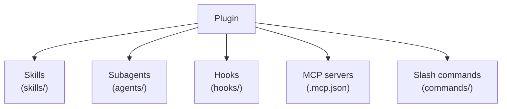
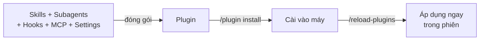

---
tags:
  - claude/nen-tang
  - claude/claude-code
aliases:
  - Plugin Claude Code
  - Chia sẻ cấu hình .claude
up: "[[Plugins]]"
---

# Plugin trong Claude Code (Chia sẻ cho Team)

Cách **đóng gói và phân phối** toàn bộ thiết lập `.claude` (Skills, Subagents, [[Hooks]]...) cho cả đội, thay vì copy-paste thủ công giữa các máy.

## Vấn đề: scale cấu hình cho team

Khi một thư mục `.claude` đã chạy mượt (Skills + Subagents + Hooks), câu hỏi là làm sao cả team dùng chung:

- **Cách cũ — copy-paste file `.claude`** giữa các máy: nhanh chóng **lệch phiên bản** (out of sync), khó cập nhật khi có thay đổi, hành vi không đồng nhất giữa các máy.
- **Cách đúng — Plugin:** gói chuẩn hóa, di động, cài/cập nhật/gỡ bằng lệnh, có phiên bản.

| | Copy-paste `.claude` | Plugin |
| --- | --- | --- |
| Đồng bộ | Thủ công, dễ lệch | Một nguồn (marketplace), cập nhật theo phiên bản |
| Cài đặt | Chép tay từng file | `/plugin install` |
| Quản lý | Không có | Enable / disable / uninstall, có `version` |
| Nhất quán | Mỗi máy một kiểu | Cả team cùng quy tắc, công cụ, cổng chất lượng |



## Bản chất: một đơn vị cài đặt duy nhất

Plugin gom mọi thứ thành **một gói có phiên bản, cài bằng một lệnh** ("one version, one install") → cả team có đúng cùng một cấu hình chuẩn.

| Thành phần | Vai trò |
| --- | --- |
| Skills | Kỹ năng tùy biến |
| Subagents | Trợ lý chuyên biệt (vd. reviewer độc lập) |
| Hooks | Cổng kiểm soát tự động, dùng exit code để chặn/cho qua |
| MCP server configs | Kết nối công cụ ngoài qua MCP |
| LSP servers | Language Server Protocol — giúp Claude phân tích code (định nghĩa, lỗi, tham chiếu) |
| Background monitors | Trình theo dõi chạy ngầm |
| Themes | Giao diện |
| Settings | Một phần `settings.json` đi kèm plugin |

> Các thành phần mở rộng (LSP, monitors, themes, settings) có thể khác nhau theo phiên bản Claude Code — kiểm tra docs hiện hành khi dùng.

## Cài đặt trong phiên làm việc

1. `/plugin install <plugin>@<marketplace>` — tải và cài plugin.
2. `/reload-plugins` — nạp lại toàn bộ plugin, áp dụng ngay vào phiên hiện tại, **không cần thoát và mở lại** Claude Code.

- **Cú pháp:** `tên-plugin@tên-marketplace` (plugin đứng trước, marketplace đứng sau dấu `@`). Marketplace phải được thêm trước bằng `/plugin marketplace add` (trừ marketplace mặc định của Anthropic).



## Cấu trúc thư mục Plugin

| Đường dẫn trong `my-plugin/` | Vai trò |
| --- | --- |
| `.claude-plugin/plugin.json` | Manifest: `name`, `version`, `description` |
| `skills/` | Mỗi Skill = một thư mục chứa `SKILL.md` |
| `agents/` | Subagent (`.md`) |
| `commands/` | Slash command (`.md`) |
| `hooks/hooks.json` | Cấu hình Hooks |
| `.mcp.json` | MCP server đi kèm |

### Convention over Configuration

Plugin dùng **cùng "hình dạng" với thư mục `.claude`** bạn đang xài hằng ngày → không phải học định dạng mới, Claude Code tự nhận diện thành phần qua **tên và vị trí thư mục**:

- **Skills:** mỗi Skill là **một thư mục riêng** trong `skills/` (`skills/skill-a/SKILL.md`).
- **Subagents:** mỗi Subagent là **một file `.md`** trong `agents/` (`reviewer.md`, `security-audit.md`).
- **Hooks & MCP:** `hooks/hooks.json` và `.mcp.json` nằm ở **gốc plugin**.

**Chuyển `.claude` thành plugin — thực tế cần làm:**

| Trong `.claude/` | Trong plugin |
| --- | --- |
| `skills/`, `agents/`, `commands/` | Chép nguyên sang **gốc plugin** (cùng tên thư mục) |
| Hooks khai báo trong `settings.json` | **Tách** sang `hooks/hooks.json` |
| MCP server khai báo trong `.mcp.json` / settings | Đặt `.mcp.json` ở gốc plugin |
| *(không có)* | Thêm `.claude-plugin/plugin.json` |

- Nghĩa là **nội dung các file giữ nguyên**, nhưng gốc plugin *không phải* thư mục `.claude` — các thư mục thành phần nằm trực tiếp ở gốc, và hooks cần tách khỏi `settings.json`.
- **Đường dẫn trong Hook/MCP:** script của plugin nên tham chiếu bằng biến `${CLAUDE_PLUGIN_ROOT}` thay vì đường dẫn tuyệt đối, vì plugin được cài vào vị trí khác trên mỗi máy.
- **Dọn trước khi đóng gói:** bỏ thứ riêng tư (đường dẫn cá nhân, token, quy tắc chỉ hợp dự án của bạn) — xem thêm mục Bảo mật bên dưới.

- Chỉ **`plugin.json` nằm trong `.claude-plugin/`**; các thư mục thành phần nằm ở **gốc plugin** (lỗi hay gặp: nhét `skills/`, `agents/` vào trong `.claude-plugin/`).
- Manifest là **tùy chọn** (xem mục dưới); nếu có thì `name` là trường duy nhất bắt buộc, và nó thành **namespace**: Skill gọi dạng `plugin:skill`.
- Muốn đóng gói thiết lập sẵn có: copy `skills/`, `agents/`, hooks từ `.claude` sang cấu trúc trên, khai báo hooks trong `hooks/hooks.json`.

## Manifest `plugin.json`

File `.claude-plugin/plugin.json` khai báo định danh và phiên bản của plugin. Ví dụ:

```json
{
  "name": "svg-splitter-review",
  "version": "0.1.0",
  "description": "Reviews the SVG Splitter repo",
  "author": { "name": "Lewis Menelaws" }
}
```

- **Tùy chọn:** không có manifest, Claude Code vẫn tự nhận Skills/Subagents/Hooks/MCP theo quy ước thư mục (tên plugin lấy từ tên thư mục). Nhưng khi chia sẻ nội bộ hoặc đưa lên marketplace, **nên luôn có manifest**.
- **`name`** — định danh duy nhất, thành tiền tố namespace (`name:skill`) → tránh trùng với plugin khác hoặc lệnh cá nhân. Dùng kebab-case, ngắn, ổn định (đổi tên = đổi tên mọi lệnh người dùng đã quen).
- **`version`** — theo **Semantic Versioning** (`MAJOR.MINOR.PATCH`, vd. `0.1.0` → `1.0.0`): cơ sở để theo dõi cập nhật và để cả team dùng đúng bản được duyệt. Mỗi lần phát hành đổi `version`, nếu không người dùng có thể không nhận bản mới do cơ chế cache.
- **Trường phụ:** `description` (hiện ở Discover/khi cài), `author`; ngoài ra có thể có `homepage`, `repository`, `license`, `keywords`.

## Phân phối qua Marketplace

**Marketplace** = danh mục plugin (thường là một repo Git) có file `.claude-plugin/marketplace.json` liệt kê các plugin và nguồn của chúng.

| Lệnh | Tác dụng |
| --- | --- |
| `/plugin` | Mở giao diện quản lý plugin |
| `/plugin marketplace add <nguồn>` | Thêm kho (repo GitHub, URL Git, đường dẫn local) |
| `/plugin install <tên>@<marketplace>` | Cài plugin |
| `/plugin enable` / `disable` / `uninstall` | Bật / tắt / gỡ |
| `/plugin marketplace update` | Kéo bản mới của kho |

### Private Marketplace cho tổ chức

Thay vì mỗi người tự cài plugin từ nhiều nguồn rải rác (khó theo dõi phiên bản, người mới không biết team dùng gì), tổ chức dựng **một marketplace riêng** làm nguồn chung:

1. Tạo repo Git của công ty (vd. `your-org/claude-plugins`) chứa các plugin + `.claude-plugin/marketplace.json`.
2. Mỗi người chạy một lần: `/plugin marketplace add your-org/claude-plugins` (dạng `owner/repo` là cách viết tắt cho GitHub; cũng nhận URL Git hoặc đường dẫn local).
3. Từ đó `/plugin install <plugin>@<tên-marketplace>` tra cứu và tải từ kho này.

| Lợi ích | Ý nghĩa |
| --- | --- |
| Discovery | Cả team (kể cả người mới) thấy danh sách plugin chuẩn của công ty |
| Version tracking | Một nơi định nghĩa phiên bản nào là bản dùng chung |
| Updates | Admin cập nhật ở kho → máy khác đồng bộ qua `/plugin marketplace update` (hoặc bật auto-update cho marketplace) |

- **Tab Discover:** trong giao diện `/plugin`, tab *Discover* liệt kê plugin của mọi marketplace đã thêm → tìm kiếm, xem mô tả, cài chỉ vài thao tác. Các tab còn lại quản lý plugin đã cài và danh sách marketplace.
- **Kho private:** người dùng cần quyền truy cập repo (đăng nhập Git/`gh`, SSH key); auto-update ở kho private cần token trong biến môi trường.
- **Siết kiểm soát:** admin có thể dùng managed settings để giới hạn marketplace được phép thêm (vd. `strictKnownMarketplaces`), tránh cài plugin ngoài danh mục.

- **Phạm vi cài (scope):** user (mọi dự án của bạn), project (ghi vào `.claude/settings.json`, commit cho cả team), local (riêng bạn, trong dự án).
- **Tự động hóa cho team:** khai báo marketplace và plugin bật sẵn trong `.claude/settings.json` của repo (`extraKnownMarketplaces`, `enabledPlugins`) → thành viên mở dự án, tin cậy thư mục là được gợi ý cài.

## Hai việc cần học

1. **Dùng plugin có sẵn:** tìm trong marketplace, cài, dùng plugin do Anthropic/cộng đồng phát hành.
2. **Tự đóng gói plugin riêng:** sau khi đã có workflow hiệu quả → đóng gói `.claude` của mình để chia sẻ cho đồng nghiệp hoặc xuất bản cho cộng đồng.

## Quy trình tự đóng gói (tóm tắt)

1. Tạo thư mục plugin + `.claude-plugin/plugin.json` (`name`, `version`, `description`).
2. Chuyển `skills/`, `agents/`, `commands/`, hooks vào gốc plugin.
3. **Test cục bộ:** `claude --plugin-dir ./my-plugin` (không cần marketplace); sửa xong chạy lại để nạp bản mới.
4. Đưa lên repo Git, thêm `marketplace.json` nếu muốn làm kho riêng.
5. Chia sẻ lệnh `/plugin marketplace add` + `/plugin install` cho team; tăng `version` mỗi lần phát hành.

## Bảo mật khi cài Plugin

Plugin **chạy code thật trên máy bạn với đúng quyền của bạn** — không chỉ nạp văn bản. [[Hooks]] của plugin tự kích hoạt mỗi khi sự kiện tương ứng xảy ra (`PreToolUse`, `Stop`...), cùng với script và MCP server đi kèm.

- **Rủi ro ẩn:** cài plugin chỉ vì một Skill, nhưng nó đính kèm sẵn một `Stop` Hook chạy ngầm. Kịch bản xấu: Hook âm thầm gửi dữ liệu/mã nguồn ra endpoint bên ngoài mỗi khi Claude kết thúc lượt, không có cảnh báo nào.
- **Claude Code hiển thị trước khi xác nhận cài:** chi tiết thành phần (bao nhiêu skills, hooks...), ước tính **context cost** (token tốn khi nạp), và cảnh báo Anthropic **không kiểm soát** nội dung plugin bên thứ ba.

| Nguồn | Quy trình duyệt |
| --- | --- |
| Official marketplace | Anthropic tuyển chọn (curated) |
| Community marketplace | Gửi qua form trong app → qua vòng **quét tự động** của Anthropic |

> **Reviewed ≠ trusted:** quét tự động chỉ bắt được các mẫu độc hại phổ biến, không đảm bảo loại bỏ hết hành vi nguy hại tinh vi.

**Checklist trước khi cài:**

1. **Nguồn:** kho nội bộ công ty / tác giả đáng tin, hay người lạ? Chỉ thêm marketplace từ nguồn tin cậy.
2. **Thành phần:** có `Stop`, `PreToolUse` hay Hook nào khác không? Có MCP server nào không?
3. **Đọc code:** mở script Hook, `hooks/hooks.json`, `.mcp.json` xem có gọi mạng / gửi dữ liệu ra ngoài, đọc file nhạy cảm không.
4. **Ghim phiên bản & xem diff khi update:** bản cập nhật cũng có thể thêm Hook mới — với plugin quan trọng, xem lại thay đổi trước khi đồng bộ.
5. **Tổ chức:** dùng marketplace nội bộ + giới hạn nguồn được phép (xem mục Private Marketplace) để giảm bề mặt rủi ro.

## Plugin chạy song song với cấu hình cá nhân

Plugin **không ghi đè hay xóa** cấu hình của bạn — mọi thành phần chạy *cùng lúc* (coexist) với thiết lập hiện có. Ba hệ quả:

| Thành phần | Cơ chế | Rủi ro |
| --- | --- | --- |
| [[Hooks]] | **Xếp chồng (stack):** Hook của bạn và của plugin cùng kích hoạt trên mỗi sự kiện, không cái nào thay thế cái nào | Cao — Hook chạy ngầm của plugin luôn thực thi → phải đọc code trước khi cài |
| Skills / Subagents / Commands | **Namespacing:** tự gắn tiền tố `plugin-name:tên` | Thấp — không trùng hay phá lệnh cá nhân |
| `settings.json` của plugin | Chỉ chấp nhận **một số ít khóa** (không phải toàn bộ settings) | Cao nếu có khóa `agent` |

- **Khóa `agent` nguy hiểm nhất:** plugin có thể đặt một Subagent của nó làm **agent chính (main thread)** → đổi luôn **system prompt, giới hạn công cụ, model** mặc định của phiên. Bật plugin xong, hành vi Claude Code có thể khác hẳn mà bạn không hay biết.
- Khóa thứ hai được chấp nhận liên quan đến **status line của subagent** (cấu hình hiển thị). Đoạn nguồn mô tả hai khóa này khá mơ hồ — kiểm tra tên khóa chính xác trong docs.
- **Kiểm tra thành phần plugin đã thêm:** mở `/plugin` → xem danh sách Skills/Hooks/Agents của từng plugin; tại đây có thể **Enable / Disable / Uninstall** bất kỳ lúc nào.
- **Khi thấy Claude cư xử lạ sau khi cài plugin:** thử disable plugin trước, rồi soát `hooks/hooks.json` và `settings.json` của nó.

## Lưu ý

- Đừng để **bí mật** (token, API key) trong plugin; dùng biến môi trường.
- Tên plugin ngắn, rõ — vì nó thành tiền tố namespace của mọi Skill/command.
- Test bằng "người dùng khác" trước khi chia sẻ: xem [[Đánh giá Skill & Plugin bằng Evals]].

## Liên kết

- Thuộc nhóm: [[Plugins]]
- Thành phần đóng gói: [[Skills]], [[Subagents (Tác vụ phụ)]], [[Hooks]], [[Quản lý MCP Server trong Claude Code]]
- Xem thêm: [[Claude Code]], [[Tự xây dựng Plugin (Cowork)]], [[Phân phối Plugin cho Tổ chức (Distribution)]]
