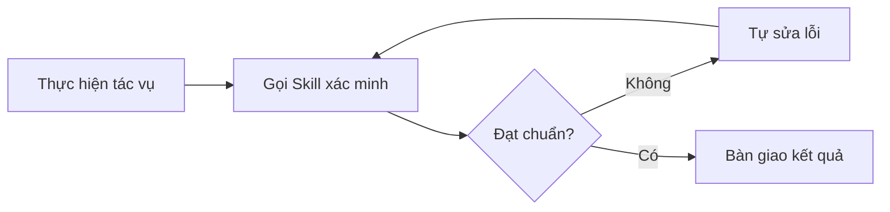

---
tags:
  - claude/nen-tang
aliases:
  - Skills
  - Quy trình
up: "[[Nền tảng cốt lõi]]"
---

# Skills (Quy trình)

Các quy trình/hướng dẫn được đóng gói sẵn (packaged instructions) mà Claude có thể **gọi ra khi cần** để thực hiện một tác vụ lặp lại theo đúng chuẩn đã định nghĩa trước.

- Thay vì giải thích lại quy trình từ đầu mỗi lần, người dùng định nghĩa Skill một lần rồi tái sử dụng.
- Ví dụ: quy trình review code, quy trình tạo báo cáo theo template cố định, checklist triển khai...
- Có thể được kích hoạt tự động khi Claude nhận thấy tác vụ phù hợp, hoặc gọi thủ công qua lệnh.

## Cấu trúc: thư mục Skill + SKILL.md

Một Skill là **một thư mục đóng gói sẵn**, gồm hướng dẫn (instructions), script và tài nguyên (resources) liên quan. Trung tâm của thư mục là file **`SKILL.md`** — nơi định nghĩa quy trình, tiêu chuẩn và định dạng đầu ra mong muốn.

- **Ở tầng API/developer:** upload thư mục Skill lên hệ thống một lần, sau đó **attach** vào bất kỳ lệnh gọi `messages.create` nào cần dùng — không phải khai báo lại mỗi lần gọi.
- **Bản chất:** dạy Claude *cách bạn làm việc* — Claude đọc Skill, làm theo đúng từng bước và trả kết quả theo đúng định dạng/phong cách đã định nghĩa.
- Ví dụ ứng dụng: mẫu Status Report (mục cần có, cách phân loại công việc, bảng biểu cố định), Review Checklist (các bước bắt buộc khi review code/tài liệu), Release Notes (quy tắc trích log Git/GitHub rồi tổng hợp theo văn phong công ty).

> Ví von: Skill giống một **SOP (Standard Operating Procedure)** dành riêng cho Claude — chuẩn hóa đầu ra AI trên toàn ứng dụng mà không cần lặp lại prompt dài dòng mỗi lần gọi.

### 4 thành phần bên trong (không bắt buộc đủ cả 4)

| Thành phần | Vai trò | Ví dụ |
| --- | --- | --- |
| **Instructions** (`SKILL.md`) | Tệp cốt lõi — Skill dùng để làm gì, khi nào kích hoạt, từng bước thực hiện ra sao (viết như runbook cho nhân viên mới) | Bản thân file `SKILL.md` |
| **Assets** | Nguyên liệu thô để dựng sản phẩm đầu ra | Logo, slide master, font, brand template |
| **References** | Ví dụ đầu ra mẫu/style guide để Claude hiểu thế nào là "đạt chuẩn" | Style guide, thư viện điều khoản mã nguồn |
| **Scripts** | Mã tự động hoá cho tác vụ lặp lại hoặc đòi hỏi chính xác tuyệt đối | Script so sánh dữ liệu, định dạng chart/tài liệu |

- **Linh hoạt, không cần đủ bộ:** Skill đơn giản chỉ cần `SKILL.md`; phức tạp hơn thì thêm Assets; đầy đủ nhất mới gồm cả 4. Tuỳ độ phức tạp của công việc mà chọn thành phần phù hợp.
- **Nguyên tắc tối giản:** chỉ đưa vào những gì thật sự cần cho tác vụ — không nhồi thêm tài nguyên thừa, vì mọi thứ trong thư mục đều tốn context khi được nạp (xem [[#Lazy loading — tối ưu context window|Lazy loading]]).

## Phân biệt với Tool

Dễ nhầm vì cả hai đều là thứ Claude "gọi ra khi cần", nhưng phục vụ hai mục đích khác nhau:

| Đặc điểm | [[Tool Use (Function Calling)\|Tool]] | Skill |
| --- | --- | --- |
| Mục đích | Kết nối Claude với **dữ liệu/hành động** bên ngoài (query CSDL, gửi email, tìm code...) | Dạy Claude **quy trình/quy chuẩn** thực hiện công việc |
| Câu hỏi trả lời | Claude **CÓ THỂ LÀM** gì (*what Claude can do*) | **CÁCH** bạn muốn nó làm (*how you want it done*) |
| Ví dụ | "Tìm đoạn code này", "Gửi email này" | "Viết báo cáo hàng ngày đúng theo template này" |

Thực tế hai thứ thường đi cùng nhau: Skill mô tả *quy trình*, còn bên trong quy trình đó Claude vẫn có thể gọi Tool để lấy dữ liệu/thực thi hành động.

## Lazy loading — tối ưu context window

Khi có hàng chục Skill được cấp cùng lúc, Claude không nạp toàn bộ nội dung ngay từ đầu:

1. **Lúc khởi chạy:** chỉ nạp **tên + mô tả (name/description)** của tất cả Skill khả dụng vào context — rất nhẹ.
2. **Khi xác định cần dùng:** Claude mới đọc *toàn bộ* `SKILL.md` (và file liên quan) của đúng Skill đó, nạp vào context ngay lúc đó (dynamic loading).

Nhờ vậy context window luôn gọn nhẹ dù có rất nhiều Skill được đăng ký — tiết kiệm token, giảm chi phí, và giữ độ chính xác phản hồi (không bị nhiễu bởi hàng chục hướng dẫn không liên quan).

### Tổ chức side files: giữ `SKILL.md` ngắn gọn (lean)

Lazy loading không chỉ áp dụng giữa các Skill mà còn **bên trong một thư mục Skill**. Skill không bó hẹp trong một file — thư mục là một "hộp công cụ" gồm file chính + side files:

```text
verify-skill/
├── SKILL.md       # bản đồ: làm gì, khi nào kích hoạt, link tới file phụ
├── reference.md   # kiến thức chuyên sâu / quy chuẩn phức tạp
└── check.sh       # script kiểm tra (test, lint, diff...)
```

| File | Vai trò | Cách Claude dùng |
| --- | --- | --- |
| `SKILL.md` | "Bản đồ chỉ đường": tổng quan **cần làm gì** và **khi nào** kích hoạt | Nạp khi Skill được chọn |
| `reference.md` | Chi tiết chuyên sâu, quy chuẩn phức tạp | `SKILL.md` chỉ **link tới**; Claude **chỉ đọc khi thực sự cần** |
| `check.sh` (scripts) | Thực thi kiểm tra: test, lint, diff... | Claude **chạy (execute)** script, **không đọc** mã nguồn vào context → tiết kiệm context |

- **Nguyên tắc:** `SKILL.md` luôn lean; kiến thức sâu đẩy sang `reference.md`, thao tác kiểm tra đẩy sang script.
- **Lợi ích:** Claude không bị "ngợp" thông tin → chính xác, mượt hơn; dễ bảo trì/mở rộng (sửa đúng file phụ, không phình `SKILL.md`).
- Với Skill xác minh (mục "Skill nên xây đầu tiên" bên dưới): `SKILL.md` nêu quy trình + trigger, `reference.md` giữ tiêu chuẩn chi tiết, `check.sh` chạy test/lint.

## Upload & tái sử dụng Skill (API)

Ở tầng developer, Skill được quản lý qua Beta SDK — upload một lần, gọi lại nhiều lần bằng ID:

```python
skill = client.beta.skills.create(
    display_title="Status Report Generator",
    files=files_from_dir("status-report-skill"),  # Thư mục chứa SKILL.md
)

print(skill.id)  # Lưu ID để dùng cho các lệnh messages.create sau này
```

- **`client.beta.skills.create`** — endpoint khởi tạo Skill mới (cũng có thể upload qua giao diện web Claude Platform thay vì code).
- **`display_title`** — tên hiển thị để quản lý Skill trên hệ thống.
- **`files_from_dir(...)`** — đóng gói toàn bộ nội dung thư mục (gồm `SKILL.md` và tài nguyên kèm theo) để gửi lên.
- Kết quả trả về **`skill.id`** duy nhất — lưu lại và truyền ID này vào các lệnh `messages.create` sau, không cần nạp lại toàn bộ file mỗi lần gọi.

### Tách biệt quy chuẩn (Skill) và dữ liệu (input)

Skill chỉ đóng gói **bộ khung/quy chuẩn cố định** (mục cần có, văn phong, cách tóm tắt, cách xử lý blocker...) — còn **dữ liệu thực tế** vẫn truyền riêng ở mỗi lần gọi, dưới dạng input đơn giản (ví dụ: activity log dạng text). Claude tự lấy khung Skill đã lưu để xử lý dữ liệu mới truyền vào — quy chuẩn không đổi, chỉ dữ liệu thay đổi theo từng lần gọi.

## Gắn Skill vào request (`container.skills`)

Skill **không** truyền qua tham số `tools` hay `messages` thông thường — mà cấu hình riêng trong đối tượng `container.skills`:

```python
response = client.beta.messages.create(
    model="claude-sonnet-4-5",
    max_tokens=4096,
    betas=["skills-2025-10-02", "code-execution-2025-08-25"],  # 1. Beta header
    container={
        "skills": [                                            # 2. container.skills
            {
                "type": "custom",
                "skill_id": skill.id,
                "version": "latest",
            }
        ]
    },
    tools=[                                                    # 3. Kết hợp với Tool
        {
            "type": "code_execution_20250825",
            "name": "code_execution",
        }
    ],
    messages=[
        {
            "role": "user",
            "content": f"Generate the daily status report from this activity log:\n\n{activity_log}",
        }
    ],
)
```

- **Beta header bắt buộc** — Skills còn ở dạng Beta nên phải gọi qua `client.beta.messages.create` kèm cờ tương ứng trong `betas` (ví dụ `"skills-2025-10-02"`); dùng tool nào cũng ở dạng beta thì cộng dồn cờ đó vào cùng mảng (ví dụ `"code-execution-2025-08-25"`).
- **`container.skills`** — mảng, cho phép gắn **nhiều Skill cùng lúc** vào một request. Mỗi phần tử gồm `skill_id` (lấy từ bước upload) và `version` (ví dụ `"latest"`).
- **Kết hợp Skill + Tool:** Skill cung cấp *quy trình* (`SKILL.md`), còn Tool (`code_execution`) là *công cụ thực thi* — Claude dùng Code Execution để chạy script mà quy trình trong Skill mô tả, xử lý dữ liệu thực tế (activity log) truyền vào `messages`. Đây là minh hoạ rõ nhất cho phần [[#Phân biệt với Tool|phân biệt Skill/Tool]] ở trên: một bên định nghĩa cách làm, một bên thực thi hành động.

## Skill trong Claude Code (CLI)

Ở tầng **sản phẩm** (Claude Code CLI, VSCode extension...), Skill vận hành theo cùng bản chất "SOP đóng gói" như trên nhưng cơ chế cụ thể khác tầng API (không dùng `container.skills`):

- **Nơi đặt Skill:** thư mục `.claude/skills/<tên-skill>/SKILL.md` ở cấp **project** (theo repo, đi cùng codebase) hoặc `~/.claude/skills/` ở cấp **user** (dùng chung mọi project). Skill đi kèm plugin được namespace dạng `plugin:skill`.
- **Kích hoạt tự động (implicit):** Claude tự đối chiếu mô tả tác vụ hiện tại với phần `description` của từng Skill đã cài — khớp thì tự nạp và làm theo, không cần người dùng gọi tên.
- **Kích hoạt thủ công (explicit):** gõ trực tiếp `/<tên-skill>` (slash command) hoặc yêu cầu bằng lời ("dùng skill X cho việc này").
- **Skill trùng tên ở nhiều phạm vi:** nếu vừa có skill chung (unscoped) vừa có skill riêng theo thư mục (scoped, hiển thị dạng `apps/web:deploy`), ưu tiên bản gắn với thư mục đang thao tác — cụ thể hơn thắng.
- **Chạy nền (background):** một số Skill tự chạy trong subagent riêng và trả kết quả sau dưới dạng thông báo, thay vì chặn phiên làm việc hiện tại chờ xong mới trả lời — không gọi lại skill đó trong lúc chờ.

## Tạo & quản lý Skill qua hội thoại (Claude.ai)

Ở tầng claude.ai (Chat/Projects), không cần tự tay tạo thư mục/viết `SKILL.md` — có thể nhờ chính Claude dựng Skill ngay trong hội thoại:

- **Cách tạo:** yêu cầu kiểu *"Tôi muốn tạo một skill cho [quy trình lặp lại mà tôi đã chán phải giải thích lại], hãy hỏi tôi những gì bạn cần biết"*. Claude sẽ hỏi ngược lại các câu cốt lõi: Skill dùng để làm gì? Khi nào nên tự kích hoạt? Đầu ra chuẩn trông như thế nào? Cần tài nguyên/mẫu sẵn nào? — càng cung cấp cụ thể (đính kèm file mẫu, ví dụ thực tế) thì Skill sinh ra càng sát nhu cầu. Kết quả: Claude tự sinh trọn thư mục Skill (`SKILL.md` + assets/references/scripts tương ứng), sẵn sàng cài đặt.
- **Quản lý & chỉnh sửa:** Skill đã cài nằm trong mục **Customize**; muốn cải tiến chỉ cần ra lệnh bằng ngôn ngữ tự nhiên (ví dụ *"thêm bước cảnh báo nếu hợp đồng trên $100K bị chậm tiến độ 2 giai đoạn"*) — Claude tự cập nhật đúng file trong thư mục Skill đó, không cần sửa tay.
- **Phạm vi toàn cục:** khác với Skill cấp *project* trong [[#Skill trong Claude Code (CLI)|Claude Code]] (chỉ áp dụng trong repo chứa `.claude/skills/`), Skill tạo ở claude.ai hoạt động đồng nhất ở **mọi phiên chat, kể cả trong các Project riêng** — không cần bật lại theo từng project, cứ tác vụ khớp mô tả là tự kích hoạt.

## Giá trị trong Production

- **Chuẩn hóa đầu ra:** user prompt chỉ cần một dòng (truyền dữ liệu thô), Claude tự bám khung `SKILL.md` để trả về kết quả đủ mục, đúng văn phong, đúng cách xử lý các trường hợp đặc biệt (ví dụ blocker trong báo cáo) — không lệch dù ai gọi, gọi bao nhiêu lần.
- **Tự động hóa, bỏ thao tác copy-paste prompt mẫu:** cả team dùng chung một Skill nên nhận kết quả cùng cấu trúc/thứ tự mục mà không ai phải tự nhớ và dán lại prompt chuẩn mỗi lần.
- **Đóng gói tri thức team thành thứ AI thực thi được:** Skill là cách "mã hoá" quy chuẩn/kinh nghiệm làm việc vốn chỉ nằm trong đầu người vào dạng Claude đọc và làm theo được — nhờ đó AI không chỉ trả lời chung chung mà có thể **đại diện làm việc đúng chuẩn của team** (giá trị này rõ nhất khi Claude đóng vai trò đồng nghiệp thực thụ, xem [[Claude Cowork]]).

> Prompt thường chỉ trả lời **"cần làm gì"**; một Skill đầy đủ trả lời thêm **"làm như thế nào, dùng nguyên liệu gì, đối chiếu tiêu chuẩn nào, và tự động hoá bằng công cụ gì"** — tương ứng 4 thành phần Instructions/Assets/References/Scripts ở trên.

## Skill nên xây đầu tiên: tự xác minh công việc (Verifying your own work)

Khi dự án lớn dần, các thao tác kiểm tra lặp đi lặp lại xuất hiện ngày càng nhiều (chạy test, lint, kiểm tra định dạng API, xác minh cấu trúc file...). Trong mọi ứng dụng của Skill, **Skill tự kiểm tra/xác minh kết quả** là loại đáng đầu tư xây trước nhất.

**Vì sao ưu tiên:**

- **Tăng độ tin cậy:** rủi ro lớn nhất khi giao việc cho AI là kết quả *trông có vẻ đúng* nhưng ẩn lỗi (hallucination, thiếu sót nhỏ).
- **Đóng vòng lặp tự sửa lỗi (self-correction loop):** làm xong → tự gọi Skill xác minh → phát hiện lỗi → tự sửa → kiểm tra lại, *trước khi* bàn giao cho người dùng.
- **Tiết kiệm thời gian:** không phải tự chạy kiểm tra thủ công rồi mới bảo AI sửa.



**Cách thiết kế (áp dụng 4 thành phần ở trên):**

- **Instructions:** checklist rõ ràng — kiểm tra những gì, tiêu chí đạt/không đạt, khi lỗi thì báo cáo và sửa thế nào.
- **Scripts:** để các phép kiểm tra *xác định được* (test, lint, validate schema, so sánh số liệu) chạy bằng script thay vì "nhờ model tự đánh giá" — kết quả khách quan, lặp lại được.
- **References:** tiêu chuẩn/ví dụ đầu ra đạt chuẩn để đối chiếu (style guide, template).
- **Mô tả (`description`) phải nêu rõ thời điểm kích hoạt** (ví dụ "sau khi hoàn thành việc chỉnh sửa/tạo mới ...") để Claude tự gọi đúng lúc.

### Vấn đề của cách kiểm tra thủ công

Sau khi AI làm xong (ví dụ refactor code), người dùng phải *tự nhớ* để chạy test suite, đọc lại file diff... Quy trình này phụ thuộc hoàn toàn vào trí nhớ con người — quên một lần là code lỗi/kém chất lượng lọt qua.

### Luồng tự động của Verification Skill

Dựa vào **trigger description** của Skill, không cần nhắc:

1. **Tự kích hoạt:** Claude vừa sửa code xong → hành động khớp mô tả Skill → Skill tự chạy.
2. **Chạy test suite:** thực thi toàn bộ bài kiểm thử.
3. **Đọc & phân tích file diff:** so sánh code mới với code cũ.
4. **Kiểm tra độ tin cậy của test:** bắt trường hợp AI "gian lận" — nới lỏng/sửa chính bài test chỉ để báo xanh (pass).
5. **Báo cáo:** kết luận Pass/Fail rõ ràng kèm bằng chứng cụ thể.

### Định nghĩa "Hoàn thành" (Definition of Done)

- **"Xong" KHÔNG phải:** đọc diff thấy code *có vẻ* đúng.
- **"Xong" phải là:** các hàng rào kiểm tra (gates) **đã được thực thi thật**, kết quả được quan sát và báo cáo minh bạch.

**Lưu ý:**

- Skill xác minh chỉ bắt được loại lỗi mà checklist/script *đã định nghĩa* — không thay thế review của con người với quyết định quan trọng; nên bổ sung dần tiêu chí mỗi khi gặp lỗi mới.
- Kiểm thử chính Skill xác minh (có bắt đúng lỗi không, có báo sai không) bằng [[Đánh giá Skill & Plugin bằng Evals]].

## Skill vs CLAUDE.md vs Hook — đặt quy tắc ở đâu?

Trong Claude Code có 3 "bề mặt" (instruction surfaces) để đặt hướng dẫn/quy tắc — dễ nhầm khi thiết lập:

| Bề mặt | Bản chất | Áp dụng | Đặt gì | Ví dụ |
| --- | --- | --- | --- | --- |
| [[CLAUDE.md Bộ nhớ dự án\|CLAUDE.md]] | **Quy chuẩn chung** (conventions) — lời dặn | Liên tục, **mọi lúc** | Phong cách, định dạng, cấu trúc dự án | Cách đặt tên biến/file; vị trí đặt module |
| **Skill** | **Quy trình & tài liệu** (procedures/reference) — lời dặn | **Theo tác vụ** (nạp khi cần) | Quy trình nhiều bước, kiến thức chuyên sâu cho một loại việc | Tự xác minh code; checklist trước khi tạo PR |
| [[Hooks\|Hook]] | **Rào cản cứng** (hard rules) — **code chạy thật** | **100%**, không bỏ qua được | Quy tắc an toàn sống còn | Chặn push thẳng lên `main`; chặn xóa database |

- **`CLAUDE.md` và Skill là lời dặn (instructions):** Claude đọc, hiểu và cố tuân theo — mức tuân thủ cao nhưng vẫn dựa vào việc AI "tự giác".
- **Hook là code thực thi:** script do hệ thống chạy độc lập; khi Claude định làm hành động nguy hiểm, Hook can thiệp và **chặn (block)** ngay.

**Quy tắc chọn nơi đặt:**

1. Claude quên/bỏ qua là **không thể chấp nhận** → **Hook**.
2. Quy trình riêng cho **một dạng bài toán** → **Skill**.
3. Thói quen/phong cách áp dụng cho **toàn bộ codebase** → **CLAUDE.md**.

> Kết hợp tốt: Hook chặn hành động nguy hiểm, Skill chứa quy trình đúng để làm thay thế, `CLAUDE.md` giữ vài dòng phong cách chung. Chi tiết về diễn đạt và bẫy file quá dài: xem [[CLAUDE.md Bộ nhớ dự án]].

## Khi nào nên dùng Skill

Cân nhắc dùng Skill khi **cách thức thực hiện quan trọng ngang với kết quả đầu ra** — tức là có một quy chuẩn/định dạng cố định cần lặp lại nhất quán (báo cáo định kỳ, checklist review, release notes...). Nếu chỉ cần Claude *làm được* một việc (truy vấn, gọi API, thực thi hành động) mà không đòi hỏi quy chuẩn trình bày cố định, đó là việc của [[Tool Use (Function Calling)|Tool]] chứ không phải Skill.

**Quy tắc ngón tay cái (rule of thumb):** nếu đã phải gõ cùng một chuỗi hướng dẫn nhiều bước **từ 2 lần trở lên**, đó là lúc đóng gói thành Skill. Áp dụng cho mọi việc lặp lại của team, không riêng kiểm thử code: Release checklist, Migration recipe (quy trình chuyển đổi dữ liệu), Pre-PR check (rà soát trước khi tạo PR)...

## Recap

| Nội dung | Chi tiết cần nhớ |
| --- | --- |
| Bản chất | Đóng gói *cách thức* thực hiện (`SKILL.md` + resources) — dạy Claude quy trình/quy chuẩn, không phải khả năng hành động. |
| 4 thành phần | Instructions (`SKILL.md`, bắt buộc) + Assets + References + Scripts (tùy chọn, thêm khi cần, tối giản). |
| Khác Tool | Tool = *what Claude can do*, Skill = *how you want it done*. |
| Nạp context | Lazy loading — chỉ nạp tên/mô tả lúc đầu, nạp toàn bộ nội dung khi Claude xác định cần dùng. |
| Side files | `SKILL.md` giữ ngắn (bản đồ: làm gì + khi nào); `reference.md` chỉ đọc khi cần; script (`check.sh`) được chạy chứ không nạp mã vào context. |
| Vòng đời API | `client.beta.skills.create` (upload 1 lần, nhận `skill.id`) → gắn vào `container.skills` (kèm `version`) trong các `messages.create` sau, cần cờ `betas`. |
| Trong Claude Code | Đặt ở `.claude/skills/` (project) hoặc `~/.claude/skills/` (user); kích hoạt tự động theo mô tả hoặc thủ công qua `/tên-skill`; scoped skill (theo thư mục) ưu tiên hơn unscoped khi trùng tên. |
| Trong claude.ai | Tạo bằng hội thoại (Claude tự hỏi các câu cốt lõi rồi sinh thư mục Skill); quản lý/sửa ở mục Customize bằng lệnh tự nhiên; phạm vi **toàn cục** — dùng chung mọi chat và mọi Project. |
| Kết hợp Tool | Skill mô tả quy trình, Tool (ví dụ `code_execution`) thực thi hành động cụ thể trong quy trình đó. |
| Skill đầu tiên nên xây | Skill **tự xác minh công việc** (test/lint/checklist) → Claude tự kiểm tra và sửa lỗi trước khi bàn giao (self-correction loop); "xong" = gates đã chạy thật, kể cả kiểm tra AI không nới lỏng test để pass. |
| Đặt quy tắc ở đâu | Phong cách toàn codebase → `CLAUDE.md`; quy trình theo tác vụ → Skill; bắt buộc 100%/an toàn sống còn → Hook (code chặn thật, không phải lời dặn). |
| Khi nào tạo Skill | Gõ cùng chuỗi hướng dẫn nhiều bước ≥ 2 lần (release checklist, migration recipe, pre-PR check...). |
| Khi nào dùng | Cách làm quan trọng ngang kết quả — cần chuẩn hóa lặp lại nhất quán trên toàn hệ thống. |

## Liên kết

- Thuộc nhóm: [[Nền tảng cốt lõi]]
- Xem thêm: [[Projects]], [[Artifacts]], [[Connectors (MCP)]], [[Claude Cowork]]
- Chạy thử Skill trước khi chia sẻ cho người khác: [[Đánh giá Skill & Plugin bằng Evals]]
- Nhiều Skill + Connectors + Subagents đóng gói thành bộ chia sẻ cho cả team: [[Plugins]]
- Ở góc nhìn hạ tầng dev, Skill là một trong các *Primitives* của [[Claude Platform]]
- Phân biệt với [[Tool Use (Function Calling)|Tool]]: Tool = khả năng hành động, Skill = quy trình/quy chuẩn
- Nơi đặt quy tắc cứng/mềm: [[Hooks]], [[CLAUDE.md Bộ nhớ dự án]]
