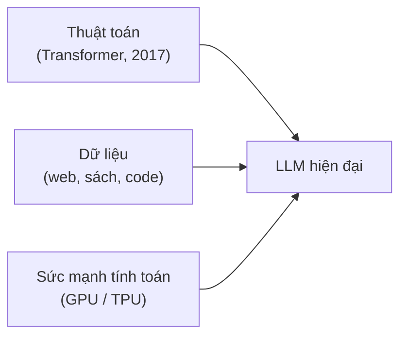
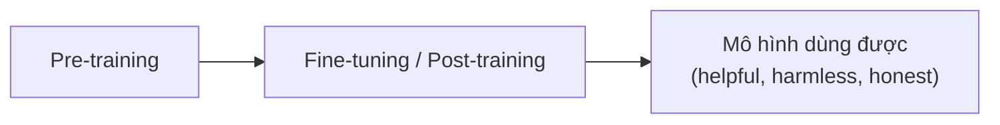

---
tags:
  - ai
  - genai
  - llm
aliases:
  - Generative AI
  - GenAI
  - LLM
  - Large Language Model
---

# Generative AI và LLM

**Generative AI (GenAI)** là AI có khả năng **tự sinh nội dung mới** (văn bản, ảnh, âm thanh, code...) dựa trên những gì đã học — khác với AI truyền thống (discriminative) chỉ *phân tích / nhận diện / phân loại* dữ liệu có sẵn (vd: ảnh chó hay mèo).

**LLM (Large Language Model)** là nhóm mô hình GenAI chuyên về ngôn ngữ, huấn luyện trên lượng văn bản khổng lồ; bản chất là **dự đoán token tiếp theo**. Claude (Anthropic) là một LLM.

## Ba yếu tố tạo nên bước nhảy LLM

- **Transformer** (bài báo *Attention Is All You Need*, 2017): cơ chế **self-attention** nhìn toàn bộ ngữ cảnh và quan hệ giữa các từ cùng lúc, thay vì đọc tuần tự từng từ như RNN/LSTM; song song hóa tốt nên scale được.
- **Dữ liệu** khổng lồ: web, sách, mã nguồn.
- **Compute**: GPU/TPU đủ sức train mô hình hàng tỷ → hàng nghìn tỷ **tham số (parameters)**.

## Quy trình huấn luyện

- **Pre-training**: giai đoạn đầu, tốn tài nguyên nhất. Học ngữ pháp, kiến thức tổng quát bằng cách dự đoán từ/token tiếp theo trên lượng văn bản khổng lồ → ra *base model* (biết nhiều nhưng chưa biết "nghe lời").
- **Fine-tuning**: huấn luyện bổ sung để mô hình biết làm theo chỉ dẫn, cư xử an toàn, đúng mong muốn con người. Kỹ thuật thường gặp:
  - **SFT** (Supervised Fine-Tuning) — học từ cặp hỏi/đáp mẫu.
  - **RLHF** (Reinforcement Learning from Human Feedback) — học tăng cường từ phản hồi/xếp hạng của con người.
  - **Constitutional AI** — Anthropic dùng bộ nguyên tắc ("hiến pháp") để mô hình tự phê bình và cải thiện, giảm phụ thuộc vào nhãn con người.

## Khái niệm quan trọng

- **Token**: đơn vị nhỏ nhất mô hình xử lý (mảnh từ/ký tự, ~¾ từ tiếng Anh; tiếng Việt thường tốn nhiều token hơn). Chi phí và giới hạn đều tính theo token.
- **Context Window**: lượng token tối đa mô hình đọc + nhớ trong **một** lần xử lý (gồm cả prompt, lịch sử hội thoại và output). Càng lớn → đọc được tài liệu/codebase dài hơn; nhưng vượt giới hạn thì phần cũ bị cắt/tóm tắt, và mô hình **không nhớ** giữa các phiên nếu không có cơ chế memory riêng. Xem [[Context Management]].
- **Emergent Capabilities**: khi tăng quy mô (dữ liệu, tham số, compute), xuất hiện năng lực mới mà mô hình nhỏ không có và không được lập trình trực tiếp (lập trình, suy luận nhiều bước, dịch ngôn ngữ phức tạp, in-context learning).
- **Hallucination**: mô hình sinh nội dung nghe hợp lý nhưng sai/bịa — hệ quả của việc dự đoán xác suất chứ không "tra cứu sự thật". Cần kiểm chứng đầu ra quan trọng.
- **Temperature**: tham số điều khiển độ ngẫu nhiên khi chọn token (thấp = ổn định, cao = sáng tạo).
- **Knowledge cutoff**: mô hình chỉ biết dữ liệu đến một mốc huấn luyện; muốn thông tin mới cần tool (search, RAG, MCP).

## Điểm mạnh của GenAI

- **Đa năng về ngôn ngữ**: dịch, tóm tắt, viết, sửa lỗi, sáng tạo nội dung, viết code — cùng một mô hình.
- **Hội thoại tự nhiên**: giữ mạch và hiểu ngữ cảnh qua nhiều lượt.
- **Chuyển tác vụ linh hoạt (zero-shot / few-shot)**: đổi từ code sang thơ, dịch sang phân tích dữ liệu chỉ bằng prompt (kèm 0 hoặc vài ví dụ), **không cần train lại** cho từng nhiệm vụ.
- **Tích hợp công cụ ngoài**: gọi search, code interpreter, calculator... để bù các điểm yếu (thông tin mới, tính toán chính xác). Đây là nền tảng của [[AI Agent]] và [[Tool Use (Function Calling)]].

## Hạn chế hiện tại

| Hạn chế | Bản chất | Cách giảm thiểu |
| --- | --- | --- |
| Knowledge cutoff | Dữ liệu train dừng ở một mốc | Web search, RAG, MCP |
| Hallucination | Đoán token theo xác suất, nói sai vẫn rất tự tin | Yêu cầu nguồn, kiểm chứng đầu ra quan trọng |
| Giới hạn context window | Chỉ xử lý tối đa N token/lần; văn bản quá dài dễ "quên" đoạn đầu hoặc kém chính xác | Chia nhỏ, tóm tắt, [[Context Management]] |
| Suy luận / toán phức tạp | Là thống kê chứ không phải logic chặt chẽ nên yếu ở bài logic nhiều bước, tính toán lớn | [[Extended Thinking]], dùng tool (code, calculator) |

Các điểm yếu này đang được cải thiện nhanh (context dài hơn, suy luận tốt hơn, ít ảo giác hơn) nhưng **chưa biến mất** — đừng mặc định tin tuyệt đối.

## Mô hình hợp tác tối ưu: Human-in-the-loop

Dùng AI hiệu quả nhất không phải thay thế con người mà **kết hợp cả hai**:

- **AI**: tốc độ, tự động hóa tác vụ lặp lại, tạo ý tưởng/bản nháp thô.
- **Con người**: định hướng, kiểm tra tính chính xác, tư duy chiến lược, **ra quyết định cuối cùng**. Ba vai trò AI còn thiếu:
  - **Critical thinking**: đánh giá đúng/sai của đầu ra AI.
  - **Judgment & Creativity**: định hướng chiến lược, quyết định nghệ thuật/kinh doanh.
  - **Ethical oversight**: đảm bảo sản phẩm không vi phạm chuẩn mực, bản quyền, không gây hại.

Xem thêm bộ khung [[Bộ khung 4D]] về cách làm việc với AI.

## Liên kết

- Áp dụng thực tế với Claude: [[Bắt đầu với Claude]]
- LLM làm lõi cho agent: [[AI Agent]]
- Các tầng model của Claude: [[Model Tiers]]
- Suy luận sâu hơn: [[Extended Thinking]]
