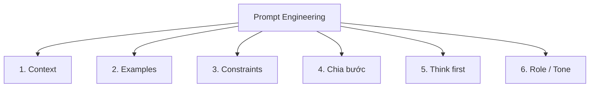

---
tags:
  - claude/su-dung
  - ai/prompt-engineering
aliases:
  - Prompt Engineering
  - Kỹ thuật viết prompt
  - Prompting Techniques
up: "[[Sử dụng Claude hiệu quả]]"
---

# Prompt Engineering

**Prompt engineering** = nghệ thuật thiết kế chỉ dẫn rõ ràng, hiệu quả cho AI. Không phải kỹ thuật lập trình phức tạp, mà là sự kết hợp giữa:

- **Giao tiếp tốt giữa người với người**: rõ ràng, có bối cảnh, đúng trọng tâm.
- **Đặc thù của mô hình**: LLM dự đoán token tiếp theo dựa trên pattern → cách bố trí, ví dụ, định dạng trong prompt ảnh hưởng trực tiếp đến output (xem [[Generative AI và LLM]]).

> Mẹo kiểm tra: đưa prompt cho một đồng nghiệp thông minh nhưng **không biết gì về bối cảnh** — họ có hiểu cần làm gì không? Nếu không, Claude cũng không.

## 6 kỹ thuật nền tảng

| # | Kỹ thuật | Ý chính | Ví dụ (IT) |
| --- | --- | --- | --- |
| 1 | **Giving context** | Nêu mục đích, đối tượng đọc, nền tảng bài toán → AI thấy "bức tranh toàn cảnh" | "Hệ thống chạy K8s trên AWS, người đọc là dev mới, cần hiểu nguyên nhân pod bị OOMKilled" |
| 2 | **Showing examples** (few-shot) | Đưa 1–3 mẫu input → output mong muốn để AI bắt chước định dạng/phong cách | Đưa 2 commit message mẫu theo Conventional Commits |
| 3 | **Specifying constraints** | Giới hạn độ dài, từ cấm, định dạng bắt buộc (bảng, JSON), tông giọng; nói rõ cả "đừng làm gì" | "Tối đa 200 từ, trả về JSON, không dùng thuật ngữ tiếng Anh không cần thiết" |
| 4 | **Breaking into steps** | Tách việc lớn thành chuỗi bước nhỏ → ít bỏ sót, dễ kiểm tra từng bước | "B1: liệt kê lỗi; B2: nhóm theo nguyên nhân; B3: đề xuất fix" |
| 5 | **Think first** (chain-of-thought) | Yêu cầu suy luận từng bước trước khi kết luận → giảm sai sót và hallucination | "Phân tích log từng bước rồi mới đưa nguyên nhân" |
| 6 | **Role / tone** | Gán vai trò/chuyên môn và giọng điệu cụ thể | "Đóng vai senior SRE khắt khe, trả lời ngắn gọn, chuyên nghiệp" |

Liên hệ: 6 kỹ thuật này là cách cụ thể hoá 3 thành tố của [[Description (Mô tả)]] — (1), (2), (3) thiên về *Product*; (4), (5) thiên về *Process*; (6) thiên về *Performance*.

## Chi tiết cần nhớ cho từng kỹ thuật

- **Context**: nói *tại sao* cần (lý do giúp AI suy ra quy tắc ngầm), không chỉ nói *cần gì*.
- **Few-shot**: ví dụ phải **đa dạng** và **đúng định dạng đích**; bọc trong thẻ như `<example>` để tách khỏi chỉ dẫn. Cẩn thận AI bắt chước quá sát (cả chi tiết không muốn).
- **Constraints**: ưu tiên nói **điều nên làm** thay vì chỉ liệt kê điều cấm ("viết đoạn văn liền mạch" tốt hơn "đừng dùng bullet").
- **Chain-of-thought**: dùng cho bài toán logic, tính toán, phân tích nhiều yếu tố; có thể yêu cầu tách phần suy luận (`<thinking>`) và đáp án (`<answer>`). Với tác vụ cần suy luận sâu, xem [[Extended Thinking]].
- **Role**: đặt vai trò ở **system prompt** hoặc đầu prompt; vai càng cụ thể (domain + cấp độ + phong cách) càng hiệu quả.

## Kỹ thuật bổ trợ

| Kỹ thuật | Mô tả ngắn |
| --- | --- |
| **XML tags** | Dùng `<document>`, `<instructions>`, `<example>`... để tách rõ dữ liệu / chỉ dẫn / ví dụ; Claude nhận diện cấu trúc này rất tốt |
| **Đặt dữ liệu dài lên trước, câu hỏi ở cuối** | Với tài liệu dài, đặt tài liệu đầu prompt và yêu cầu ở cuối cải thiện chất lượng |
| **Prompt chaining** | Chia workflow thành nhiều prompt nối tiếp, output bước trước là input bước sau (nháp → review → chỉnh) |
| **Cho phép nói "không biết"** | Cho AI quyền trả lời "không chắc/không đủ thông tin" để giảm bịa đặt |
| **Yêu cầu trích dẫn** | Bắt AI trích đoạn gốc trước khi kết luận → dễ kiểm chứng ([[Bộ khung 4D#Bốn năng lực\|Diligence]]) |

## "Vũ khí bí mật": nhờ AI cải thiện prompt (meta-prompting)

Khi mới có ý tưởng chung chung, nhờ chính Claude viết lại prompt:

> "Hãy giúp tôi viết lại câu lệnh này để thu được kết quả tốt nhất từ bạn."

- Claude sẽ **đặt câu hỏi ngược** và gợi ý cấu trúc lại prompt (thêm context, format, ràng buộc còn thiếu).
- Dùng khi chưa biết bắt đầu từ đâu, hoặc muốn tạo prompt tái sử dụng (lưu vào [[Skills]] / [[CLAUDE.md Bộ nhớ dự án]]).

## Quá trình lặp & hợp tác

- Không kỳ vọng một prompt cho kết quả hoàn hảo ngay lần đầu: **thử → xem output → tinh chỉnh → phản hồi**.
- Xem AI là **đối tác**, không phải máy bán hàng tự động — cùng tư duy với [[Description (Mô tả)]].
- Nên tinh chỉnh ngay trong hội thoại thay vì viết lại từ đầu (xem [[Tinh chỉnh kết quả]]).

## Troubleshooting — khi kết quả chưa đúng

| Triệu chứng | Nguyên nhân thường gặp | Cách xử lý |
| --- | --- | --- |
| Chung chung, nhạt | Thiếu context / ví dụ | Bổ sung đối tượng đọc, mục đích, 1–2 mẫu |
| Sai định dạng | Constraint mơ hồ | Nêu format cụ thể + đưa ví dụ output |
| Dài dòng hoặc quá ngắn | Chưa chỉ định độ dài | Đặt giới hạn rõ (số từ, số ý) |
| Sai logic / bỏ sót | Việc quá lớn một lần | Chia bước, yêu cầu suy luận trước |
| Bịa thông tin | Không có nguồn, ép phải trả lời | Cung cấp tài liệu nguồn, cho phép "không biết", yêu cầu trích dẫn |
| Sai tông giọng | Thiếu role/tone | Gán vai + mô tả giọng điệu + ví dụ |

Nguyên tắc: **sửa prompt, không chỉ than phiền output** — cụ thể hoá điều *sai ở đâu* và *muốn thế nào*; tận dụng hội thoại để lặp (xem [[Tinh chỉnh kết quả]]).

## Common patterns — mẫu prompt hay dùng

- **Prompt hiệu quả thường có đủ 4 thành tố**: (1) Tổng quan nhiệm vụ — cần làm gì; (2) Định dạng đầu ra — sản phẩm trông thế nào; (3) Ràng buộc cụ thể — giới hạn là gì; (4) Bối cảnh liên quan — thông tin nền bổ trợ.
- **Công thức 3 phần**: Context + Action + Format & Style ([[Bắt đầu với Claude]]), hoặc Deliverable + Inputs + Nuances ([[Công thức Prompt chuẩn (Deliverable + Inputs + Nuances)]]).
- **Role + Task + Constraints**: "Bạn là [vai]. Hãy [việc]. Ràng buộc: [...]".
- **Hỏi ngược trước khi làm**: "Nếu thiếu thông tin, hãy hỏi tôi trước khi bắt đầu".
- **Draft → Critique → Revise**: nhờ AI viết, tự phản biện, rồi sửa lại.
- **Persona phản biện**: "Hãy đóng vai người phản đối và chỉ ra lỗ hổng trong kế hoạch này".
- **Template hoá**: prompt dùng lặp lại → lưu vào [[CLAUDE.md Bộ nhớ dự án]] hoặc [[Skills]] thay vì gõ lại.

## Liên kết

- Thuộc: [[Sử dụng Claude hiệu quả]]
- Cùng cấp: [[Bắt đầu với Claude]], [[Tinh chỉnh kết quả]], [[Ứng dụng thực tế]]
- Liên quan: [[Description (Mô tả)]], [[Viết Prompt An toàn (Tránh Hiểu Lầm)]], [[Extended Thinking]], [[Generative AI và LLM]]
