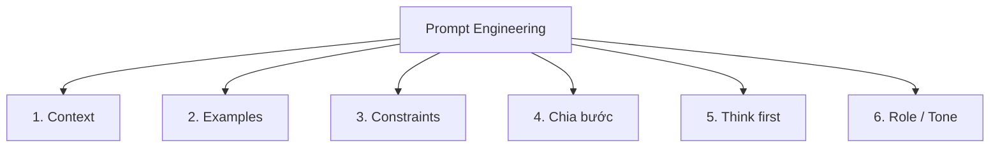
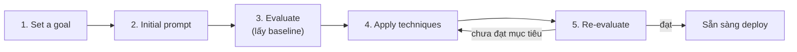

---
tags:
  - claude/su-dung
  - ai/prompt-engineering
aliases:
  - Prompt Engineering
  - Kỹ thuật viết prompt
  - Prompting Techniques
up: "[[Sử dụng Claude hiệu quả]]"
---

# Prompt Engineering

**Prompt engineering** = nghệ thuật thiết kế chỉ dẫn rõ ràng, hiệu quả cho AI. Không phải kỹ thuật lập trình phức tạp, mà là sự kết hợp giữa:

- **Giao tiếp tốt giữa người với người**: rõ ràng, có bối cảnh, đúng trọng tâm.
- **Đặc thù của mô hình**: LLM dự đoán token tiếp theo dựa trên pattern → cách bố trí, ví dụ, định dạng trong prompt ảnh hưởng trực tiếp đến output (xem [[Generative AI và LLM]]).

> Mẹo kiểm tra: đưa prompt cho một đồng nghiệp thông minh nhưng **không biết gì về bối cảnh** — họ có hiểu cần làm gì không? Nếu không, Claude cũng không.

## 6 kỹ thuật nền tảng



| # | Kỹ thuật | Ý chính | Ví dụ (IT) |
| --- | --- | --- | --- |
| 1 | **Giving context** | Nêu mục đích, đối tượng đọc, nền tảng bài toán → AI thấy "bức tranh toàn cảnh" | "Hệ thống chạy K8s trên AWS, người đọc là dev mới, cần hiểu nguyên nhân pod bị OOMKilled" |
| 2 | **Showing examples** (few-shot) | Đưa 1–3 mẫu input → output mong muốn để AI bắt chước định dạng/phong cách | Đưa 2 commit message mẫu theo Conventional Commits |
| 3 | **Specifying constraints** | Giới hạn độ dài, từ cấm, định dạng bắt buộc (bảng, JSON), tông giọng; nói rõ cả "đừng làm gì" | "Tối đa 200 từ, trả về JSON, không dùng thuật ngữ tiếng Anh không cần thiết" |
| 4 | **Breaking into steps** | Tách việc lớn thành chuỗi bước nhỏ → ít bỏ sót, dễ kiểm tra từng bước | "B1: liệt kê lỗi; B2: nhóm theo nguyên nhân; B3: đề xuất fix" |
| 5 | **Think first** (chain-of-thought) | Yêu cầu suy luận từng bước trước khi kết luận → giảm sai sót và hallucination | "Phân tích log từng bước rồi mới đưa nguyên nhân" |
| 6 | **Role / tone** | Gán vai trò/chuyên môn và giọng điệu cụ thể | "Đóng vai senior SRE khắt khe, trả lời ngắn gọn, chuyên nghiệp" |

Liên hệ: 6 kỹ thuật này là cách cụ thể hoá 3 thành tố của [[Description (Mô tả)]] — (1), (2), (3) thiên về *Product*; (4), (5) thiên về *Process*; (6) thiên về *Performance*.

## Chi tiết cần nhớ cho từng kỹ thuật

- **Context**: nói *tại sao* cần (lý do giúp AI suy ra quy tắc ngầm), không chỉ nói *cần gì*.
- **Few-shot**: ví dụ phải **đa dạng** và **đúng định dạng đích**; bọc trong thẻ như `<example>` để tách khỏi chỉ dẫn. Cẩn thận AI bắt chước quá sát (cả chi tiết không muốn).
- **Constraints**: ưu tiên nói **điều nên làm** thay vì chỉ liệt kê điều cấm ("viết đoạn văn liền mạch" tốt hơn "đừng dùng bullet").
- **Chain-of-thought**: dùng cho bài toán logic, tính toán, phân tích nhiều yếu tố; có thể yêu cầu tách phần suy luận (`<thinking>`) và đáp án (`<answer>`). Với tác vụ cần suy luận sâu, xem [[Extended Thinking]].
- **Role**: đặt vai trò ở **system prompt** hoặc đầu prompt; vai càng cụ thể (domain + cấp độ + phong cách) càng hiệu quả (xem thêm nguyên tắc bên dưới).

### Nguyên tắc "dòng đầu tiên" (The first line)

**Dòng đầu tiên của prompt định hình gần như toàn bộ chất lượng đầu ra** — đặt vai trò/yêu cầu cốt lõi/quy tắc bất di bất dịch ở ngay đầu, chi tiết phụ để phía sau.

- **Vì sao hiệu quả:** phần mở đầu giúp mô hình "vào vai" ngay (kích hoạt từ vựng, văn phong, cách suy luận của vai đó) *trước khi* đọc phần còn lại; nội dung nằm cuối dễ bị xử lý hời hợt. Đây là kinh nghiệm thực hành đã được kiểm chứng, không phải quy tắc tuyệt đối — vẫn nên đo bằng eval.
- **So sánh:**

| | Ví dụ | Vấn đề / ưu điểm |
| --- | --- | --- |
| Yếu | "Viết cho tôi thực đơn ăn kiêng, tính calo kỹ nhé. Tiện thể đóng vai chuyên gia dinh dưỡng." | Vai trò bị đẩy xuống cuối → output chung chung, thiếu chiều sâu |
| Mạnh | "You are an elite sports nutritionist designing high-performance meal plans for professional athletes." (rồi mới tới chiều cao, cân nặng, dị ứng...) | Dòng 1 chốt danh tính + tiêu chuẩn; các dòng sau chỉ điền dữ kiện |

- **Dòng đầu cần đạt 2 tiêu chí: Clarity + Directness**

| Tiêu chí | Ý chính | Tránh | Nên viết |
| --- | --- | --- | --- |
| **Clarity** (rõ ràng) | Từ ngữ đơn giản, đơn nghĩa, không ẩn dụ/văn hoa → AI không phải "đoán mò" (khoa học? đời thường? quảng cáo?) | "Viết gì đó thật hay về dinh dưỡng" | "Bạn là chuyên gia dinh dưỡng, nhiệm vụ là tính chính xác thực đơn hằng ngày" |
| **Directness** (trực diện) | Bỏ xã giao mở đầu, đặt mệnh lệnh/vai trò ngay từ chữ đầu tiên → AI định hướng đúng từ token đầu, không bị thông tin phụ làm phân tâm | "Chào bạn, làm ơn cố gắng giúp tôi..." | "Tính thực đơn 7 ngày cho vận động viên..." |

- **Ví dụ Clarity (mập mờ → rõ ràng):**

| | Prompt | Nhận xét |
| --- | --- | --- |
| Mập mờ | "I need to know about those things people put on their roofs that use sun - those solar panel things, I think they're called..." | Vòng vo, rào đón, thiếu chắc chắn → AI phải đoán chủ đề và dạng trả lời |
| Rõ ràng | "Write three paragraphs about how solar panels work." | Nêu thẳng chủ thể (solar panels) + giới hạn đầu ra (3 đoạn) |

- **3 quy tắc để đạt Clarity:**
  1. **Từ ngữ đơn giản, thông dụng:** tránh ví von, diễn đạt ấp úng.
  2. **Nói thẳng vào vấn đề:** cắt câu kể lể hoàn cảnh, rào trước đón sau.
  3. **Quy định rõ phạm vi (scope):** nói rõ lượng nội dung/dạng đầu ra (*3 đoạn văn*, *5 gạch đầu dòng*, *1 bảng so sánh*) → AI không lan man hay quá dài.
- **Directness: dùng câu mệnh lệnh thay câu hỏi**
  - Câu hỏi thường kéo AI sang văn phong hội thoại, kể lể, dẫn dắt lan man trước khi vào trọng tâm.
  - **Động từ hành động mạnh** (*Write, Create, Generate, Identify, List, Summarize, Compare...*) biến prompt thành một **task assignment** → AI cấu trúc câu trả lời gọn, đúng trọng tâm.

| | Prompt | Nhận xét |
| --- | --- | --- |
| Câu hỏi + kể lể | "I was reading about renewable energy and geothermal energy sounds neat. What countries use it?" | Bối cảnh cá nhân làm loãng mục tiêu → trả lời dàn trải |
| Mệnh lệnh trực diện | "Identify three countries that use geothermal energy. Include generation stats for each." | 2 nhiệm vụ dứt khoát (xác định 3 nước + kèm số liệu) → dễ định hình đầu ra thành 3 mục rõ ràng |

- **Công thức:** `[Động từ hành động] + [đối tượng] + [phạm vi/số lượng] + [yêu cầu kèm theo]`. Ví dụ IT: "List five common causes of pod OOMKilled. Include one kubectl command to verify each."
- **Ví dụ tổng hợp Clarity + Directness (nâng cấp prompt yếu):**

| | Prompt | Nhận xét |
| --- | --- | --- |
| Yếu | "What should this person eat?" | Câu hỏi bâng quơ: không giao việc, thiếu chủ thể, bối cảnh, phạm vi → trả lời chung chung |
| Cải thiện | "Generate a one-day meal plan for an athlete that meets their dietary restrictions." | Một nhiệm vụ hoàn chỉnh, đủ 3 mảnh ghép bên dưới |

- **3 thành phần của một dòng lệnh tốt:**

| Thành phần | Trong ví dụ | Tác dụng |
| --- | --- | --- |
| **Action verb** | "Generate" | Ra lệnh thực hiện việc cụ thể thay vì hỏi trống không |
| **Deliverable** | "a one-day meal plan" | Chốt sản phẩm đầu ra → không lan sang kế hoạch dài hạn/lý thuyết chung |
| **Constraints** | "for an athlete", "that meets their dietary restrictions" | Đối tượng + điều kiện lọc → bám sát thực tế |

- **Bài học:** tối ưu prompt không phải viết dài, hoa mỹ, mà là **đóng gói mệnh lệnh gọn + động từ mạnh + đủ biên giới (constraints)** ngay dòng đầu. Cấu trúc này trùng với công thức [[Công thức Prompt chuẩn (Deliverable + Inputs + Nuances)]].
- **Kết quả đo được:** chỉ nhờ đổi dòng đầu từ câu hỏi mơ hồ sang mệnh lệnh rõ ràng (ví dụ meal plan ở trên), điểm eval tăng **2.32 → 3.92** — chưa cần few-shot hay chain-of-thought. → Chỉ dẫn rõ ràng cho hiệu quả tức thì, và là bước đầu nên làm trong vòng lặp [[Prompt Evaluation cho thực đơn vận động viên]].
- **Mindset:** coi AI là **trợ lý có năng lực**, không phải công cụ tìm kiếm gõ từ khóa cộc lốc, cũng đừng bắt nó "đọc vị" ý bạn. Giao việc cho trợ lý giỏi = nói rõ *làm gì* (động từ mạnh), *cho ai/cái gì* (đối tượng), *giới hạn ra sao* (constraints).
- **Công thức dòng đầu (tóm tắt):**
  1. Mở bằng **động từ hành động mạnh** (Generate, Create, Write, Identify).
  2. **Đi thẳng trọng tâm**, không rào trước đón sau.
  3. **Định nghĩa constraints** ngay trong dòng đầu.
- **Phép thử nhanh:** người (hoặc AI) chỉ đọc dòng đầu đã biết ngay *bạn muốn làm gì và với vai nào* → đạt.
- **Lưu ý:** bỏ xã giao không có nghĩa bỏ bối cảnh — context vẫn cần, nhưng đặt **sau** dòng đầu.
- **Cấu trúc gợi ý:** dòng 1 = vai + mục tiêu → tiếp theo context/dữ liệu → ràng buộc → format đầu ra.
- **Khi debug (iteration):** nếu AI lạc đề, lan man, sai trọng tâm → **kiểm tra dòng đầu tiên trước**, đưa yêu cầu cốt lõi lên đầu thay vì viết thêm câu lệnh phía sau.
- **Lưu ý đi kèm:** với tài liệu dài, đặt *dữ liệu* lên trước và *câu hỏi* ở cuối (xem bảng "Kỹ thuật bổ trợ") — không mâu thuẫn: dòng đầu vẫn nên nêu vai/nhiệm vụ, dữ liệu dài đứng sau đó, câu hỏi cụ thể chốt cuối.

## Kỹ thuật bổ trợ

| Kỹ thuật | Mô tả ngắn |
| --- | --- |
| **XML tags** | Dùng `<document>`, `<instructions>`, `<example>`... để tách rõ dữ liệu / chỉ dẫn / ví dụ; Claude nhận diện cấu trúc này rất tốt |
| **Đặt dữ liệu dài lên trước, câu hỏi ở cuối** | Với tài liệu dài, đặt tài liệu đầu prompt và yêu cầu ở cuối cải thiện chất lượng |
| **Prompt chaining** | Chia workflow thành nhiều prompt nối tiếp, output bước trước là input bước sau (nháp → review → chỉnh) |
| **Cho phép nói "không biết"** | Cho AI quyền trả lời "không chắc/không đủ thông tin" để giảm bịa đặt |
| **Yêu cầu trích dẫn** | Bắt AI trích đoạn gốc trước khi kết luận → dễ kiểm chứng ([[Bộ khung 4D#Bốn năng lực\|Diligence]]) |

## "Vũ khí bí mật": nhờ AI cải thiện prompt (meta-prompting)

Khi mới có ý tưởng chung chung, nhờ chính Claude viết lại prompt:

> "Hãy giúp tôi viết lại câu lệnh này để thu được kết quả tốt nhất từ bạn."

- Claude sẽ **đặt câu hỏi ngược** và gợi ý cấu trúc lại prompt (thêm context, format, ràng buộc còn thiếu).
- Dùng khi chưa biết bắt đầu từ đâu, hoặc muốn tạo prompt tái sử dụng (lưu vào [[Skills]] / [[CLAUDE.md Bộ nhớ dự án]]).

## Quá trình lặp & hợp tác

- Không kỳ vọng một prompt cho kết quả hoàn hảo ngay lần đầu: **thử → xem output → tinh chỉnh → phản hồi**.
- Xem AI là **đối tác**, không phải máy bán hàng tự động — cùng tư duy với [[Description (Mô tả)]].
- Nên tinh chỉnh ngay trong hội thoại thay vì viết lại từ đầu (xem [[Tinh chỉnh kết quả]]).

### Iterative Refinement — prompt engineering như quy trình kỹ thuật

Khi build ứng dụng (không chỉ chat), prompt engineering = **lấy prompt ban đầu rồi tối ưu dần để kết quả *đáng tin cậy hơn* (reliable) và *chất lượng cao hơn***, dựa trên **dữ liệu đo lường** chứ không phải cảm tính hay "linh cảm viết hay".

- **Reliability ≠ đúng một lần:** prompt tốt phải đúng ổn định trên hàng trăm input thật (ví dụ ~99/100 lần), không phải chỉ đẹp ở lần thử tay. LLM không tất định nên cần đo trên nhiều mẫu ([[Temperature]]).
- **Chu trình 5 bước (Iterative Improvement Process):**



| Bước | Việc cần làm | Đầu ra |
| --- | --- | --- |
| **1. Set a goal** | Định nghĩa đầu ra mong muốn *trước khi* viết prompt, nên **đo được** (ví dụ: "chỉ trả về mã Python thô, đúng cú pháp, chạy được, không kèm lời dẫn") | Mục tiêu + ngưỡng đạt (vd điểm TB > 9/10, lỗi cú pháp 0%) |
| **2. Initial prompt** | Viết bản đầu (v0.1) đơn giản, trực diện — đừng cố hoàn hảo ngay | Prompt khởi tạo |
| **3. Evaluate** | Chạy test suite, chấm bằng code grader + model grader ([[Grader (Hệ thống chấm điểm)]]) | **Baseline score** + điểm yếu cụ thể (vd hay sai JSON, thiếu logic) |
| **4. Apply techniques** | Dựa trên lỗi ở bước 3, chọn kỹ thuật tương ứng, đổi **một thứ mỗi lần** | Prompt phiên bản mới |
| **5. Re-evaluate** | Chạy lại **toàn bộ** test suite, so điểm với lần trước | Điểm mới → lặp bước 4–5 đến khi đạt mục tiêu |

- **Vòng lặp lõi là bước 4 ⟲ 5:** sửa prompt → chạy eval → kiểm tra điểm; mỗi vòng phải có **cải thiện đo lường được** từ grader, không dựa cảm nhận.
- **Bước 1 là cái khiến "đạt" có nghĩa:** không có mục tiêu/ngưỡng định trước thì không biết khi nào dừng. Mục tiêu nên gồm cả tiêu chí cứng (code grader kiểm: đúng format, parse được) lẫn tiêu chí mềm (model grader: chất lượng, đủ ý).
- **Đối chiếu với [[Prompt Evaluation (Đánh giá câu lệnh)]]:** quy trình 5 bước ở đó thiên về *cơ chế chạy eval* (draft → dataset → chạy → chấm → sửa); chu trình ở đây là *khung quản lý tổng thể* — thêm bước đặt mục tiêu ở đầu và re-evaluate ở cuối.

- **Chọn kỹ thuật theo loại lỗi** (không áp dụng tràn lan):

| Loại lỗi đo được | Kỹ thuật thử trước |
| --- | --- |
| Sai/lệch định dạng (vd kèm lời dẫn thừa quanh code/JSON) | Ràng buộc format, few-shot, [[Structured Output (Ép đầu ra JSON thuần)\|prefill + stop sequences]] (prefill ` ```python ` ép Claude bắt đầu thẳng bằng code) |
| Thiếu thông tin / sơ sài | Bổ sung context, yêu cầu độ chi tiết |
| Suy luận kém, sai logic | Chain-of-thought, chia bước, [[Extended Thinking]] |
| Lẫn chỉ dẫn với dữ liệu | XML tags |
| Sai giọng điệu, vai trò | Role / tone + ví dụ |

- **Quy tắc kỹ sư:** điểm tăng → giữ; điểm giảm → rollback; điểm tăng nhưng có case cũ tụt → hồi quy, xem lại. Lưu mỗi phiên bản prompt kèm điểm (git/bảng so sánh).
- **Giá trị cốt lõi:** mọi thay đổi có **một con số** chứng minh nó làm AI tốt lên hay tệ đi — thay "đoán mò" bằng làm việc như kỹ sư.
- Quy trình chi tiết 5 bước, dataset, grader, điều kiện dừng và tránh overfit: xem [[Prompt Evaluation (Đánh giá câu lệnh)]].

## Troubleshooting — khi kết quả chưa đúng

| Triệu chứng | Nguyên nhân thường gặp | Cách xử lý |
| --- | --- | --- |
| Chung chung, nhạt | Thiếu context / ví dụ | Bổ sung đối tượng đọc, mục đích, 1–2 mẫu |
| Sai định dạng | Constraint mơ hồ | Nêu format cụ thể + đưa ví dụ output |
| Dài dòng hoặc quá ngắn | Chưa chỉ định độ dài | Đặt giới hạn rõ (số từ, số ý) |
| Sai logic / bỏ sót | Việc quá lớn một lần | Chia bước, yêu cầu suy luận trước |
| Bịa thông tin | Không có nguồn, ép phải trả lời | Cung cấp tài liệu nguồn, cho phép "không biết", yêu cầu trích dẫn |
| Sai tông giọng | Thiếu role/tone | Gán vai + mô tả giọng điệu + ví dụ |
| Lạc đề, lan man | Vai/yêu cầu cốt lõi nằm cuối hoặc bị chìm | Đưa lên **dòng đầu tiên** (xem nguyên tắc "dòng đầu tiên") |

Nguyên tắc: **sửa prompt, không chỉ than phiền output** — cụ thể hoá điều *sai ở đâu* và *muốn thế nào*; tận dụng hội thoại để lặp (xem [[Tinh chỉnh kết quả]]).

## Common patterns — mẫu prompt hay dùng

- **Prompt hiệu quả thường có đủ 4 thành tố**: (1) Tổng quan nhiệm vụ — cần làm gì; (2) Định dạng đầu ra — sản phẩm trông thế nào; (3) Ràng buộc cụ thể — giới hạn là gì; (4) Bối cảnh liên quan — thông tin nền bổ trợ.
- **Công thức 3 phần**: Context + Action + Format & Style ([[Bắt đầu với Claude]]), hoặc Deliverable + Inputs + Nuances ([[Công thức Prompt chuẩn (Deliverable + Inputs + Nuances)]]).
- **Role + Task + Constraints**: "Bạn là [vai]. Hãy [việc]. Ràng buộc: [...]".
- **Hỏi ngược trước khi làm**: "Nếu thiếu thông tin, hãy hỏi tôi trước khi bắt đầu".
- **Draft → Critique → Revise**: nhờ AI viết, tự phản biện, rồi sửa lại.
- **Persona phản biện**: "Hãy đóng vai người phản đối và chỉ ra lỗ hổng trong kế hoạch này".
- **Template hoá**: prompt dùng lặp lại → lưu vào [[CLAUDE.md Bộ nhớ dự án]] hoặc [[Skills]] thay vì gõ lại.

## Liên kết

- Thuộc: [[Sử dụng Claude hiệu quả]]
- Cùng cấp: [[Bắt đầu với Claude]], [[Tinh chỉnh kết quả]], [[Ứng dụng thực tế]]
- Đo lường chất lượng prompt khi build ứng dụng: [[Prompt Evaluation (Đánh giá câu lệnh)]], [[Grader (Hệ thống chấm điểm)]]
- Liên quan: [[Description (Mô tả)]], [[Viết Prompt An toàn (Tránh Hiểu Lầm)]], [[Extended Thinking]], [[Generative AI và LLM]]
