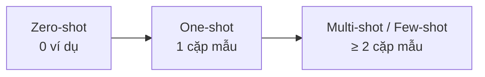
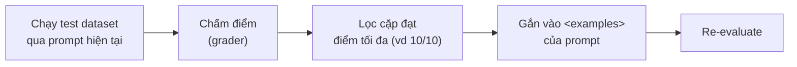

---
tags:
  - claude/su-dung
  - ai/prompt-engineering
aliases:
  - Few-shot Prompting
  - Multi-shot Prompting
  - One-shot Prompting
  - Cung cấp ví dụ mẫu
up: "[[Prompt Engineering]]"
---

# Few-shot Prompting (Cung cấp ví dụ mẫu)

**Few-shot prompting** = đưa vào prompt các cặp mẫu **Input → Output** để AI "học theo mẫu" thay vì chỉ nghe mô tả bằng lời. Cốt lõi: **cho AI *thấy* kết quả mong muốn, thay vì chỉ *nói* phải làm gì**.

## 3 mức độ



| Mức | Số ví dụ | Đặc điểm |
| --- | --- | --- |
| **Zero-shot** | 0 | Chỉ có chỉ thị; AI tự suy luận định dạng/cách trả lời từ dữ liệu đã học |
| **One-shot** | 1 | Đủ để AI hình dung cấu trúc và tông giọng mong muốn |
| **Multi-shot / Few-shot** | ≥ 2 | Tối ưu cho tác vụ phức tạp: AI nắm chắc quy luật logic và định dạng đầu ra |

## Vì sao hiệu quả

- **Trực quan hơn mô tả bằng lời:** 1–2 ví dụ thay cho hàng trăm từ giải thích định dạng/phong cách.
- **Chốt cấu trúc đầu ra:** output luôn đúng format (JSON, XML, bảng, regex...) → tiện tích hợp AI vào phần mềm tự động hóa.
- **Giảm suy luận lệch:** ví dụ là "khuôn đúc", ngăn AI tự biến tấu phong cách hoặc trả lời rườm rà.

## One-shot vs Multi-shot: chọn khi nào

| | One-shot | Multi-shot |
| --- | --- | --- |
| Cách làm | Đúng 1 cặp Input → Output trước yêu cầu thật | ≥ 2 cặp, nên đa dạng: case bình thường, ngoại lệ, dữ liệu nhiễu |
| Mục đích | Thiết lập pattern, chốt nhanh định dạng cơ bản (vd JSON) | Dạy logic bên dưới, không chỉ bắt chước một khuôn |
| Hạn chế | Không đủ chỗ dạy tình huống phức tạp/ngoại lệ | Prompt dài hơn |

**Chuyển sang multi-shot khi:**

- Có **edge cases** dễ nhầm (mỉa mai, thiếu trường, định dạng lộn xộn).
- Một yêu cầu có **nhiều dạng phản hồi đúng** tùy ngữ cảnh → 2–3 ví dụ với kết quả khác nhau để AI biết khi nào dùng kiểu nào.
- Ranh giới phân loại **mơ hồ nếu chỉ mô tả bằng lời** (vd mức ưu tiên P1/P2/P3).

Ví dụ IT — phân loại ticket + SLA (mỗi ví dụ đại diện một mức):

```xml
<examples>
  <example>
    <input>Ứng dụng bị sập hoàn toàn, không thể đăng nhập được!</input>
    <output>Mức độ: Khẩn cấp (P1) | SLA: 15 phút</output>
  </example>
  <example>
    <input>Tính năng xuất báo cáo Excel đôi khi bị chậm vào giờ cao điểm.</input>
    <output>Mức độ: Trung bình (P2) | SLA: 4 giờ</output>
  </example>
  <example>
    <input>Làm thế nào để đổi ảnh đại diện trong phần cài đặt tài khoản?</input>
    <output>Mức độ: Thấp (P3) | SLA: 24 giờ</output>
  </example>
</examples>

<user_input>
Tôi quên mật khẩu và không nhận được email khôi phục.
</user_input>
```

→ 3 ví dụ phủ 3 mức giúp AI rút ra quy luật phân loại để áp vào input thật ở cuối.

## Kết hợp XML tags + multi-shot

Bọc ví dụ trong `<examples>` / `<example>` (mỗi cái có `<input>`, `<output>`), tách khỏi `<instructions>` và dữ liệu thật `<user_input>` (xem [[Thẻ XML (XML Tags)]]):

```xml
<instructions>
Chuyển câu mô tả công việc thành JSON gồm action và target.
</instructions>

<examples>
  <example>
    <input>Tôi cần gửi báo cáo doanh thu cho sếp trước 5h chiều.</input>
    <output>{"action": "gửi báo cáo", "target": "doanh thu", "deadline": "17:00"}</output>
  </example>
  <example>
    <input>Nhắc tôi mua sữa và trứng khi đi siêu thị.</input>
    <output>{"action": "mua", "target": ["sữa", "trứng"], "location": "siêu thị"}</output>
  </example>
</examples>

<user_input>
Hãy cập nhật lại mã nguồn của module thanh toán trên máy chủ test.
</user_input>
```

- Lưu ý: ví dụ mẫu cho phép **trường tùy chọn** (`deadline`, `location`) — chỉ xuất hiện khi input có thông tin tương ứng.

## Ví dụ: nhận diện mỉa mai (Sentiment Analysis)

Ví dụ điển hình ví dụ mẫu làm được mà chỉ thị khó làm: **sarcasm**.

- Câu: *"Đúng rồi, đây chắc chắn là bộ phim hay nhất tôi từng xem kể từ 'Plan 9 from Outer Space'."*
  - **Bề nổi:** có từ rất tích cực ("hay nhất") → dễ bị gán nhầm **Positive**.
  - **Ẩn ý:** *Plan 9 from Outer Space* là phim nổi tiếng là thảm họa → so sánh châm biếm → thực tế **Negative**.
- **Vì sao chỉ thị thường thất bại:** "Hãy chú ý câu mỉa mai" quá chung — AI không biết chuẩn châm biếm của bạn là gì, cũng có thể không bắt được ngữ cảnh văn hóa/điện ảnh ngầm.
- **Cách giải:** đưa cặp mẫu đã gán nhãn kèm lý do ngắn, như một case study:

```xml
<examples>
  <example>
    <input>Ồ tuyệt vời, chuyến bay bị hoãn 5 tiếng, thật là một khởi đầu hoàn hảo cho kỳ nghỉ!</input>
    <output>Tiêu cực (Mỉa mai)</output>
  </example>
  <example>
    <input>Đúng rồi, đây chắc chắn là bộ phim hay nhất tôi từng xem kể từ 'Plan 9 from Outer Space'.</input>
    <output>Tiêu cực (Mỉa mai - so sánh với phim thảm họa)</output>
  </example>
</examples>
```

- **Giá trị cốt lõi:**
  - **Truyền ngữ cảnh ẩn:** AI hiểu phải nhìn sâu hơn nghĩa đen.
  - **Calibrate ranh giới đánh giá:** xử lý edge case (mỉa mai, nói giảm nói tránh, chơi chữ) mà không cần viết hàng loạt quy tắc dài dòng.
- Mẹo: ghi kèm **lý do trong nhãn** (vd "so sánh với phim thảm họa") để AI học được *vì sao*, không chỉ nhãn.

### Xử lý corner case bằng ví dụ đối lập

Bài toán thực tế luôn có case "bẫy" → chọn ví dụ theo **2 góc đối lập** + 1 câu context nhắc kiểm tra mỉa mai trước khi kết luận:

| Ví dụ | Nhãn | Vai trò |
| --- | --- | --- |
| "Great game tonight!" | Positive | **Điểm tựa chuẩn:** tích cực đúng nghĩa đen |
| "Oh yeah, I really needed a flight delay tonight! Excellent!" | Negative | **Case bẫy:** từ khen ("Excellent") nhưng ngữ cảnh (trễ chuyến bay) là tiêu cực |

- Đặt tên thẻ **mô tả vai trò** thay vì `<input>`/`<output>` chung: `<sample_input>` và `<ideal_output>`.

```xml
<instructions>
Phân tích cảm xúc của đoạn văn bản bên dưới.
Lưu ý: chú ý câu mỉa mai/châm biếm để gán nhãn chính xác.
</instructions>

<examples>
  <example>
    <sample_input>Great game tonight!</sample_input>
    <ideal_output>Positive</ideal_output>
  </example>
  <example>
    <sample_input>Oh yeah, I really needed a flight delay tonight! Excellent!</sample_input>
    <ideal_output>Negative</ideal_output>
  </example>
</examples>

<user_input>
[Văn bản cần phân tích]
</user_input>
```

- **Lợi ích khi kết hợp XML:**
  - Phân định rõ đâu là dữ liệu giả định, đâu là định dạng kết quả kỳ vọng.
  - Tăng độ tin cậy khi tự động hóa: AI bắt chước đúng cấu trúc trong `<ideal_output>`, không rườm rà.
  - Ví dụ đối lập "cài" phản xạ phân tích ngữ cảnh thay vì quét từ khóa bề nổi.

## 4 trường hợp nên thêm ví dụ mẫu

Dùng few-shot khi chỉ thị bằng lời không đủ mô tả logic, định dạng hoặc văn phong — ví dụ như "bản vẽ thiết kế chuẩn".

| # | Trường hợp | Vì sao cần ví dụ | Ví dụ |
| --- | --- | --- | --- |
| 1 | **Corner / edge cases** | Input thực tế có case "bẫy" (mỉa mai, từ đồng âm, dữ liệu thiếu, viết tắt) làm AI đoán sai | Phân biệt khen thật ("Dịch vụ quá tốt") với châm biếm ("Dịch vụ tốt đến mức đợi 3 tiếng mới có đồ ăn" → Tiêu cực) |
| 2 | **Complex output formats** | Cấu trúc khắt khe để tích hợp hệ thống (JSON, XML, bảng Markdown, SQL); mô tả bằng lời dài và dễ sai cú pháp | Mẫu JSON có mảng lồng nhau + trường bắt buộc → AI trả đúng schema để parse được |
| 3 | **Exact style / tone** | "Chuyên nghiệp nhưng thân thiện", "dí dỏm", "ngắn gọn" đều mơ hồ; AI học nhịp câu, cách dùng từ, độ dài, mức trang trọng từ mẫu | Một thư phản hồi khiếu nại lịch thiệp, đồng cảm → giữ nhất quán cho các khách sau |
| 4 | **Ambiguous inputs** | User hay nhập ngắn, thiếu ý; ví dụ chỉ cho AI biết nên suy luận mặc định, hỏi lại hay báo lỗi | `Đặt lịch họp mai` → "Bạn chưa cung cấp giờ và thành viên. Bạn muốn đặt vào khung giờ nào?" |

- Case 4 thường bổ trợ cho mẹo "cho phép nói không biết / hỏi ngược" ở [[Prompt Engineering]].

## Nâng cao: lấy ví dụ từ output điểm cao nhất của eval

Thay vì tự bịa ví dụ giả định (dễ lệch với dữ liệu thật), **tái sử dụng cặp Input → Output thực tế đạt điểm tối đa** từ quá trình đánh giá ([[Prompt Evaluation (Đánh giá câu lệnh)]]):



- **Vì sao hiệu quả:**
  - **Định nghĩa "hoàn hảo" bằng sản phẩm thật** thay vì câu chung chung "viết thật hay" → AI thấy rõ mức chi tiết, độ sâu, phong cách mong muốn.
  - **Thu hẹp khoảng cách kỳ vọng:** output điểm cao thường chứa cách xử lý tinh tế cho case phức tạp mà ví dụ tự nghĩ bỏ sót.
  - Là bước đưa prompt từ "dùng tạm" lên "chạy ổn định ở production" trong vòng [[Prompt Engineering#Iterative Refinement — prompt engineering như quy trình kỹ thuật|Iterative Refinement]].
- **LLM Ops:** quy trình này có thể tự động hóa — chạy dataset → model grader (vd Claude chấm Claude) chọn output xuất sắc nhất → tự trích cặp Input/Output gắn vào `<examples>` (xem [[Grader (Hệ thống chấm điểm)]]).
- Lưu ý: sau khi đổi ví dụ phải **chạy lại toàn bộ eval**; tránh overfit khi ví dụ trùng với chính test case.

## Nâng cao: thêm giải thích "vì sao tốt" vào ví dụ

Chỉ đưa cặp Input/Output thì AI học chủ yếu **hình thức** (định dạng, độ dài, thẻ) và có thể **đoán sai nguyên nhân thành công** (tưởng do văn bóng bẩy, trong khi bạn đánh giá cao vì số liệu chính xác hay tuân thủ quy tắc).

- **Giải pháp:** thêm khối giải thích (vd `<explanation>`) ngay dưới `<ideal_output>`, nêu **tiêu chí cụ thể** làm câu trả lời đạt chất lượng.
- **Tác dụng:** AI "hiểu tư duy" thay vì bắt chước máy móc; khối giải thích đóng vai **checklist ngầm** để AI tự rà soát output trước khi xuất.

```xml
<example>
  <athlete_input>
  - Cân nặng: 80kg
  - Mục tiêu: Tăng cơ
  - Chế độ: Ăn chay
  </athlete_input>

  <ideal_output>
  Bữa sáng: 100g yến mạch ngâm sữa đậu nành + 30g protein thực vật từ đậu nành.
  Bữa trưa: 150g đậu phụ rán nồi chiên không dầu + 200g cơm gạo lứt + rau súp lơ luộc.
  </ideal_output>

  <explanation>
  Đạt chuẩn vì: (1) định lượng rõ từng thực phẩm (gram); (2) đúng tiêu chí ăn chay (không thịt/cá/trứng); (3) protein cao, phù hợp tăng cơ cho VĐV 80kg.
  </explanation>
</example>
```

- Dạy AI **reasoning**, không chỉ **formatting**; liên hệ bài toán thực đơn ở [[Prompt Evaluation cho thực đơn vận động viên]].
- Lưu ý: giải thích nên ngắn, bám tiêu chí; nếu output chỉ cần giữ nguyên định dạng thì cân nhắc không để AI chép cả phần `<explanation>` vào kết quả (nói rõ "chỉ trả về nội dung như trong `<ideal_output>`").

## Best practices (checklist)

1. **Luôn bọc ví dụ bằng XML tags** (`<examples>`, `<example>`, `<input>`, `<output>`) — không dán trần dính vào câu lệnh chính, để AI phân biệt dữ liệu tham khảo với yêu cầu thực thi.
2. **Nói rõ mục đích của ví dụ** bằng lời dẫn (vd "Dưới đây là ví dụ về input kèm phản hồi lý tưởng") → AI không nhầm là phải xử lý chính dữ liệu mẫu.
3. **Nhắm vào các case dễ thất bại** (mỉa mai, thiếu dữ liệu, định dạng phức tạp), không chỉ ví dụ "xuôi chèo mát mái".
4. **Giải thích vì sao output đạt chuẩn** bằng `<explanation>` → AI nắm logic, không chỉ hình thức.
5. **Giữ ví dụ sát nhiệm vụ và miền dữ liệu thật** (phân tích code thì ví dụ phải là code thực tế, không chung chung).

> **Show, don't tell:** mô tả bằng lời (văn phong dí dỏm, JSON lồng phức tạp, cách xử lý mơ hồ) dài dòng và dễ hiểu sai; một mẫu Input → Output → Explanation giúp AI bắt được các yêu cầu tinh tế khó diễn đạt hết bằng lời.

## Lưu ý khi dùng

- Ví dụ phải **đa dạng** và **đúng định dạng đích**; cẩn thận AI bắt chước quá sát cả chi tiết không muốn.
- Cần cải thiện độ ổn định → thêm ví dụ rồi đo lại bằng eval ([[Prompt Evaluation (Đánh giá câu lệnh)]]).

## Liên kết

- Thuộc: [[Prompt Engineering]] (kỹ thuật nền tảng số 2 — *Showing examples*)
- Cùng cấp: [[Thẻ XML (XML Tags)]]
- Liên quan: [[Structured Output (Ép đầu ra JSON thuần)]], [[Prompt Evaluation (Đánh giá câu lệnh)]], [[Grader (Hệ thống chấm điểm)]]
