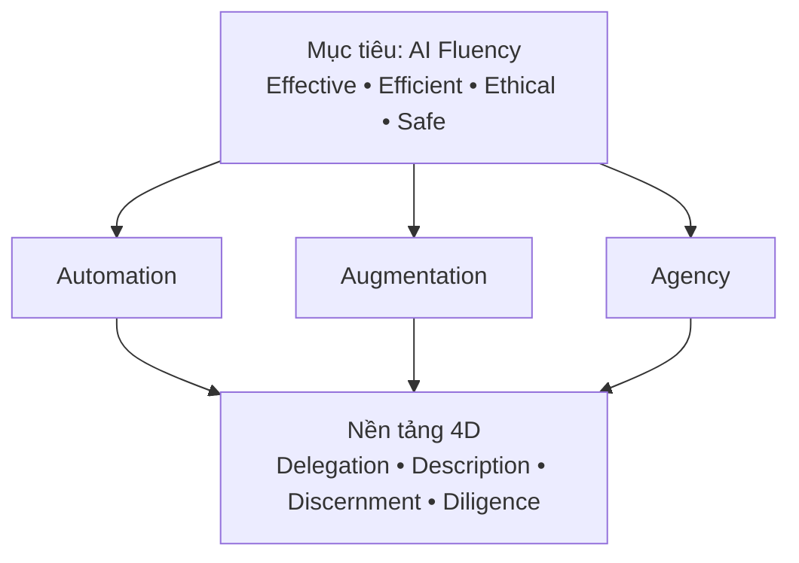
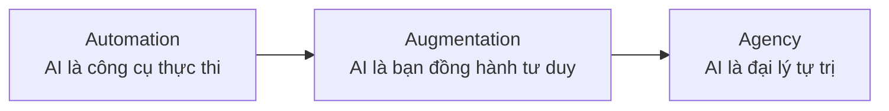

---
tags:
  - claude/su-dung
  - ai/fluency
aliases:
  - AI Fluency
  - Thành thạo AI
  - 3 Engagement Modes
  - Automation Augmentation Agency
up: "[[Tinh chỉnh kết quả]]"
---

# AI Fluency (Thành thạo AI)

Không chỉ là biết gõ prompt — là sự kết hợp của **kỹ năng thực hành, kiến thức, góc nhìn và giá trị đạo đức** để tương tác với AI sao cho:

- **Effective** — đạt đúng kết quả mong muốn.
- **Efficient** — tối ưu thời gian, tài nguyên.
- **Ethical** — tôn trọng bản quyền, minh bạch, chuẩn mực xã hội.
- **Safe** — an toàn thông tin, bảo mật dữ liệu, kiểm soát rủi ro.

Năng lực cần có để đạt 4 tiêu chí trên: **4D** (Delegation, Description, Discernment, Diligence) — xem [[Bộ khung 4D]].

## Bức tranh tổng thể

- **3 mode** = *cách* hợp tác; **4D** = *kỹ năng nền* dùng chung cho cả 3 mode (trọng tâm mỗi mode khác nhau, xem [[Bộ khung 4D]]).
- Mô hình không lỗi thời khi model AI tiến hóa: luôn cần giao đúng việc, mô tả đúng, thẩm định đúng, giữ trách nhiệm.

## 3 hình thức tương tác (Engagement Modes)

### Automation (Tự động hóa)

- Giao **một tác vụ cụ thể** theo chỉ dẫn trực tiếp; AI chỉ thực thi đúng việc được bảo.
- Ví dụ: viết câu SQL, tóm tắt văn bản, đổi định dạng file.

### Augmentation (Cộng tác)

- Người và AI **cùng tư duy**, trao đổi qua lại: mở rộng ý tưởng, phản biện, hoàn thiện.
- Ví dụ: brainstorm kiến trúc hệ thống, phản biện quy trình, code review.

### Agency (Ủy quyền tự trị)

- Không giao từng việc nhỏ mà **cấu hình AI** (tri thức, hành vi, quy tắc kiểm soát) để nó tự lập kế hoạch và hành động thay mình; người dùng đóng vai quản lý đặt mục tiêu + giới hạn.
- Ví dụ: Sub-agent / Plugin tự chạy test, phân tích và sửa lỗi trong CI/CD, dùng Hook để kiểm soát.

## So sánh nhanh

| Hình thức | Vai trò người | Vai trò AI | Mức tự trị |
| --- | --- | --- | --- |
| Automation | Người ra lệnh cụ thể | Trình thực thi | Thấp |
| Augmentation | Đối tác sáng tạo | Bạn đồng hành tư duy | Trung bình |
| Agency | Người đặt luật/quy chuẩn | Đại lý độc lập | Cao |

## Lưu ý

- Ba hình thức **không loại trừ nhau** — một dự án thường trộn cả ba; chọn theo mức rủi ro và độ rõ ràng của việc.
- Càng lên Agency, **Discernment + Diligence** càng quan trọng vì AI chạy lâu, ít người giám sát từng bước → cần guardrail (permission, hook, review kết quả).

## Liên kết

- Thuộc: [[Tinh chỉnh kết quả]]
- Chi tiết: [[Bộ khung 4D]]
- Công cụ ứng với Agency: [[Subagents (Tác vụ phụ)]], [[Hooks]], [[Claude Code]], [[Tự động hóa Claude Code (Routines & Headless)]]
- Xem thêm: [[Bắt đầu với Claude]], [[Ứng dụng thực tế]]
