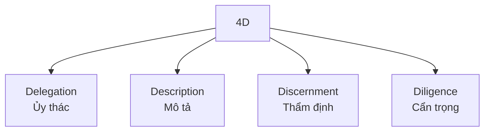

---
tags:
  - claude/su-dung
  - ai/fluency
aliases:
  - 4D
  - Bộ khung 4D
  - Delegation Description Discernment Diligence
up: "[[AI Fluency]]"
---

# Bộ khung 4D

4 năng lực cốt lõi của [[AI Fluency]], giúp tương tác với AI vừa hiệu quả vừa an toàn.

## Bốn năng lực

| Năng lực | Ý chính | Ứng dụng / keyword |
| --- | --- | --- |
| **Delegation** → [[Delegation (Ủy thác)]] | Quyết định việc nào giao AI, việc nào tự làm | Tránh 2 thái cực: ỷ lại (giao cả việc chiến lược/đạo đức) và bảo thủ (tự làm việc lặp lại AI làm tốt hơn) |
| **Description** → [[Description (Mô tả)]] | Truyền đạt bối cảnh, vai trò, mục tiêu, ràng buộc rõ ràng | Product / Process / Performance, prompt chuẩn, context đầu vào, `CLAUDE.md`, System Prompt |
| **Discernment** → [[Discernment (Thẩm định)]] | Đánh giá output/hành vi AI bằng góc nhìn phản biện | Phát hiện hallucination, logic sai, bias, code đẹp nhưng lỗi ngầm; xem `git diff` thay vì chỉ đọc summary |
| **Diligence** | Dùng AI có trách nhiệm, an toàn, tuân thủ | Review bảo mật, cổng kiểm soát tự động (Hooks, test exit code 2), bảo vệ dữ liệu nhạy cảm, chịu trách nhiệm cuối cùng |

## 4D theo từng Engagement Mode

| Mode | Trọng tâm 4D |
| --- | --- |
| Automation | Description (lệnh chính xác) + Discernment (kiểm tra nhanh kết quả) |
| Augmentation | Delegation (chia nhỏ bài toán để cùng bàn) + Discernment (phản biện ý tưởng AI) |
| Agency | Delegation (đặt ranh giới hoạt động) + Diligence (test/hook kiểm soát chặt khi AI tự chạy) |

## Giá trị bền vững

Model AI thay đổi liên tục, nhưng 4D là kỹ năng nền không lỗi thời: luôn cần biết giao đúng việc, mô tả đúng bối cảnh, thẩm định đúng/sai và giữ trách nhiệm.

## Liên kết

- Thuộc: [[AI Fluency]]
- Chi tiết: [[Delegation (Ủy thác)]], [[Description (Mô tả)]], [[Discernment (Thẩm định)]]
- Liên quan: [[Tinh chỉnh kết quả]], [[Hooks]], [[CLAUDE.md Bộ nhớ dự án]], [[Xác minh tương xứng (Proportional Verification)]]
