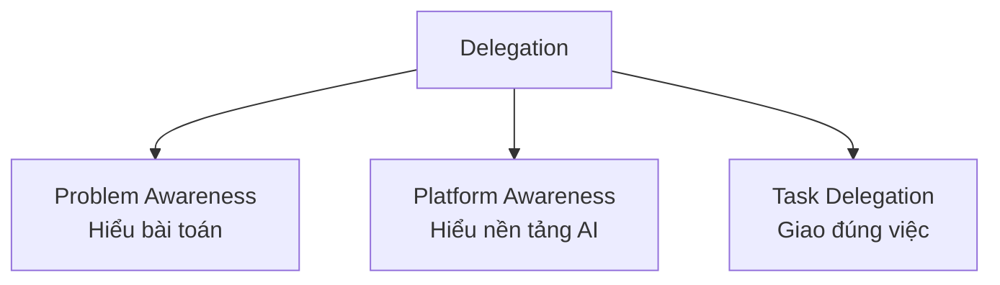

---
tags:
  - claude/su-dung
  - ai/fluency
  - ai/fluency/delegation
aliases:
  - Delegation
  - Ủy thác
  - Problem Awareness
  - Platform Awareness
  - Task Delegation
up: "[[Bộ khung 4D]]"
---

# Delegation (Ủy thác)

Năng lực **D đầu tiên** trong [[Bộ khung 4D]]: quyết định **việc nào tự làm, việc nào làm cùng AI, việc nào giao hẳn cho AI** để tối ưu thời gian và chất lượng. Không phải "giao hết cho AI" mà là **phân chia công việc có chiến lược** — người chuyển từ vai "làm thủ công" sang **orchestrator** (người điều phối).

## 3 thành tố

| Thành tố | Câu hỏi cần trả lời | Keyword |
| --- | --- | --- |
| **Problem Awareness** | Mục tiêu cuối là gì? Cần những công việc con nào để đạt được? | Mục tiêu, phạm vi, tiêu chí hoàn thành, chia nhỏ công việc |
| **Platform Awareness** | AI/model này mạnh, yếu gì? Có công cụ, dữ liệu, context nào? | Điểm mạnh/giới hạn của model, knowledge cutoff, hallucination, context window, công cụ tích hợp |
| **Task Delegation** | Phần nào cho người, phần nào cho AI, phần nào cùng làm? | Phân vai theo thế mạnh, chia nhỏ workflow, chọn mode phù hợp |

- Thứ tự thường dùng: **Problem → Platform → Task** (hiểu việc trước, rồi mới chọn công cụ và chia việc).
- Có thể lặp lại: giao thử → thấy AI làm kém chỗ nào → điều chỉnh lại cách chia việc.

## Điều kiện thành công

Cần kết hợp **cả hai**, thiếu một thì ủy thác lệch:

1. **Domain Expertise** (chuyên môn lĩnh vực) — hiểu bản chất việc, định hướng đúng, **thẩm định được output** (nền cho [[Bộ khung 4D#Bốn năng lực|Discernment]]).
2. **AI Capabilities** (hiểu năng lực AI) — giao đúng khả năng, tránh kỳ vọng sai và lãng phí thời gian.

| Thiếu | Hậu quả |
| --- | --- |
| Thiếu chuyên môn (chỉ biết dùng AI) | Không đánh giá được AI đúng/sai → rủi ro trong công việc, tin AI mù quáng |
| Thiếu hiểu AI (chỉ giỏi chuyên môn) | Không tận dụng được AI để tăng năng suất x2, x3; giao việc AI làm kém hoặc tự làm tay việc AI làm tốt |

## Gợi ý phân chia việc

| Nhóm | Ví dụ trong IT | Cách xử lý |
| --- | --- | --- |
| **Giao cho AI** | Boilerplate code, viết test, regex/SQL, tóm tắt log/tài liệu, đổi định dạng, tìm kiếm thông tin | [[AI Fluency#Automation (Tự động hóa)\|Automation]] — kiểm tra nhanh kết quả |
| **Làm cùng AI** | Thiết kế kiến trúc, phân tích nguyên nhân lỗi, review code, brainstorm giải pháp | [[AI Fluency#Augmentation (Cộng tác)\|Augmentation]] — trao đổi qua lại, phản biện |
| **Tự làm** | Quyết định chiến lược, đánh đổi nghiệp vụ, vấn đề đạo đức/pháp lý, thao tác nhạy cảm (credential, production) | Người giữ trách nhiệm cuối cùng |

- **Tự làm**: việc cần tư duy chiến lược, phán đoán chuyên môn, cảm xúc, hoặc trách nhiệm pháp lý/đạo đức.
- **Cùng làm**: AI gợi ý ý tưởng/dàn ý → người chỉnh sửa, định hướng, quyết định.
- **Giao hẳn AI**: việc lặp lại, xử lý dữ liệu thô, định dạng văn bản, sinh code cơ bản.

### Thế mạnh mỗi bên (cơ sở để chia việc)

| Bên | Thế mạnh |
| --- | --- |
| **AI** | Tốc độ, xử lý khối lượng dữ liệu lớn, tính toán, tìm mẫu hình (pattern) |
| **Người** | Tư duy phản biện, thấu cảm, kinh nghiệm thực tế, đánh giá chất lượng |

### Lưu ý khi áp dụng

- **Chưa rõ mục tiêu thì chưa mở AI**: prompt sẽ lan man, output lệch nhu cầu (Problem Awareness).
- **Mỗi công cụ/model có điểm mạnh-yếu riêng** (Claude, ChatGPT, Gemini, tool code, tool thiết kế...): mạnh ở viết, phân tích dữ liệu, đọc tài liệu dài; yếu ở hallucination, suy luận logic phức tạp → chọn đúng tool cho đúng việc (Platform Awareness).

Câu hỏi nhanh trước khi giao:

- Việc này có **rủi ro cao** nếu sai không? (càng cao càng cần người duyệt — xem [[Xác minh tương xứng (Proportional Verification)]]).
- Mình có đủ chuyên môn để **kiểm tra kết quả** không?
- AI có **đủ context** (file, dữ liệu, quyền) để làm không, hay cần cung cấp thêm? (→ [[Bộ khung 4D#Bốn năng lực|Description]])
- Việc này **lặp lại** nhiều lần không? Nếu có, cân nhắc đóng gói thành [[Skills]] / [[Subagents (Tác vụ phụ)]] / [[Routines]].

## Hai thái cực cần tránh

- **Ỷ lại**: giao cả việc chiến lược, đạo đức, hoặc việc mình không đủ khả năng kiểm tra.
- **Bảo thủ**: tự làm tay các việc lặp lại mà AI làm tốt và nhanh hơn.

## Mục tiêu cuối cùng

Không phải tự động hóa 100% hay thay thế con người, mà là xây dựng **quan hệ đối tác Human-AI (Human-AI Partnership)** hiệu quả nhất để đạt kết quả tối ưu.

## Liên kết

- Thuộc: [[Bộ khung 4D]]
- Cùng cấp (các D còn lại): Description, Discernment, Diligence — xem bảng trong [[Bộ khung 4D]]
- Liên quan: [[AI Fluency]], [[Tiêu chí chọn Task phù hợp (3 Patterns)]], [[So sánh 3 chế độ làm việc (Chat, Cowork, Code)]], [[Subagents (Tác vụ phụ)]]
