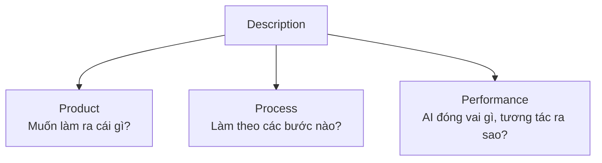

---
tags:
  - claude/su-dung
  - ai/fluency
  - ai/fluency/description
aliases:
  - Description
  - Mô tả
  - Product Description
  - Process Description
  - Performance Description
up: "[[Bộ khung 4D]]"
---

# Description (Mô tả)

Năng lực **D thứ hai** trong [[Bộ khung 4D]]: **thiết lập bối cảnh làm việc** để người và AI hiểu cùng một mục tiêu, cùng cách phối hợp. Không chỉ là viết một câu prompt ngắn. Nguyên lý cốt lõi: **AI không đọc được suy nghĩ của bạn** — chất lượng output phụ thuộc trực tiếp vào độ rõ ràng khi diễn đạt nhu cầu, cách tiếp cận mong muốn và phong cách tương tác.

## 3 thành tố

| Thành tố | Định hướng | Bao gồm (keyword) |
| --- | --- | --- |
| **Product Description** | Kết quả đầu ra trông như thế nào | Định dạng (văn bản, bảng, code...), độ dài, đối tượng độc giả, tông giọng, tiêu chuẩn hoàn thành (definition of done) |
| **Process Description** | AI thực hiện bằng cách nào | Làm từng bước (step-by-step), khung tư duy (STAR, SWOT...), nguồn/tài liệu cần tham khảo trước khi trả lời |
| **Performance Description** | Thái độ, vai trò, cách ứng xử của AI | Giao vai (chuyên gia khắt khe, mentor kiên nhẫn), hỏi ngược trước khi trả lời, phản biện, tóm tắt ngắn gọn |

> Kết hợp đủ 3 tố chất → prompt chặt chẽ, AI hoạt động đúng kỳ vọng.

- Chỉ định **Process** thường quan trọng **không kém** mô tả mục tiêu cuối: cùng một đích nhưng khác cách làm thì kết quả khác hẳn.
- **Performance** gồm cả: độ dài trả lời (ngắn gọn/chi tiết), mức phản biện (khắt khe/động viên), có hỏi ngược lại trước khi trả lời hay không.

## Thay đổi tư duy: AI là đối tác, không phải máy bán hàng tự động

| Cách nghĩ cũ | Cách nghĩ đúng |
| --- | --- |
| Như **Google / cơ sở dữ liệu**: tra cứu thụ động | AI là **đối tác đối thoại hai chiều** |
| Như **máy bán hàng**: bỏ đồng xu (prompt) → ra kết quả cố định | AI tinh chỉnh, thảo luận, đổi hướng theo từng phản hồi của bạn |

→ Vì vậy Description là **quá trình giao tiếp liên tục**, không phải một lần gõ lệnh.

## Lợi ích thiết thực

- **Dành thêm 1–2 phút mô tả đủ Product – Process – Performance ngay prompt đầu** → kết quả chuẩn sớm, tránh sửa qua sửa lại nhiều vòng (tiết kiệm thời gian tổng thể).

## Ví dụ minh họa (IT)

| Thành tố | Ví dụ |
| --- | --- |
| Product | "Viết runbook dạng checklist, tối đa 1 trang, cho on-call engineer mới; tông giọng ngắn gọn" |
| Process | "Đọc log đính kèm trước, liệt kê giả thuyết nguyên nhân, rồi mới đề xuất cách fix từng bước" |
| Performance | "Đóng vai senior SRE khắt khe; nếu thiếu thông tin thì hỏi lại tôi trước khi kết luận" |

## Mẹo áp dụng

- **Mô tả cả "đừng làm gì"**: ràng buộc, phạm vi, điều cần tránh cũng là một phần của Product/Process.
- **Cung cấp context đầu vào**: file, dữ liệu, ví dụ mẫu (few-shot) — AI không tự biết bối cảnh của bạn.
- **Description là vòng lặp**: gửi → xem output ([[Bộ khung 4D#Bốn năng lực|Discernment]]) → chỉnh lại mô tả. Output lệch thường do mô tả thiếu, không phải AI "kém".
- **Mô tả lặp lại nhiều lần thì đóng gói**: lưu vào [[CLAUDE.md Bộ nhớ dự án]] (bối cảnh dự án), [[Global Instructions & Bộ nhớ theo Ngữ cảnh|Global Instructions]] (phong cách/vai trò chung) hoặc [[Skills]] (quy trình).
- **Độ chi tiết tương xứng với độ quan trọng**: việc đơn giản chỉ cần Product; việc phức tạp/rủi ro cao mới cần đủ cả Process và Performance.

## Liên hệ với Engagement Mode

| Mode | Cách dùng Description |
| --- | --- |
| Automation | Nhấn mạnh **Product** + **Process** chính xác để output dùng được ngay |
| Augmentation | Nhấn mạnh **Performance** (AI là đối tác phản biện, hỏi lại, đưa lựa chọn) |
| Agency | Mô tả rõ ranh giới, mục tiêu, tiêu chí dừng vì AI tự chạy nhiều bước |

## Liên kết

- Thuộc: [[Bộ khung 4D]]
- Cùng cấp: [[Delegation (Ủy thác)]] (quyết định giao gì → Description nói cách giao), [[Discernment (Thẩm định)]] (mặt đối ứng: nhận về, đánh giá output), Diligence — xem bảng trong [[Bộ khung 4D]]
- Liên quan: [[AI Fluency]], [[Công thức Prompt chuẩn (Deliverable + Inputs + Nuances)]], [[Viết Prompt An toàn (Tránh Hiểu Lầm)]], [[Anatomy của một Task chuẩn]]
