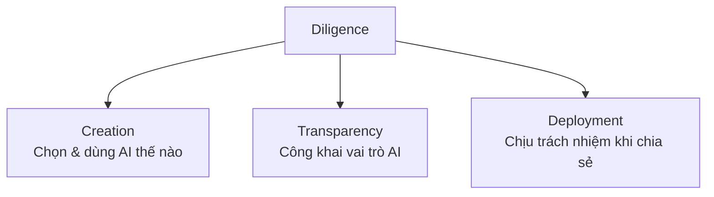

---
tags:
  - claude/su-dung
  - ai/fluency
  - ai/fluency/diligence
aliases:
  - Diligence
  - Cẩn trọng
  - Trách nhiệm
  - Creation Diligence
  - Transparency Diligence
  - Deployment Diligence
up: "[[Bộ khung 4D]]"
---

# Diligence (Cẩn trọng)

Năng lực **D thứ tư** trong [[Bộ khung 4D]]: **hợp tác với AI một cách có trách nhiệm, an toàn và tuân thủ đạo đức**. Nếu Delegation/Description/Discernment tập trung vào **hiệu quả** và **tốc độ**, thì Diligence là "bộ phanh đạo đức": đảm bảo thứ AI giúp tạo ra an toàn để dùng và chia sẻ, và **con người vẫn chịu trách nhiệm cuối cùng**.

## 3 thành tố

| Thành tố | Ý nghĩa | Hành động thực tế (keyword) |
| --- | --- | --- |
| **Creation Diligence** | Cân nhắc kỹ ngay từ bước **chọn công cụ AI** và cách tương tác | Chọn model/nhà cung cấp uy tín, đúng công cụ cho đúng việc; **không đưa dữ liệu cá nhân/bí mật doanh nghiệp** vào công cụ không được phép; hiểu chính sách lưu trữ & huấn luyện dữ liệu |
| **Transparency Diligence** | **Trung thực** về vai trò của AI trong sản phẩm/công việc | Ghi nguồn hoặc gắn nhãn (AI viết nháp, tạo ảnh, phân tích dữ liệu); không giả vờ 100% do con người làm |
| **Deployment Diligence** | **Chịu trách nhiệm** với sản phẩm có AI hỗ trợ khi chia sẻ cho người khác | Kiểm tra tính chính xác (hallucination), thiên vị (bias), an toàn, bản quyền **trước khi** xuất bản/gửi khách hàng, đồng nghiệp |

> Thứ tự theo vòng đời: **Creation** (trước khi làm) → **Transparency** (trong khi làm/công bố) → **Deployment** (khi bàn giao/triển khai).

- Transparency áp dụng với **mọi bên liên quan**: sếp, khách hàng, giảng viên, người đọc.
- Deployment: chia sẻ ra ngoài nghĩa là bạn **đứng ra đảm bảo (vouch)** cho chất lượng nội dung đó.

## Context Matters (ngữ cảnh quyết định chuẩn mực)

Mỗi môi trường có quy định và kỳ vọng riêng về **disclosure** (công khai dùng AI) và **verification** (kiểm chứng):

| Môi trường | Ví dụ kỳ vọng |
| --- | --- |
| Cá nhân | Tự quyết, nhưng vẫn chịu trách nhiệm với người nhận sản phẩm |
| Học thuật | Có thể cấm hẳn hoặc yêu cầu trích dẫn/ghi rõ cách dùng AI |
| Doanh nghiệp | Cho dùng AI để tăng năng suất nhưng bắt buộc tuân thủ chính sách bảo mật thông tin nội bộ |

Không rõ quy định → hỏi/tra chính sách trước, mặc định theo hướng minh bạch.

## Diligence vs Discernment

- **Discernment**: AI làm ra cái này có **đúng/tốt** không? (chất lượng)
- **Diligence**: có **nên/được phép** dùng và **chia sẻ** nó không, và ai chịu trách nhiệm? (đạo đức, an toàn, tuân thủ)
- Discernment là điều kiện cần cho **Deployment Diligence**: chưa thẩm định thì chưa nên triển khai.

## Áp dụng trong IT

| Tình huống | Diligence cần làm |
| --- | --- |
| Dán log/code/config vào chat | Che **secret** (API key, token, mật khẩu, IP nội bộ, dữ liệu khách hàng/PII); dùng gói enterprise/chính sách data phù hợp |
| Code do AI sinh ra | Review bảo mật (injection, secret hard-code, dependency lạ/không tồn tại), kiểm tra **license**, chạy test/lint trước khi merge |
| Agent tự chạy lệnh (Agency) | Giới hạn quyền ([[Permission Modes]]), cổng kiểm soát tự động ([[Hooks]], test exit code 2), nguyên tắc **least privilege**, thao tác khó đảo ngược phải có người duyệt |
| Nội dung từ web/file/tool bên ngoài | Cảnh giác **prompt injection**: dữ liệu bên ngoài không phải lệnh; xác nhận trước khi hành động nhạy cảm |
| Tài liệu/báo cáo/PR có AI hỗ trợ | Ghi chú rõ mức độ dùng AI theo quy định tổ chức; người ký tên là người chịu trách nhiệm |
| Nội dung ảnh hưởng đến người (tuyển dụng, đánh giá, quyết định tài chính) | Kiểm tra bias/công bằng, giữ **human-in-the-loop**, không để AI tự quyết |

## Nguyên tắc cần nhớ

- **Trách nhiệm không chuyển cho AI**: "AI viết" không phải lý do cho lỗi, rò rỉ hay vi phạm bản quyền.
- **Ngữ cảnh quyết định chuẩn mực**: mỗi công ty/trường học/quốc gia có quy định và kỳ vọng riêng về dùng AI (chính sách nội bộ, luật bảo vệ dữ liệu như GDPR...); trách nhiệm cá nhân là **hiểu và tuân thủ** chúng.
- **Tương xứng rủi ro**: việc nhỏ nội bộ có thể nhẹ tay; việc ra bên ngoài/production/dữ liệu nhạy cảm phải kiểm kỹ — xem [[Xác minh tương xứng (Proportional Verification)]].
- **Đích đến**: hợp tác AI không chỉ **effective** (hiệu quả) và **efficient** (tiết kiệm thời gian) mà phải **ethical** (đúng đạo đức) và **safe** (an toàn); Diligence là mảnh ghép giúp tránh rủi ro pháp lý, mất uy tín, vi phạm đạo đức nghề nghiệp.
- Càng giao nhiều quyền tự chủ cho AI (mode **Agency**), Diligence càng quan trọng.

## Liên kết

- Thuộc: [[Bộ khung 4D]]
- Cùng cấp: [[Delegation (Ủy thác)]], [[Description (Mô tả)]], [[Discernment (Thẩm định)]] (Discernment là điều kiện cần cho Deployment Diligence)
- Liên quan: [[AI Fluency]], [[Hooks]], [[Permission Modes]], [[Xác minh tương xứng (Proportional Verification)]]
