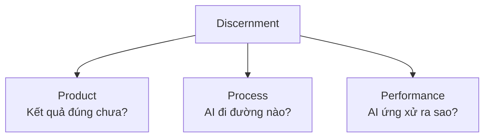
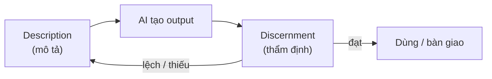

---
tags:
  - claude/su-dung
  - ai/fluency
  - ai/fluency/discernment
aliases:
  - Discernment
  - Thẩm định
  - Phán đoán
  - Product Discernment
  - Process Discernment
  - Performance Discernment
up: "[[Bộ khung 4D]]"
---

# Discernment (Thẩm định)

Năng lực **D thứ ba** trong [[Bộ khung 4D]]: **đánh giá có tư duy phản biện** đối với output, quy trình và hành vi của AI. Là **mặt đối ứng của [[Description (Mô tả)]]**: Description là chiều *gửi đi* (diễn đạt nhu cầu), Discernment là chiều *nhận về* (kiểm tra kết quả có đáp ứng nhu cầu không). Nhờ đó con người giữ vai trò **người kiểm duyệt và quyết định cuối cùng**, không nghiệm thu mù quáng.

## 3 bộ lọc đánh giá

| Bộ lọc | Đánh giá cái gì | Câu hỏi kiểm tra (keyword) |
| --- | --- | --- |
| **Product Discernment** | Sản phẩm AI tạo ra (văn bản, bảng, code, báo cáo...) | 4 tiêu chí: **Accuracy** (chính xác, có **hallucination** không?), **Appropriateness** (hợp bối cảnh, văn phong, độc giả), **Coherence** (mạch lạc, chặt chẽ), **Relevance** (đúng mục tiêu). Thêm: đúng định dạng, đạt definition of done |
| **Process Discernment** | Cách AI tiếp cận bài toán | Có làm đúng các bước yêu cầu? Lỗi suy luận logic? **Attention gaps** (bỏ sót input/tài liệu quan trọng)? Cách tiếp cận có hợp lý? |
| **Performance Discernment** | Thái độ, phong cách làm việc trong phiên chat | Giao tiếp, mức phản biện, phản hồi có hiệu quả và đúng kiểu hợp tác bạn muốn? Có đúng vai đã giao? Có hỏi lại khi thông tin mơ hồ hay **tự giả định sai**? Có xu nịnh (sycophancy), đồng ý bừa? |

Tóm gọn: Discernment đánh giá **cái gì** AI tạo ra (Product), **cách** AI làm ra nó (Process) và **hành vi** của AI khi tương tác (Performance).

> Ba bộ lọc **khớp 1-1 với 3 thành tố của Description** (Product / Process / Performance): mô tả thế nào thì thẩm định theo đúng trục đó.

## Vòng lặp Description ↔ Discernment

Ba bước của vòng lặp: (1) **Description** truyền đạt yêu cầu (đầu vào) → (2) **Discernment** đánh giá kết quả (đầu ra) → (3) dựa trên đánh giá, dùng lại **Description** để tinh chỉnh cho đến khi đạt chất lượng.

- Output lệch thường do **mô tả thiếu** hơn là AI "kém" → sửa Description rồi thẩm định lại.
- Phát hiện lỗi ở Process/Performance giúp biết **sửa prompt ở đâu** (thêm bước, đổi vai, yêu cầu hỏi lại).

## Các lỗi hay gặp cần soi

| Lỗi | Dấu hiệu |
| --- | --- |
| **Hallucination** | Bịa số liệu, trích dẫn, API/hàm/flag không tồn tại, nhưng giọng rất tự tin |
| **Plausible but wrong** | Trông hợp lý, đúng văn phong nhưng sai chi tiết; code đẹp nhưng lỗi ngầm (edge case, bảo mật) |
| **Bỏ sót ngữ cảnh** | Không dùng file/dữ liệu đã đính kèm, quên ràng buộc ở đầu hội thoại |
| **Bias / giả định ngầm** | Chọn một hướng mà không nói rõ lý do hay các lựa chọn khác |
| **Sycophancy** | Khen/đồng ý với ý tưởng sai của người dùng thay vì phản biện |
| **Tự báo thành công** | Nói "đã xong, test pass" nhưng chưa thực sự chạy/kiểm chứng |

## Cách thẩm định hiệu quả (IT)

- **Code**: đọc `git diff` thay vì chỉ đọc summary của AI; chạy test/lint; thử edge case; soát bảo mật.
- **Kiến thức/số liệu**: đối chiếu tài liệu chính thống, kiểm tra nguồn trích dẫn có thật.
- **Process**: yêu cầu AI nêu từng bước/giả định/nguồn đã dùng (hoặc xem reasoning) để dò chỗ hổng logic.
- **Phản biện ngược**: nhờ AI tự tìm điểm yếu, liệt kê rủi ro, hoặc dùng một phiên/vai khác để review.
- **Hỏi lại khi nghi ngờ**: "Vì sao chọn cách này? Có phương án nào khác?", "Phần nào bạn không chắc?".
- **Thẩm định tương xứng rủi ro**: việc nhỏ lướt nhanh; việc quan trọng/khó đảo ngược (production, bảo mật, tài chính) phải kiểm chứng kỹ — xem [[Xác minh tương xứng (Proportional Verification)]].

## Liên hệ với Engagement Mode

| Mode | Cách dùng Discernment |
| --- | --- |
| Automation | Kiểm tra nhanh output (Product) trước khi dùng |
| Augmentation | Phản biện ý tưởng AI đưa ra, đánh giá cả Process và Performance của "đối tác" |
| Agency | Soát quy trình AI tự chạy (Process) vì không xem được từng bước; kết hợp Diligence (test, [[Hooks]]) làm cổng kiểm soát |

## Nguyên lý cốt lõi

AI dù tiên tiến đến đâu vẫn **cần sự giám sát của con người**: không thay thế được phán đoán chuyên môn, trải nghiệm thực tế và sự kiểm duyệt cuối cùng.

## Liên kết

- Thuộc: [[Bộ khung 4D]]
- Cùng cấp: [[Delegation (Ủy thác)]], [[Description (Mô tả)]] (mặt đối ứng: gửi đi ↔ nhận về), [[Diligence (Cẩn trọng)]]
- Liên quan: [[AI Fluency]], [[Tinh chỉnh kết quả]], [[Xác minh tương xứng (Proportional Verification)]]
